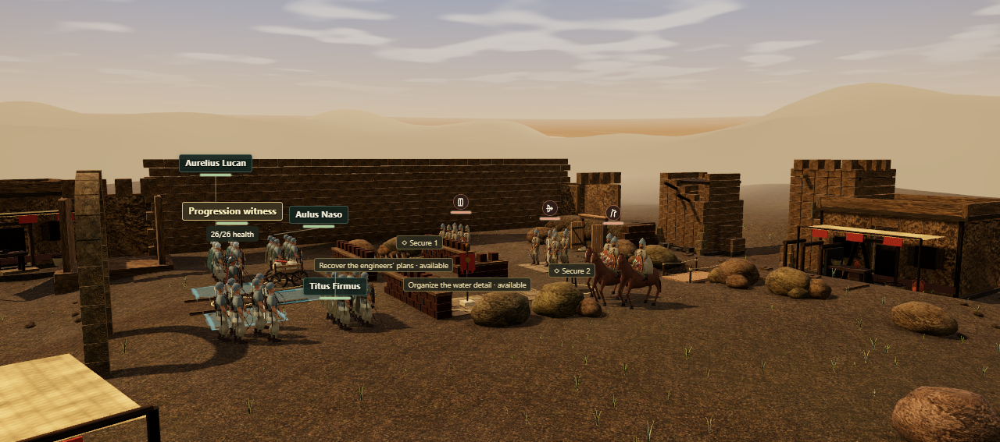

# IMPERIUM: From Recruit to Emperor

## In development: 0.40, real time with pause (Phases 0–4)

Imperium is being converted from turns to real time with pause. The player guide for 0.40 is the specification ([player-guide-0.40.md](docs/player-guide-0.40.md)); the survey of what changes is [realtime-survey.md](docs/realtime-survey.md); each phase's results and what is still to be judged are in its report ([0](docs/realtime-phase-0-report.md), [1](docs/realtime-phase-1-report.md), [2](docs/realtime-phase-2-report.md), [3](docs/realtime-phase-3-report.md), [4](docs/realtime-phase-4-report.md)). **The campaign still plays on turns by default** until Gate 4. With Settings → Development → Controls model set to *Real time* (shown under `npm run dev`, or with `?dev` in the address):

- **Every chapter plays in real time:** your own soldier, his companions with their standing orders and, from Chapter IV, his squads under Command; walkable camps in Chapters I–III; the Contests of Chapters VII–XII walked as chambers; and the finale's five routes. **P** pauses at any moment and every command still works.
- **Difficulty, every setting of the guide** with key remapping, and the guide itself as the in-game Controls & rules (**?**).
- **Chronicles saved before 0.40** load exactly as saved, choose their soldier's training once and receive the training points of the chapters they completed.
- **The real-time arena** ([`showcase/arena.html`](showcase/arena.html)): a Legionary against three raiders, the first real-time fight.
- **A deterministic simulation** ([`src/core/realtime/`](src/core/realtime)) stepped at 20 Hz, its rules as data, replayed identically at every speed, with pauses and through save and load. Its timing is in Settings → Run performance check.

Gate 4 still needs a person's play-through on Story and on Standard, the manual accessibility checks, and phone and desktop measurements.

To try the arena, run `npm run dev` and open `http://127.0.0.1:4173/showcase/arena.html`. To measure it on a phone on the same trusted network, run `npm run build`, then `HOST=0.0.0.0 npm run preview` (this serves only the production build), and open the computer's address on port 4173 at `/showcase/arena.html`.

## Version 0.38.1 — the rest of smooth play

A battle is now built in short steps behind its "Preparing" veil, so the page keeps answering while it is made: in the software benchmark no task while building reaches 90 ms, where 0.38.0's took up to a second. Each battle compiles 46–56 shader programs instead of 58–68, the figures' geometry is a third of what it was, and the page updates in place instead of being rebuilt, so the board keeps its focus between moves. The codebase is tidier: consistent line endings, archived reports, behavioural tests instead of source-text checks, and the 3D stage split into modules. See the [changelog](CHANGELOG.md) and the [performance notes](docs/performance.md); no device has been measured yet.

## Version 0.38 — smooth play

Battles now open behind a short "Preparing" veil and then play without freezes. Before a battle is shown, everything it will draw is ready:
- what its figures wear, its ground images and its generated scenery;
- every shader program, compiled and linked in short steps, including the shadow pass's own;
- its textures, uploaded ahead.

Model images decode off the main thread. In the software benchmark, nothing compiles after a battle is shown and no long task interrupts the exchange or the camera tour; before, each battle compiled 15–19 shader programs during play and froze for 4–13 seconds. Phones start on Performance, a battle that stays slow builds the next one a tier lower (never mid-battle), and **Pause → Run performance check** measures your own device at each quality and saves the results as a file. See the [performance notes](docs/performance.md), including what is still open: no device has been measured yet.

## Version 0.37 — generated character bodies

Every soldier, rider and civilian in the battles and ceremonies now wears a detailed body generated with Tripo and bound in Blender to the game's own skeleton: Roman recruits, legionaries, archers, a centurion and a commander, and Gothic, Persian and Palmyrene warriors, archers and riders, sixteen in all. The game's own animation, hands, weapons, shields, cloaks, insignia and horses stay as they were, and the protagonist's armour still changes with his command. Senate figures keep their togas, whose trims name their bloc. Each chapter downloads only the bodies its figures wear; Chapter I's download limit rises to 10 MB. See the [changelog](CHANGELOG.md) and the [asset pipeline](docs/asset-pipeline.md).

## Version 0.36 — the first generated scenery

Chapter V now has a small supply camp beside the battlefield: spoil baskets, mine timbers, mudbrick, storage jars and a leather tent. The models were generated with Tripo from text prompts and refined in Blender, and they sit outside the board, so the battles and their rules are unchanged. They load only with Chapter V, at Balanced and High quality. The [asset pipeline](docs/asset-pipeline.md) describes how generated models are made, checked, recorded and placed.

## Version 0.35.1 — one battle per approach, and fixes after the 0.35 review

A field approach now covers one battle, like the operational preparation, so a costly approach is not charged again unless you choose it. A rider withdrawn by a braced counter blow shakes nearby companions. Fallen figures on a repaired bridge rest on the deck, a figure-style change keeps figures until their replacements are ready, footstep sounds are shared fairly on busy turns, and the signal flag no longer changes shared materials. A change to the character code no longer fails `npm test` until the handoff GLBs are re-exported; `npm run audit:handoff` reports a stale export. See the [changelog](CHANGELOG.md).

## Version 0.35 — character production and field approaches

Improved skin and equipment materials, formed helmets, tailored clothing, authored combat recovery, distance-based movement timing and contextual labels now use the shared twelve-chapter renderer. New campaigns add engineering, diversion and defensive approaches, with supply costs, opening tradeoffs and visible enemy responses; older saves can opt in at camp.

The [production notes](docs/production-v035.md) describe the implementation, evidence and deferred physical-phone/player checks. The [character handoff](art-source/characters/README.md) includes full-body, rigged GLBs with embedded materials and four clips, plus a local browser workshop. These development assets are excluded from player downloads. Four legal campaign runs validate all 25 encounters and each Chapter V approach.

The image below records the preceding 0.34 benchmark.



*Actual version 0.34 gameplay at a legally reached Chapter V checkpoint, using Sculpted figures, Balanced quality and the Horizon camera. Captured in software-rendered Chromium.*

A free, browser-first tactical chronicle set in the Roman third-century crisis. Begin as a Danube recruit around AD 250, earn military commands, govern a province, enter the Senate, and contest the succession after Aurelian’s death. The campaign contains **12 chapters and 25 playable encounters**, including battles and political Contests.

The game combines original prose and locally bundled painted artwork with three-dimensional battlefields and political chambers, plus an optional 2D tactical view. Movement, gestures and tactical effects animate committed actions while the rules remain turn-based. It requires no account, backend, runtime art service or paid assets. The 3D view uses locally bundled Three.js; campaign rules remain dependency-free and run in both a browser and Node.js.

## Version 0.34 — Chapter V benchmark and twelve-chapter command campaign

Chapter V has a new fractured mudbrick siege precinct and detailed, stateful field equipment. Twelve regional material palettes extend the environmental direction through the campaign. Repaired bridges support figures, picking, movement previews and tactical overlays at their actual deck height.

Characters gain continuous clothing, individual campaign and cast finishes, facial corrective motion, eleven additional authored joint performances, refined horses and reduced overview geometry. An original local surface atlas supplies cloth, leather and metal colour detail. This is code-authored geometry and animation built on the existing licensed anatomy, not a commissioned character pack or motion capture.

New chronicles add deployment plans with real supply costs and tradeoffs, visible enemy doctrines, distinct chapter opportunities, a limited braced-defender reaction and two documented political cases for each hearing. Older chronicles opt in at camp; suspended encounters retain their rules. Preparation costs, outcomes and evidence obey the same save, retry and once-only result boundaries.

The interface adds exact case previews, a command record, camp practice access, a compact battlefield view, high-contrast controls, six remappable shortcuts and configurable touch-preview delay. Contextual sound direction uses the existing local recordings with chapter, weather and objective-pressure mixing.

See the [production ledger](docs/benchmark-production-v034.md), [command rules](docs/command-campaign-v034.md), [character production record](docs/character-production-v034.md), [environment record](docs/environment-production-v034.md) and [release validation](docs/archive/release-validation-v034.md). Run `npm run verify` for rules, compatibility, build, offline and asset checks; `npm run benchmark` restores legally reached checkpoints through the real interface and captures all twelve chapters. Browser automation requires a separately installed Playwright/Chromium. Automated correctness and software-rendered captures do not establish physical-device performance or human enjoyment.

## Version 0.33 — hold a finger to see the route

On a touch screen, holding a finger still on the board now shows what a tap there would do, including the route a walk would take, in both 2D and 3D. Lifting the finger after a hold does nothing, and a tap then walks. Every pull request now also drives the production build in headless Chromium (`npm run smoke`): New Game, walking, Confirm moves, a restored expanded field and phone touch. Playwright is installed only for that check and is not a project dependency. See the [changelog](CHANGELOG.md).

## Version 0.32.1 — field objects named on the board, and a player guide

The board readout, the arrow-key cursor, the target list and the ground note now name field objects and their state, for example "Side gate (closed)". The [player guide](docs/PLAYING.md) and the in-game Help explain the expanded campaign; the Help also describes walking. Every pull request now runs the full `npm run verify` on GitHub. See the [changelog](CHANGELOG.md).

## Version 0.32 — expanded battlefields, policy debates and character refinement

New chronicles gain interactive gates, damaged bridges, barricades, pitch fire and competing supply/signal objectives. Selected chapters expand to 10 × 8 boards. Cohesion, suppression and weather enter the exact combat forecast; enemies coordinate their approach and protected columns stay with the commander. Political Contests add motions, rival amendments and reforms that affect later battles. Existing chronicles can opt in at camp, preserving suspended encounters and exact retries.

Sculpted figures receive fitted equipment details and High-quality cloth sheen; painted Roman figures gain a new four-direction atlas and additional rig responses. Melee contact and shield reactions follow the committed impact. Settings exposes real frame measurements, with reflection refresh adapting to its measured cost. Click-to-walk routes go around closed gates and count rain on high ground, so the preview and the walk still match the rules. This work was prepared as draft 0.31 and renumbered 0.32 when it was merged after click to walk; its records keep their `v031` file names. See the [rules](docs/expanded-campaign-v031.md), [art provenance](docs/art-generation-v031.md) and [verification record](docs/archive/release-validation-v031.md) for coverage and limits.

## Version 0.31 — click to walk

Moving is now one selection: with no other action chosen, click or tap open ground and the selected unit walks there. Ground beyond this turn's reach walks the unit as far toward it as the rules allow. Pointing at ground first draws the route (solid to where the unit stops this turn, dashed beyond) over a faint wash of the ground it can reach, and the figure then walks exactly that route in 2D and 3D. A walk is the ordinary legal move, so **Undo Move** (`U`) takes it back until the unit acts; attacks, speeches and orders still preview first. **Pause → Confirm moves** brings back preview-then-confirm for moves. The rules are unchanged. This was checked with automated tests and scripted, software-rendered runs of the real interface, not on real devices or with a screen reader; see [movement verification for 0.31](docs/archive/movement-verification-v031.md).

## Version 0.30 — graphics refinement: Senate blocs beyond colour, a graded Performance tier, living formations and battle remains, weightier combat, weather on the light and story paintings in 2.5D

Senate delegates' blocs no longer rest on colour: both views share one palette (Landholders are now wheat ochre), the 3D stance marker carries the bloc's letter, and each bloc's toga trim has its own shape. **Performance** quality keeps each chapter's grade and gains baked ground occlusion around walls, tents and rocks. Followers in a formation move a beat behind their leader instead of in unison, and with the new **Battle remains** setting the fallen, spent arrows and trodden ground stay on the field until the encounter ends. Painted (HD-2D) figures are lit by the scene and breathe and sway; blows carry trails, a held beat and a small camera jolt; archers in formation loose together. Faint cloud shadows drift across the field, shafts of sunlight slant through dawn mist and the Senate's halls, and on High the board's rivers mirror the figures above them. On Balanced and High the story paintings drift slowly in depth, with each chapter's weather drawn between near and far. Everything is presentation only and was checked with automated tests and software rendering, not on real devices; see [graphics verification for 0.30](docs/archive/graphics-verification-v030.md).

## Version 0.29 — graphics overhaul: readable diorama terrain, painted (HD-2D) and ink-and-wash figures, formations, inked tactical ground and signature moments

The 3D board now reads as a diorama: high ground is a 1.6 m plateau with earth and rock banks (or squared-stone terraces beside paving), rivers sit in a channel under one water surface with gravel fords, walls run as faced stone, mudbrick or timber, roads have kerbs, and a code-painted regional panorama stands beyond the ridges. Each chapter is lit to its own colour script, and fog now starts beyond the board. **Pause → 3D figure style** offers *Sculpted*, *Painted (HD-2D)*, which stands the campaign's own painted unit art in the 3D scene with silhouette shadows and a tilt-shift finish, and *Ink and wash*. From Chapter IV military units appear as formations whose men fall with the unit's strength. Rank-and-file labels are compact glyphs; move reach and enemy threat are inked onto the ground. Senate delegates show their bloc on the toga trim and their stance in posture, and after the vote they divide to the side they were counted on. The finale stands before Aurelian's half-built walls with massed legions, an optional **Action camera** follows committed attacks, the oath and the accession are staged in 3D over their paintings, and the Imperial Tabula is a painted map of your career. All of this is presentation only and respects reduced motion. The release also improves frame pacing, anti-aliasing and shadows, trims the Chapter I download, and fixes the Chapter XII route, unreadable-save, Undo Move credit, Archive export and tab-conflict bugs. See the [changelog](CHANGELOG.md) and the [0.29 graphics verification](docs/archive/graphics-verification-v029.md), which also lists what was not checked: no real-device, real-GPU or other-browser runs and no human playtesting.

## Version 0.28 — tactical Undo Move (Regressus), 3D/2D reinforcement arrival beacons (Exploratores), clickable chamber vote seats (Tabula Curiae) and Quartermaster solvency & succession forecast (Ratio Imperii)

In both field battles and political Contests, moving your commander or speaker without yet committing an attack, speech, order, fieldwork, precedent, or agreement unlocks **Undo Move** (`canUndoMove` / `undoMove`, `#undo-move` button or `U` shortcut), returning the actor to their turn-start tile and refunding `moved` so you can test sightlines, flanking angles, and chamber speech reach before committing. Encounters with scheduled enemy reinforcement waves now project **Reinforcement Arrival Beacons** (`reinforcementBeacons`) in 3D (`updateReinforcementBeacons`) and 2D (`tacticalOverlay`) with turn countdowns (`T2`, `T3`) and enemy role breakdowns, mirrored in the mission record (`#command-mission-record`). In political Contests, every voter chip (`.vote-seat`) and Whip Forecast badge (`.whip-link`) is directly clickable (`data-cmd="inspect-delegate"`), focusing that delegate on the 3D/2D chamber floor and opening their inspection dossier. In camp (`#camp-quartermaster`) and the Obligations & Alliances ledger (`#quartermaster-forecast`), a live **Quartermaster Solvency & Succession Forecast** (`quartermasterForecast`) tracks current Supplies against due and deferred political agreements, warns of solvency shortfalls before entering an encounter, and in Chapters VIII–XII previews eligibility across all three Chapter XII succession routes (*Senatorial Acclamation*, *Army Acclamation*, *settlement with Varro*).

## Version 0.27 — tactical formation counter-play (Cuneus & Testudo), live chamber whip forecast, 3D/2D morale spectacle, camp War Council, after-action chronicle and customizable Reign Cards

Enemy formations now project visible cohesion links (`enemyFormationLinks`) in 3D and 2D while `combatBreakdown` and `combatModifiers` surface explicit Formation-Breaker diagnostics (`Wedge splits shield wall` and `Flank breaks shield line`). In political Contests, the coalition panel adds a live **Chamber Whip Forecast** (`coalitionWhipForecast`) highlighting current supporters **At Risk** from rival speakers' next-turn lobby intentions and naming **1-speech flips** in reach. On the 3D stage and 2D board, `Rally` and `Inspire` emit expanding golden shockwave rings (`radius: 2.6`), shaken (`<= 40`) and broken (`<= 20`) units display amber/crimson morale base rings, and pledged cohorts carry golden standard accents. In camp, an interactive **"Consult the War Council"** panel (`warCouncilPanel`) gathers present companions (`Varro`, `Lucan`/`Sabinus`, `Crispus`, `Aelia`, `Paullus`) to offer character-voiced counsel on the chapter's decision and encounter ahead. Post-encounter victory/defeat screens now include an **After-Action Chronicle** (`encounterDebrief`) naming Distinguished Service, key Turning Points, and concrete Defeat Diagnostics, while the shareable Reign Card adds selectable **Monument Themes** (*Imperial Purple*, *Senatorial Marble*, *Legionary Bronze*) and earned **Service Laurels** (`reignLaurels`).

## Version 0.26 — player-control overhaul, unavailable-action diagnostics, formation roster preview and chamber/allocation clarity

Every action button and selector now surfaces its exact cost (`1 move`, `1 action`, `1 order`, `1 speech`, `1 javelin`, cooldown, or promise limit), while empty-target states and `#command-named-controls` / `#command-coaching` (`What can I do?`) explain why an action or ally cannot currently be used and which chapter capabilities remain before promotion. In Chapters V+, previewing `Formation` on an allied anchor names up to 3 joining allies and explains why any nearby allies are excluded (`already ordered this turn`, `more than 1 tile from anchor unit`, or `3-unit formation cap reached`). In political Contests, the interface explicitly defines **Resolve** (*"speaking stamina; 0 withdraws from speaking, vote remains"*), states that votes are counted at the deadline (`end of turn X`), displays the strongest speech appeals for each delegate's interest and bloc, and adds direct `Inspect` buttons to the chamber delegate roster. Chapter X camp preparation adds four one-click convoy presets (`2·2·2`, `4·1·1`, `1·4·1`, `1·1·4`) and a live draft preview (`#allocation-preview`) of meter, road-morale, store-integrity, and tribunal stance effects. Arrow-key board navigation now visibly updates `#board-hover`, and 3D camera shortcuts (`F`, `Home`, `+`, `-`, `H`) work across all campaign encounters. See the [controls overhaul specification & verification record](docs/archive/controls-overhaul-verification.md).

## Version 0.25 — Lux Imperii HDR post-processing, dynamic 3D water, subsurface foliage, physical armor shaders, volumetric fire and 2D Tabula Picta

The 3D finishing pass (`Lux Imperii`) adds single-pass HDR specular bloom, Contrast-Adaptive Micro-Sharpening (CAS), depth-aware aerial perspective, and a warm fresco vignette. Rivers and fords (`Flumen & Vadum`) use custom GLSL wave/foam/rain-ripple shaders; foliage (`Ventus & Marmor`) sways with wind vertex displacement and warm backlit subsurface scattering, while Senate and council chambers feature procedural veined marble and polished floor reflections. Character materials (`Lorica & Paludamentum`) add anisotropic metallic sheen on Roman armor/helmets, velvet-like rim sheen on tunics and cloaks, and harmonic banner flutter. Braziers and torches emit volumetric rising flame/ember plumes (`Ignis & Ferrum`), projectiles trail multi-segment ribbons, and the 2D tactical canvas (`Tabula Picta`) renders isometric fieldworks, diagonal crimson threat-envelope hatching, time-of-day color grading, and 2D weather particles.

## Version 0.24 — legionary fieldworks (Munitiones), war-room mutators, 3D Aquila & Cornu brass, Oculus Tactica threat envelopes, Rostra interjections and Cursus Honorum monument

From Chapter III (Immunis) battles, the commander's engineering detachment can erect one tactical fortification per battle (`stakes`, `rampart`, or `brazier`) that alters combat modifiers and renders in 3D and 2D. Archive sandbox replays gain War-Room Mutators (`difficulty`, `weather`, `timeOfDay`, and Chapter XII `route`), commanders and formation leaders carry 3D Legionary Aquila & Signum standards with synthesized Roman Cornu brass cues, the command inspector and 3D stage display `Oculus Tactica` combat modifier chips and enemy threat envelopes, political Contests feature named delegate interjections and a 3D marble Rostra dais, and the character dossier includes an interactive `Cursus Honorum` monument.

## Version 0.23 — Archive of the Reign sandbox, dynamic 3D weather & night-march torchlight, veteran commendation ranks, interactive Tabula and Senate precedent motions

Completed field battles and political Contests can be replayed at any time from the Mission Journal or Accession Epilogue in an isolated **Archive of the Reign** sandbox without altering the primary campaign save. All 25 encounters support deterministic 3D weather particles (rain, mist, dust, embers) and night-march/dusk torchlight, veterans earn **Commendation Ranks** (*Gregarius → Immunis → Principalis → Evocatus*) with passive mastery bonuses and 3D crest/torc insignia, the Campaign Map features an interactive theatre **Tabula** alongside an encounter **Turn-Step Scrubber**, and Chapters VII–XII Contests unlock **Senate Career Precedent Motions**.

## Version 0.22 — 3D ground paths, multi-unit forecasts, opponent intent arcs, custom Order destinations and Imperial epilogue record

On the 3D stage, previewing a move now traces the exact orthogonal ground path across the terrain, legal target rings are color-coded by action intent (crimson for offensive/hostile actions, gold for guard/command/promises, teal for movement/support), the selected unit's ring carries a directional facing chevron, and adjacent allies sharing an active formation display cohesion tethers. Multi-unit orders (`Formation`, `Rally`, `Address`, `Threaten`) now project floating forecast badges over every affected comrade, rival or delegate simultaneously, and inspecting an opponent projects a crimson 3D intent arc toward their declared next-turn target. In Chapter IV+ battles, `Order · Advance` exposes a custom destination selector (`#order-destination`) for directing an ally to a specific reachable tile, the 3D camera bar adds a `Speed 1× / 2×` playback toggle (plus click/`Space` fast-forward), the Reign Card header is updated to `I M P E R I U M`, and the accession epilogue includes a complete Imperial Service & Company Record.

## Version 0.21 — 3D pre-action forecast badges, specialist foley and camp progression clarity

Previewing an attack, specialist ability or political speech now displays an authoritative floating outcome badge directly on the targeted figure's 3D world label (`−4 HP · Flank`, `Ward −2 dmg`, `+20 morale · +1 HP`, `+3 stance`, `Support 3 → 5`, `-4 Resolve`, `Blunt speech`) in both the main campaign and the standalone 3D showcase. Protector `Guard`, Formation leader `Inspire` and political `agreement` actions have distinct synthesized foley recipes, and active 3D ward and trajectory arcs gently shimmer when reduced motion is off. In camp, the Veteran training and Relationships & agreements panels automatically open and highlight counts whenever a veteran is ready to specialize or a political agreement is due now.

## Version 0.20 — expressive gaze, 3D tactical wards and Chapter I budget headroom

Weighted eyebrow joints (`left-brow`, `right-brow`), syllabic jaw cadence and bounded head gaze (`gazeYaw`, `gazePitch`) give speaking delegates, rallying commanders and braced soldiers clearer facial expression without altering idle or reduced-motion poses. On the 3D stage, Protector veterans now project visible gold ward tethers to adjacent guarded allies, ranged and javelin previews display trajectory arcs, and multi-phase operations label active `Phase 1` / `Phase 2` objectives while smoothly re-centering the overview camera on phase transitions. Cross-platform build normalization reclaims ~159 KB of Chapter I compressed budget headroom (`7.84 MB` / `8.00 MB`).

## Version 0.19 — more natural faces

Fitted almond eye openings, restrained irises and weighted eyelids replace the prominent round eye surfaces. Fine tapered eyebrows follow the skin. Complexion normalization preserves more highlight variation; mature faces gain subtle cheek and fold shaping. Beards include fuller moustaches and feather into the skin, while scalp edges and the imported short-hair cutout are softened.

The changes use the existing male and female anatomy and textures, with no new runtime art downloads. Gameplay and save files remain unchanged. See the [v0.19 validation record](docs/archive/release-validation-v019.md) for the final build, regression results and browser-check scope.

## Historical version 0.18 — fitted characters and wearable equipment

Characters use fitted complexion textures on imported male and separate female anatomy. Their original UV coordinates keep facial features aligned with the sculpt. Fitted necklines and helmet openings follow the head and collar, and eye surfaces retain their intended highlights through material batching. A locally bundled short-hair model and cutout texture replace the scalp cap on eligible male figures; bound female hair retains its original fitted geometry. The short-haired figures share one source model, with identity-specific fitting and tint.

Connected tunic and armor shells bend across sewn sleeve seams, with shaped folds, turned openings and a fuller protective silhouette. Cloth, leather, mail, scale and metal have distinct local normal and roughness maps. Rebuilt hands have shaped palms, tapered fingers and an opposing thumb; fitted boots distinguish the heel, instep, toe and sole. Dedicated overview meshes reduce distant hand and boot detail while preserving grip and ground-contact frames. Geometry remains deterministic, with explicit ownership and disposal of shared textures and skeletal resources.

This is a presentation-only release: campaign rules, choices, save formats and authoritative action timing remain unchanged. The [v0.18 validation record](docs/archive/release-validation-v018.md) records a **562-test full regression**, **78 final actor checks**, **6 final surface checks**, **25 browser scenes / 518 assertions**, **63 targeted browser assertions** and **13 asset checks**. Production revision **`a0dbf383f33b`** meets the declared download budgets. After the all-chapters download, a server-stopped reload and normal Continue action restored Chapter VI with the exact same portable save code.

The [character surface provenance](docs/character-surfaces-v018.md) records source licenses and export details. These figures combine imported anatomy and surfaces with original stylized equipment and authored joint animation. They are not complete scanned characters or motion-captured performances; physical-device performance and independent human playtesting remain unverified.

## Historical version 0.17 — a developing company and recurring political rivals

New chronicles add **22 operation alternatives across eleven encounters**, three permanent veteran specializations, and nine named representatives who recur across all six political Contests. Branches change objectives and later field benefits; negotiated agreements exchange support now for supply payments and lasting trust. The optional opening guide explains legal commands and their forecasts. Older chronicles retain their previous rules and exact retry checkpoints.

Locally bundled CC0 anatomy supplies male heads, necks and exposed arms, fitted to the existing rig and identity system. Clothing, hands, legs, female figures and horses remain original project models. Weapon-specific authored clips, inhabited settlements and richer chambers improve presentation; camera cutaways and body-aware labels help keep inspected figures visible. GPU-based adaptive resolution is optional and affects the scene buffer rather than interface text. Audio recordings are unchanged.

The [v0.17 validation record](docs/archive/release-validation-v017.md) records **510 passing Node tests**, **25 browser scenes / 518 assertions**, 63 targeted assertions, 21 dedicated GPU checks, thirteen asset/offline checks, eleven isolated browser progression checks and two legal 25-encounter routes. Production revision **`9faf31555b45`** meets the declared download budgets and retains exact previous-version compatibility. Normal-interface progression controls and a server-stopped Chapter I continuation were checked, with the save preserved exactly. Physical-device and independent human playtests remain unperformed.

## Version 0.16 — fuller scenery and stronger character form

Oak, willow and cypress canopies now use original textured leaf sprays on branching trunks, with curved date-palm fronds and softer road verges. Rebuilt facial contours, connected shoulders and limbs, fitted mail and open helmet guards give the original procedural characters cleaner silhouettes.

Balanced and High add a linear HDR finishing pass with depth-based contact shading, edge smoothing and restrained color treatment. Directional lighting has less flat fill. Performance retains a direct rendering path; unsupported hardware or a failed finishing shader also falls back to it. Graphics and camera controls preserve the existing rules and complete saves.

The [v0.16 validation record](docs/archive/release-validation-v016.md) separates real GPU checks, campaign-scene checks, ordinary interface/offline checks and desktop timings from unperformed physical-device or human playtests. [Texture provenance](docs/presentation-assets-v016.md) records the new foliage and optimized character atlas. These remain stylized, code-authored models and animation.

## Version 0.15 — company, operations and presentation

New chronicles offer **Story, Standard and Veteran** difficulty, selectable veterans and deployment order, and one optional supply package before each eligible battle. Eleven battles now unfold through two earned objective phases. Contextual field and chamber advice responds to the current position. Existing chronicles retain their original campaign rules and complete retry checkpoints.

All 25 encounters have authored entrances, destination landmarks and camera compositions. Characters gain distinct facial anatomy, age and identity details, code-authored joint animation clips and a shared generated material atlas. Optional local music, environmental ambience, spatial combat foley and four voiced briefings add sound without requiring it to understand a command. Exact spoken text stays available.

The [v0.15 validation record](docs/archive/release-validation-v015.md) separates automated, browser and still-needed human/device evidence. [Asset provenance](docs/presentation-assets-v015.md) records the original prompts and file hashes. Characters and animation remain original code-authored models and clips; recordings are generated, not professional actor performances.

## Version 0.14.1 — Imperium

The game is now **Imperium**, formerly Sacramentum. The source repository is [obeidpeter/Imperium](https://github.com/obeidpeter/Imperium). Existing saves and portable codes remain compatible. Historical verification records, original artwork prompts and source filenames retain their recorded names; *sacramentum* still means the Roman military oath where used in the story or historical notes.

## Version 0.14 — weighted figures and material detail

Original character meshes now use weighted skeletal deformation at clothing and limb joints, with bounded cloth motion and planted sole/hoof contacts. Locally generated reflection lighting helps metal, cloth and stone respond to the scene's sky and sun. Soft foot contacts and short pose-aligned impact effects connect figures to the ground and committed actions.

Walking and mounted strides follow distance travelled. The 3D action sequence gives movement, anticipation, contact and recovery more time while keeping footsteps, weapon release and impacts aligned. Shield blocks and reactions face their source; optional synthesized sound distinguishes hard-ground footsteps, hooves and wading. These changes preserve turn rules, committed results and reduced-motion behavior.

The environment adds smoother boulders, compound palm fronds, tapered tree branches, verge plants, fluted columns and jointed masonry arches. Broad ground variation and material weathering retain the existing continuous terrain, legal grid and distant landscape. Performance keeps simpler masonry; Balanced and High add beveled edges. These remain original procedural models and scripted performances, not imported character sculpts or motion capture. No new downloaded texture files are required.

The [version 0.14 verification record](docs/archive/character-quality-verification.md) reports **401 passing tests**, legal completion of all **25 encounters**, and **25 browser scenes / 518 assertions** checked in two batches. Ordinary production play completed the drill and entered the road; camera/view changes and reload preserved the exact save code. A 360 px desktop viewport had no horizontal overflow. Measured desktop rendering costs and the shader precision warning are disclosed; physical phones, independent human playtests and a fresh browser-offline session were not tested. Previous-version results below remain historical evidence.

## Version 0.13 — sky and distant landscape

The 3D scene adds an original procedural sky and a regional landscape beyond the playable ground. Choose **Horizon** or press **H** to look toward them; **Overview** or **Home** returns to the tactical frame, and **Follow unit** remains available for inspection. The campaign and standalone skirmish expose the same explicit Horizon control. Camera changes spend no turn and leave the encounter state unchanged; the initial view remains the tactical overview.

The [sky and horizon verification record](docs/archive/sky-horizon-verification.md) records **375 passing tests**, legal completion of all **25 encounters**, an earlier **25-scene / 468-assertion** browser sweep and targeted checks after the final camera/water corrections. Normal camera/view controls preserved the exact exported save code; a 360 px browser viewport retained Horizon without horizontal overflow. Harness portrait/landscape captures are identified separately from full-game viewport checks. No physical-device or frame-rate guarantee is claimed. The version 0.12 results below describe that prior release.

## Version 0.12 — clearer cameras, figures and labels

Overview frames the playable ground and actual figures; Follow chooses a clear angle around structural scenery. Unit badges and objective markers share collision-aware placement, giving selected figures priority. Original procedural rigs add planted feet and hooves, bounded transitions, equipment-aligned projectiles and mounted aiming. Distance detail, batched scenery and cached rendering work preserve the same legal encounter state and 2D alternative.

The [version 0.12 verification record](docs/archive/campaign-3d-refinement-verification.md) reports **360 passing tests**, a **25-scene / 468-assertion browser sweep**, and **103 normal-interface commands** completing the marsh, cavalry and Senate encounters. The complete Senate route worked with the local server stopped and retained its victory after reload. Narrow/enlarged-text layouts, view switching and actual desktop rendering costs were checked separately. No physical-phone, independent human-playtest or guaranteed frame-rate claim is made. The completed version 0.11 evidence below is preserved as historical evidence.

## Version 0.11 — the campaign's battlefields and chambers in 3D

The shared 3D view now covers all twelve chapters: nineteen battles and six political Contests. Chapter II's marsh and causeway lead into ruined stations, fortified gates, eastern campaigns, river crossings, provincial administration and the Senate. Original procedural figures distinguish military roles, cavalry, civilian escorts and civic speakers. Existing rules, choices, milestones, previews, saves and retries remain authoritative. **Switch to 2D** offers the same encounter in the tactical view, which also serves as the WebGL fallback.

Chambers show delegate **stance**, bloc and commitment, while speakers show **Resolve**. Compact labels keep the thirteen-person room readable; selecting or hovering reveals names. A withdrawn speaker retains their vote. Political gestures follow the argument's recipients without presenting debate as weapon combat. Field objectives and extraction points follow the actual rule grid, including hidden enemies, reinforcements, escorts and finale routes.

The renderer and materials stay out of the initial shell. Every chapter's offline group contains its shared 3D dependencies, so a restored later-chapter save does not need to visit Chapter I first. Cached shared URLs are reused across chapters. The standalone skirmish page/style remain separate until visited or included in the explicit full download. Camera, keyboard, named controls, grid, quality, reduced motion and optional default-off sound remain available.

The [encounter inventory](docs/campaign-3d-encounters.md) records actual layouts, roles and branch requirements. The [current 3D verification record](docs/archive/campaign-3d-verification.md) covers 339 passing tests, all 25 scenes checked in a real browser, normal-interface Chapter II victories, measured desktop rendering cost and a cold Chapter XI offline restore. Original procedural models are not scanned actors or motion capture; these checks do not establish physical-device performance or player enjoyment.

## Historical version 0.10 — Chapter I integration

Chapter I's training and frontier battle now open in a real 3D scene inside the normal campaign. Commands, previews, autosaves, retries and earned progress use the existing campaign state. **Switch to 2D** returns to the tactical view of the same encounter; Pause also saves this presentation preference. If WebGL initialization fails, the game returns to the 2D view. Chapters II–XII retain their existing 2D battles and political chambers.

Drag to orbit, scroll or use **+ / −** to zoom, and choose **Overview** or **Follow unit** to frame the action. The focused campaign board keeps arrow-key tile navigation and Enter to select or confirm; named action and target selectors remain available. **G / Grid** reveals tile boundaries. Actions still require a legal preview and confirmation, and camera movement never spends a turn.

Original procedural character rigs now include shaped anatomy and clothing, distinct practice and field equipment, and small generated fabric, leather, mail and shield-surface textures. Terrain, the training yard and frontier scenery are built from local mesh and material code. These are original procedural models and poses, not imported production character models or motion-capture performances. Performance/Balanced/High and reduced motion control presentation only.

**Generated sound effects** remain optional and off by default in Pause. With sound enabled, the 3D action timeline cues restrained footsteps, cloth, weapons, shields and impacts synthesized locally with Web Audio. Volume is adjustable; no recordings or audio service are used. Sound stops when the page is hidden, and every action remains understandable without it.

Three.js 0.186.1 and its MIT license are local files; no CDN or installation is required. The initial shell excludes the 3D modules and textures. Chapter I's offline download includes the shared renderer, materials and vendor files; the separate study page and its stylesheet join the explicit full download. See [3D presentation verification](docs/archive/showcase-verification.md) for checks actually performed and pending browser/device work, and [art provenance](docs/3d-art-provenance.md) for how the models and materials were made.

## Version 0.9 — the separate frontier study remains available

Choose **Try a standalone skirmish** on the title screen, or open `showcase/index.html` through the local server. This is a single playable battle with three-dimensional terrain and articulated figures, an orbiting camera, a compact command deck and the campaign's legal select–preview–confirm rules. Its temporary battle remains separate from the twelve-chapter chronicle and does not read or write the campaign save.

Drag to orbit, scroll to zoom, or focus the canvas and use arrows and **+ / −**. **Focus soldier** and **Field view** restore useful viewpoints. Named action and target controls provide a keyboard alternative to picking in the scene. Performance/Balanced/High and reduced motion control presentation only. Restart repeats this study; Return to campaign opens the existing game.

The study requires WebGL 2 and shares the campaign's locally bundled renderer. Its own page and stylesheet are excluded from chapter downloads; the explicit full offline download includes them. See [3D study scope](docs/3d-study.md) and [license notices](docs/LICENSE-NOTICES.md). Device support, performance and accessibility claims require the separately recorded checks.

## Version 0.8 — battlefield presentation and direct controls

The encounter now occupies its own command stage, with a compact mission bar, company roster and action dock around the battlefield. Point at figures to select them, at reachable ground to preview movement, and at opponents to preview legal attacks. Activate the same target again or press Confirm to commit. Optional named selectors, full forecasts and rules remain available. Keys 1–9 select actions; N cycles ready units, E ends the turn, G toggles the grid, and Escape cancels.

New local ground materials and natural props support continuous terrain with a quiet default grid. Authored animation sheets add distinct movement, attack, defensive and speaking poses to covered figures; uncovered roles and facings retain the earlier directional artwork. Ambient motion runs only while the scene is visible and motion is enabled; Performance and reduced-motion settings disable it. Result labels remain readable through recovery instead of flashing past.

The [production direction](docs/production-direction.md) records scope and the revised asset budgets. This presentation release preserves the version 0.7 tactical and political rules, milestones and saved encounter compatibility. [Version 0.8 verification](docs/archive/production-verification.md) records actual tests and visual inspection, including remaining limits.

## Version 0.7 — historical tactical and political overhaul

Battles now reward screening, facing, terrain and coordinated formations. Guards defend approaches, archers seek useful firing positions, raiders pressure objectives, and allies consider the mission. Hits affect morale on both sides; shaken troops lose effectiveness, broken troops regroup, and the new Withdraw order helps preserve a line. Damage previews explain the actual modifiers, while mission briefs and visible intentions help the player plan the next turn.

Political Contests now distinguish bloc preferences as well as personal interests. Nearby speakers strengthen Persuade, rivals publish their next planned intervention, and previews show exact stance changes, net votes and costs. Material promises carry a larger accession debt; the fixed electorate, deadline vote and two-promise limit remain. The campaign still advances through earned military command, governorship, Senate admission and the final confrontation.

Regional terrain and chamber materials, formation and morale markers, recipient-linked political gestures and directional recoil make these decisions more visible. Career guidance explains each chapter’s practical responsibility; optional effects now have a volume control. **Standard is the supported difficulty.** Presentation quality settings do not change rules or opponent strength.

Old active encounters and their retries retain their saved rules. New encounters use the revised rules, identified internally by `combatVersion: 2` or `politicsVersion: 2`; importing an older chronicle does not restart the campaign. Read the [overhaul plan](docs/overhaul-plan.md), [chapter review](docs/overhaul-chapter-review.md), [combat design](docs/overhaul-combat-design.md), [political design](docs/overhaul-politics-design.md), and [visual design](docs/overhaul-visual-design.md) for implemented changes and their limits. The [current overhaul verification report](docs/archive/overhaul-verification.md) separates automated results, representative browser play, rendering costs and unresolved onboarding concerns. No independent human or physical-device playtest is claimed.

## Version 0.6 — historical graphics refinement

Painted units now articulate their existing artwork during walking, attacks, throws, bracing, hits, mounted actions and political speeches. Footfall phase follows movement along the visual route; actions have preparation, contact and recovery poses. Directional contact shadows, projectile arcs and distinct impact effects give the figures a clearer relationship to the ground and their targets. These remain procedural animations of four authored facings, rather than a 3D character system or newly painted animation frames.

Connected banks, road wear and material edges follow the actual terrain map. Sparse regional groundcover and exterior camp supplies, moorings, masonry, gardens and chamber seating add context without introducing playable obstacles. Cached ground and bounded detail levels retain the Performance, Balanced, High and reduced-motion controls. The campaign, tactical rules, earned progression and save behavior are unchanged.

Read the [graphics refinement verification report](docs/archive/graphics-refinement-verification.md) for that release’s comparison, checks actually performed and remaining limits. It separates static rendering cost from animated rendering, legal action captures from isolated pose diagnostics, and browser observations from physical-device evidence. These measurements describe version 0.6.

## Version 0.5 — historical website and interface release

The interface release introduced an immediate Play or Continue action, a cinematic opening, and concise sections showing the career, world, an early decision, and actual gameplay captures. Its shared ivory, charcoal, and Pompeian-red interface remains throughout the mobile menu, camp, chapter progression, character equipment, journal, obligations, settings, recovery, and reference panels. Chapters remain earned; navigation does not reset the campaign or bypass an unfinished encounter.

Read the [interface design system](docs/interface-design-system.md), [initial interface audit](docs/interface-audit.md), [historical interface verification report](docs/archive/interface-verification.md), and [0.5 automated regression evidence](docs/evidence/interface-regression.json). Those measurements describe the interface release, not version 0.7.

The underlying 0.4 artwork remains: faction-specific figures, layered battlefields and chambers, character aging, recurring-cast expressions, and rank-specific ceremonies. Text scaling also remains available. [Graphics art direction](docs/graphics-art-direction.md), [rendering architecture](docs/graphics-architecture.md), and [narrative artwork](docs/graphics-narrative-art.md) document that foundation. The [asset manifest](docs/asset-manifest.json) records locally bundled art and provenance.

## Play locally

Use Node.js 20 or later. Open a terminal in the project directory. There is no `npm install` step.

```sh
node scripts/serve.mjs
```

Open the address printed by the server, normally `http://127.0.0.1:4173`. Choose **Play now** to start, or **Continue your chronicle** if a local save exists. The first chapter teaches the controls. [Playing instructions](docs/PLAYING.md) cover commands, voting, advancement, and saving.

Use the local server instead of opening `index.html` directly: native JavaScript modules require an HTTP origin. This source preview does not generate the production offline cache.

## Build and preview the production folder

```sh
node scripts/build.mjs
node scripts/serve.mjs dist
```

The equivalent commands are `npm run build` and `npm run preview`. The output is **`dist/`**, a plain static folder of HTML, CSS, JavaScript, manifest, icons, and a generated service worker. Build from the project root. The builder safely replaces the generated `dist` directory; source and local browser saves are separate from it.

The build writes `dist/build-report.json` with startup, chapter I, and full-campaign asset counts, byte totals, compressed estimates, and the configured address. It rejects initial-shell estimates above 2,000,000 bytes, shell plus chapter I above 10,000,000 (8,000,000 before 0.37), or the complete campaign above 24,000,000. All three include the worker. This is a build-budget check, not a measurement of a particular phone’s actual download.

## Replit static deployment

Build this source repository outside Replit’s agent. Import [obeidpeter/Imperium](https://github.com/obeidpeter/Imperium) or upload the project, name the Replit app **Imperium**, and use a **Static** deployment with:

| Setting | Value |
| --- | --- |
| Build command | `node scripts/build.mjs` |
| Public directory | `dist` |
| Backend / server command | None |

The supplied `.replit` records these static deployment settings. The same `dist` folder can be served unchanged by another static host. The development server is only for local preview; do not deploy it as a backend.

Set the build environment variable **`SITE_URL`** to the game’s canonical HTTPS address, including any hosting subdirectory. The builder uses that single value for the production configuration, manifest identity and start address, and the share-card link. For example, in PowerShell:

```powershell
$env:SITE_URL = 'https://your-game-domain.example/'
node scripts/build.mjs
```

Replace the example with the domain you own. With `SITE_URL` unset, relative URLs follow the current static host for local previews. A real custom domain, its DNS, Replit publication, and testing that live address on real phones remain deployment steps for the owner. No production domain has been purchased or assumed by the source.

Keeping the same public origin when changing hosting preserves the browser address to which saves and installs belong. Changing the address does not automatically migrate browser storage; portable save codes provide a manual transfer route.

## Saving, offline play, and sharing

- Actions autosave through an IndexedDB transaction, with a localStorage mirror where available. Concurrent tabs use a checked sequence; a stale tab must explicitly load the latest chronicle to continue. If IndexedDB is unavailable, localStorage saving requires Web Locks. Unsafe writes fail closed while in-memory play and export remain available.
- **Pause → Recover an earlier checkpoint** previews and restores one of the last three distinct checkpoints or replaced chronicles. The displaced current save joins that recovery history.
- **Pause → Copy a save code** exports a checked portable save, including the active encounter checkpoint. Restore validates the code before asking to replace the current campaign.
- Retry restores the entire encounter-start snapshot, including the random seed and staged promises. Rewards are committed when the result is recorded, once per encounter.
- The first save requests persistent browser storage. A browser may decline that request, so keep a save code independently.
- The production service worker first caches the shell and opening artwork. Every chapter requests its own artwork plus the shared 3D renderer and materials; shared cached files are reused. Suitable connections may prefetch the next chapter. **This chapter is ready offline** covers the current chapter only. To keep the whole campaign and standalone study, choose **Pause → Download all chapters for offline play** and wait for **All chapters available offline**. Pause also provides a retry for missing chapter resources. A new edition activates after old tabs close, preserving the current encounter. HTTPS or a local secure-context exception is required for browser service workers.
- On iPhone, Safari’s **Share → Add to Home Screen** provides the installation path. Real-device installation, long-term storage retention, and platform share menus require device testing.
- The ending can create a PNG reign card with the ruler’s name, broad choices, accession route, and configured game link. It omits character fates. Download and device sharing happen only on the player’s action.

## Project map

| Path | Responsibility |
| --- | --- |
| `src/core/game.js` | Campaign state, advancement, milestone locks, transactions, save validation, finale forecast |
| `src/core/battle.js` | Tactical rules, objectives, AI, command capacity, formations, confrontation routes |
| `src/core/contest.js` | Political grid rules, votes, Resolve, stance, cooldowns, promises, rival speakers |
| `src/data/battle-balance.js` / `contest-balance.js` | Standard combat tuning, formation effects, bloc affinities and rival priorities |
| `src/core/shared.js` | Grid helpers, units, movement, deterministic random support |
| `src/core/debug.js` | Explicitly enabled development-only scenario injection; excluded from production builds |
| `src/data/campaign.js` | Twelve chapters, cast, decisions, dialogue, absence branches, oath, historical notes, epilogue |
| `src/ui/app.js` | Event routing and persistence; screen views are split into `campaign-views.js`, `encounter-view.js`, and `panels.js` |
| `src/ui/render-controller.js` / `turn-replay.js` | Tested render scheduling, asynchronous share preparation and cancellable turn summaries |
| `src/ui/page-update.js` | Applies each render to the live page in place, so the board keeps its focus and listeners, the 3D view its canvas and a field what was typed |
| `src/ui/board-input.js` / `board-readout.js` / `settings.js` | The board's pointer, touch-hold and keyboard input; its readout and announcements; Settings defaults and repair |
| `src/core/career.js` / `src/data/story-stages.js` | Persistent company service, recovery and state-aware story scenes |
| `src/core/progression*.js` / `src/data/progression-operations.js` / `negotiators.js` | Versioned operation branches, veteran specializations, recurring representatives and staged agreements |
| `src/data/encounters.js` | Authored battlefield layouts, objectives, pressure and route variants |
| `src/data/campaign-guidance.js` / `src/ui/tactical-intel.js` | Chapter responsibilities, mission briefs, coalition status and visible field intentions |
| `src/ui/progression-views.js` / `field-guide.js` | Camp specialization/operation choices, agreement terms and optional contextual opening guidance |
| `src/core/legacy-*.js` | Original suspended-encounter rules retained only for old saves and their exact retries |
| `src/ui/renderer.js` / `battle-art.js` | Canvas battlefield/chamber rendering, depth order, contact shadows, cached ground and path previews |
| `src/ui/unit-sprites.js` / `sprite-poses.js` | Authored directional unit atlases, faction gear and procedural articulation of painted figures |
| `src/ui/world-art.js` / `terrain-detail.js` / `battle-effects.js` | Regional scenery, connected terrain detail, projectiles and tactical effects |
| `src/ui/animation-timeline.js` / `motion.js` / `ambient.js` | Bounded action choreography, visual feedback and scene atmosphere |
| `src/ui/graphics-quality.js` | Player-selectable presentation tiers and adaptation to measured rendering cost |
| `src/ui/art.js` / `asset-loader.js` | Portrait/environment selection, chapter asset groups, bounded image loading and cache |
| `src/ui/campaign-views.js` / `cinematic.css` | Readable story passages, character staging, promotions and accession |
| `assets/` | Local portraits, scenes, atlases, materials, audio and the fitted character GLB; provenance in docs/asset-manifest.json |
| `src/ui/battle-stage-controller.js` / `battle-3d.css` | All-chapter battle/chamber 3D view, view switching and renderer lifecycle |
| `src/showcase/stage.js` / `actors.js` / `actor-pose.js` | Shared WebGL scene, fitted imported anatomy with original rigs/equipment, and articulated action poses |
| `src/showcase/stage-*.js` / `build-steps.js` / `shadow-depth.js` | The stage's input, camera, labels, figures, overlays and its preparation behind the veil; building in short steps; the shadow pass's depth variants |
| `src/showcase/actor-assets.js` / `actor-clips.js` | Local CC0 anatomy loading/fallback, identity fitting and original weapon-specific joint clips |
| `src/showcase/frame-budget.js` / `environment-occlusion.js` / `stage-label-layout.js` | Asynchronous GPU timing, bounded scene resolution, scenery cutaways and collision-aware labels |
| `src/showcase/environment*.js` / `combat-presentation.js` / `battle-sound.js` | Procedural scenery/materials, visual event timing and optional synthesized combat sounds |
| `src/showcase/campaign-scene-profile.js` / `stage-readout.js` | Campaign scene identity, military/civic labels and mission markers |
| `showcase/` / `src/showcase/main.js` / `session.js` | Optional standalone frontier study and its isolated in-memory battle |
| `vendor/three/` | Locally bundled Three.js 0.186.1 modules and their unchanged MIT license |
| `src/ui/storage.js` | Browser save envelopes, mirrored storage, conflict handling, portable codes |
| `src/ui/audio.js` | Optional browser-generated sound effects |
| `src/ui/styles.css` / `interface.css` | Shared tokens, responsive website and panels, focus states, status treatments, and reduced-motion presentation |
| `src/ui/site-media.js` | Optional supporting website captures, loaded on request or suitable connections |
| `src/config.js` | Source defaults; the builder supplies production `SITE_URL` and version configuration |
| `scripts/build.mjs` / `scripts/serve.mjs` | Dependency-free static builder and local preview server |
| `scripts/autoplay.mjs` | Full campaign runner using legal gameplay commands from New Game |
| `scripts/progression-autoplay.mjs` | Legal new-progression routes, branch/specialist/agreement coverage and exact retries |
| `scripts/political-diagnostics.mjs` | Explicitly injected political scenario comparisons using legal commands; separate from full-campaign evidence |
| `scripts/graphics-fixtures.mjs` / `tests/graphics-lab.html` | Legal campaign scenes and a development graphics review surface |
| `scripts/campaign-3d-fixtures.mjs` / `tests/campaign-3d-browser.*` | All 25 legally reached start checkpoints, command replays and explicit real-WebGL review harness |
| `tests/interface-server.mjs` / `tests/interface-load.html` | Development-only observation of actual entry requests and rendered UI milestones |
| `scripts/export-narrative-art.py` / `export-specialist-art.py` / `optimize-tactical.py` | Development-only cropping and compression of approved generated art |
| `tests/` | Rules, progression, save, branch, and scenario checks; generated legal-route checkpoints |

Read the [Contest rules sheet](docs/contest-rules.md), [historical research](docs/historical-research.md), [reference-document reconciliation](docs/reference-requirements.md), [privacy note](docs/privacy.md), and [licensing notices](docs/LICENSE-NOTICES.md). The verification reports of earlier releases are in [the archive](docs/archive/README.md). The optional in-game historical library links sources and discloses the alternate succession, composite career, reconstructed lead seal, original oath, fictional cast, and other adaptations.

## Verification commands

```sh
npm test
node scripts/autoplay.mjs
node scripts/build.mjs
node scripts/verify-assets.mjs
# optional, development only (needs Playwright and a browser):
node scripts/visual-regression.mjs --record   # then later: node scripts/visual-regression.mjs
npm run build && npm run smoke                 # drive the production build in headless Chromium
```

`npm test` automatically runs `scripts/prepare-tests.mjs` first. It sequentially generates the legal campaign checkpoints, graphics scenes, graphics action cases and all-chapter 3D review checkpoints, then starts the tests. Generated `tests/fixtures/` files are excluded from the source archive and repository; their generators and the fixed `tests/compatibility/` inputs are included. For a direct `node --test` invocation on a fresh source copy, run `node scripts/prepare-tests.mjs` first.

`npm run verify` runs that preparation and test sequence, autoplay, build and asset/offline checks. `node scripts/autoplay.mjs --fixtures` separately regenerates the legal-route chapter checkpoints and trace used for browser checks. The full-route runner starts at New Game and uses the same legality-enforced commands as the browser; chapter injection belongs only to separately identified development scenarios.

The earlier 0.3 release changed gameplay, campaign scenes, the phone action loop and local save recovery. Its [campaign improvements](docs/campaign-improvements.md), [save recovery](docs/save-recovery.md), and [playability verification report](docs/archive/playability-verification.md) remain historical evidence. The [graphics report](docs/archive/graphics-verification.md) documents 0.4; the [aesthetic report](docs/archive/aesthetic-verification.md) documents 0.2. Those are not measurements of version 0.7. The [physical-device and human playtest kit](docs/playtest-kit.md) remains available for further evaluation.

Commands and implemented checks are not proof of a particular result. See the [v0.17 validation record](docs/archive/release-validation-v017.md) for completed automated, browser, ordinary-interface and local offline evidence, the [v0.16 graphics record](docs/archive/release-validation-v016.md), and the [historical overhaul verification](docs/archive/overhaul-verification.md) for their respective scopes. Autoplay does not establish enjoyable pacing, emotional impact, touch ergonomics on a physical device, or real-world offline durability.

## Scope and design choices

This implementation uses native JavaScript modules, Canvas/WebGL, and a small custom static builder instead of the larger TypeScript/framework stack discussed in the Word reference documents. The pasted build brief governs this delivery. The rules remain directly executable under Node; the campaign and standalone study use locally bundled Three.js, while the tactical alternative uses Canvas. Every runtime asset ships with the static game. There is no backend, monetization, multiplayer service, or native Android/iOS shell in this version.

The whole campaign is present, including the two final milestone locks, three campaign meters, obligations, cast absence branches, four main confrontation forms plus costly backing, and the accession bookend. The historical career is a disclosed composite; battle units and chamber votes are gameplay abstractions.

The **90–150 minute** campaign length is a design target, not a validated completion-time claim. Human enjoyment and pacing tests, a complete physical-device touch pass, iOS/Android installation and offline checks, and the live custom-domain deployment remain work to validate. Consult the verification report for narrower automated and browser-interface evidence.
