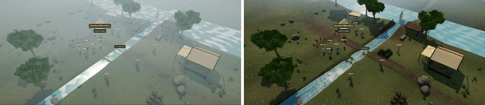
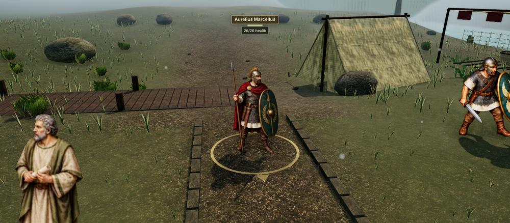
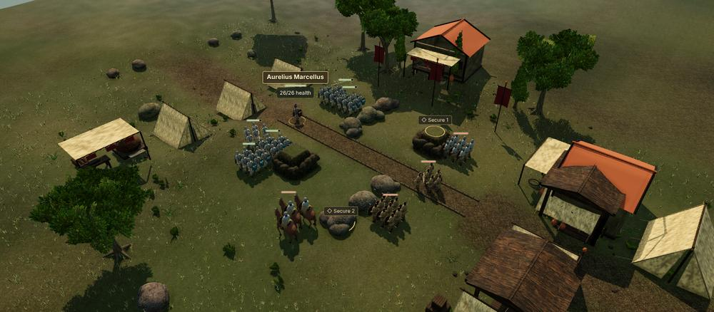
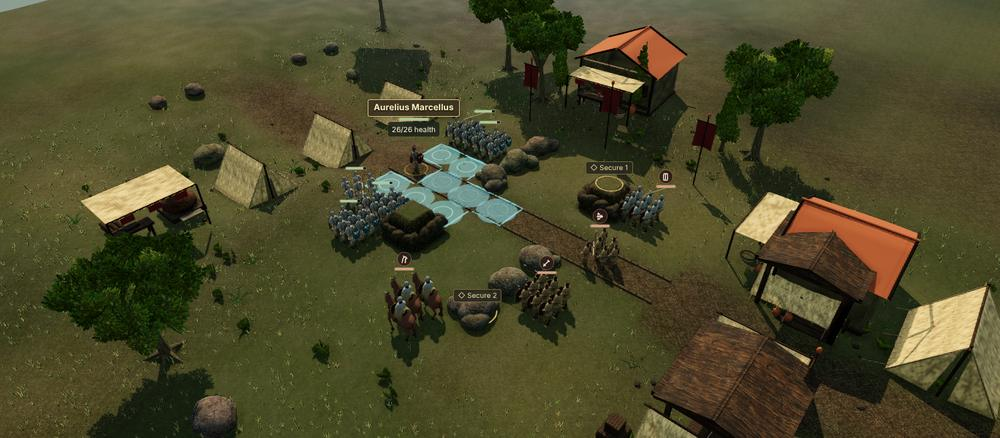
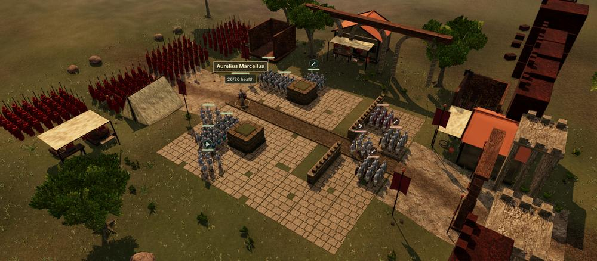
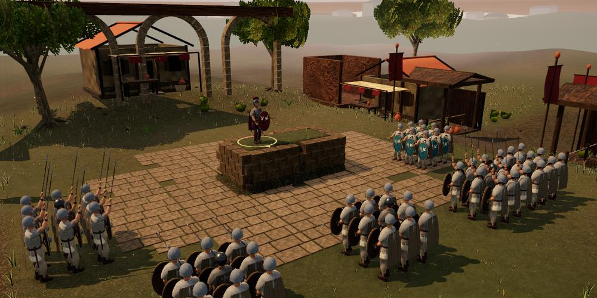
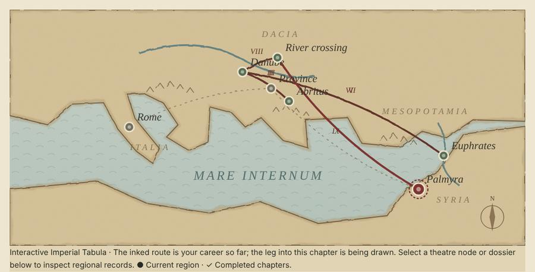

# Graphics verification — 0.29.0

This records what was checked for the 0.29 graphics overhaul and how. It does not claim frame rates, real-device behaviour, other browsers or human playtesting; those were not done.

## Automated checks

- `npm run verify` passed: 640 Node tests, the legal-command campaign autoplay (New Game to Augustus), the production build and the asset/offline checks.
- Chapter I is 7,237,302 bytes compressed of its 8,000,000-byte budget; the first load and the complete-campaign budgets also pass.
- `tests/v029-upgrades.test.mjs` covers each new system. Among other things it checks:
  - plateau, channel and ford heights;
  - roads never climb a bank;
  - batching folds parts without moving a vertex;
  - the panorama wraps without a seam;
  - water shader terms;
  - painted-facing selection against the 2D convention;
  - card orientation, sun-facing shadow and paint-only picking;
  - figure-style swaps leave the encounter untouched;
  - compositor finishes are clamped;
  - formation slots stay inside the tile and are deterministic;
  - crowd rendering shares the leader's buffers and skeleton;
  - compact labels and bloc trims;
  - stance postures;
  - ink reach and threat cells;
  - the finale layout stays off the board and within the draw budget;
  - action-camera framing;
  - the division plan agrees with the rules' vote count;
  - ceremony scenes and their controller fallback;
  - the painted Tabula keeps its theatre-node contract.
- Existing environment, stage, batching, horizon and foliage tests still pass. Their draw-object (under 60) and triangle (under 650,000) budgets hold for every fixture scene. The two High-ground assertions now use the exported `HIGH_GROUND_HEIGHT` instead of the old 0.45 m.

## Injected and synthetic scenarios

These are labelled because they are not ordinary play:

- The division (*discessio*) unit test sets a Chapter XI fixture encounter's status to `won` to exercise the staging. In play the rules set that status at the vote deadline.
- The ceremony tableaux are synthetic boards the rules never see (`ceremony.js`). Their app mounting is checked through `ceremony-controller.js` with a stand-in stage, not by playing the campaign to the oath or the accession in a browser.
- The 3D harness's *Preview* option passes the hero's legal move targets (from `Game.getTargets`) or inspects the first enemy. It is read-only inspection, not a command.

## Software-rendered screenshots

Captured with headless Chromium using SwiftShader (software WebGL) at High quality from the development harnesses `tests/campaign-3d-browser.html` (legally reached checkpoints from `scripts/campaign-3d-fixtures.mjs`) and `tests/ceremony-browser.html`. They show composition and readability only; software rendering says nothing about speed, and colours and anti-aliasing will differ on real GPUs.

*Chapter VIII ferry crossing, the same overview before and after this release.*

*Painted (HD-2D) figure style: the 2D campaign's own unit paintings standing in the 3D scene, each casting its silhouette.*

*Formations from Chapter IV, with compact role glyphs above the rank and file.*

*Move reach inked on the ground, from the targets the rules returned.*

*Chapter XII: the commander's legions drawn up off the board; the brick curtain rises beyond the gate.*

*The accession tableau (synthetic board, presentation only).*

*The painted Tabula, rendered statically after its draw animation.*

Other scenes were also inspected this way during development:

- Chapters I, II, V, IX, X and XI;
- horizon views of the panorama;
- the ink-and-wash style;
- the enemy threat hatching;
- the Senate trims and postures;
- the oath tableau.

`scripts/visual-regression.mjs` can record per-machine baselines of these harness views for future comparison; no baseline is committed, because software renders differ between machines.

## Not checked

- Real GPUs and devices (desktop, iOS, Android), Safari and Firefox, frame rate, memory and battery. Painted cards, crowd rendering and the tilt-shift and ink finishes in particular need real-hardware timing.
- Screen-reader and keyboard review of the new settings (*3D figure style*, *Action camera*) and of the compact labels. The text panels that carry unit information for assistive technology are unchanged.
- The division, the action camera and the 3D ceremonies inside a full browser playthrough. They are covered by unit tests and harness screenshots only.
- Every unit type and action in the painted style. Units without authored animation frames use their static painted column.
- Human playtesting of readability and of the 90–150 minute campaign target.

## Known limitations

- Tilt-shift and ink finishes are absent on Performance quality, which renders without the compositor.
- Followers in sculpted formations always use the overview level of detail, so close up they are simpler than their leader.
- The panorama is painted in code rather than commissioned art, and the geometry remains code-built. The authored Blender/KTX2 asset kit and the WebGPU renderer were not attempted in this release.
