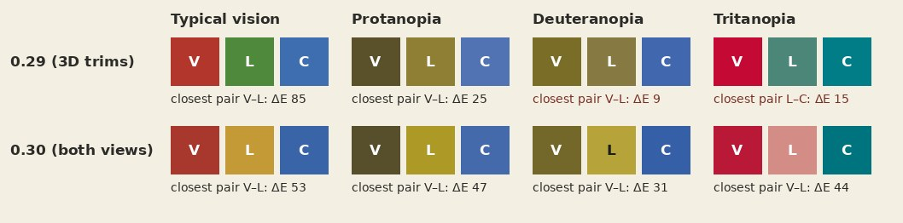
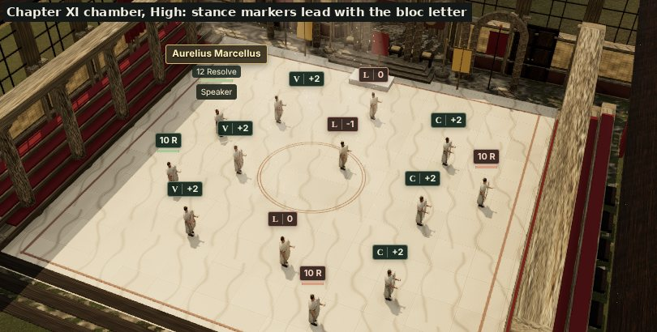
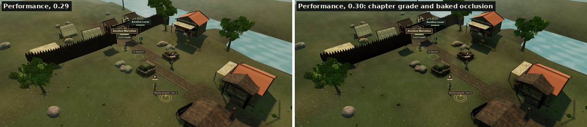
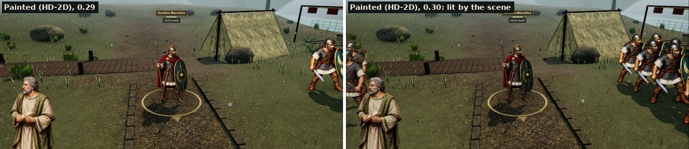
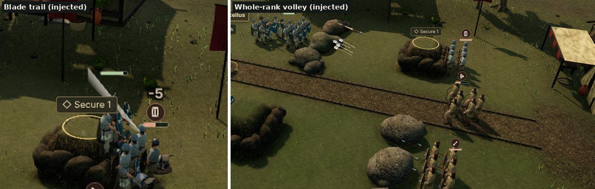
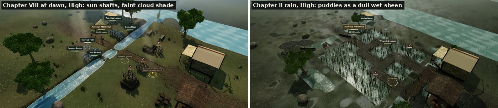
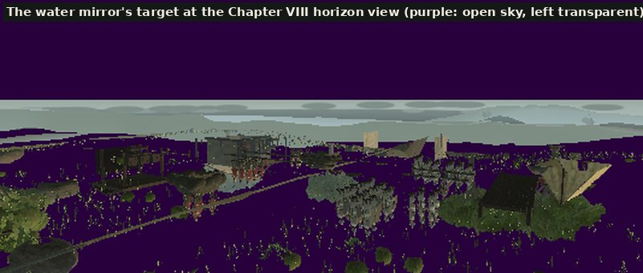
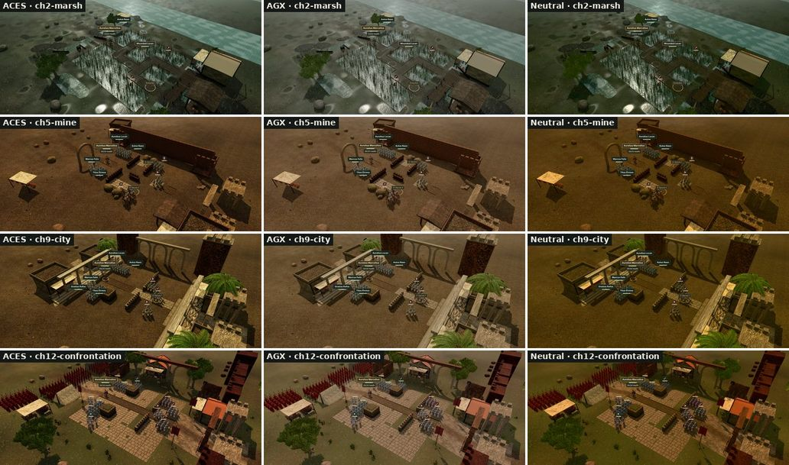
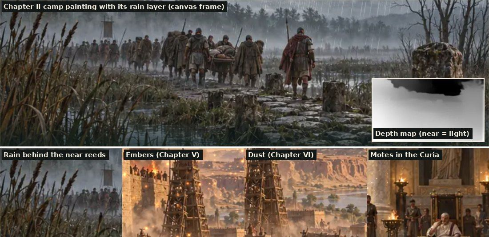

# Graphics verification — 0.30.0

This records what was checked for the 0.30 graphics refinement and how. It does not claim frame rates, real-device behaviour, other browsers or human playtesting; those were not done.

## Automated checks

- `npm run verify` passed: 657 Node tests, the legal-command campaign autoplay (New Game to Augustus), the production build and the asset/offline checks.
- Chapter I is 7,278,795 bytes compressed of its 8,000,000-byte budget (0.29: 7,237,302); the first-load (443,165 of 2,000,000) and complete-campaign (10,756,848 of 24,000,000) budgets also pass.
- `tests/v030-upgrades.test.mjs` covers each new system. Among other things it checks:
  - every pair of delegate blocs stays apart under simulated protanopia, deuteranopia and tritanopia (Machado, Oliveira and Fernandes 2009), the 2D board and the 3D trims draw the same colours and letters, and trims differ in shape;
  - the grade written into tone mapping uses the finishing pass's terms and clamps and costs one direct render with no extra pass, and a partial grade update keeps the fields it does not name;
  - baked occlusion is deterministic, darkens beside standing scenery and is sampled by every environment surface on every tier;
  - followers read fixed, staggered pose banks and never all move in unison;
  - the fallen lie low, spent shafts stand clear of their mark, the caps hold and the setting hides them; ground marks follow the timeline's clock;
  - painted cards are lit and puppeted, and reduced motion holds the idle terms;
  - trails, volleys, dust, the held beat (bounded per motion) and the camera jolt (only with the action camera, never with reduced motion);
  - cloud strength by weather and setting, a deterministic field that drifts, and cloud shade on ground, scenery and figure surfaces;
  - sun-shaft counts by tier and placement, motes held under reduced motion, the mirror camera's reflected eye and oblique plane, what the mirror hides and restores, the water shader reading the mirror by alpha, and the wet-ground highlight caps;
  - story paintings: a depth map for each of the eight paintings with the painting's own shape, the chapter groups that carry them (Chapter IX's promotion painting included), weather by place and chapter, the `object-fit: cover` window, the CSS arrival curve, motion with no jump over two minutes sampled at 30 fps and within small bounds, and the controller: no canvas on Performance or with reduced motion, about 30 or 60 draws a second, the same canvas and clock across re-renders, pausing when hidden or scrolled away, and the still painting after a failed load, shader, lost context or missing WebGL, without touching `Math.random`.
- The eight depth maps regenerate byte for byte from `scripts/scene-depth.py` with the recorded model and tool versions. `scripts/verify-assets.mjs` checks their manifest sizes and hashes like every other asset.
- The atmosphere and story-painting commits were each also tested on their own tree (the v0.30 tests plus the related environment, asset and actor suites).
- Correction: the message of the commit that moved the grade into tone mapping says AgX and Neutral were compared with ACES. At that point only AgX had been. Neutral was compared afterwards for this record, with that commit's code and the same four High views (Chapters II, V, IX and XII; figure below). Under AgX the chapter grades read flatter; under Neutral they read darker in the mid-tones and over-saturated in the warm scenes. ACES stays.

## Real interface (scripted browser, software GPU)

A scripted headless Chromium session (SwiftShader) ran the actual app from the development server: New Game, then the Chapter I camp. The camp mural's canvas appeared (decorative, `aria-hidden`, no pointer events; the `` with its text alternative stayed in place) and remained the same element across three story re-renders. Choosing Performance removed it and High restored it; turning on Reduced motion removed it and turning it off restored it. The first run of this check found that the Reduced motion switch left the canvas running; that was fixed before release (`mountPainting()` now runs on that switch and on quality changes). The only console error was the development server's missing `sw.js`, which exists only in the build. Two further browser checks used the 3D harness: the stage reported the water mirror active on High at the Chapter VIII crossing (17 mirror renders into a 534 × 227 target, float colour targets available), and reading that target back found mirrored scenery in 35% of its texels with the open sky left transparent. This was a scripted check, not a human playthrough, and software rendering says nothing about smoothness.

## Found and fixed during verification

- **Rain puddles.** The first 0.30 commits capped wet-ground highlights and the release notes said white discs were gone, but a High-quality capture of Chapter II still showed them. Isolating the shading terms in the browser (turning the sun, rain particles, sky reflection and finishing pass on and off, then rendering each lighting term alone) showed the discs were puddle highlights that stayed within the cap, but the cap (0.12 + 0.3 in linear light) still left them four to five times brighter on screen than the dark marsh ground. The caps are now 0.05 and 0.07, and the same view shows a dull wet sheen (above). Only Chapter II has wet ground.
- **Reduced motion and the story paintings.** Described above under the real-interface check.

## Injected and synthetic scenarios

These are labelled because they are not ordinary play:

- The combat and remains screenshots replay hand-made before/after encounter states on the 3D harness's in-memory stage through its read-only `globalThis.__campaign3d` handle, slowed or frozen at timeline moments. The rules did not produce those exact states, and no save is read or written.
- Unit tests that thin a formation, lay out the fallen or hold a blow use synthetic stage inputs.
- `tests/scene-parallax-browser.html` shows any painting with any chapter's weather on a manual clock; it is development-only and outside the build.

## Software-rendered screenshots

Captured with headless Chromium using SwiftShader (software WebGL) from the development harnesses `tests/campaign-3d-browser.html` (legally reached checkpoints from `scripts/campaign-3d-fixtures.mjs`) and `tests/scene-parallax-browser.html`, except the palette figure, which is computed. They show composition and readability only; colours and anti-aliasing will differ on real GPUs.

*Delegate bloc colours under simulated colour-vision deficiency. In 0.29 the 3D Veterans and Landholders trims fell within ΔE 9 of each other under deuteranopia; in 0.30 the closest pair stays at ΔE 31 or more, and the letter and trim shape carry the bloc as well.*

*Chapter XI chamber at High: each stance marker leads with its bloc's letter (V, L, C) before the stance.*

*Performance quality, the same Chapter I view in 0.29 and 0.30: the chapter grade now applies without the finishing pass, and the ground darkens beside the palisade, tents and rocks.*

*Painted (HD-2D) figures, the same Chapter VIII view in 0.29 (the image from that release's record) and 0.30, now lit by the scene.*

*Injected, presentation-only replays: a blade trail at the blow, and an archer rank loosing with its leader.*

*Weather on the light at High: sun shafts slanting across the Chapter VIII crossing at dawn, and Chapter II's rain-soaked ground, whose puddles now hold a dull sheen.*

*What the water mirror holds, read back from its half-resolution target in the software-rendered browser at the Chapter VIII horizon view: the formations, banks, buildings and far panorama, mirrored. Open sky is left transparent (purple here) so the water keeps its own sky reflection. On screen the mirror is subtle by design (a Fresnel-weighted, capped share of the water's highlight), which is why the read-back, not a screenshot, is the evidence that it renders.*

*Tone mapping at High in Chapters II, V, IX and XII: ACES (kept), AgX and Neutral, each with the chapter grades tuned for ACES. Rendered from the commit that moved the grade into tone mapping, so the Chapter II puddles predate their fix.*

*Story paintings, frames from the development harness on its manual clock: the Chapter II camp painting with its rain layer and depth map (inset), then rain behind the near reeds, embers over the burning fort, dust, and motes in the Curia's light.*

Other views were also inspected this way during development: baked occlusion in Chapters I, IV, IX and XI; formation and fallen layouts in Chapter VII; the Chapter VIII crossing and ferry; and all eight story paintings, each with the weather of a chapter that shows it.

## Not checked

- Real GPUs and devices (desktop, iOS, Android), Safari and Firefox, frame time, memory and battery. The new costs that most need real-hardware timing are the water mirror (a second scene render at half resolution on High), the story-painting canvas (a full-screen shader at up to twice the CSS resolution), cloud shade on every lit surface, the formation pose history and the one-off bakes (occlusion, fallen figures).
- Screen-reader and keyboard review of the new **Battle remains** setting.
- The 2.5D paintings in motion at real frame rates; they were inspected as single frames and through the scripted interface run above.
- The fallen, volleys and trails inside a full browser playthrough; they are covered by unit tests and injected harness scenarios only.
- Human playtesting of readability and of the 90–150 minute campaign target.

## Known limitations

- Not attempted: the authored, artist-made prop kit (it needs an artist) and the WebGPU renderer (still deferred). Code-built props remain.
- The water mirror runs only on High, with float colour targets and on the board's own water; distant water keeps its sky reflection. Sun shafts are lit geometry, not volumetric light, so they do not respond to occluders. Cloud shadows dim the direct light only and do not move the shadow map.
- The depth maps are monocular estimates at 256 × 256: thin objects such as spears and standards blur into their background and the sky is flat, so the drift is kept small. The weather layers are procedural, not painted.
- Fallen figures are baked from the overview figure, so close up they are simpler than the living.
