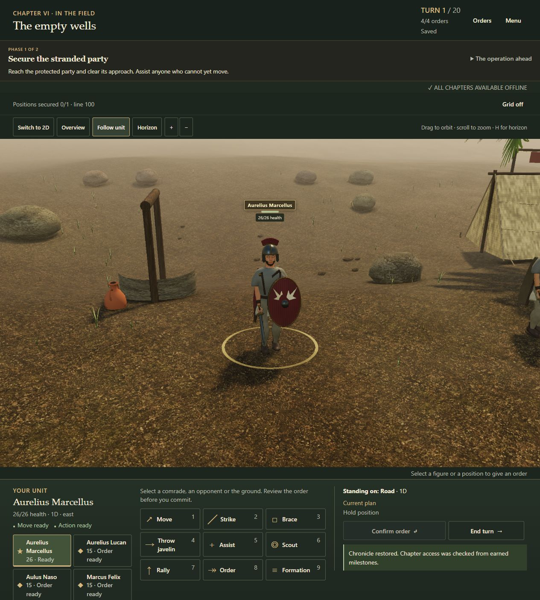

# Version 0.18 release validation

Version **0.18.0**, production revision **`a0dbf383f33b`**, improves character anatomy, clothing, surface response and hair. Completed evidence is summarized in [presentation-verification-v018.json](presentation-verification-v018.json), including exact hashes of the raw local reports. Verification and limitations are separated below; archive validation and publication are separate delivery steps.

The image above is an actual ordinary-interface capture of the final revision after restoring the legally reached Chapter VI save, not a separate character mockup.

## What changed

Male and female imported anatomy now use fitted complexion maps with their original UV coordinates. A separate female GLB supplies Aelia's exposed anatomy. The imports cover exposed regions, while the project's clothing, equipment, limbs and horses remain authored procedural geometry. Both imported neck crop boundaries fit inside the garment collar; helmet openings and the continuous crest fit the head. Eyes retain their physical material after batching.

Tunic and armor bodies share indexed seams with their sleeves. Their weighted shells have shaped folds, turned neck/cuff edges and thicker armor outlines. Hands have shaped palms, fingers, opposing thumbs and nail detail; boots distinguish heel, instep, toe box and sole. Dedicated overview meshes reduce this geometry while preserving contact frames. Original periodic normal and roughness fields distinguish cloth, leather, mail, scale and metal. The final mail adjustment reduces metalness and increases roughness to moderate close-up highlights.

One locally bundled MakeHuman CC0 short-hair mesh and cutout texture serve eligible male figures. It is one shared hairstyle with identity fitting and tinting, not a separately authored groom for every character. Female bound hair retains project geometry. Pending actor construction holds explicit complexion ownership, and disposal releases it even before loading finishes; late completion cannot revive the abandoned map. See [character surface provenance](../character-surfaces-v018.md) and the [asset manifest](../asset-manifest.json) for sources, hashes, conversions and rights limitations.

## Automated verification

| Check | Completed result | Scope |
| --- | --- | --- |
| Full Node regression | **562 passed**, 0 failed/skipped/cancelled; 55,964.2689 ms | Full checkpoint before the final female/beard, helmet/crest and mail polish. |
| Final actor regression | **78 passed**, 0 failed/skipped/cancelled; 15,619.7197 ms | After final geometry, fitting and ownership edits; before the final mail scalar adjustment. |
| Final material regression | **6 passed**, 0 failed/skipped/cancelled; 927.4157 ms | After the final mail adjustment. |
| Final asset/worker verification | **13 passed** | Manifest hashes, budgets, chapter groups and simulated service-worker failure/retry protocols. |
| Legal campaign autoplay | **25 wins**, all 12 chapters, **217 turns**, Augustus; seed 275 | New Game followed only by legal gameplay commands. |
| Frozen compatibility routes | **1,041 v0.14.1 commands** and **1,079 v0.16 commands**, each with 25 exact retries | Included in the full suite, with exact save/reload and legacy rules behavior. |

The full suite also exercises both new-progression careers, all 22 operation alternatives, three earned veteran actions and six agreements. Those mechanics were introduced earlier; this release changes their presentation.

New tests inspect connected garment topology and real blended seam vertices, preserved material tint, finite and outward normals, eye material response after batching, deterministic grooming, graphics-quality limits and resource disposal. Neck checks include both original crop rims and **240 ray samples** around the fitted circumference at neutral-pose heights 1.400–1.440 m. They do not establish every extreme animated neck deformation. Pending-load tests cover abandoned actors, simultaneous owners, ownership transfer and fallback/retry.

## Protected gameplay and saves

An exact SHA-256 and byte comparison against the frozen v0.17 source found **all 26 protected files unchanged**: 14 files in `src/core/`, nine in `src/data/`, plus `src/ui/storage.js`, `src/ui/session-gate.js` and `src/showcase/session.js`. Both directory inventories match as well. The core comparison includes serialization, deserialization, retry and campaign rules. The configured save key remains **`sacramentum.campaign.v1`**; the historical identifier is deliberately retained for compatibility. Every file's before/after hash is in the compact record.

## Actual browser and interface checks

The production renderer was exercised in desktop Chromium 154 on Windows using legally reached encounter checkpoints. **All 25 scenes passed 518 assertions**. Three additional cases—Chapter IX cavalry, Chapter II marsh and a narrow Chapter XII legitimacy chamber—passed **63 further assertions**. The targeted raw report includes the original 25 rows plus those three; its cumulative 581 assertions are not counted as another independent full sweep.

The browser viewport was 1280 × 720 with device pixel ratio 2. The ordinary test canvas was 1233 × 468; the added narrow chamber used a **360 × 420 canvas within that desktop viewport**. Checks cover actual WebGL rendering, weighted actors, authoritative anchors, labels and picking. These reports precede only the final mail metalness/roughness scalar adjustment, which was subsequently inspected in the ordinary production interface. These are renderer checks, not human ratings of realism, FPS improvements or a phone performance guarantee.

Separately, the final production revision on a clean local origin restored a legally reached Chapter VI save through the ordinary save dialog and entered the field. After the explicit all-chapter download reported completion, the owned preview server was stopped. Reload and Continue restored `ch6-wells` through the service worker. The normal Copy Save dialog produced a portable code **byte-identical to the original: 4,609 bytes**, independently checked and hashed in the compact record. This verifies server-unavailable continuation on **`a0dbf383f33b`**; it does not claim every chapter was played offline, device network disablement, real-device installation, quota eviction or update recovery.

## Final build and loading

| Compressed package scope | Measured gzip bytes | Gate |
| --- | ---: | ---: |
| Initial shell | **398,221** | 2,000,000 |
| Chapter I and shared dependencies | **7,994,830** | 8,000,000 |
| Complete opt-in package | **11,802,569** | 24,000,000 |

The build contains **215 runtime files**, divided into 79 initial and 136 deferred files. The complete raw size is 14,676,900 bytes. Measurements sum per-file gzip output, including the worker; they are not a browser network trace. Chapter I has only **5,170 bytes of compressed headroom** under its unchanged gate.

Male anatomy, complexion and eligible short hair belong to each chapter's shared dependencies. Female anatomy and complexion remain deferred until Chapter VIII. Neither enters the initial shell. The complete opt-in package retains historical artwork required by its inventory; active chapter groups omit superseded resources.

## Remaining limits

There has been no physical-phone GPU, RAM, thermal or battery assessment, human screen-reader test or recruited independent playtest for this release. The 90–150 minute target, enjoyment and perceived character identity still require human evaluation. Close-up surface quality and repeated faces remain artistic limits. Overview deliberately substitutes simpler geometry, and animation remains authored joint motion with procedural corrections rather than motion capture. Licensed source provenance is documented without claiming exclusivity or a legal guarantee.
