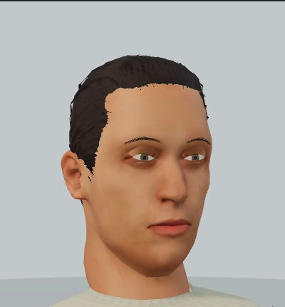

# Version 0.19 release validation

Version **0.19.0**, production revision **`650e10882696`**, refines faces and hair in the shared campaign and skirmish actor renderer.

This is a cropped capture of the actual production actor in the development inspection scene. It is not separate concept art or a battlefield screenshot.

## Changes

Fitted almond openings and clipped irises replace the prominent round eye surfaces. Upper eyelids blend between the moving lid and fixed head, keeping the corners and outer rim anchored. Their UVs sample the existing skin texture. Fine tapered brow hairs follow the face instead of raised tubes. Skin normalization leaves more highlight headroom and preserves local contrast. Age affects cheek hollows and facial folds by less than three millimetres.

Fuller moustaches join the beard coverage; beard and procedural scalp edges feather into the skin using bounded vertex alpha and opaque-pass alpha hashing. Imported short hair retains finer cutout strands. These edges may show grain at extreme close distances. Existing anatomy, runtime texture bytes and licenses are unchanged; see [v0.18 provenance](../character-surfaces-v018.md).

Facial fitting uses a local XY triangle index. An exhaustive comparison at **800 male/female sample coordinates** confirms identical frontmost depth and UV results, including missing-surface fallback. This reduces repeated triangle scans during character construction; it is not an FPS or physical-device performance claim.

## Verification

- **569 full Node tests passed**, with no failures, skips or cancellations after the final runtime edit. Seven new tests cover fitted apertures, forward winding, actual skinned blink vertices, fixed corners, UV alignment, age isolation, feathered boundaries and indexed lookup equivalence.
- **13 asset/service-worker checks passed**; manifests, budgets, chapter groups and cache failure/retry behavior remain valid.
- Legal autoplay completed **all 25 encounters across 12 chapters**, in **217 turns**, ending at Augustus. Gameplay and save files are byte-identical to v0.18.
- Desktop Chromium rendered **25 campaign scenes / 518 passing assertions**. The sweep precedes only the exact-output lookup optimization; **3 final targeted scenes / 63 assertions** cover the final source. The browser checks use legally reached checkpoints, preserve complete saves, and exercise labels, anchors, reduced motion, cancellation and cleanup. They are not a complete manual campaign playthrough.
- Actual close-up inspection covered the recruit, a Persian guard, Aelia and Paullus, including closed eyelids and older hair. The development inspector now has an explicit closed-eyelid control.

The final production build on a clean local origin restored Chapter VI through the ordinary save dialog. After the all-chapters download, the preview server was stopped; reload and Continue rendered the field offline. Exporting the save through the normal interface produced the exact original **4,609-byte** code. The server was restarted for the delivered preview.

Exact report hashes and scopes are in [presentation-verification-v019.json](presentation-verification-v019.json).

## Build

The static build contains **216 content files**, plus the service worker and build report. Summed per-file gzip estimates including the worker are **398,238 B initial**, **7,997,686 B through Chapter I**, and **11,805,425 B complete**. All unchanged 2/8/24 MB gates pass. Chapter I retains only **2,314 B** of headroom. No new runtime image or model downloads were added.

The figures remain stylized and share the existing source anatomy and hairstyle families. Physical-phone GPU, thermal, memory and battery behavior, and independent human playtests remain unverified.
