# Artwork generation and export record

The current Roman figure replacement is documented in [the 0.31 character generation record](art-generation-v031.md), including both exact prompts, measured row normalization and the distinction between bitmap frames and procedural action coverage.

> Archived v0.2/v0.3 library record. The current v0.4 replacements, expression variants, accession scene and specialist atlas are documented in [graphics-narrative-art.md](graphics-narrative-art.md). The sizes and commands below describe the earlier assets.

Later texture records: [v0.15 character materials and audio](presentation-assets-v015.md), and [v0.16 foliage and optimized character materials](presentation-assets-v016.md). The v0.16 foliage prompt is explicitly recorded as a retained summary, not an exact quotation.

The authorised aesthetic update combines cinematic illustration, restored-fresco pigment and quiet procedural gameplay graphics. The former code-only restriction has been superseded by the new brief. These are original AI-generated game illustrations, not archaeological reconstructions or copied museum imagery.

## Library and continuity

The runtime library contains 21 local WebP images: seven protagonist career stages, seven other recurring characters, one title composition and six environment murals. Fourteen portraits total **327,692 bytes**, the title **296,498 bytes**, and six scenes **391,300 bytes**: **1,015,490 bytes of artwork**. Per-file provenance, original dimensions, crop coordinates, export settings, hashes and intended use are in [asset-manifest.json](asset-manifest.json).

The main portrait atlas was requested at 2048 × 1536 but the built-in tool delivered **1448 × 1086**, with **4 columns and 3 rows** of 362-pixel square cells. A one-pixel inset produced twelve **360 × 360** exports. The supplementary Paullus/Sabinus sheet delivered **1774 × 887**, two equal square cells; its crops were downscaled to 360 × 360. The title delivered and retains **1536 × 1024**. The scene sheet delivered **1536 × 1024**, **2 columns and 3 rows**; row-major crops export at **720 × 319 or 320**.

The same dark curls, olive complexion, brow, nose and lean jaw identify the hero. Stubble, beard, greying and clothing communicate progression; governor and senator use civilian drapery. The cheek wound in the centurion portrait is an earlier scar, represented less distinctly years later rather than a different identity. Purple and a laurel wreath occur only in the emperor portrait. Varro, Lucan, Crispus, Severianus, Aelia, Paullus and Sabinus have distinct faces and dress. The supplementary sheet used the main generated atlas as its style reference.

All atlas cells were visually reviewed; the optimized recruit and emperor exports were also inspected at their final size. No visible cell borders, labels, clipped heads or watermarks remain. The environment images are fictional compositions, with architecture and logistics simplified for a chapter mural. They do not claim to reproduce a named fortress or a precise view of ancient Rome.

## Shared reusable specification

Use painted historical-chronicle realism with subtle fresco pigment, expressive but restrained faces, warm directional light, olive and earth shadows, warm ivory, Pompeian red, weathered bronze and quiet plaster. Avoid excessive gold, glossy fantasy armour, giant crests, lorica segmentata as a universal uniform, modern objects, tiny baked-in writing and decorative noise behind interface text. Keep all labels in the DOM. Use richer purple only when earned.

The military clothing and shield direction follows the existing [historical notes](historical-research.md): mail or scale, long-sleeved tunics as the portrait default, oval painted shields as a visual convention, and the third-century spatha. Those notes explicitly retain rectangular-shield evidence and describe the pendant as a deliberate reconstruction. Civic garment folds, stripe widths, fasteners and ceremonial details are stylized for status readability, not claims of an exact reconstructed uniform.

## Local export

Generation used the **built-in image_gen tool**, not an API CLI or a paid subscription. No third-party art was supplied. The supplementary cast sheet referenced only the project's first generated atlas. No runtime request reaches a generation service.

Pillow is used only during development for the explicitly authorised crop, downscale and WebP optimisation. The original generated PNGs remain in the local working art directory and the tool's original output locations; they are not shipped in the browser bundle. The optimized copies live in `assets/`.

From the project root, with Python and Pillow available:

```sh
python scripts/optimize-assets.py portraits --input /path/cast-atlas-original.png
python scripts/optimize-assets.py portraits-extra --input /path/cast-extra-original.png
python scripts/optimize-assets.py title --input /path/frontier-oath-original.png
python scripts/optimize-assets.py scenes --input /path/scenes-atlas-original.png
npm run build
node scripts/verify-assets.mjs
```

The default WebP export uses quality **86**, method **6**, RGB and Lanczos downscaling. Portrait export never enlarges a source crop. These commands regenerate the intended project paths and manifest; an atlas must be visually checked for the declared grid before export. The script does not repair arbitrary grid layouts.

The manifest does not assert exclusive copyright or invent an ownership declaration. Historical-source links are references, not licenses to redistribute their photographs. No fonts or recorded audio are added by this pipeline.

## Loading and build checks

The service worker installs the application shell plus title, recruit and Varro art. Other portraits and scene murals are outside the install list. The application sends `cache-campaign` after its initial display/idle opportunity; the worker reports `offline-progress`, caches missing files, and emits `offline-ready` only when every versioned asset is present. A failed download remains partial and may be retried. Cache lookups use the active worker's own revision, so an older image cannot satisfy a newer build. Waiting updates do not call `skipWaiting`.

The build separately reports initial and complete raw/gzip file sums, including the generated worker in those two figures. Both retain the existing **2,000,000-byte compressed gate**. File sums are reproducible size estimates, not actual browser transfer or hardware-timing measurements. The original `bytes`/`gzipBytes` fields continue to count runtime files excluding the generated worker for comparison with the earlier build.

The asset verification command checks manifest byte counts and hashes, portrait/title budgets, deferred installation, truthful partial status, version-scoped lookup, failure without false readiness, retry to completion, cached navigation with an unavailable server, and update activation without forced takeover. These are Node mocks, separate from the browser and real-device checks in the overall verification report.

## Exact main portrait generation prompt

```text
Use case: historical-scene. Asset type: one coherent portrait atlas for the existing SACRAMENTUM Roman historical browser game. Create a high-quality 2048 by 1536 landscape image consisting of EXACTLY 12 individual chest-up bust portraits in a perfectly regular 4-column by 3-row grid of equal 512 by 512 square cells. No gaps, no text or labels, no decorative outer border: each portrait fills its own square cell against the same quiet muted olive-plaster background, with the head completely contained and ample breathing room. Each is a finely painted military chronicle portrait: expressive faces, cinematic realism interpreted through restored Roman fresco pigment, restrained brushwork and subtle plaster, never photorealistic glamour, cartoons or fantasy. All faces at the same scale, chest-up, upright, subtly three-quarter turn, looking toward viewer, warm directional light from upper left, unified Pompeian red, warm ivory, bronze, olive, charcoal and earth palette.

The seven consecutive first portraits are the SAME male protagonist aging naturally: olive complexion, dark short wavy hair, lean square jaw, broad cheekbones, distinct slightly broken bridge of nose, brown eyes, characteristic calm alert gaze. Preserve recognizable facial identity. Distinct clothing stages:
Row 1 column 1: protagonist recruit age 20, youthful clean-shaven, plain worn ivory long-sleeved tunic, small simple lead seal pendant, NO armour and NO crown.
Row 1 column 2: SAME protagonist miles age 25, short stubble, practical iron mail over long-sleeved tunic, worn muted red cloak shoulder, NO crown.
Row 1 column 3: SAME protagonist centurion age 30, slightly weathered, thin small healed cheek scar, mail, red cloak with simple bronze brooch, NO crown and NO giant helmet crest.
Row 1 column 4: SAME protagonist prefect age 36, mature short beard, recognizable broken nose, mail and slightly finer red command cloak, NO crown.
Row 2 column 1: SAME protagonist governor age 43, salt beginning at temples, short neat beard, dignified plain cream civilian draped garment with narrow wine-red stripe, no armour and NO crown.
Row 2 column 2: SAME protagonist senator age 45, the same face aged only two more years, formal warm ivory toga with broad dark red senatorial stripe, no armour and NO crown.
Row 2 column 3: SAME protagonist emperor age 45, the EXACT SAME age and face as the adjacent senator, deep restrained imperial purple draped mantle, small laurel wreath, no giant jewelled crown. The ONLY portrait with any laurel.
Row 2 column 4: mentor Varro age 55, clearly DIFFERENT man, stocky face and wide nose, thinning cropped grey hair, close grey beard, old weathered veteran in mail and faded red cloak, gentle stern expression, NO crown.
Row 3 column 1: comrade Lucan age 30, clearly DIFFERENT man, lighter warm complexion, curly brown hair, rounder open face, short beard, worn mail and muted ochre scarf, steadfast friendly expression, NO crown.
Row 3 column 2: rival Crispus age 35, clearly DIFFERENT man, pale olive complexion, narrow elegant face, straight aquiline nose, neat dark cropped hair, clean shaven, costly but restrained deep red cloak over mail, composed challenging expression, NO crown.
Row 3 column 3: patron Severianus age 55, clearly DIFFERENT man, fuller face, receding grey curls, clean-shaven, ivory civic drapery with muted bronze brooch, observant guarded expression, NO crown.
Row 3 column 4: provincial ally Aelia age 35, an adult Roman provincial woman with dark hair pinned simply back, strong attentive brown eyes, ivory stola and muted terracotta mantle, thoughtful confident expression, NO crown.

Historical constraints: Roman empire around AD 250–275, long-sleeved tunics with mail for soldiers, restrained bronze fasteners, civilian drapery. No lorica segmentata or fantasy armour, no medieval plate, no modern uniforms, no giant plumed helmets, no weapons across faces, no text, letters, numerals, writing, watermark, logo or panel labels. Seven protagonist stages must be visibly the same person. The five cast portraits must be clearly distinct people. Keep every head and shoulders safely inside its own identical square cell for precise automated cropping.
```

## Exact supplementary portrait generation prompt

```text
Use case: historical-scene. The attached twelve-portrait atlas is a STYLE REFERENCE, not an image to duplicate. Create a new matching two-person companion portrait sheet for SACRAMENTUM. EXACTLY TWO equal SQUARE cells in ONE ROW, overall landscape 2:1 aspect ratio, no margin or gap between the cells, no labels or writing. Match the reference's painted military chronicle realism, warm upper-left light, quiet olive plaster, pigment texture, chest-up scale, subtle three-quarter turn and unified Roman third-century material palette. Both heads must fit fully inside their own cells with safe space above hair.

LEFT CELL: fictional elder senator Lucius Cassius Paullus, Roman man around 70, clean-shaven, short white hair with receding temples, long narrow lined face and prominent cheekbones, intelligent reserved eyes, dignified solemn expression; warm ivory toga with a broad deep Pompeian red senatorial stripe, no armour, no laurel, no crown. His face must clearly differ from the broad, full-faced patron Severianus on the third row third column of reference.

RIGHT CELL: fictional replacement officer Sabinus, middle-aged Danube soldier around 40, broad sturdy face, dark tightly curly cropped hair, thick short curly beard, warm olive complexion, alert dependable expression; practical iron mail over a long-sleeved tunic, worn muted OLIVE GREEN cloak with simple bronze fastener, no laurel or crown. His face must differ from the protagonist, Lucan and Varro of the reference.

Roman empire AD 250–275, no lorica segmentata, no medieval plate or fantasy armour, no modern elements, no weapon across a face, no border, no text, no watermark. Keep both cells stylistically seamless with the reference atlas.
```

## Title and scene generation

The title and six-scene sheet use the same painted-chronicle palette and historical exclusions. Their original-source SHA-256 hashes and export bounds are recorded in the manifest. The following reusable instructions record the intended composition; generated pixels are not archaeological reconstructions.

**Title reproduction instructions.** Original historical scene, cinematic painted military chronicle with restrained restored-fresco grain, landscape 1536×1024. A young twenty-year-old recruit, short dark wavy hair, olive complexion, lean square jaw and uneven nose, in three-quarter back view in the right third. Worn ivory long-sleeved wool tunic, brown trousers, practical belt, muted russet cloak and large oval oxblood shield with restrained bronze details. Danube frontier around AD250: a timber gate and stone fort, marching column, river, misted hills and distant eagle standard at amber dusk. Leave generous quiet dark space on the left. Charcoal, forest olive, ivory, Pompeian red, weathered bronze and antique gold. No lettering, logo, UI, frame, fantasy or medieval armour, lorica segmentata, rectangular shields, laurel, crown or oversaturation.

**Environment sheet reproduction instructions.** Six independent landscape illustrations, exactly two columns and three rows, 1536×1024, no gutters, labels or frames. Row1: Danube legionary camp at dawn; misty marsh retreat with reeds and worn crossing stones. Row2: arid eastern frontier fort evoking the Euphrates region; a river crossing with timber pontoons and a distant garrison. Row3: a provincial centre with tribunal, grain stores and displaced families; Rome with colonnades and Aurelian-era walls at sunset. Match the title's cinematic painted-chronicle realism, upper-left directional light, restrained pigment grain, warm olive/ivory/red palette and consistent human scale. No hero close-ups, no fantasy, medieval or Renaissance elements, no modern landmarks, no actual text or UI. Keep lower areas quiet enough for a separately rendered caption. Export each cell independently; no runtime atlas slicing.

## Tripo-generated Chapter V scenery (v0.36)

Five decorative props for a supply camp beside the Chapter V battlefield were generated with Tripo's text-to-model API (model `v2.5-20250123`, default settings: textured PBR, 20 credits each) on 2026-10-20, from text prompts only: no reference image or third-party model. The owner's paid Tripo account gives the owner full rights to use, modify, distribute and commercially exploit them; Tripo holds a royalty-free, non-exclusive licence to display them as needed to provide its service.

Each raw download (about 17 MB, roughly 500,000 triangles, three 2048 px maps) was processed in Blender 5.2.2 by `scripts/assets/process-model.py`: welded, decimated by one ratio to the triangle budget, scaled to the stated height, stood at the origin, textures shrunk and exported as WebP in one GLB. The raw files stay outside the repository; their SHA-256 digests, the Tripo task ids and the parameters Tripo reported are in each request file in `art-source/models/requests/`, and the processing reports are in `art-source/models/reports/`.

| Model | Tripo task | Triangles (raw → shipped) | Textures | Height | Shipped bytes (WebP → compressed) |
| --- | --- | ---: | --- | ---: | ---: |
| `ch5-spoil-baskets` | `e4a3180a-7bb9-438f-a9c2-15c716734d0a` | 501,886 → 2,939 | 512 px, WebP 72 | 0.6 m | 188,228 → 213,856 |
| `ch5-gallery-timbers` | `ad77a449-ea69-4c32-9ba6-60c45bb6812b` | 490,456 → 4,899 | 512 px, WebP 80 | 2.0 m | 271,412 → 266,160 |
| `ch5-mudbrick-stack` | `48f5ed9c-ccc5-4f6e-8322-ecd58b10e161` | 501,040 → 2,937 | 512 px, WebP 80 | 0.8 m | 173,144 → 187,856 |
| `ch5-storage-jars` | `a95f1fff-ae87-4967-a352-a6c803227789` | 501,572 → 3,919 | 512 px, WebP 80 | 1.1 m | 161,296 → 181,820 |
| `ch5-leather-tent` | `efad6e3f-58d8-4752-a888-b23213a51cf3` | 501,250 → 4,898 | 512 px, WebP 80 | 1.8 m | 230,672 → 231,056 |

Review notes: the jars came as four rather than three, without the requested rope sling or sand; the mudbrick stack reads as orange fired brick rather than pale sun-dried mud.

On 2026-10-22 the asset foundation compressed all five in place with `scripts/assets/compress.mjs`: KTX2 textures (Basis Universal 1.16.4, ETC1S at quality 128, with mipmaps) and meshopt geometry, every triangle unchanged. The manifest keeps each WebP version's bytes and digest; the reports in `art-source/models/reports/*-compress.json` give each texture's measured error ([compression](asset-pipeline.md#compression)).

### Exact prompts


**ch5-spoil-baskets**

```text
A cluster of three woven palm-fibre baskets heaped with excavated pale earth and broken mudbrick, spoil carried out of a siege mine. Mid-3rd-century Roman Euphrates frontier fortress during a siege, c. AD 256. Realistic, weathered, practical, earthy colours; a single object on bare ground. No people, no animals, no text or inscriptions, no modern objects or materials, no fantasy elements.
```
**ch5-gallery-timbers**

```text
A timber shoring frame at the mouth of a mine gallery: two rough-hewn upright posts and a lintel of unpainted split poplar and palm wood, packed earth around their feet. Mid-3rd-century Roman Euphrates frontier fortress during a siege, c. AD 256. Realistic, weathered, practical, earthy colours; a single object on bare ground. No people, no animals, no text or inscriptions, no modern objects or materials, no fantasy elements.
```
**ch5-mudbrick-stack**

```text
A neat stack of about forty sun-dried mudbricks with straw temper on a low earthen base, a few broken bricks beside it. Mid-3rd-century Roman Euphrates frontier fortress during a siege, c. AD 256. Realistic, weathered, practical, earthy colours; a single object on bare ground. No people, no animals, no text or inscriptions, no modern objects or materials, no fantasy elements.
```
**ch5-storage-jars**

```text
Three large terracotta storage jars, two standing and one cracked and lying on its side, half-sunk in sand, rope slings around one. Mid-3rd-century Roman Euphrates frontier fortress during a siege, c. AD 256. Realistic, weathered, practical, earthy colours; a single object on bare ground. No people, no animals, no text or inscriptions, no modern objects or materials, no fantasy elements.
```
**ch5-leather-tent**

```text
A Roman army eight-man tent of stitched goatskin leather panels over a wooden ridge pole, with guy ropes and wooden pegs, patched and dusty. Mid-3rd-century Roman Euphrates frontier fortress during a siege, c. AD 256. Realistic, weathered, practical, earthy colours; a single object on bare ground. No people, no animals, no text or inscriptions, no modern objects or materials, no fantasy elements.
```

## Character handoff GLBs (v0.35, development only)

`art-source/characters/` holds full-body, rigged glTF 2.0 exports of three Chapter V figures (Marcellus, Lucan and a Persian guard) for art review and editing in a DCC. No image or model generation was used. `scripts/build-character-handoff.mjs` builds each figure with the game's own character code (original garments, equipment, material fields, pore map and authored clips over the retained MakeHuman CC0 head/arm anatomy and skin texture) and `scripts/character-glb.mjs` writes it: one self-contained GLB per figure, metres with +Y up and +Z forward, skin joints, face morph targets, embedded PNG maps and sampled idle, walk, attack and block clips. Rights and provenance are recorded under `developmentAssets` in [asset-manifest.json](asset-manifest.json); per-file sizes and SHA-256 digests are in `art-source/characters/manifest.json`, which each export rewrites.

Since 0.37 the battle figures wear generated character bodies over the same rig; these exports show the code-built figure without one, which the game draws until a body loads or if it fails.

The files are excluded from the website build and offline download. Re-export with `npm run art:handoff` (Sharp required, not a project dependency); `npm run audit:handoff` says when the character code has changed since the last export. An export is repeatable on one machine, but a different Node.js or Sharp version can produce different bytes.

## Scene depth maps (v0.30)

The eight story paintings in `assets/scenes/` each have a greyscale depth map in `assets/scenes/depth/`, used only by the 2.5D drift and weather layers of `src/ui/scene-parallax.js`. Near is light and far is dark. The maps are never shown on their own and add no new imagery: each is a mechanical estimate from the project's own shipped painting.

They were made offline with `scripts/scene-depth.py` and the **MiDaS v2.1 small** model (`model-small.onnx` from https://github.com/isl-org/MiDaS/releases/tag/v2_1, SHA-256 `2d8c6cb8f415229daf1eb041024208e2608c9f98e17c81cc7c6ecb449c56fd58`). MiDaS is released under the MIT licence (Copyright (c) 2019 Intel ISL). The model is not bundled and nothing runs at play time; only the eight small output files ship.

Settings: the painting is resized bicubically to 256 × 256 and normalised with the ImageNet mean and standard deviation. The model's relative inverse depth is spread between its 2nd and 98th percentiles and eased by a gamma of 0.85. The result is resized bicubically to 384 pixels wide at the painting's own aspect, softened with a Gaussian blur of radius 1.2 so the drift never tears an edge, and saved as RGB WebP at quality 88, method 6. The eight files total 13,790 bytes. With onnxruntime 1.31.0 (CPU), NumPy 2.5.4 and Pillow 12.3.0 (libwebp 1.6.0) a second run reproduces them byte for byte:

```sh
python3 -I scripts/scene-depth.py --model /path/to/model-small.onnx [--pylib /path/to/site-packages]
```

Per-file source hashes, sizes and export checksums are in [asset-manifest.json](asset-manifest.json). A monocular estimate is approximate: depth is coarse (the model sees 256 × 256), thin objects such as spears and standards blur into their background, and the far sky is flattened. The renderer keeps the drift small for that reason.

## Tripo-generated character bodies (v0.37)

Sixteen character bodies were generated with Tripo's text-to-model API (model `v3.0-20250812`, default settings: textured PBR, 20 credits each) on 2026-10-20, from text prompts only: no reference image or third-party model. Each was rigged by Tripo's biped auto-rig (25 credits each), so the batch cost 720 credits. The owner's paid Tripo account gives the owner full rights to use, modify, distribute and commercially exploit them; Tripo holds a royalty-free, non-exclusive licence to display them as needed to provide its service.

Each prompt asks for a T-pose for rigging and leaves out the shield, weapons, cloak, pack and quiver, which the game draws itself on the figure's joints. `scripts/assets/bind-character.py` (Blender 5.2.2) posed each rigged model into the game's bind pose with Tripo's own weights, welded the vertices the importer splits along texture seams (decimating them apart opened hairline cracks), decimated it to the near triangle budget, folded Tripo's 41 joints onto the game's 15, removed the open hands (the game's gripping hands take their place), gave everything below the ankle to the foot, fitted the body onto the game's joint positions with its soles on the game's sole plane, made a further-decimated overview level with the texture colours baked into it for the fallen bodies, shrank the colour map to 1,024 px and the normal and roughness/metal maps to 512 px, all WebP, and exported a skinned GLB; `scripts/assets/quantize-model.mjs` then quantized its vertex data. The raw and rigged downloads stay outside the repository; their SHA-256 digests, tasks and the parameters Tripo reported are in each request file in `art-source/models/requests/`, and the binding reports are in `art-source/models/reports/`.

| Body | Chapters | Tripo task | Rig task | Triangles (raw → near + overview) | Shipped bytes (WebP → compressed) |
| --- | --- | --- | --- | ---: | ---: |
| `roman-recruit` | I–XII | `9de4f190-0e52-4686-8687-0c669eef23c5` | `e413469b-5f43-46fc-b957-262296db9557` | 662,056 → 11,186 + 2,499 | 418,392 → 366,388 |
| `roman-trainer` | I | `753e26c5-63d2-4df0-ae10-28a450a55866` | `6366f165-e003-4beb-8a0b-fdb2e0168838` | 736,354 → 11,295 + 2,499 | 448,620 → 401,064 |
| `roman-legionary` | I, II, III, IV, V, VI, VII, VIII, IX, X, XII | `3d021c57-c89e-4575-bfce-ceae378320c9` | `dddddd8f-3829-49f7-9136-512b5c07cd8e` | 780,927 → 11,432 + 2,499 | 508,428 → 447,560 |
| `roman-archer` | III, IV, V, VI, VII, VIII, IX, X, XII | `9b6df0c7-2627-4789-b283-0e9a680b1b63` | `07a70b13-dae5-4b39-ac8e-4b69691e07c5` | 691,865 → 11,131 + 2,499 | 483,852 → 436,028 |
| `roman-officer` | IV, V, VI | `5434c6ae-dcdb-4d6b-9009-68a3c523558b` | `3e040ac6-b7d8-4f50-b28b-3912ee775723` | 765,498 → 11,393 + 2,499 | 537,496 → 471,316 |
| `roman-commander` | VII, VIII, IX, X, XI, XII | `b3680837-dcef-4bcd-a98d-c84df9414e34` | `34b645af-e32b-48d5-b3f6-fa5e355b4dde` | 751,743 → 11,298 + 2,499 | 546,208 → 482,700 |
| `gothic-warrior` | I, II, III, IV, VII, VIII, X | `d4e79b53-deea-4280-8e3f-52643d6b27e1` | `1039160f-c2d0-426e-af6d-5b48b27e1a03` | 698,122 → 11,441 + 2,499 | 432,708 → 368,820 |
| `gothic-archer` | I, II, III, IV, VII, VIII, X | `3b3595b2-ee0c-4699-9ce8-ae9533b85e98` | `77d1f7dd-001d-4219-9094-e89d57f05e5b` | 709,065 → 11,375 + 2,499 | 484,744 → 426,424 |
| `gothic-noble` | IV, VII | `ecb62c9b-603a-4f92-bc7c-b3c618424586` | `37c9c297-8092-4480-9315-fce8a08454c5` | 734,809 → 11,480 + 2,500 | 498,632 → 441,704 |
| `persian-infantry` | V, VI | `19e9cdd2-7155-4311-8b3e-e93ef0e417c3` | `05da8b9d-8b08-4289-9b77-a5241c8fb4aa` | 741,648 → 11,480 + 2,500 | 525,572 → 460,068 |
| `persian-archer` | V, VI | `0fe42e69-c07a-4806-81bf-77125cfb87d6` | `a358953c-e353-403f-a22a-11537496fd5d` | 828,362 → 11,465 + 2,500 | 512,640 → 446,880 |
| `persian-cavalry` | V, VI | `6ea64fb2-7dc9-43d1-a928-90280b523387` | `5a8b5e83-6733-4cd3-8db7-133b5851cd4b` | 764,965 → 11,515 + 2,500 | 549,960 → 479,072 |
| `palmyrene-infantry` | IX | `4e6ac7da-0733-4cef-94a7-a849d668c822` | `d6ec60f4-7c4f-4f7c-9e50-08e3a3521fc1` | 730,656 → 11,521 + 2,500 | 535,356 → 463,580 |
| `palmyrene-archer` | IX | `5e86017f-e99d-4922-a5ec-3c957af69fcb` | `45c7459a-7f4b-4c9e-9e8b-57a24763e8f4` | 768,660 → 11,410 + 2,499 | 472,440 → 417,196 |
| `palmyrene-cavalry` | IX | `b61ba77c-f98c-4b3a-b885-77178554817c` | `8dfd9a8a-1ee2-4994-8ec0-efe8dabaf72b` | 692,719 → 11,611 + 2,499 | 557,720 → 479,632 |
| `civilian-escort` | I, II, III, IV, VI, VIII | `7292c822-f168-4ce9-abd2-2e7ef4893100` | `c0277728-1689-4bd3-9d3d-3766ce704ffb` | 676,436 → 11,269 + 2,500 | 422,340 → 377,588 |

Review notes: the generator returned T-poses rather than the A-pose first asked for, and open hands; the officer wears segmented plate rather than the mail its prompt describes. The binding stretches some shins by up to 6.5 cm, where Tripo's ankle joint sits higher above the sole than the game's.

The asset foundation compressed all sixteen in place on 2026-10-22, as it did the props: KTX2 textures and meshopt geometry over the quantized vertices, every triangle unchanged, with the WebP versions' bytes and digests kept in the manifest ([compression](asset-pipeline.md#compression)).

### Exact prompts

**roman-recruit**

```text
Full-body young Roman army recruit in training in the mid-3rd century AD, standing in a T-pose for rigging: arms straight out to the sides, legs straight and slightly apart, facing forward, symmetrical. He wears a plain undyed off-white long-sleeved wool tunic to the knee, belted with a simple leather belt, dark wool trousers and closed leather boots. Bare head with short dark curly hair, clean-shaven young face. Realistic proportions, historically accurate, worn and practical, earthy colours. No shield, no weapons, no cloak, no backpack, no quiver, no text or inscriptions, no modern objects, no fantasy elements.
```
**roman-trainer**

```text
Full-body grizzled Roman veteran drill instructor of the mid-3rd century AD, standing in a T-pose for rigging: arms straight out to the sides, legs straight and slightly apart, facing forward, symmetrical. He wears a long-sleeved brown wool tunic to the knee, a studded military belt, dark wool trousers, closed leather boots and a leather neck scarf. Bare head with short cropped grey hair and a short grey beard, weathered older face. Realistic proportions, historically accurate, worn and practical, earthy colours. No shield, no weapons, no cloak, no backpack, no quiver, no text or inscriptions, no modern objects, no fantasy elements.
```
**roman-legionary**

```text
Full-body Roman legionary soldier of the mid-3rd century AD, standing in a neutral A-pose for rigging: arms straight and held about 40 degrees away from the body, legs straight and slightly apart, hands in loose fists, facing forward, symmetrical. He wears an iron mail shirt to mid-thigh over a long-sleeved red-brown wool tunic, a leather belt with bronze plates, dark wool trousers and closed leather boots, and an iron helmet with large cheek guards and a deep neck guard. Clean-shaven weathered face. Realistic proportions, historically accurate, worn and practical, earthy colours. No shield, no weapons, no cloak, no backpack, no text or inscriptions, no modern objects, no fantasy elements.
```
**roman-archer**

```text
Full-body Roman auxiliary archer of the mid-3rd century AD, recruited in the eastern provinces, standing in a T-pose for rigging: arms straight out to the sides, legs straight and slightly apart, facing forward, symmetrical. He wears a short iron mail shirt over a long-sleeved olive-brown wool tunic, a leather belt, wool trousers and soft leather boots, a leather bracer on the left forearm, and a conical iron helmet with a short neck guard. Short dark beard. Realistic proportions, historically accurate, worn and practical, earthy colours. No shield, no weapons, no cloak, no backpack, no quiver, no text or inscriptions, no modern objects, no fantasy elements.
```
**roman-officer**

```text
Full-body Roman centurion of the mid-3rd century AD, standing in a T-pose for rigging: arms straight out to the sides, legs straight and slightly apart, facing forward, symmetrical. He wears a fine iron mail shirt to mid-thigh with bronze edging and doubled shoulders over a long-sleeved off-white wool tunic, a broad bronze-plated military belt with a hanging apron of studded leather straps, dark wool trousers, closed leather boots and bronze greaves, and a polished iron helmet with brass fittings and large cheek guards, without a crest. Mature, clean-shaven, stern face. Realistic proportions, historically accurate, worn and practical, earthy colours. No shield, no weapons, no cloak, no backpack, no quiver, no text or inscriptions, no modern objects, no fantasy elements.
```
**roman-commander**

```text
Full-body Roman senior army commander of the 260s and 270s AD, standing in a T-pose for rigging: arms straight out to the sides, legs straight and slightly apart, facing forward, symmetrical. He wears a bronze muscled cuirass with leather strap pteruges at the shoulders and hips over a long-sleeved white wool tunic, a red sash knotted around the waist, dark wool trousers, closed leather boots and bronze greaves, and a gilded iron helmet with cheek guards, without a crest. Mature face with a short dark beard. Realistic proportions, historically accurate, worn and practical, earthy colours. No shield, no weapons, no cloak, no backpack, no quiver, no text or inscriptions, no modern objects, no fantasy elements.
```
**gothic-warrior**

```text
Full-body Gothic warrior of the mid-3rd century AD, standing in a T-pose for rigging: arms straight out to the sides, legs straight and slightly apart, facing forward, symmetrical. He wears a long-sleeved patterned wool tunic in muted brown and ochre to mid-thigh, a leather belt, loose wool trousers wrapped with leg bindings and leather shoes. Long fair-brown hair tied back and a full beard, no helmet, no armour. Realistic proportions, historically accurate, worn and practical, earthy colours. No shield, no weapons, no cloak, no backpack, no quiver, no text or inscriptions, no modern objects, no fantasy elements.
```
**gothic-archer**

```text
Full-body Gothic archer of the mid-3rd century AD, standing in a T-pose for rigging: arms straight out to the sides, legs straight and slightly apart, facing forward, symmetrical. He wears a short undyed wool tunic under a sheepskin vest, a leather belt, wool trousers with leg wraps and leather shoes, and a fur cap. Braided hair and a beard, no armour. Realistic proportions, historically accurate, worn and practical, earthy colours. No shield, no weapons, no cloak, no backpack, no quiver, no text or inscriptions, no modern objects, no fantasy elements.
```
**gothic-noble**

```text
Full-body Gothic chieftain warrior of the mid-3rd century AD, standing in a T-pose for rigging: arms straight out to the sides, legs straight and slightly apart, facing forward, symmetrical. He wears an iron mail shirt over a red-brown patterned wool tunic, a broad belt with silver fittings, wool trousers with leg wraps and leather boots, and a simple iron segmented helmet. Long hair and a full beard. Realistic proportions, historically accurate, worn and practical, earthy colours. No shield, no weapons, no cloak, no backpack, no quiver, no text or inscriptions, no modern objects, no fantasy elements.
```
**persian-infantry**

```text
Full-body Sasanian Persian infantry spearman of the mid-3rd century AD, standing in a T-pose for rigging: arms straight out to the sides, legs straight and slightly apart, facing forward, symmetrical. He wears a knee-length coat of iron scale armour over a long-sleeved deep red tunic with patterned trim, baggy trousers gathered at the ankle, soft leather boots, and a domed conical iron helmet with a mail aventail covering the neck. Full black beard. Realistic proportions, historically accurate, worn and practical, earthy colours. No shield, no weapons, no cloak, no backpack, no quiver, no text or inscriptions, no modern objects, no fantasy elements.
```
**persian-archer**

```text
Full-body Sasanian Persian archer of the mid-3rd century AD, standing in a T-pose for rigging: arms straight out to the sides, legs straight and slightly apart, facing forward, symmetrical. He wears a long quilted kaftan in ochre and dark blue with patterned borders over a short mail shirt, a leather belt, baggy trousers, soft leather boots, and a rounded felt cap with ear flaps. Black beard. Realistic proportions, historically accurate, worn and practical, earthy colours. No shield, no weapons, no cloak, no backpack, no quiver, no text or inscriptions, no modern objects, no fantasy elements.
```
**persian-cavalry**

```text
Full-body Sasanian Persian heavy cavalryman of the mid-3rd century AD, standing in a T-pose for rigging: arms straight out to the sides, legs straight and slightly apart, facing forward, symmetrical. He wears armour of iron lamellae and mail, with mail sleeves covering the arms, scale skirts over the thighs, armoured boots, and a polished conical iron helmet with a mail aventail, face visible. Black beard. Realistic proportions, historically accurate, worn and practical, earthy colours. No shield, no weapons, no cloak, no backpack, no quiver, no text or inscriptions, no modern objects, no fantasy elements.
```
**palmyrene-infantry**

```text
Full-body Palmyrene soldier of the 270s AD, standing in a T-pose for rigging: arms straight out to the sides, legs straight and slightly apart, facing forward, symmetrical. He wears a corselet of bronze scale armour over a long-sleeved patterned tunic in red and gold, baggy trousers, soft leather boots, and a conical bronze helmet. Short dark beard. Realistic proportions, historically accurate, worn and practical, earthy colours. No shield, no weapons, no cloak, no backpack, no quiver, no text or inscriptions, no modern objects, no fantasy elements.
```
**palmyrene-archer**

```text
Full-body Palmyrene archer of the 270s AD, standing in a T-pose for rigging: arms straight out to the sides, legs straight and slightly apart, facing forward, symmetrical. He wears a richly embroidered long-sleeved tunic with a decorated hem and belt, baggy embroidered trousers, soft leather boots, and a cloth headband, no helmet. Short dark beard. Realistic proportions, historically accurate, worn and practical, earthy colours. No shield, no weapons, no cloak, no backpack, no quiver, no text or inscriptions, no modern objects, no fantasy elements.
```
**palmyrene-cavalry**

```text
Full-body Palmyrene heavy cavalryman of the 270s AD, standing in a T-pose for rigging: arms straight out to the sides, legs straight and slightly apart, facing forward, symmetrical. He wears full armour of bronze scales with mail sleeves and mail leggings, armoured boots, and a conical helmet with a mail aventail, face visible. Short dark beard. Realistic proportions, historically accurate, worn and practical, earthy colours. No shield, no weapons, no cloak, no backpack, no quiver, no text or inscriptions, no modern objects, no fantasy elements.
```
**civilian-escort**

```text
Full-body provincial Roman civilian traveller of the mid-3rd century AD, standing in a T-pose for rigging: arms straight out to the sides, legs straight and slightly apart, facing forward, symmetrical. He wears a long-sleeved faded blue-grey wool tunic to the knee with a rope belt, wool leggings and worn leather shoes. Short brown hair and a short beard, tired face. Realistic proportions, historically accurate, worn and practical, earthy colours. No shield, no weapons, no cloak, no backpack, no quiver, no text or inscriptions, no modern objects, no fantasy elements.
```

## Chapter V world-building pilot · 23 October 2026

Four additional Tripo text-to-model generations used `v3.1-20260211`, standard geometry, textures and PBR. Each cost 20 credits: **80 credits total**, within the owner's 400-credit pilot cap. Complete prompts, request bodies, task IDs, raw hashes and actual charges are retained in:

- [Cistern request](../art-source/models/requests/ch5-cistern.json)
- [Siege hoist request](../art-source/models/requests/ch5-siege-hoist.json)
- [Damaged masonry request](../art-source/models/requests/ch5-damaged-masonry.json)
- [Household bundles request](../art-source/models/requests/ch5-household-bundles.json)

The generated objects were processed in Blender, reviewed on contact sheets, and exported with compressed geometry and mipmapped KTX2 PBR maps. The household bundle mesh was processed again locally at 7,840 triangles to retain its cloth and basket shapes; this incurred no further generation charge. They are environmental props, without paid rigs or character animation.

The sixteen-component fortress kit and its stone, plaster, timber and canvas surfaces are original procedural Blender work, built by [build-ch5-fortress.py](../scripts/assets/build-ch5-fortress.py), with the editable `.blend` retained under `art-source/models/`. The [pilot guide](chapter-v-world-pilot.md) records integration, review steps and limits. The [credit ledger](../art-source/models/ch5-pilot-credits.json) reconciles the balance from 4,180 to 4,100 and records the remaining 320-credit authorization as unspent. The owner subsequently approved the pilot and the regional extension below; its credit allowance is separate.

## Regional world-building extension · 23 October 2026

The owner approved up to **600 additional Tripo credits** after reviewing Chapter V. Seventeen successful text-to-model tasks used `v3.1-20260211`, standard geometry, textures and PBR, at 20 credits each: **340 consumed, 260 unused and zero reserved**. The [regional credit ledger](../art-source/models/regional-world-credits.json) reconciles each reported charge with the account balance falling from 4,100 to 3,760. Sixteen props were selected; the first rack was not selected because its full-face helmet did not fit the art direction. Its [original request](../art-source/models/requests/equipment-rack-initial.json) and task remain recorded alongside the selected replacement.

All prompts were original text requests with no supplied third-party model or image. Each linked request retains the exact prompt, submitted body, task ID, raw digest, reported charge and the owner's recorded licence terms. Blender processing set the prop heights and triangle budgets, reduced textures to 512 pixels, and exported static models; meshopt and mipmapped KTX2 compression produced the final files in `assets/models/world/`. No new character rig or animation was purchased. The sixteen runtime files total **4,294,648 bytes** before transport compression.

| Selected request | Chapters |
| --- | --- |
| [Legionary cookstation](../art-source/models/requests/legionary-cookstation.json) | I, III, VII |
| [Equipment rack](../art-source/models/requests/equipment-rack.json) | I, IV, VII |
| [Courier table](../art-source/models/requests/courier-table.json) | III, VII, XI |
| [Casualty litter](../art-source/models/requests/casualty-litter.json) | II, VI, VIII |
| [Broken baggage cart](../art-source/models/requests/broken-baggage-cart.json) | II, VI |
| [River ferry](../art-source/models/requests/river-ferry.json) | VIII |
| [Mooring ropes](../art-source/models/requests/mooring-ropes.json) | II, VIII |
| [Eagle rally stand](../art-source/models/requests/eagle-rally-stand.json) | VI, XII |
| [Caravan trough](../art-source/models/requests/caravan-trough.json) | IX |
| [Caravan baggage](../art-source/models/requests/caravan-baggage.json) | IX |
| [Signal brazier](../art-source/models/requests/signal-brazier.json) | IV, VI |
| [Command table](../art-source/models/requests/command-table.json) | VII, XII |
| [Grain bins](../art-source/models/requests/grain-bins.json) | X |
| [Relief cart](../art-source/models/requests/relief-cart.json) | X |
| [Archive cabinet](../art-source/models/requests/archive-cabinet.json) | XI |
| [Civic fountain](../art-source/models/requests/civic-fountain.json) | XI, XII |

The selected rack omits the rejected helmet and has two red oval shield fronts. Four cardinal views of the final compressed rack and archive cabinet confirmed their useful fronts face local +X; authored placement now turns those faces toward their service approach or the playable board. The cookstation's initially unsupported cauldron chain received an original local iron support frame through [refine-cookstation.py](../scripts/assets/refine-cookstation.py). The [refinement report](../art-source/models/reports/legionary-cookstation-refinement.json) records 84 added triangles, contact with the chain and grounded feet, with zero paid calls. Asset review statuses describe their specific inspection scope; they do not stand in for the final production playthrough.

### Original regional architecture

[build-regional-kits.py](../scripts/assets/build-regional-kits.py) authors five kits, each with twelve named components and at most four shared materials. Geometry and deterministic 512-pixel surface bakes are original local work, without external photographs. Editable `.blend` sources, processed GLBs, compression reports and the [complete component bounds](../art-source/models/processed/regional-kits.json) are retained. The sixty components total **34,592 triangles**; compressed runtime kits total **2,024,380 bytes**.

| Kit | Chapters | Triangles | Runtime bytes |
| --- | --- | ---: | ---: |
| Danube military | I, III, IV | 6,892 | 402,160 |
| River wetlands | II, VIII | 6,172 | 365,648 |
| Italian marching | VI, VII | 4,352 | 311,028 |
| Provincial civic | X | 7,648 | 439,964 |
| Roman monumental | IX, XI, XII | 9,528 | 505,580 |

Chapter IX combines the approved eastern fortress kit with selected Roman components. Other pilot props are reused only in chapter packs named by the [world catalog](../src/ui/world-catalog.js); Chapter V's approved composition is retained. The existing civilian body is reused for service roles across all twelve chapters rather than generating new people. These fictional settings and symbolic outcome details do not claim archaeological fidelity or add enterable buildings, naval play or new gameplay rewards.

Final build, browser and benchmark results remain pending in [regional-world-building.md](regional-world-building.md). File-size and triangle totals above are asset measurements, not frame-rate or real-device claims.

## Ground layers and regional skylines · 24 October 2026

Release 2 of the [worlds and gameplay plan](worlds-and-gameplay-plan.md) adds two kinds of art, neither generated by a model service and neither costing Tripo credits.

- **The ground's eleven layers** are CC0 photographic texture sets from Poly Haven, fetched with `npm run asset:cc0`. Each record in `art-source/cc0/` keeps its source page, authors, licence URL and every file's SHA-256 digest, and the two shipped KTX2 arrays (`assets/textures/ground/`) list every layer's record in their manifest entries. CC0 needs no attribution; the authors are credited in the manifest all the same. The [ground section](asset-pipeline.md#the-ground) gives the sets and the processing.
- **Nine regional skylines** (`assets/textures/panoramas/`) are original procedural landscapes rendered in Blender 5.2.2 (Cycles, 64 samples) by [render-panorama.py](../scripts/assets/render-panorama.py): seeded noise terrain, rivers, forests, fields and landmarks built from boxes, roofs and drums. No external image, model or prompt was used. Each region's report in `art-source/panoramas/` keeps its seed, the region's data, the render settings and the render's SHA-256 digest; the renders themselves (8192 by 320 PNG) stay out of the repository and can be made again from the script. [build-panoramas.mjs](../scripts/assets/build-panoramas.mjs) checks each render against its report and encodes it (ETC1S, quality 255, with mipmaps): 217–364 KB a region, 2,856,500 bytes for all nine. The landscapes, cities and camps are evocations, not reconstructions: Rome, Palmyra, Milan and the Euphrates valley are drawn from simple shapes and claim no archaeological fidelity. The [horizon section](asset-pipeline.md#the-horizon) gives the regions and their chapters.

## Persistent identities and massed formations · 26 October 2026

No paid generation, new external model, recording or texture was used. `generated-identity.js` clips the existing generated recruit head at the neck while preserving its UVs, authored smooth normals and skin weights. That same textured head remains on the protagonist's recruit, infantry, officer, commander and civic costumes. Named male heads receive bounded jaw, cheek and nose adjustments, stubble and greying; four original small corrective morphs move the actual head vertices for jaw, focus, concern and blinking. These are authored approximate expressions, not facial capture or phoneme lip sync. Existing female anatomy remains unchanged. The source generated short haircut remains; full hairstyle and tunic customization are still limited to the procedural fallback.

`scripts/build-finale-crowd.mjs` mechanically reduces the already licensed `roman-legionary.glb` overview into 940-triangle front-rank and 136-triangle distant silhouettes, retaining the model's baked vertex colours. The generated 47,428-byte `src/showcase/finale-crowd-data.js` contains the source digest and is listed in the asset manifest. It loads with the deferred 3D renderer, adds no new textures, and is reproduced or checked with `node scripts/build-finale-crowd.mjs [--check]`. Performance uses only the distant silhouette; other tiers reserve the finer mesh for the first rank. A shared vertex shader adds small, staggered breathing/weight shifts while the soles remain stationary. This is not a new set of baked skeletal crowd clips.

The actual Chrome character viewer and Chapter XII renderer were inspected through `scripts/character-upgrade-review.mjs` and the existing stage benchmark. Images and JSON reports are under `tests/visual-results/character-upgrade/` (ignored review output). These show the generated heads, separate rank equipment, cavalry gait phases and injury/morale bearing. Automated resource counts and software-rendered images do not establish physical-device frame rate or a subjective production-quality verdict.

## Full-body motion and scalp silhouettes · 26 October 2026

The subsequent player-experience pass adds original manually specified sole-target channels to `scripts/character-sources/performance-v034.json`, compiled by `scripts/build-character-performance.mjs`. Start, stop, pivot, recoil and recovery now transfer weight through the pelvis and feet before the existing two-bone terrain solve. `actor-gait.js` samples the wounded right leg's shorter support and lower clearance and the sound leg's longer support directly from travelled distance. Its foot velocity during stance still cancels the authoritative root travel. Presentation state remembers plants across a stop and releases on a lift, teleport, explicit reset or excessive turn; it never changes a unit's health, speed, path or attack clock.

The same module authors four-beat horse walk, diagonal trot and asymmetric canter contacts. Live rigs blend gait changes over 0.24 seconds and coordinate the rider's pelvis, torso, thighs and knees with the sampled horse motion. This remains the existing stylized horse mesh with the four-horned saddle and no stirrups; no paid service, animation capture or new animal asset was used.

`generated-identity.js` now reshapes the existing donor scalp into cropped, curly, wavy, swept, receding, shaved and longer-nape silhouettes. Existing cast hair assignments select these bounded crown, side-volume and rear-volume fields; shared uniforms adjust the hairline, nape, ageing and stubble while retaining donor maps. These are geometry and material derivatives of the same generated head, not complete new hair-card grooms or independent head scans. The geometry count, UVs, skin weights, neck seam, texture count and shared shader-source count are preserved. The hero's selected silhouette persists across ranks, and the existing female bound groom is retained. Further sculpted heads and production grooms remain an art-production opportunity.

Focused automated evidence is in `tests/character-motion-polish.test.mjs`: asymmetric support durations and exact planted velocity, full-body transitions and mirrored pivots, unchanged contact clocks, plant continuity, horse contact patterns and rider channels, shared-program cast variants and live rigs across all twelve chapters. Existing generated-body, equipment-contact, neck, material ownership and character-budget regressions remain applicable. These checks do not establish motion-capture quality, physical-device frame rate or human playtest results.

## Fortification board kits · 27 October 2026

Release 4 of the [worlds and gameplay plan](worlds-and-gameplay-plan.md). No paid generation, external model, photograph or prompt was used, and no Tripo credit was spent: the account balance read 3,760 before and after.

[build-board-kit.py](../scripts/assets/build-board-kit.py), run in Blender 5.2.2 LTS (the `bpy` module that `npm run asset:setup` installs), authors three kits, one per masonry family. Each has the same fourteen pieces, every one with a simpler far level: a curtain block, a tower and its stair, a gate frame, gate leaves closed, barred, battered and open, a panel for the rest of a shut gateway, breach rubble, a bridge deck, a damaged deck and the stumps of a demolished bridge, and a rampart breastwork. Every piece is built to the real-time board: a 2.5-metre cell, a 3.2-metre tower deck and its 1.6-metre stair, the curtains 3.2 metres high in stone and mudbrick and 2.5 metres in timber, with the piece's face toward local +x. The script also writes each piece's bounds to `src/showcase/board-kit-components.js`, which the tests read.

Three shared materials (masonry, timber, iron) carry deterministic procedural bakes made by the script from seeded noise: a base colour, a glTF roughness-metalness map and a tangent-space normal map, at 512 pixels (iron at 256). These are tileable sets per material, not true trim sheets. The editable `.blend` files, processed GLBs, their reports in `art-source/models/processed/` and the compression reports in `art-source/models/reports/` are retained. `npm run asset:compress` (meshopt geometry, ETC1S KTX2 textures with mipmaps) made the runtime files in `assets/models/scenery/`:

| Kit | Chapters | Triangles, near and far | Processed GLB | Runtime file |
| --- | --- | ---: | ---: | ---: |
| Stone | VIII, XII | 4,380 and 408 | 931,140 bytes | 322,900 bytes |
| Mudbrick | V, VI, IX | 4,512 and 408 | 853,184 bytes | 319,292 bytes |
| Timber | IV | 3,856 and 372 | 956,472 bytes | 308,544 bytes |

ETC1S keeps the colour maps close to their source (43 dB PSNR) but the normal maps only at 25–27 dB, so their fine relief is blocky at close range.

**Mudbrick re-baked · 28 October 2026.** The first mudbrick bake laid worn plaster over the bricks in large patches 16–40% brighter than them, which read as camouflage at close range. The re-bake keeps a few soft patches close to the bricks' own colour (about a tenth of the surface instead of four tenths) and darkens the joints a shade where no plaster covers them. Geometry, seeds and the other two kits are unchanged; the mudbrick's processed GLB went from 923,524 to 853,184 bytes and its runtime file from 332,432 to 319,292 (`--only mudbrick`, then `npm run asset:compress`). The kits draw only in real-time battles on Balanced and High; on Performance, or when a kit cannot be downloaded, the code-built works of the campaign world upgrade stand in. Where each piece stands, and the checks that keep it off walkable ground, are in the [release report](fortifications-release4-report.md).

## Regional trees and rocks · 28 October 2026

Release 5 of the [worlds and gameplay plan](worlds-and-gameplay-plan.md). The [release report](nature-release5-report.md) has how they are drawn and what they cost.

### Trees

[build-trees.py](../scripts/assets/build-trees.py), run in Blender 5.2.2 LTS, authors three kits, one for each group of chapters that plants the same species (`world-weather.js`). Every species comes three times: near, with trunk, boughs and twigs as tapered tubes and its leaf cards; mid, with fewer boughs and fewer, larger cards; and an impostor of two crossed cards. Trees are built at a real height, then normalised to 0.5 units tall so the runtime scales each to its placement and the foliage wind bends it from its foot. Each kit has one material: a 1,024-pixel atlas of sixteen 256-pixel cells.

- **Bark** is a CC0 Poly Haven texture set, its colour darkened in its crevices by its own ambient occlusion (the ARM map's red channel) and averaged down to one cell: Bark Brown 01 and 02 (Rob Tuytel), Bark Willow (Dario Barresi, Dimitrios Savva), Chinese Cedar Bark and Palm Bark (Charlotte Baglioni), Pine Bark (Dimitrios Savva). The palm's bark is lifted by 1.4, as the photographed set reads black on a trunk. A trunk wraps its cell once round and repeats it along its length in whole segments.
- **Leaf cards** are composed in their cells by the script: painted twigs fanning from the card's foot, carrying sprites cut from CC0 plant textures that Poly Haven publishes with its models (only their named colour and alpha maps, never the models): the fir and pine twigs of Fir Tree 01 and Pine Tree 01 (Rob Tuytel, Rico Cilliers) for fir, pine and umbrella pine, and densely for cypress; the leaves of Island Tree 01 (Rob Tuytel, Rico Cilliers) for beech and poplar; the twigs of Tree Small 02 (Rico Cilliers) for alder; the narrow leaves of Shrub 02 (Rico Cilliers), greyed, for olive; the fronds of Jacaranda Tree (Rob Tuytel, Rico Cilliers), greyed, for tamarisk. Oak, willow and the date palm use the oak, willow and palm cells of the game's own generated foliage atlas (`foliage-v016`), as the code-built trees do: no CC0 source the build could reach offers lobed oak leaves, hanging willow strands or a palm frond. The palm's cell draws its frond along the diagonal, so the card stretches it 1.8 times across to fill the frond's width. The plan named ambientCG's leaf sets; its download host is not reachable from the build's network.
- **Revised after the renders.** Beside the code-built trees, the first kit's date palms were sparse and its willow bare and coarse at close range. Each palm frond is now folded into a V along its rachis, 34 to a crown, and its card stretched to the frond's full width, which its leaflets had filled only a third of. The willow has thinner boughs and more, longer hanging cards, which now carry the game's own willow strands in place of a card composed from Shrub 02; its twigs are no longer drawn as tubes, which showed as dark sticks above the crown, since the cards paint their own. The other species were rebuilt unchanged.
- **Impostors** are rendered from each near tree in Cycles (CPU, orthographic, flat white sky, specular off), halved with premultiplied alpha and lifted by 1.35 toward the near tree's brightness under the game's light.

`npm run asset:cc0 -- fetch polyhaven:<id> --maps …` fetched every source with its digests (`art-source/cc0/`); the raw files stay outside the repository. The editable `.blend` files, the processed GLBs and their reports (`art-source/models/processed/trees-*.json`) are retained. The script also writes each species' crown radius to `src/showcase/tree-kit-components.js`. The runtime files were made with `scripts/assets/quantize-model.mjs` (normals as bytes, texture coordinates as shorts), then `npm run asset:compress` (meshopt geometry, ETC1S KTX2 with mipmaps):

| Kit | Chapters | Species (triangles near, mid, far) | Processed GLB | Runtime file |
| --- | --- | --- | ---: | ---: |
| Temperate | I–IV, VIII, X | oak 1,840, 516, 4; beech 1,840, 516, 4; willow 2,056, 756, 4; alder 1,624, 588, 4; pine 1,984, 528, 4; fir 4,352, 896, 4 | 2,549,772 bytes | 594,256 bytes |
| Italy | VII, XI, XII | poplar 1,936, 804, 4; cypress 1,248, 640, 4; umbrella pine 2,000, 600, 4; olive 1,848, 612, 4 | 1,577,088 bytes | 356,280 bytes |
| Arid | V, VI, IX | date palm 944, 300, 4; tamarisk 2,064, 684, 4 | 845,392 bytes | 165,436 bytes |

In ETC1S the atlases keep 29.5 dB PSNR (temperate), 32.3 dB (Italy) and 35.1 dB (arid). No Tripo credit was spent on the trees.

### Rocks

Twelve rocks, four for each group of chapters, were generated with Tripo's text-to-model API (`v3.1-20260211`, textured PBR, standard geometry, 20 credits each) on 2026-10-28, from the text prompts below only: no reference image or third-party model. The balance read 3,760 credits before and 3,520 after: 240 spent, as the plan allowed. The plan's credit ledger, [`worlds-plan-credits.json`](../art-source/models/worlds-plan-credits.json), reconciles each task's reported credits with the balance. The owner's paid Tripo account gives the owner full rights to use, modify, distribute and commercially exploit them; Tripo holds a royalty-free, non-exclusive licence to display them as needed to provide its service.

Each raw download (about 46 MB, 1.43–1.50 million triangles) was processed by `scripts/assets/process-model.py` to its budget (2,000 triangles; the sandstone kept 2,486 and the temperate outcrop 2,935, as the decimation works by one ratio over all parts), with 512-pixel textures, scaled to the height in its request and stood on its base. [build-rock-kits.py](../scripts/assets/build-rock-kits.py) then assembles each group's four into one kit, each with a far level decimated toward a tenth of its triangles (it keeps the texture's seams, so the far levels have 194–678), and leaves out the roughness-metalness maps: the game draws a rock with one roughness, as its stone. Each was compared with its Tripo render before shipping: the basalt came out a pitted rusty brown rather than dark grey, and the temperate outcrop's layered shale reads close to a dry-stone wall.

| Kit | Rocks (Tripo task) | Heights | Processed GLB | Runtime file |
| --- | --- | --- | ---: | ---: |
| Temperate | boulder (`41c1b4df-4837-4d03-a91b-e9e9d9688496`), outcrop (`523a9ab4-f3b6-4607-ab7b-db2216307420`), river stones (`cac5c18a-fa00-4e80-806b-dd2510628056`), slab (`72744aaa-efa8-4945-9469-8c6e5f67429e`) | 1.2, 1.6, 0.55, 0.45 m | 729,820 bytes | 566,552 bytes |
| Italy | outcrop (`2a4a1db3-d732-4aab-a699-904c66f830bc`), slab (`e8a4adff-dec0-4e85-adea-fcd5b15048e8`), travertine (`e82508a9-dc9c-41df-90a7-d38fc588de4f`), tuff (`ea45fe20-a81a-49f1-9703-041c1727b920`) | 1.5, 0.4, 1.0, 1.1 m | 674,656 bytes | 528,780 bytes |
| Arid | basalt (`dad0d542-1d96-44b8-a292-048c81de014d`), outcrop (`5b4eab6d-3e0a-4a77-b8ee-e397c72b2b97`), sandstone (`fb1ba3b2-1f82-4e24-8dcb-f4a0bd321032`), slab (`80753f25-5510-4085-995b-37efd57bad68`) | 0.9, 1.4, 1.3, 0.4 m | 627,680 bytes | 505,740 bytes |

The raw files stay outside the repository; their digests, the task ids and the parameters Tripo reported are in each request file (`art-source/models/requests/rock-*.json`), and the processing reports in `art-source/models/reports/`.

#### Exact prompts

**rock-arid-basalt**

```text
A dark basalt boulder of the Syrian steppe with a glossy brown desert varnish, rough vesicular surface and rounded edges, pale dust in its pits. Realistic weathered PBR, a single isolated rock with real thickness and interesting geometry from every angle, its underside roughly flat so it sits on the ground. No ground plane, base slab or pedestal, no grass or plants growing on it, no people, animals, text, carvings, tools or modern objects.
```
**rock-arid-outcrop**

```text
A cracked outcrop of pale desert limestone above the Euphrates valley, blocky joints, sharp edges, sun-bleached cream and buff colours with darker weathered seams. Realistic weathered PBR, a single isolated rock with real thickness and interesting geometry from every angle, its underside roughly flat so it sits on the ground. No ground plane, base slab or pedestal, no grass or plants growing on it, no people, animals, text, carvings, tools or modern objects.
```
**rock-arid-sandstone**

```text
A wind-eroded ochre and rust sandstone boulder of the Syrian desert, smooth scooped hollows and fine horizontal bedding lines, sand-polished surfaces. Realistic weathered PBR, a single isolated rock with real thickness and interesting geometry from every angle, its underside roughly flat so it sits on the ground. No ground plane, base slab or pedestal, no grass or plants growing on it, no people, animals, text, carvings, tools or modern objects.
```
**rock-arid-slab**

```text
A flat layered sandstone slab of the desert, buff and red bands, its upper layer flaking away at the edges, wind-polished top. Realistic weathered PBR, a single isolated rock with real thickness and interesting geometry from every angle, its underside roughly flat so it sits on the ground. No ground plane, base slab or pedestal, no grass or plants growing on it, no people, animals, text, carvings, tools or modern objects.
```
**rock-italy-outcrop**

```text
A Mediterranean limestone outcrop, pale ivory stone with grey weathering, sharp karst ridges and small solution pits, a little dry orange lichen. Realistic weathered PBR, a single isolated rock with real thickness and interesting geometry from every angle, its underside roughly flat so it sits on the ground. No ground plane, base slab or pedestal, no grass or plants growing on it, no people, animals, text, carvings, tools or modern objects.
```
**rock-italy-slab**

```text
A flat pale limestone slab of the Italian countryside, lying almost level, cracked across its top, rounded worn edges and grey weathering stains. Realistic weathered PBR, a single isolated rock with real thickness and interesting geometry from every angle, its underside roughly flat so it sits on the ground. No ground plane, base slab or pedestal, no grass or plants growing on it, no people, animals, text, carvings, tools or modern objects.
```
**rock-italy-travertine**

```text
A pale cream travertine boulder from central Italy, its surface pitted and porous with small cavities and fine horizontal banding, warm grey weathering on the exposed side. Realistic weathered PBR, a single isolated rock with real thickness and interesting geometry from every angle, its underside roughly flat so it sits on the ground. No ground plane, base slab or pedestal, no grass or plants growing on it, no people, animals, text, carvings, tools or modern objects.
```
**rock-italy-tuff**

```text
A rounded block of dark grey and brown volcanic tuff from the Roman Campagna, soft porous stone with small embedded pumice fragments and gently eroded edges. Realistic weathered PBR, a single isolated rock with real thickness and interesting geometry from every angle, its underside roughly flat so it sits on the ground. No ground plane, base slab or pedestal, no grass or plants growing on it, no people, animals, text, carvings, tools or modern objects.
```
**rock-temperate-boulder**

```text
A large rounded granite boulder of the lower Danube hills, grey with darker speckles, worn smooth by weather, with soft patches of green moss and pale grey lichen on its upper face and a few frost cracks. Realistic weathered PBR, a single isolated rock with real thickness and interesting geometry from every angle, its underside roughly flat so it sits on the ground. No ground plane, base slab or pedestal, no grass or plants growing on it, no people, animals, text, carvings, tools or modern objects.
```
**rock-temperate-outcrop**

```text
A tilted outcrop of layered grey limestone breaking through the ground, stepped beds with sharp broken edges, frost-shattered corners, rain streaks and thin moss in the joints. Realistic weathered PBR, a single isolated rock with real thickness and interesting geometry from every angle, its underside roughly flat so it sits on the ground. No ground plane, base slab or pedestal, no grass or plants growing on it, no people, animals, text, carvings, tools or modern objects.
```
**rock-temperate-river-stones**

```text
A low cluster of three river-rounded grey and brown cobbles and boulders pressed together, smoothed by water, damp dark lower edges, faint green algae stains. Realistic weathered PBR, a single isolated rock with real thickness and interesting geometry from every angle, its underside roughly flat so it sits on the ground. No ground plane, base slab or pedestal, no grass or plants growing on it, no people, animals, text, carvings, tools or modern objects.
```
**rock-temperate-slab**

```text
A flat weathered slab of grey schist lying almost level, split into two thick plates along its bedding, chipped edges, lichen spots on top. Realistic weathered PBR, a single isolated rock with real thickness and interesting geometry from every angle, its underside roughly flat so it sits on the ground. No ground plane, base slab or pedestal, no grass or plants growing on it, no people, animals, text, carvings, tools or modern objects.
```

## The cast, the chamber and the horses · 28 October 2026

Release 6 of the [worlds and gameplay plan](worlds-and-gameplay-plan.md). The [release report](cast-release6-report.md) has how they are drawn and what they cost, and [the asset pipeline](asset-pipeline.md#the-cast-the-chamber-and-the-horses--2026-10-28) how they are made.

Seventeen models were generated with Tripo's text-to-model API (`v3.1-20260211`, textured PBR, standard geometry, 20 credits each) on 2026-10-28, from the text prompts below only: no reference image or third-party model. The fourteen figures were rigged by Tripo's biped auto-rig (25 credits each); the three horses are meshes only, skinned in Blender to the game's own horse skeleton. Lucan took three attempts (see below). The balance read 3,520 credits before and 2,765 after: 755 spent of the 840 the owner approved, reconciled task by task in the plan's credit ledger, [`worlds-plan-credits.json`](../art-source/models/worlds-plan-credits.json). The owner's paid Tripo account gives the owner full rights to use, modify, distribute and commercially exploit them; Tripo holds a royalty-free, non-exclusive licence to display them as needed to provide its service.

The prompts follow [the historical notes](historical-research.md): soldiers in mail shirts or tunics with long sleeves, dark trousers and closed boots, with broad belts and ring buckles; no segmented plate for AD 250–275; senators in plain white togas, the game drawing each bloc's trim on top; and the eastern horse in the scale trapper found at Dura-Europos. Negative prompts (Tripo's `negative_prompt`) ruled out plate, segmented armour and fantasy details; Varro's and the Roman horse's requests have none.

| Model | Who | Chapters | Tripo task | Rig task | Triangles | Runtime file |
| --- | --- | --- | --- | --- | ---: | ---: |
| char-cast-lucan | Lucan, the protagonist's tent-mate | I–XII | `c42bdf1f-4341-4a24-91d7-124553a84da0` | `761da6b9-87d8-459e-90b8-125aaacd94d5` | 13,197 | 653,468 bytes |
| char-cast-varro | Varro, the drill instructor | I–III, V, VI | `3ff363f9-4600-405d-acb4-615ada7702e5` | `7f595fea-3dbd-4d58-9984-9ce852ba8b1a` | 15,232 | 655,692 bytes |
| char-cast-sabinus | Sabinus, who stands in Lucan's place | II–XII | `4e5eea65-2f80-4f9a-884f-8e5badb7dad8` | `3f05e132-4705-4b24-91ee-38b388dc7ca7` | 14,739 | 688,812 bytes |
| char-cast-naso | Naso, the file's shield-mate | II–X, XII | `9230d938-a07d-4689-875a-a1b79e5ed97d` | `9adf2885-3124-462c-b3c7-05ca5e56340a` | 15,363 | 693,068 bytes |
| char-cast-felix | Felix, archer and scout | III–X, XII | `c2d196f1-f898-4e79-867c-a7aa3f66b3c1` | `8623dfac-8622-4fbd-a6d1-34ee9bd966a2` | 14,054 | 673,688 bytes |
| char-cast-brennus | Brennus, the explorator | III | `14503529-6861-4472-9671-92c85359b75a` | `2a063a5f-6286-4225-b3a1-b8f4980f9043` | 15,125 | 659,252 bytes |
| char-cast-crispus | Crispus, the young tribune | III | `3628a5dc-9ef5-4773-a94d-9a76f513b7c0` | `c5fbdaaf-b98a-4aca-a693-db7954111b5e` | 15,006 | 662,200 bytes |
| char-senator-elder | a senator, about sixty-five | VII, VIII, X–XII | `d27a4bfb-309e-4f38-8a1d-c60f380215e5` | `17c4817a-a6ce-41c6-b0b8-3cd5a4927ab5` | 13,927 | 425,516 bytes |
| char-senator-bearded | a senator, about fifty | VII, VIII, X–XII | `139c681b-c38b-424f-bba1-bbb3403bc121` | `4d7e0050-ed61-40c3-8290-572a405b432c` | 14,046 | 409,524 bytes |
| char-senator-younger | a senator, about forty | VII, VIII, X–XII | `98b5e5d7-9598-44d1-b884-6f7bc49d6987` | `d3146006-8a1b-4bff-b763-e8b380ba5e1a` | 13,905 | 401,184 bytes |
| char-camp-clerk | the camp's clerks and quartermasters | I–XII | `055018e0-8912-4736-be7e-f74cc2938a1f` | `f2bbc6b7-ca6a-4319-a609-cd04c57b2192` | 13,674 | 395,512 bytes |
| char-camp-capsarius | Capsarius Didius and the orderlies | I–XII | `4ba61fec-b221-460e-93c0-4072c5490722` | `72b45b3e-b9df-45a9-949b-5305866deb5e` | 13,731 | 411,120 bytes |
| char-camp-sutler | Syra the sutler | I–III | `c9e83ec4-14ba-4112-a34c-64a443a5f59b` | `d6167b0f-9eff-40fd-8f7c-3e3822646a19` | 13,750 | 410,352 bytes |
| char-roman-cavalry | Roman cavalrymen | VII, IX, XII | `6f7475c7-3a1e-413c-b7e5-937f0a99dfae` | `d5dff328-7898-42ee-aa80-1cbf502a5a5a` | 13,824 | 417,964 bytes |
| horse-roman | Roman riders' horse, a bay | VII, IX, XII | `8bbffabb-f5c9-4e59-88f6-212acfebb1da` | — | 10,800 | 433,300 bytes |
| horse-northern | Gothic riders' horse, a dun | VII | `3175b256-3e46-4153-9293-07005c18e4d7` | — | 10,800 | 421,324 bytes |
| horse-eastern | Persian and Palmyrene heavy cavalry's horse, a grey in scale armour | V, VI, IX | `e082a6db-94f6-46a1-a3c0-6d73f031ad61` | — | 10,859 | 550,740 bytes |

Triangles count both levels of detail and, for the named men, both of their heads; the near bodies have 11,155–11,363 triangles, the near horses 8,929–9,000. Every runtime file is quantized and compressed (meshopt geometry, ETC1S KTX2 with mipmaps) and passes `check-model` within 900,000 bytes, its request's triangles and 1,024-pixel textures. The raw files stay outside the repository; their digests, the task ids and the parameters Tripo reported are in each request file (`art-source/models/requests/`), and the binding, head-wrap and compression reports in `art-source/models/reports/`, with each named man's face as the head wrap's finders saw it (`char-cast-<who>-faces/`).

### Reviewed before shipping

Each model was compared with its Tripo render and then, bound, with the game's own figure in software-rendered close-ups and full views (see the [release report](cast-release6-report.md)). What it showed, and what was kept:

- **Lucan's first two attempts** came back in segmented plate, the first with shoulder plates and a studded belt apron, the second a cuirass of iron hoops with laminated shoulder guards despite a prompt that ruled them out. Both were rejected (65 credits from the retry allowance); the second had been rigged, bound and wrapped for the spending gate before it was replaced. The third, with a negative prompt and the mail described as a chainmail shirt of small interlocking rings, wears mail over his red-brown tunic, as his portrait does.
- **The named men's faces** are their own generated heads' shape and paint on the shared head, which keeps the game's blinks and expressions; every one was checked to blink and to differ from the others. Inside the eyes they all keep the shared head's own paint, which its lids were made for. Each head was scaled to the shared head's eye spacing, by 0.88 (Sabinus and Felix) to 1.02 (Lucan and Crispus). Brennus's long hair needed a longer bake, his beard is trimmed to his jaw, and his light eyes under heavy brows were set from his report picture, as the finder read his brows as eyes.
- **Sleeves.** Crispus's and the clerk's tunics came out short-sleeved, though tunics of the 250s and 260s were long-sleeved; they were kept.
- **Senators** wear sandals and knee-length togas. In the third century a senator's toga reached his feet and he wore closed shoes (calcei); and the trims that name a bloc are the game's own convention, not a senator's marks of rank, which the prompts kept off the togas (no purple stripe).
- **Syra** wears a long dress and headscarf, and her own head, as do the staff and the senators: only the named men wear the shared head.
- **The eastern horse's** trapper of iron scales leaves a raised seat on its back, under the game's saddle, and its ground-length tail was cut at 0.55 m in binding: whole, it swept the ground and the legs as it swung. Sasanian reliefs show war horses' tails tied up short.
- **The northern horse** came out larger than the prompt's stocky breed: the binder scales every horse to the game's horse skeleton.

#### Exact prompts

**char-cast-lucan, attempt 1 (rejected)**

```text
Full-body young Roman legionary of the mid-3rd century AD, about twenty years old, standing in a neutral A-pose for rigging: arms straight and held about 40 degrees away from the body, legs straight and slightly apart, hands in loose fists, facing forward, symmetrical. He wears an iron mail shirt to mid-thigh over a long-sleeved red-brown wool tunic, a leather belt with bronze plates, dark wool trousers and closed leather boots. Bare head with thick wavy dark-brown hair, clean-shaven, a round, friendly open face with full cheeks, a wide mouth and a short straight nose, a light warm complexion. Realistic proportions, historically accurate, worn and practical, earthy colours. No helmet, no shield, no weapons, no cloak, no backpack, no text or inscriptions, no modern objects, no fantasy elements.
```

**char-cast-lucan, attempt 2 (rejected)**

```text
Full-body young Roman legionary of the mid-3rd century AD, about twenty years old, standing in a T-pose for rigging: arms straight out to the sides, legs straight and slightly apart, facing forward, symmetrical. He wears a short-sleeved shirt of fine iron ring mail (lorica hamata) reaching mid-thigh over a long-sleeved red-brown wool tunic, a plain broad leather belt with a bronze ring buckle, dark wool trousers and closed leather boots. Bare head with thick wavy dark-brown hair, clean-shaven, a round, friendly open face with full cheeks, a wide mouth and a short straight nose, a light warm complexion. Realistic proportions, historically accurate, worn and practical, earthy colours. No plate armour, no segmented armour, no shoulder plates, no studded straps or apron, no helmet, no shield, no weapons, no cloak, no backpack, no text or inscriptions, no modern objects, no fantasy elements.
```

**char-cast-lucan** (third attempt, shipped)

```text
Full-body young late Roman soldier of the mid-3rd century AD, about twenty years old, standing in a T-pose for rigging: arms straight out to the sides, legs straight and slightly apart, facing forward, symmetrical. He wears a loose chainmail shirt of small interlocking iron rings, short-sleeved and hanging to mid-thigh like a heavy knitted shirt, grey and slightly rusty, over a long-sleeved red-brown wool tunic; a plain broad leather belt with a bronze ring buckle, dark wool trousers and closed leather boots. Bare head with thick wavy dark-brown hair, clean-shaven, a round, friendly open face with full cheeks, a wide mouth and a short straight nose, a light warm complexion. Realistic proportions, historically accurate, worn and practical, earthy colours. No helmet, no shield, no weapons, no cloak, no backpack, no text or inscriptions, no modern objects, no fantasy elements.
```
Negative prompt:

```text
plate armour, lorica segmentata, segmented armour, breastplate, cuirass, muscle cuirass, shoulder plates, pauldrons, metal bands, studded straps, belt apron, helmet, shield, weapon, cloak, fantasy armour
```

**char-cast-varro**

```text
Full-body Roman army drill instructor of the mid-3rd century AD, a veteran about fifty years old, standing in a T-pose for rigging: arms straight out to the sides, legs straight and slightly apart, facing forward, symmetrical. He wears a long-sleeved undyed brown wool tunic to the knee, a broad leather military belt with bronze plates, dark wool trousers and closed leather boots. Bare head with thinning close-cropped grey hair and a close grey beard, a stocky square face with a heavy jaw, a broad prominent nose, a heavy brow and a weathered, lined face. Realistic proportions, historically accurate, worn and practical, earthy colours. No helmet, no armour, no shield, no weapons, no staff, no cloak, no backpack, no text or inscriptions, no modern objects, no fantasy elements.
```

**char-cast-sabinus**

```text
Full-body late Roman soldier of the mid-3rd century AD, a sturdy broad-shouldered man about thirty years old, standing in a T-pose for rigging: arms straight out to the sides, legs straight and slightly apart, facing forward, symmetrical. He wears a loose chainmail shirt of small interlocking iron rings, short-sleeved and hanging to mid-thigh like a heavy knitted shirt, grey and slightly rusty, over a long-sleeved dark olive-green wool tunic; a plain broad leather belt with a bronze ring buckle, dark wool trousers and closed leather boots. Bare head with dark, tightly curled cropped hair, a thick short curly black beard, a broad sturdy face with a strong jaw, a warm olive complexion and an alert, dependable expression. Realistic proportions, historically accurate, worn and practical, earthy colours. No helmet, no shield, no weapons, no cloak, no backpack, no text or inscriptions, no modern objects, no fantasy elements.
```
Negative prompt:

```text
plate armour, lorica segmentata, segmented armour, breastplate, cuirass, muscle cuirass, shoulder plates, pauldrons, metal bands, studded straps, belt apron, helmet, shield, weapon, cloak, fantasy armour
```

**char-cast-naso**

```text
Full-body late Roman legionary of the mid-3rd century AD, a strong man in his mid-thirties, standing in a T-pose for rigging: arms straight out to the sides, legs straight and slightly apart, facing forward, symmetrical. He wears a loose chainmail shirt of small interlocking iron rings, short-sleeved and hanging to mid-thigh like a heavy knitted shirt, grey and slightly rusty, over a long-sleeved off-white wool tunic with narrow dark red bands at the cuffs; a plain broad leather belt with a bronze ring buckle, dark brown wool trousers and closed leather boots. Bare head with short dark hair receding at the temples, a short dark beard with a little grey, a long prominent hooked nose, heavy brows, a weathered olive complexion and a steady, dry expression. Realistic proportions, historically accurate, worn and practical, earthy colours. No helmet, no shield, no weapons, no cloak, no backpack, no text or inscriptions, no modern objects, no fantasy elements.
```
Negative prompt:

```text
plate armour, lorica segmentata, segmented armour, breastplate, cuirass, muscle cuirass, shoulder plates, pauldrons, metal bands, studded straps, belt apron, helmet, shield, weapon, cloak, fantasy armour
```

**char-cast-felix**

```text
Full-body young late Roman archer of the mid-3rd century AD, about twenty-three years old, lean and wiry, standing in a T-pose for rigging: arms straight out to the sides, legs straight and slightly apart, facing forward, symmetrical. He wears a loose chainmail shirt of small interlocking iron rings, short-sleeved and hanging to the hips like a heavy knitted shirt, grey and slightly rusty, over a long-sleeved light ochre wool tunic to the knee; a leather bracer on the left forearm, a plain leather belt with a bronze ring buckle, close-fitting dark wool trousers and soft leather ankle boots. Bare head with wavy dark-brown hair, light stubble, a narrow lively face with high cheekbones and watchful eyes, a warm tanned complexion. Realistic proportions, historically accurate, worn and practical, earthy colours. No helmet, no shield, no bow, no quiver, no arrows, no weapons, no cloak, no backpack, no text or inscriptions, no modern objects, no fantasy elements.
```
Negative prompt:

```text
plate armour, lorica segmentata, segmented armour, breastplate, cuirass, muscle cuirass, shoulder plates, pauldrons, metal bands, studded straps, belt apron, helmet, shield, weapon, cloak, fantasy armour, bow, quiver
```

**char-cast-brennus**

```text
Full-body frontier scout serving the Roman army in the mid-3rd century AD, a big broad-shouldered man about thirty years old, standing in a T-pose for rigging: arms straight out to the sides, legs straight and slightly apart, facing forward, symmetrical. He wears a long-sleeved dark green-brown wool tunic to the knee with a woven border at the hem, a broad leather belt with a bronze ring buckle, loose grey-brown wool trousers bound with leather straps below the knee, and soft leather shoes. Bare head with long reddish-brown hair tied back at the nape, a full thick beard, a broad face with a heavy jaw, a fair weathered complexion and a patient, watchful expression. Realistic proportions, historically accurate, worn and practical, earthy colours. No armour, no helmet, no shield, no weapons, no cloak, no hood, no fur, no backpack, no text or inscriptions, no modern objects, no fantasy elements.
```
Negative prompt:

```text
chainmail, plate armour, lorica segmentata, breastplate, cuirass, shoulder plates, pauldrons, fur, horned helmet, helmet, shield, weapon, cloak, hood, viking, fantasy armour
```

**char-cast-crispus**

```text
Full-body young Roman military tribune of the mid-3rd century AD, an aristocratic officer of about twenty-seven, slender, standing in a T-pose for rigging: arms straight out to the sides, legs straight and slightly apart, facing forward, symmetrical. He wears an expensive long-sleeved white wool tunic to the knee with narrow purple stripes from the shoulders and purple bands at the cuffs, a broad military belt with ornate bronze fittings and a ring buckle, close-fitting dark trousers and fine closed leather boots. Bare head with neat dark hair brushed forward, clean-shaven, a narrow elegant face with a straight aquiline nose, a pale olive complexion and a composed, challenging expression. Realistic proportions, historically accurate, refined but restrained, muted colours. No armour, no helmet, no shield, no weapons, no cloak, no sash, no jewellery, no text or inscriptions, no modern objects, no fantasy elements.
```
Negative prompt:

```text
chainmail, plate armour, lorica segmentata, segmented armour, breastplate, cuirass, muscle cuirass, shoulder plates, pauldrons, helmet, shield, weapon, cloak, toga, gold armour, fantasy armour
```

**char-senator-elder**

```text
Full-body Roman senator of the mid-3rd century AD, a thin elderly man about sixty-five, standing in a T-pose for rigging: arms straight out to the sides, legs straight and slightly apart, facing forward, symmetrical. He wears a large plain white wool toga over the left shoulder and across the body, its folds gathered into a broad flat band running diagonally across the chest from the left shoulder to the right hip, over a long-sleeved white tunic that shows on both arms; reddish-brown closed shoes. Both arms free of the toga. Bare head with thin white hair receding high, clean-shaven, a long lined face with an aquiline nose and a dry, judging expression, a pale olive complexion. Realistic proportions, historically accurate, muted colours. No coloured stripes or borders, no armour, no weapons, no cloak, no laurel or crown, no jewellery, no text or inscriptions, no modern objects, no fantasy elements.
```
Negative prompt:

```text
purple stripe, coloured border, red stripe, armour, chainmail, helmet, weapon, cloak, cape, laurel, crown, gold, jewellery, modern suit, fantasy, cartoon
```

**char-senator-bearded**

```text
Full-body Roman senator of the mid-3rd century AD, a heavy-set man about fifty, standing in a T-pose for rigging: arms straight out to the sides, legs straight and slightly apart, facing forward, symmetrical. He wears a large plain white wool toga over the left shoulder and across the body, its folds gathered into a broad flat band running diagonally across the chest from the left shoulder to the right hip, over a long-sleeved white tunic that shows on both arms; reddish-brown closed shoes. Both arms free of the toga. Bare head with short curly grey-brown hair and a short full grey beard, as many third-century senators wore, a broad round face with a heavy brow and a shrewd expression, a warm olive complexion. Realistic proportions, historically accurate, muted colours. No coloured stripes or borders, no armour, no weapons, no cloak, no laurel or crown, no jewellery, no text or inscriptions, no modern objects, no fantasy elements.
```
Negative prompt:

```text
purple stripe, coloured border, red stripe, armour, chainmail, helmet, weapon, cloak, cape, laurel, crown, gold, jewellery, modern suit, fantasy, cartoon
```

**char-senator-younger**

```text
Full-body Roman senator of the mid-3rd century AD, a fit man about forty, standing in a T-pose for rigging: arms straight out to the sides, legs straight and slightly apart, facing forward, symmetrical. He wears a large plain white wool toga over the left shoulder and across the body, its folds gathered into a broad flat band running diagonally across the chest from the left shoulder to the right hip, over a long-sleeved white tunic that shows on both arms; reddish-brown closed shoes. Both arms free of the toga. Bare head with short dark hair brushed forward and a close-trimmed dark beard, a square face with a straight nose and an alert, ambitious expression, a light olive complexion. Realistic proportions, historically accurate, muted colours. No coloured stripes or borders, no armour, no weapons, no cloak, no laurel or crown, no jewellery, no text or inscriptions, no modern objects, no fantasy elements.
```
Negative prompt:

```text
purple stripe, coloured border, red stripe, armour, chainmail, helmet, weapon, cloak, cape, laurel, crown, gold, jewellery, modern suit, fantasy, cartoon
```

**char-camp-clerk**

```text
Full-body Roman army clerk of the mid-3rd century AD, a thin, stooped man about forty-five, standing in a T-pose for rigging: arms straight out to the sides, legs straight and slightly apart, facing forward, symmetrical. He wears a long-sleeved off-white wool tunic to the knee with narrow dark blue bands at the cuffs, a plain leather belt with a bronze ring buckle and a small leather pouch, dark wool trousers and closed leather shoes. Bare head with short dark hair greying at the temples, clean-shaven, a narrow careful face with deep lines and tired, attentive eyes, an olive complexion. Realistic proportions, historically accurate, worn and practical, earthy colours. No armour, no helmet, no shield, no weapons, no cloak, no hat, no backpack, no tablets or scrolls, no text or inscriptions, no modern objects, no fantasy elements.
```
Negative prompt:

```text
chainmail, plate armour, lorica segmentata, breastplate, cuirass, helmet, shield, weapon, cloak, toga, hat, glasses, backpack, fantasy armour
```

**char-camp-capsarius**

```text
Full-body Roman army medical orderly (capsarius) of the mid-3rd century AD, a solid man about forty, standing in a T-pose for rigging: arms straight out to the sides, legs straight and slightly apart, facing forward, symmetrical. He wears a long-sleeved undyed light brown wool tunic to the knee, a broad leather belt with a bronze ring buckle, a small cylindrical leather case for bandages on a strap at his left hip, dark wool trousers and closed leather boots. Bare head with short dark hair, a short dark beard, a calm practical face with kind eyes and a tanned complexion. Realistic proportions, historically accurate, worn and practical, earthy colours. No armour, no helmet, no shield, no weapons, no cloak, no blood, no backpack, no text or inscriptions, no modern objects, no fantasy elements.
```
Negative prompt:

```text
chainmail, plate armour, lorica segmentata, breastplate, cuirass, helmet, shield, weapon, cloak, toga, blood, apron, backpack, fantasy armour
```

**char-camp-sutler**

```text
Full-body provincial woman of the mid-3rd century AD, a trader from Syria who keeps a stall outside a Roman army camp on the Danube, about thirty-five, standing in a T-pose for rigging: her arms straight out to the sides, legs straight and slightly apart, facing forward, symmetrical. She wears a long-sleeved ankle-length wool dress in faded madder red, belted at the waist with a woven girdle and a small leather purse, and closed leather shoes. Her dark hair is bound up under a simple undyed wool headscarf; a shrewd, good-humoured face with dark eyes and a weathered olive complexion. Realistic proportions, historically accurate, worn and practical, earthy colours. No armour, no helmet, no weapons, no cloak, no basket, no jewellery but small bronze earrings, no text or inscriptions, no modern objects, no fantasy elements.
```
Negative prompt:

```text
armour, chainmail, helmet, weapon, cloak, veil over the face, crown, jewellery, gold, low neckline, modern dress, fantasy, cartoon
```

**char-roman-cavalry**

```text
Full-body Roman cavalryman of the mid-3rd century AD, about thirty, standing in a T-pose for rigging: arms straight out to the sides, legs straight and slightly apart, facing forward, symmetrical. He wears a loose chainmail shirt of small interlocking iron rings, short-sleeved and hanging to mid-thigh like a heavy knitted shirt, over a long-sleeved red-brown wool tunic; a broad leather belt with a bronze ring buckle, close-fitting dark wool trousers and closed leather riding boots, and a plain iron cavalry helmet with a deep bowl, large cheek guards covering the ears and a short neck guard. A short dark beard and a weathered face. Realistic proportions, historically accurate, worn and practical, earthy colours. No crest, no plume, no face mask, no shield, no weapons, no cloak, no backpack, no text or inscriptions, no modern objects, no fantasy elements.
```
Negative prompt:

```text
plate armour, lorica segmentata, segmented armour, breastplate, cuirass, shoulder plates, pauldrons, crest, plume, face mask, shield, weapon, cloak, horse, fantasy armour
```

**horse-roman**

```text
A Roman cavalry horse of the mid-3rd century AD standing square for rigging: all four legs straight and vertical, evenly spaced, head raised and facing forward, tail hanging straight down, symmetrical. A sturdy, compact riding horse about 1.45 metres at the withers, bay coat with black mane, tail and lower legs, a plain leather bridle with a bronze-studded browband and the reins resting on the neck. Realistic proportions, anatomically accurate. No saddle, no saddle cloth, no rider, no armour, no harness beyond the bridle, no text or inscriptions, no modern objects, no fantasy elements.
```

**horse-northern**

```text
A Gothic warrior's horse of the mid-3rd century AD from the lands north of the Danube, standing square for rigging: all four legs straight and vertical, evenly spaced, head raised and facing forward, tail hanging straight down, symmetrical. A small, stocky, hardy northern horse about 1.35 metres at the withers, with a deep chest, short strong legs and a thick neck; dun coat with a dark dorsal stripe, a thick dark mane and tail and dark lower legs; a simple leather bridle without ornament, the reins resting on the neck. Realistic proportions, anatomically accurate. No saddle, no saddle cloth, no rider, no armour, no harness beyond the bridle, no text or inscriptions, no modern objects, no fantasy elements.
```
Negative prompt:

```text
saddle, saddle cloth, rider, person, armour, horse armour, horns, wings, extra legs, fantasy, cartoon
```

**horse-eastern**

```text
An armoured cavalry horse of the Sasanian Persian and Palmyrene heavy cavalry of the mid-3rd century AD, standing square for rigging: all four legs straight and vertical, evenly spaced, head raised and facing forward, tail hanging straight down, symmetrical. A tall, strong horse about 1.55 metres at the withers, grey coat with a dark mane and tail. It wears a close-fitting armour trapper of small overlapping iron scales sewn on leather, covering the neck, chest and body down to the belly, with an open space on the back where a saddle sits, like the scale horse armour found at Dura-Europos, and a plain leather bridle; the legs below the trapper are bare. Realistic proportions, anatomically accurate, worn and practical. No saddle, no saddle cloth, no rider, no face mask, no plumes, no spikes, no text or inscriptions, no modern objects, no fantasy elements.
```
Negative prompt:

```text
saddle, rider, person, plate armour, face mask, plumes, spikes, horns, wings, extra legs, armoured legs, fantasy, cartoon
```

## The Curia · 29 October 2026

Release 9 of the [worlds and gameplay plan](worlds-and-gameplay-plan.md). No paid generation, external model, photograph or prompt was used, and no Tripo credit was spent.

[build-curia.py](../scripts/assets/build-curia.py), run in Blender 5.2.2 LTS (the `bpy` module that `npm run asset:setup` installs), authors the Senate house of Chapters XI and XII around the 8 × 8 chamber board. Its nine pieces are built in place in the hall's own frame, so each stands at the board's centre:

- the floor;
- the senators' steps on each side;
- the west, east and north walls;
- the entrance wall;
- the tribunal;
- the Victory with her altar and lampstands.

The design follows [the historical note on the Curia](historical-research.md):

- the hall of the 270s, as Domitian restored it;
- three wide, low steps carrying the senators' benches;
- the presiding magistrates at the far end;
- three windows over bronze doors;
- the Victory on her globe with a palm and a wreath, and her altar.

It is widened to hold the board: 28 by 31 metres inside instead of about 18 by 27. It keeps the real height of 21 metres. Its marbles, the patterns of its dado and floor, its niches and the windows of its far wall are the game's own. The script also writes each piece's bounds to `src/showcase/curia-kit-components.js`, which the tests and the placement read.

Five materials carry deterministic procedural bakes made by the script from seeded noise: a base colour, a glTF roughness-metalness map and a tangent-space normal map, at 512 pixels. They are white Luna marble, the dado's opus sectile (pavonazzetto and cipollino slabs framed in giallo antico, small porphyry roundels), the floor's opus sectile (porphyry and serpentine roundels, one square to a board tile), ashlar-ruled stucco and oiled bench wood. Gilded bronze, dark bronze and madder wool are plain material factors with no texture. The geometry is built with `bmesh`, one mesh per piece and material. On every run the triangles, positions and textures are the same, but the exported file is not byte-identical: the Victory's triangles can come out in a different order, and two of its normals can differ in the fifth decimal place.

The editable `.blend` file, the processed GLB and its report (`art-source/models/processed/roman-curia-kit.*`) and the compression report (`art-source/models/reports/roman-curia-kit-compress.json`) are retained. As for the tree kits, `quantize-model.mjs` stored the normals as signed bytes (the tiled texture coordinates stay floats), then `npm run asset:compress` (meshopt geometry, ETC1S KTX2 textures with mipmaps) made the runtime file:

| Kit | Chapters | Triangles | Processed GLB | Runtime file |
| --- | --- | ---: | ---: | ---: |
| `roman-curia-kit` | XI, XII | 18,760 | 2,145,904 bytes | 680,196 bytes |

Quantizing took the runtime file from 771,380 to 680,196 bytes; most of what remains is geometry, whose positions and texture coordinates the meshopt codec keeps as stored. ETC1S keeps the colour maps at 34.6–49.0 dB PSNR but the normal maps only at 23.5–30.3 dB, so the joints' fine relief is soft at close range.

### Reviewed before shipping

The hall was first reviewed in Blender's Cycles renderer from the game's overview, horizon and close cameras (not the game's own lighting). Three faults were fixed before any in-game render:

- **The first dado** repeated a strong yellow panel with a dark red roundel every 3.3 metres, which read as a row of playing cards. It now alternates veined pavonazzetto and cipollino slabs in thin giallo frames, with a small roundel on every second slab.
- **The Victory's first wings** were a zigzag surface that rendered as crumpled foil. They are now a smooth, cupped surface with separate tapered feathers along the trailing edge, longest at the tip. A girdle and the overfold of her peplos were added. Her rounded parts are smooth-shaded.
- **The stucco's ruled joints** were dark enough to read as brickwork. They are now light incisions.

The first in-game render (the stage benchmark, in software rendering) showed one more fault. The paving lay exactly on the level terrain, and the two flickered through each other around the board and before the door. The paving now stands 12 millimetres above the ground, and none lies under the board's own floor. The frame round the board reaches down to the ground, so the placed floor keeps its foot at 0.

The Curia draws only on Balanced and High. On Performance, or when it cannot be downloaded, the code-built audience hall and the chamber's colonnades stand in. In Chapters XI and XII those stand-ins are batched within their own groups so the Curia can hide them whole.

## Aurelian's walls · 29 October 2026

[build-aurelian-walls.py](../scripts/assets/build-aurelian-walls.py), run in Blender 5.2.2 LTS like the Curia's builder, authors Rome's new walls beyond the east edge of the finale's field (Chapter XII). Its six pieces each stand on the wall's centre line, with the outer face toward the field:

- a finished 4-metre stretch, with its wall walk, parapet and merlons;
- three stretches still building, at 2.8, 4.2 and 5.6 metres, each with its scaffold, ladder and a stack of new bricks;
- a square tower with its upper chamber;
- the double gateway between its two semicircular towers, 24.4 metres along the wall.

The design follows [the historical note on Aurelian's walls](historical-research.md): brick-faced concrete 3.5 metres thick, a wall walk 6.6 metres up, a square tower every thirty metres and two passages faced in travertine. At runtime the pieces follow the code-built curtain's own pattern of finished and rising stretches (`src/showcase/aurelian-walls.js`). A stretch whose scaffold would stand among the claimant's cohorts is finished instead. The script also writes each piece's bounds to `src/showcase/aurelian-walls-components.js`, which the placement and the tests read.

Four materials carry deterministic procedural bakes from seeded noise, at 512 pixels, as the Curia's do:

- the brick facing (*opus testaceum*): thin bricks in thick mortar, a bonding course of large tiles and an open putlog hole;
- the travertine ashlar of the gate, its faces streaked with pores;
- the concrete core (*opus caementicium*) of tufa and grey rubble, seen where a stretch is unfinished;
- the scaffold timber.

The towers' and the gate's dark interiors are a plain material with no texture. The geometry is built with `bmesh` through the builders shared with the Curia in `kitlib.py`. One of them now welds near-coincident points after cutting openings. An arch's springing used to meet its jamb within rounding, which left 52 zero-area triangles in the walls and made the compressor's geometry check fail. The Curia's triangles are unchanged by the weld: the same set, compared vertex by vertex.

| Kit | Chapters | Triangles | Processed GLB | Runtime file |
| --- | --- | ---: | ---: | ---: |
| `aurelian-walls-kit` | XII | 5,712 | 1,410,024 bytes | 428,656 bytes |

As for the Curia, `quantize-model.mjs` stored the normals as signed bytes, then `npm run asset:compress` made the runtime file. Quantizing took it from 454,496 to 428,656 bytes. ETC1S keeps the colour maps at 37.4–40.2 dB PSNR and the normal maps at 24.4–35.3 dB.

### Reviewed before shipping

The walls were reviewed in Blender's Cycles renderer, assembled along the finale's line from the gate outward (not the game's own lighting). These faults were fixed before any in-game render:

- **The gate's merlons** stood at the curtain's height on the taller gate. They now take the gate's own height.
- **The tower windows** sat off their curve, facing the wrong way. They are now dark arched panels tangent to the curve, just proud of it.
- **Two dark boxes** meant to shade the passages hung inside them like lintels. They were removed.
- **The brick** was too saturated and its putlog holes too large. The brick is toned down and the holes are smaller.
- **Zero-area triangles** at the arches' springings failed the compressor's geometry check. The weld above removes them.

The pieces are merged into one mesh for each of the kit's five materials, since the walls never change and are never picked. The finale therefore draws five walls meshes, not one for each piece and material. The walls draw only on Balanced and High. On Performance, or when the kit cannot be downloaded, the code-built curtain and the regional kit's gate arch stand in. When the walls draw, that arch steps aside for Aurelian's gate.

## Landmarks and life · 29 October 2026

Release 9 of the [worlds and gameplay plan](worlds-and-gameplay-plan.md). The [release report](landmarks-release9-report.md) has how they stand in the game, and [the asset pipeline](asset-pipeline.md#landmarks--2026-10-29) how they are made.

Fifty-three models were generated with Tripo's text-to-model API (`v3.1-20260211`, textured PBR, standard geometry, 20 credits each) on 2026-10-29, from the text prompts below only: no reference image or third-party model. Forty-six are in the game: 32 landmarks for the chapters' horizons and 14 props of life about the camps and towns. The owner approved a cap of 1,150 credits, opened by a gate of five models (a signal tower, a tower tomb, the bridge over the Adda, the Colosseum and a laundry line), to stop and report if they came out poorly at the game's distances; four passed and the rest followed. The balance read 2,765 credits before and 1,705 after: 1,060 spent, 140 of them on seven rejected attempts, reconciled task by task in the plan's credit ledger, [`worlds-plan-credits.json`](../art-source/models/worlds-plan-credits.json). The owner's paid Tripo account gives the owner full rights to use, modify, distribute and commercially exploit them; Tripo holds a royalty-free, non-exclusive licence to display them as needed to provide its service.

The prompts follow [the historical notes](historical-research.md): each building as it stood in the third century, in its region's stone or mudbrick, and each prop in a Roman form. Where a name calls up a later state, the prompt describes the thing instead: the Mausoleum of Hadrian as a drum, mound and chariot group rather than the castle it became, and the Milvian Bridge with no tower. Two retries carried a negative prompt (Tripo's `negative_prompt`): the walls of Mediolanum, ruling out machicolations and corbels after a first attempt came back as a medieval castle, and the travelling carriage, ruling out animals, four wheels and a folding hood. Tripo refuses a prompt over 1,024 characters without charging; the script now checks before asking.

The landmarks were processed by `scripts/assets/process-model.py` to their budgets (3,000–7,000 triangles), scaled to their outlines' heights, with `--colour-only` at 256 pixels: seen at 115 metres and more, a normal map's relief is below a pixel, so each keeps its colour map alone, with a constant roughness and metalness, the means of its roughness-metalness map. Measured on two of them, processed again with all three maps: the colour map alone halves the maps' bytes, but at 256 pixels they are a small share of the file, so the signal tower's and the city gate's runtime files are 13% and 10% smaller (140,628 against 160,832 bytes, and 137,420 against 152,216); most of what remains is geometry. Where Tripo set a model's front on its side, or a bridge's or an aqueduct's length along its depth, `--turn` turned it to the side the game shows (each request's `processing` says why): seventeen landmarks and four props. The life props, seen near, keep all three maps at 512 pixels. Every runtime file is compressed (meshopt geometry, ETC1S KTX2 with mipmaps) and passes `check-model` within its request's bytes, triangles and texture size.

Eight budgets were raised after processing, each with a note in its request. The pile hut's thatch keeps more vertices for each triangle than the stone landmarks (200,000 bytes, from 180,000). Five props came out at 223,000–234,000 bytes against an estimate of 220,000 and were allowed 240,000: the camel gear, the handcart, the woodpile, the loom and the carriage. The decimation stops short of the ox cart's and the hay rick's triangle budgets whatever the target, held by the non-manifold edges of their wheels and straw, so they have 3,400 triangles and 270,000 bytes, and 4,200 and 300,000. The fishing nets were not shipped: both attempts were past any such allowance (see below).

| Model | What | Chapters | Tripo task | Triangles | Runtime file |
| --- | --- | --- | --- | ---: | ---: |
| landmark-novae-gate | the stone gate of Novae | I | `d778db71-dcec-4496-937d-ba8320ff16f5` | 4,900 | 144,520 bytes |
| landmark-signal-tower | a stone signal tower | I, IV | `f7e9f600-c655-46ef-8908-07a5d604e376` | 3,920 | 140,628 bytes |
| landmark-burial-mound | a Thracian burial mound | I, IV | `26145aa2-98b2-4375-970a-cb24f9ca49d5` | 2,940 | 115,292 bytes |
| landmark-pile-hut | a reed hut on piles | II | `498307d9-8f39-466e-aa56-d0a6b54c841f` | 3,919 | 181,944 bytes |
| landmark-bridge-piers | the piers of an old bridge, standing without its deck | II | `8d691066-0e74-4388-bde5-7b2f86191c2f` | 4,900 | 151,948 bytes |
| landmark-river-quay | a harbour quay and its warehouse | II | `8a681fe3-61ec-4186-8bb7-2eb69e0f476b` | 4,900 | 160,284 bytes |
| landmark-road-station | a road station | III, IV | `5280c147-0a8a-4041-af56-21696c787fc5` | 4,900 | 195,432 bytes |
| landmark-small-temple | a small temple | III | `d3055cb5-21da-4013-9625-61e616ace846` | 3,920 | 117,516 bytes |
| landmark-burned-farmstead | a burned farmstead | III | `51a7a1d8-7094-416a-add9-a068ec96528c` | 3,919 | 171,188 bytes |
| landmark-river-citadel | a citadel on the river cliff | V | `3004fea2-8b58-4398-b10d-3e421cc78e67` | 5,880 | 186,612 bytes |
| landmark-ruined-watchtower | a ruined watchtower | V | `7ee8d35f-56af-47b5-8947-b3897bc47824` | 2,940 | 128,916 bytes |
| landmark-necropolis-tower-tomb | a tower tomb of the necropolis | V | `7fbcca7d-26ff-46c2-abb8-8d7b27ce1cba` | 3,918 | 125,040 bytes |
| landmark-caravan-station | a mudbrick caravan station | VI | `155c82c5-6ff2-4326-a217-a2f429ef382e` | 4,900 | 169,704 bytes |
| landmark-syrian-temple-court | a Syrian temple court | VI | `e7b28dd3-8123-4a28-9ccb-deb4ba79d616` | 5,880 | 191,316 bytes |
| landmark-rock-cut-tombs | chamber tombs cut in the hillside | VI | `50d816cb-a25d-4c53-a165-4a93f565d31c` | 4,900 | 166,804 bytes |
| landmark-adda-bridge | the bridge over the Adda | VII | `0e051b37-8e0f-4b46-a906-b6f93cd76ff2` | 4,899 | 168,120 bytes |
| landmark-mediolanum-walls | the walls of Mediolanum | VII | `b8417128-09c9-44ab-8b02-c39ba9592eba` | 4,900 | 143,996 bytes |
| landmark-roadside-tomb | a tall tomb beside the road | VII | `8389b598-ae00-47a4-a42c-d4788c18fb3c` | 3,920 | 116,664 bytes |
| landmark-fort-gate | the stone gate of a frontier fort | VIII | `2ad1b885-0c0b-4bb9-ab38-f857806a5d07` | 4,900 | 164,068 bytes |
| landmark-river-warehouses | river warehouses | VIII | `09049267-e949-45b3-b875-3206a0028b45` | 4,900 | 173,732 bytes |
| landmark-dacian-sanctuary | the ruined Dacian hill sanctuary | VIII | `f04f0ab7-6912-41c7-a314-48797c113904` | 3,919 | 160,880 bytes |
| landmark-tetrapylon | a tetrapylon with its colonnades | IX | `2841d856-a096-4af6-a583-cbdc3022bae2` | 5,880 | 176,520 bytes |
| landmark-walled-sanctuary | a sanctuary in its walled court | IX | `48e613f0-4696-4cbf-a768-ea552e766395` | 5,880 | 197,832 bytes |
| landmark-city-gate | the city gate | IX | `b386d333-6f58-4e96-ace6-f5e5327ddd14` | 4,900 | 137,420 bytes |
| landmark-villa | a villa | X | `45b81e06-fead-4568-bae0-41d0d5c72529` | 4,900 | 179,704 bytes |
| landmark-provincial-basilica | the province’s basilica | X | `5d734b09-749d-444e-8e56-58a7a2a66a69` | 4,900 | 171,956 bytes |
| landmark-aqueduct | an aqueduct | X | `e444f709-d297-456a-9413-c6ae036032b9` | 3,920 | 127,792 bytes |
| landmark-pantheon | the Pantheon | XI | `18e58742-fe2b-4476-ba4a-81f50b3c607b` | 5,879 | 182,664 bytes |
| landmark-arch-of-severus | the Arch of Septimius Severus | XI | `a9d57b7c-1708-4ae2-989a-54e46d7e4750` | 5,880 | 201,648 bytes |
| landmark-mausoleum-of-hadrian | the Mausoleum of Hadrian | XII | `1508fe16-c798-4275-9a09-0ff9e8f18acd` | 6,859 | 195,376 bytes |
| landmark-temple-of-sol | Aurelian’s Temple of the Sun | XII | `54648116-8681-4d46-a5e1-88f9aef8050d` | 5,880 | 198,200 bytes |
| landmark-milvian-bridge | the Milvian Bridge | XII | `0a6ab405-35e4-47dd-a716-b6116ded7aa8` | 4,900 | 120,028 bytes |
| life-amphora-rack | wine and oil amphorae | VII, XI, XII | `f06d3916-999b-4f41-a86f-e7ac58e98159` | 2,940 | 191,972 bytes |
| life-beehives | a farm's beehives | III, VII | `e13d0ca4-508f-4096-a4ac-bafae5cba3da` | 2,940 | 212,912 bytes |
| life-bread-oven | a bread oven | I, III, VI, IX | `f131e451-d6ed-48c0-af44-f019d8e30101` | 2,940 | 159,016 bytes |
| life-camel-gear | a caravan's saddles and baggage | VI, IX | `f20ca161-6ea7-4692-b061-208111c6aa43` | 2,938 | 223,344 bytes |
| life-grindstone | the camp's grindstone | I, IV | `72f25faa-3ff6-4090-9bef-9c2035038223` | 2,940 | 192,556 bytes |
| life-handcart | a handcart of the camp's stores | III, IV | `03893e85-bb2c-472a-a3ce-539f57d733e6` | 2,939 | 230,004 bytes |
| life-hay-rick | a haystack of the farms | II, VIII, X | `8d338609-f930-4fe7-b5d4-a8f20452bce3` | 4,117 | 289,420 bytes |
| life-laundry-line | washing hung out to dry | I, III, VIII, X | `3499f8ff-b499-4b72-a516-5638b678e40e` | 2,939 | 209,340 bytes |
| life-loom | a household loom | VIII, X | `4a8fb5db-67ce-4c4d-9e75-6e80d9da44e1` | 2,938 | 233,636 bytes |
| life-market-stall | a market stall of the towns | IX, X, XI, XII | `b554acaa-3e37-4d98-8d30-86165384bac7` | 2,940 | 199,364 bytes |
| life-ox-cart | a farm cart of the frontier villages | VIII, X | `5023d43b-dd97-442b-9b4e-f3a0b1848699` | 3,388 | 267,232 bytes |
| life-pottery-stall | a potter's wares | VI, IX, XI, XII | `d9688685-809d-4fa4-8900-b5bff4e49c44` | 2,938 | 205,704 bytes |
| life-travel-carriage | a traveller's covered carriage | VII, XI, XII | `09dac9c4-f026-4219-936f-0c32b49b0650` | 2,940 | 234,324 bytes |
| life-woodpile | firewood for the camp | I, II, IV | `69bdb762-598b-4a66-a126-7a6e47d8191d` | 2,939 | 223,716 bytes |

Triangles and bytes are the runtime files'. The raw files stay outside the repository; their digests, the task ids and the parameters Tripo reported are in each request file (`art-source/models/requests/`), and the processing and compression reports in `art-source/models/reports/`.

### Reviewed before shipping

Each model was compared with its Tripo render and with a sheet of four views of its processed file beside a 1.8-metre figure (`scripts/assets/preview-model.mjs`), and then in the game's own scenes in software rendering (see the [release report](landmarks-release9-report.md)). Seven attempts were rejected:

- **The Colosseum** (three attempts, 60 credits) came back as a curved fragment of the outer wall, then as the monument stands today, its outer ring fallen away on one side, then as a cutaway with no near wall. In 275 the amphitheatre stood whole; its outer ring fell in medieval earthquakes. It keeps its code-built outline, which stands whole.
- **The walls of Mediolanum**: the first attempt was medieval, round brick towers under corbelled, machicolated parapets like the Sforza castle's. The second, with its negative prompt, is a curtain of grey stone with courses of red brick and square merlons between two round towers with arched windows.
- **The travelling carriage**: the first attempt was a four-wheeled buggy under a folding hood, a later form than the light two-wheeled cisium asked for, with a mule drawn collapsed flat between the shafts. The second asked for a carpentum standing unharnessed, and is one: a barrel roof of dark leather on hoops over a wooden body, two spoked wheels with iron tyres, its shafts on the ground.
- **The fishing nets** were not shipped. The first attempt was an open knotted net, 12,329 triangles and 592,536 bytes after processing. The second, asked for in closed folds, was a net hung over a frame like ragged cloth that the decimation left at 5,395 triangles; at the camp's distance it read as cloth on a frame, as the laundry line already does. The river camps keep their mooring ropes and the ferry.

The models in the game depart from their prompts in these ways, kept because they are a few pixels at the game's distance or are true to the period:

- **The Danube (I–IV).** Novae's gate has one wide passage where a double gateway was asked. The old bridge's five piers keep broken arches between them where one surviving arch was asked. The burned farmstead's fence is of rails, not wattle.
- **Mesopotamia and Syria (V, VI, IX).** The citadel's corner towers are round where square were asked. The caravan station's gate arch is slightly pointed, a later form. The Syrian temple court shows its walls, merlons and gateway, but no temple inside. The rock-cut tombs are a block of rock, not a hillside. The tetrapylon is one pavilion of tall columns on a platform, not four groups at a crossing. The walled sanctuary shows a colonnade without its temple's cella.
- **Italy and Rome (VII, XI, XII).** The roadside tomb's round temple has a dome where a cone was asked. The Milvian Bridge has five arches where four were asked. The Mausoleum of Hadrian's statues stand round the drum's face, not on its top edge.
- **The new Dacia (VIII, X).** The fort gate's timber gates stand open. The river warehouses are one storehouse with a wharf and hoist beam, not three. The aqueduct has five arches where eight were asked. The villa's roofs carry small windows like dormers. The Dacian sanctuary stands on a raised paved platform, though none was asked; Sarmizegetusa's sanctuaries stood on paved terraces.
- **Life about the camps and towns.** The grindstone reads more as a hand mill than a sharpening stone. The amphorae are more decorated, with bands and studs, than transport amphorae were. The ox cart rides on four spoked wheels where two solid disc wheels were asked, its pole on the ground without the trestle. The hay rick has no stone weights or loose bundles. The loom's half-woven cloth has a zigzag pattern where stripes were asked. The pottery stall's oil lamps and small amphorae are not to be seen. The woodpile stands on a low square patch of earth.

#### Exact prompts

**landmark-novae-gate**

```text
The stone gate of the Roman legionary fortress of Novae on the lower Danube in the third century: a double gateway of two round-arched passages between two projecting square towers of rough grey limestone ashlar, each tower three storeys high with small arched windows and a crenellated top, a straight stretch of crenellated curtain wall with its wall walk on each side, and heavy closed timber gates. A single isolated structure for a painterly-realistic historical game set in the third century Roman world, seen from a distance: a clear, strong silhouette, restrained surface detail, physically based aged materials, believable hand-made construction, a level base and complete geometry from every side. No surrounding landscape, ground plane, base slab or display plinth, no water, trees, people, animals, scaffolding, modern materials, text or logos.
```

**landmark-signal-tower**

```text
A Roman stone signal tower of the Danube frontier in the third century, as shown on Trajan's Column: a square tower of rough whitewashed limestone about ten metres high, two storeys with small windows and a single door at the foot, a timber balcony gallery with a railing running round the upper storey, a low tiled pyramid roof, and a tall wooden beacon pole for signal fires beside the roof. A single isolated structure for a painterly-realistic historical game set in the third century Roman world, seen from a distance: a clear, strong silhouette, restrained surface detail, physically based aged materials, believable hand-made construction, a level base and complete geometry from every side. No surrounding landscape, ground plane, base slab or display plinth, no water, trees, people, animals, scaffolding, modern materials, text or logos.
```

**landmark-burial-mound**

```text
A Thracian burial mound of the lower Danube: a smooth round dome-shaped earthen tumulus about twenty metres across and four metres high, covered in short dry grass with a few bare patches of earth, a ring of rough kerb stones half sunk round its foot, and a small weathered standing stone on its top. A single isolated structure for a painterly-realistic historical game set in the third century Roman world, seen from a distance: a clear, strong silhouette, restrained surface detail, physically based aged materials, believable hand-made construction, a level base and complete geometry from every side. No surrounding landscape, ground plane, base slab or display plinth, no water, trees, people, animals, scaffolding, modern materials, text or logos.
```

**landmark-pile-hut**

```text
A fisherman's reed hut on timber piles in a Danube marsh: a small one-room hut of reed bundles and wattle daubed with mud under a steep thatched reed roof, raised about two metres on a dozen rough wooden piles, with a short ladder up to a narrow plank platform at its door and fishing nets hung on a pole beside it. A single isolated structure for a painterly-realistic historical game set in the third century Roman world, seen from a distance: a clear, strong silhouette, restrained surface detail, physically based aged materials, believable hand-made construction, a level base and complete geometry from every side. No surrounding landscape, ground plane, base slab or display plinth, no water, trees, people, animals, scaffolding, modern materials, text or logos.
```

**landmark-bridge-piers**

```text
The ruins of an old Roman bridge across the lower Danube: a straight row of five massive rectangular piers of grey stone ashlar, each with a pointed cutwater at both ends, standing apart at equal spacing, only the first round arch between two of them still standing and the rest of the roadway long gone, their tops broken and uneven, darkened and mossy at the foot. Seen broadside, the row running left to right. A single isolated structure for a painterly-realistic historical game set in the third century Roman world, seen from a distance: a clear, strong silhouette, restrained surface detail, physically based aged materials, believable hand-made construction, a level base and complete geometry from every side. No surrounding landscape, ground plane, base slab or display plinth, no water, trees, people, animals, scaffolding, modern materials, text or logos.
```

**landmark-river-quay**

```text
A Roman river harbour on the lower Danube in the third century: a long straight quay wall of large squared stone blocks with iron mooring rings and stone steps down at one end, and standing on the quay a long single-storey warehouse of whitewashed stone under a low red tiled roof, a row of wide doorways facing the quay edge, a few barrels and crates by the doors. A single isolated structure for a painterly-realistic historical game set in the third century Roman world, seen from a distance: a clear, strong silhouette, restrained surface detail, physically based aged materials, believable hand-made construction, a level base and complete geometry from every side. No surrounding landscape, ground plane, base slab or display plinth, no water, trees, people, animals, scaffolding, modern materials, text or logos.
```

**landmark-road-station**

```text
A Roman road station (mansio) on a frontier highway in the third century: a two-storey rectangular inn of whitewashed stone and timber built round a small courtyard, under red tiled roofs, with an arched carriage entrance in the middle of its long front, small shuttered windows, a stable lean-to along one side and a stone milestone by the entrance. A single isolated structure for a painterly-realistic historical game set in the third century Roman world, seen from a distance: a clear, strong silhouette, restrained surface detail, physically based aged materials, believable hand-made construction, a level base and complete geometry from every side. No surrounding landscape, ground plane, base slab or display plinth, no water, trees, people, animals, scaffolding, modern materials, text or logos.
```

**landmark-small-temple**

```text
A small Roman temple of the Danube provinces in the third century: a rectangular cella of plastered stone raised on a podium with a flight of steps at the front, a porch of four plain columns under a triangular pediment, a red tiled gable roof and a small stone altar before the steps. A single isolated structure for a painterly-realistic historical game set in the third century Roman world, seen from a distance: a clear, strong silhouette, restrained surface detail, physically based aged materials, believable hand-made construction, a level base and complete geometry from every side. No surrounding landscape, ground plane, base slab or display plinth, no water, trees, people, animals, scaffolding, modern materials, text or logos.
```

**landmark-burned-farmstead**

```text
The burned ruin of a small farmstead of the Danube frontier after a raid: the low blackened stone walls of a rectangular farmhouse with an empty doorway, its roof fallen in, a few charred roof beams leaning across the walls, a collapsed wattle fence and a broken cart wheel beside it, soot streaking the stones. A single isolated structure for a painterly-realistic historical game set in the third century Roman world, seen from a distance: a clear, strong silhouette, restrained surface detail, physically based aged materials, believable hand-made construction, a level base and complete geometry from every side. No surrounding landscape, ground plane, base slab or display plinth, no water, trees, people, animals, scaffolding, modern materials, text or logos.
```

**landmark-river-citadel**

```text
The citadel of a Roman frontier city on the Euphrates in the third century, like the citadel of Dura-Europos: a massive compact fortress of pale buff limestone and mudbrick with tall plain walls, three square towers and a single arched gate reached by a ramp, its walls standing on a base of rough rock. A single isolated structure for a painterly-realistic historical game set in the third century Roman world, seen from a distance: a clear, strong silhouette, restrained surface detail, physically based aged materials, believable hand-made construction, a level base and complete geometry from every side. No surrounding landscape, ground plane, base slab or display plinth, no water, trees, people, animals, scaffolding, modern materials, text or logos.
```

**landmark-ruined-watchtower**

```text
A ruined square watchtower of the Syrian desert frontier: the lower half of a small tower of rough buff limestone and mudbrick, its upper storey fallen and its walls broken off unevenly at different heights, a doorway at the foot and a heap of tumbled stones against one side. A single isolated structure for a painterly-realistic historical game set in the third century Roman world, seen from a distance: a clear, strong silhouette, restrained surface detail, physically based aged materials, believable hand-made construction, a level base and complete geometry from every side. No surrounding landscape, ground plane, base slab or display plinth, no water, trees, people, animals, scaffolding, modern materials, text or logos.
```

**landmark-necropolis-tower-tomb**

```text
A tall square funerary tower of the Syrian desert and the Euphrates valley, of the kind built at Palmyra and Dura-Europos in the first to third centuries: four storeys of plain buff limestone ashlar rising from a low stepped base, a narrow doorway low on one face, a projecting stone balcony slab with a recessed panel above it high on the front face, a few narrow slit windows, a flat top with a simple projecting cornice, weathered and dusty. A single isolated structure for a painterly-realistic historical game set in the third century Roman world, seen from a distance: a clear, strong silhouette, restrained surface detail, physically based aged materials, believable hand-made construction, a level base and complete geometry from every side. No surrounding landscape, ground plane, base slab or display plinth, no water, trees, people, animals, scaffolding, modern materials, text or logos.
```

**landmark-caravan-station**

```text
A caravan station of the Syrian steppe in the third century: a square walled caravanserai of sun-dried mudbrick on a stone footing, plastered in pale earth colours, with one tall arched gateway in the middle of its front, small high windows, flat roofs behind low parapets and a square tower at one corner. A single isolated structure for a painterly-realistic historical game set in the third century Roman world, seen from a distance: a clear, strong silhouette, restrained surface detail, physically based aged materials, believable hand-made construction, a level base and complete geometry from every side. No surrounding landscape, ground plane, base slab or display plinth, no water, trees, people, animals, scaffolding, modern materials, text or logos.
```

**landmark-syrian-temple-court**

```text
A temple of the Syrian Euphrates in the third century in its walled court: a rectangular court wall of buff limestone with a monumental gateway in the front, and inside it a temple with a tall plain cella and a porch of columns, a row of stepped merlons along its roof line, and a stone altar in the court. A single isolated structure for a painterly-realistic historical game set in the third century Roman world, seen from a distance: a clear, strong silhouette, restrained surface detail, physically based aged materials, believable hand-made construction, a level base and complete geometry from every side. No surrounding landscape, ground plane, base slab or display plinth, no water, trees, people, animals, scaffolding, modern materials, text or logos.
```

**landmark-rock-cut-tombs**

```text
A low cliff face of pale limestone with a row of Roman-period family chamber tombs cut into it, like those in the hills of Edessa: five rectangular rock-cut doorways with simple carved frames, a few small niches, one doorway under a carved pediment, a rough rock ledge before them, weathered and dusty. Seen from the front, the row running left to right. A single isolated structure for a painterly-realistic historical game set in the third century Roman world, seen from a distance: a clear, strong silhouette, restrained surface detail, physically based aged materials, believable hand-made construction, a level base and complete geometry from every side. No surrounding landscape, ground plane, base slab or display plinth, no water, trees, people, animals, scaffolding, modern materials, text or logos.
```

**landmark-adda-bridge**

```text
A Roman stone road bridge of the third century over a north Italian river, about forty metres long: a level roadway carried on six round stone arches of grey ashlar, sturdy piers with pointed cutwaters, plain low parapets along both sides, its ends running into short sloping approach ramps, seen broadside with its length running left to right. A single isolated structure for a painterly-realistic historical game set in the third century Roman world, seen from a distance: a clear, strong silhouette, restrained surface detail, physically based aged materials, believable hand-made construction, a level base and complete geometry from every side. No surrounding landscape, ground plane, base slab or display plinth, no water, trees, people, animals, scaffolding, modern materials, text or logos.
```

**landmark-mediolanum-walls, attempt 1 (rejected)**

```text
A stretch of the walls of a north Italian city in the third century: a straight curtain wall of brick-faced concrete about eight metres high with a crenellated parapet and wall walk, and two projecting round towers rising above it, each with arched windows near its top. Seen from the front, the wall running left to right. A single isolated structure for a painterly-realistic historical game set in the third century Roman world, seen from a distance: a clear, strong silhouette, restrained surface detail, physically based aged materials, believable hand-made construction, a level base and complete geometry from every side. No surrounding landscape, ground plane, base slab or display plinth, no water, trees, people, animals, scaffolding, modern materials, text or logos.
```

**landmark-mediolanum-walls**

```text
A stretch of the stone walls of a Roman provincial city in the third century, ancient Roman work: a straight curtain wall of small squared grey stones with courses of flat red bricks, about eight metres high, with a plain parapet of simple square merlons and a wall walk, and two projecting round towers rising a storey above it, built in the same masonry with small round-arched windows near their tops and flat roofs. Seen from the front, the wall running left to right. A single isolated structure for a painterly-realistic historical game set in the third century Roman world, seen from a distance: a clear, strong silhouette, restrained surface detail, physically based aged materials, believable hand-made construction, a level base and complete geometry from every side. No surrounding landscape, ground plane, base slab or display plinth, no water, trees, people, animals, scaffolding, modern materials, text or logos.
```

Negative prompt: `medieval castle, machicolations, corbels, corbelled parapet, swallowtail merlons, Gothic, pointed arches, conical roofs, plaster, render`

**landmark-roadside-tomb**

```text
A tall Roman funerary monument beside a road in north Italy, like the mausoleum of the Julii at Glanum: a square stone base with plain relief panels, above it an arched storey open on all four sides, and on top a round temple of slender columns under a conical stone roof, in pale weathered limestone. A single isolated structure for a painterly-realistic historical game set in the third century Roman world, seen from a distance: a clear, strong silhouette, restrained surface detail, physically based aged materials, believable hand-made construction, a level base and complete geometry from every side. No surrounding landscape, ground plane, base slab or display plinth, no water, trees, people, animals, scaffolding, modern materials, text or logos.
```

**landmark-fort-gate**

```text
The stone gateway of a Roman auxiliary fort on the Dacian frontier in the third century: one round-arched passage between two square towers of rough grey stone, the towers two storeys high with small windows and crenellated tops, short stretches of crenellated wall on either side, and closed timber gates. A single isolated structure for a painterly-realistic historical game set in the third century Roman world, seen from a distance: a clear, strong silhouette, restrained surface detail, physically based aged materials, believable hand-made construction, a level base and complete geometry from every side. No surrounding landscape, ground plane, base slab or display plinth, no water, trees, people, animals, scaffolding, modern materials, text or logos.
```

**landmark-river-warehouses**

```text
A row of Roman river warehouses on the bank of the lower Danube: three adjoining long stone storehouses with tall plain walls, small high windows and red tiled gable roofs, their wide doorways opening onto a timber wharf along the front, with a wooden crane beam over one door. A single isolated structure for a painterly-realistic historical game set in the third century Roman world, seen from a distance: a clear, strong silhouette, restrained surface detail, physically based aged materials, believable hand-made construction, a level base and complete geometry from every side. No surrounding landscape, ground plane, base slab or display plinth, no water, trees, people, animals, scaffolding, modern materials, text or logos.
```

**landmark-dacian-sanctuary**

```text
The burned ruins of a large Dacian circular sanctuary of the first century: a ring of low flat andesite blocks about eighteen metres across, inside it a ring of short squared stone posts and charred wooden post stumps, and within that a horseshoe of posts, all broken off low among scattered stones. A single isolated structure for a painterly-realistic historical game set in the third century Roman world, seen from a distance: a clear, strong silhouette, restrained surface detail, physically based aged materials, believable hand-made construction, a level base and complete geometry from every side. No surrounding landscape, ground plane, base slab or display plinth, no water, trees, people, animals, scaffolding, modern materials, text or logos.
```

**landmark-tetrapylon**

```text
A tetrapylon at the crossing of a colonnaded street in a Syrian city of the third century: four square stone platforms at the corners of the crossing, each carrying four tall columns under a moulded entablature, and a stretch of colonnaded street running out on each side. Seen from the front, the street running left to right. A single isolated structure for a painterly-realistic historical game set in the third century Roman world, seen from a distance: a clear, strong silhouette, restrained surface detail, physically based aged materials, believable hand-made construction, a level base and complete geometry from every side. No surrounding landscape, ground plane, base slab or display plinth, no water, trees, people, animals, scaffolding, modern materials, text or logos.
```

**landmark-walled-sanctuary**

```text
A great sanctuary of a Syrian city in the third century: a temple with a colonnade of tall fluted columns all round its cella and a row of stepped merlons along its roof line, standing in the middle of a square walled court with a colonnaded gateway, all in warm golden limestone. A single isolated structure for a painterly-realistic historical game set in the third century Roman world, seen from a distance: a clear, strong silhouette, restrained surface detail, physically based aged materials, believable hand-made construction, a level base and complete geometry from every side. No surrounding landscape, ground plane, base slab or display plinth, no water, trees, people, animals, scaffolding, modern materials, text or logos.
```

**landmark-city-gate**

```text
The main gate of a Syrian caravan city of the third century: a monumental triple archway of golden limestone, a tall central arch between two smaller ones, framed by pilasters under a richly moulded cornice, set in a plain stretch of city wall with a square tower on each side. A single isolated structure for a painterly-realistic historical game set in the third century Roman world, seen from a distance: a clear, strong silhouette, restrained surface detail, physically based aged materials, believable hand-made construction, a level base and complete geometry from every side. No surrounding landscape, ground plane, base slab or display plinth, no water, trees, people, animals, scaffolding, modern materials, text or logos.
```

**landmark-villa**

```text
A Roman country villa of the lower Danube in the third century: a long single-storey farmhouse of whitewashed stone under red tiled roofs, with a colonnaded porch along its front and two short wings projecting forward at its ends round a small yard, a few small windows. A single isolated structure for a painterly-realistic historical game set in the third century Roman world, seen from a distance: a clear, strong silhouette, restrained surface detail, physically based aged materials, believable hand-made construction, a level base and complete geometry from every side. No surrounding landscape, ground plane, base slab or display plinth, no water, trees, people, animals, scaffolding, modern materials, text or logos.
```

**landmark-provincial-basilica**

```text
The basilica of a Roman provincial town in the third century: a long rectangular hall of plastered stone with a tall nave lit by a row of arched clerestory windows, lower side aisles under lean-to tiled roofs, a semicircular apse at one end and a porch of columns on its long front. Seen broadside, its length running left to right. A single isolated structure for a painterly-realistic historical game set in the third century Roman world, seen from a distance: a clear, strong silhouette, restrained surface detail, physically based aged materials, believable hand-made construction, a level base and complete geometry from every side. No surrounding landscape, ground plane, base slab or display plinth, no water, trees, people, animals, scaffolding, modern materials, text or logos.
```

**landmark-aqueduct**

```text
A straight run of a Roman provincial aqueduct: one row of eight round arches on plain square piers of grey stone, carrying a covered water channel along its top. Seen broadside, its length running left to right. A single isolated structure for a painterly-realistic historical game set in the third century Roman world, seen from a distance: a clear, strong silhouette, restrained surface detail, physically based aged materials, believable hand-made construction, a level base and complete geometry from every side. No surrounding landscape, ground plane, base slab or display plinth, no water, trees, people, animals, scaffolding, modern materials, text or logos.
```

**landmark-colosseum, attempt 1 (rejected)**

```text
The Flavian Amphitheatre in Rome, the Colosseum, whole and in use as it stood in the third century: a tall elliptical amphitheatre of pale warm travertine, its outer wall in four storeys, the lower three of open round arches framed by engaged half-columns, the top storey a solid attic wall with small square windows between flat pilasters, the wall complete all the way round with no ruined or missing section, the raked seating visible within and a sand arena floor. A single isolated structure for a painterly-realistic historical game set in the third century Roman world, seen from a distance: a clear, strong silhouette, restrained surface detail, physically based aged materials, believable hand-made construction, a level base and complete geometry from every side. No surrounding landscape, ground plane, base slab or display plinth, no water, trees, people, animals, scaffolding, modern materials, text or logos.
```

**landmark-colosseum, attempt 2 (rejected)**

```text
The whole Flavian Amphitheatre of Rome, the Colosseum, complete and undamaged as it stood in the third century, shown entire from a high three-quarter view as one closed elliptical ring: its oval outer wall of pale warm travertine runs unbroken all the way round, with three tiers of round arches between half-columns and a plain attic storey above, and within the ring the tiers of seating step down on every side to the oval sand floor of the arena, open to the sky. The far side of the ring is as complete as the near side. One isolated freestanding building for a painterly-realistic historical game, to be seen from far away: a clear, strong silhouette, simple surface detail, physically based aged stone, a level base and complete geometry from every side. No surrounding landscape, ground plane, base slab or display plinth, no ruined, broken or missing section, no cutaway, no city, water, trees, people, animals, scaffolding, modern materials, text or logos.
```

**landmark-colosseum, attempt 3 (rejected)**

```text
A huge Roman amphitheatre newly finished in the third century, whole and intact: one closed elliptical ring of pale travertine whose outer wall is the same full height all the way round, three storeys of round arches between engaged half-columns and a solid top storey with small square windows, under a level cornice unbroken round the whole oval. Inside, tiers of seating rise evenly on every side from an oval sand arena, open to the sky. Seen from a high three-quarter view, the far side stands exactly as tall as the near side and every arch is whole. One isolated freestanding building for a painterly-realistic historical game, seen from far away: a clear, strong silhouette, simple surface detail, clean lightly weathered stone, a level base, complete from every side. No ruin, collapse or missing wall, no cutaway, landscape, ground plane, base slab or plinth, no city, water, trees, people, scaffolding, modern materials, text or logos.
```

**landmark-pantheon**

```text
The Pantheon in Rome as Hadrian rebuilt it, as it stood in the third century: a great round brick rotunda under a low stepped dome, joined to a deep rectangular porch of sixteen granite columns, eight across its front, under a triangular pediment, with marble facing on the porch. A single isolated structure for a painterly-realistic historical game set in the third century Roman world, seen from a distance: a clear, strong silhouette, restrained surface detail, physically based aged materials, believable hand-made construction, a level base and complete geometry from every side. No surrounding landscape, ground plane, base slab or display plinth, no water, trees, people, animals, scaffolding, modern materials, text or logos.
```

**landmark-arch-of-severus**

```text
The Arch of Septimius Severus in Rome as it stood in the third century: a triumphal arch of white marble with a tall central archway between two smaller side arches, four columns on tall pedestals across each face, carved relief panels over the side arches, a tall plain attic and a bronze chariot group on top. A single isolated structure for a painterly-realistic historical game set in the third century Roman world, seen from a distance: a clear, strong silhouette, restrained surface detail, physically based aged materials, believable hand-made construction, a level base and complete geometry from every side. No surrounding landscape, ground plane, base slab or display plinth, no water, trees, people, animals, scaffolding, modern materials, text or logos.
```

**landmark-mausoleum-of-hadrian**

```text
A great Roman imperial tomb of the second century beside the Tiber, whole as it stood in the third century: a huge round drum faced with white marble on a low square base faced with marble, a ring of marble statues along the drum's top edge, a grassy earth mound on the drum, and at its centre a smaller round tower crowned by a bronze chariot group. A single isolated structure for a painterly-realistic historical game set in the third century Roman world, seen from a distance: a clear, strong silhouette, restrained surface detail, physically based aged materials, believable hand-made construction, a level base and complete geometry from every side. No surrounding landscape, ground plane, base slab or display plinth, no water, trees, people, animals, scaffolding, modern materials, text or logos.
```

**landmark-temple-of-sol**

```text
A new Roman temple of the Sun of the 270s: a grand white marble temple with a deep porch of tall Corinthian columns under a pediment, raised on a podium with broad steps, standing in a long rectangular court enclosed by a colonnade, a gilded statue on the pediment's top. A single isolated structure for a painterly-realistic historical game set in the third century Roman world, seen from a distance: a clear, strong silhouette, restrained surface detail, physically based aged materials, believable hand-made construction, a level base and complete geometry from every side. No surrounding landscape, ground plane, base slab or display plinth, no water, trees, people, animals, scaffolding, modern materials, text or logos.
```

**landmark-milvian-bridge**

```text
A long Roman stone road bridge over the Tiber north of Rome in the third century: four large round arches of grey tufa and travertine, small flood arches through the piers above their pointed cutwaters, a level roadway with low parapets, and no tower or gatehouse. Seen broadside, its length running left to right. A single isolated structure for a painterly-realistic historical game set in the third century Roman world, seen from a distance: a clear, strong silhouette, restrained surface detail, physically based aged materials, believable hand-made construction, a level base and complete geometry from every side. No surrounding landscape, ground plane, base slab or display plinth, no water, trees, people, animals, scaffolding, modern materials, text or logos.
```

**life-amphora-rack**

```text
A wooden rack of Roman transport amphorae: a dozen tall red clay wine and oil amphorae with pointed feet leaning in two rows against a timber frame, a few more lying stacked on the ground. Single isolated static prop for a grounded painterly-realistic historical game set in the third century Roman world. Physically based aged materials, believable hand-made construction and strong readable silhouette, restrained surface detail, level base and complete geometry from every side. No environment, ground plane, decorative display plinth, modern materials, text, logos or people.
```

**life-beehives**

```text
Three Roman beehives: tall bell-shaped wicker skeps plastered with clay, standing in a row on a low wooden bench under a small lean-to shelter of planks. Single isolated static prop for a grounded painterly-realistic historical game set in the third century Roman world. Physically based aged materials, believable hand-made construction and strong readable silhouette, restrained surface detail, level base and complete geometry from every side. No environment, ground plane, decorative display plinth, modern materials, text, logos or people.
```

**life-bread-oven**

```text
A Roman domed bread oven: a round clay dome on a low stone base with an arched mouth, a long wooden baker's peel leaning against it and a neat stack of kindling beside it. Single isolated static prop for a grounded painterly-realistic historical game set in the third century Roman world. Physically based aged materials, believable hand-made construction and strong readable silhouette, restrained surface detail, level base and complete geometry from every side. No environment, ground plane, decorative display plinth, modern materials, text, logos or people.
```

**life-camel-gear**

```text
A desert caravan's resting gear on the ground: a wooden camel saddle frame, two striped woven saddle bags, rope-tied bundles of goods wrapped in cloth and two goatskin water bags. Single isolated static prop for a grounded painterly-realistic historical game set in the third century Roman world. Physically based aged materials, believable hand-made construction and strong readable silhouette, restrained surface detail, level base and complete geometry from every side. No environment, ground plane, decorative display plinth, modern materials, text, logos or people.
```

**life-fishing-nets, attempt 1 (rejected)**

```text
Fishing nets drying on a riverside frame: three tall wooden poles with a crossbar hung with brown knotted nets and cork floats, a coiled net, two wicker fish traps and an oar on the ground beneath. Single isolated static prop for a grounded painterly-realistic historical game set in the third century Roman world. Physically based aged materials, believable hand-made construction and strong readable silhouette, restrained surface detail, level base and complete geometry from every side. No environment, ground plane, decorative display plinth, modern materials, text, logos or people.
```

**life-fishing-nets, attempt 2 (rejected)**

```text
Fishermen's nets drying by a river: a wooden frame of three poles and a crossbar with heavy brown hemp nets folded over the bar and hanging in thick closed folds like sacking, their mesh shown only as a pattern on the cloth-like surface, a few cork floats, a heap of folded net, two wicker fish traps and an oar on the ground beneath. Single isolated static prop for a grounded painterly-realistic historical game set in the third century Roman world. Physically based aged materials, believable hand-made construction and strong readable silhouette, restrained surface detail, level base and complete geometry from every side. No environment, ground plane, decorative display plinth, modern materials, text, logos or people.
```

**life-grindstone**

```text
A Roman soldier's sharpening grindstone: a round sandstone wheel turning on an iron axle in a sturdy wooden frame with a hand crank, a small wooden water trough under the wheel and a whetstone on the frame. Single isolated static prop for a grounded painterly-realistic historical game set in the third century Roman world. Physically based aged materials, believable hand-made construction and strong readable silhouette, restrained surface detail, level base and complete geometry from every side. No environment, ground plane, decorative display plinth, modern materials, text, logos or people.
```

**life-handcart**

```text
A Roman two-wheeled wooden handcart: a plank bed on two spoked wooden wheels with iron tyres, loaded with tied grain sacks and a coil of rope, its two long handles resting on the ground. Single isolated static prop for a grounded painterly-realistic historical game set in the third century Roman world. Physically based aged materials, believable hand-made construction and strong readable silhouette, restrained surface detail, level base and complete geometry from every side. No environment, ground plane, decorative display plinth, modern materials, text, logos or people.
```

**life-hay-rick**

```text
A conical haystack built round a tall wooden pole, the hay combed down its sides and tied with ropes weighted by stones, a few loose bundles of hay at its foot. Single isolated static prop for a grounded painterly-realistic historical game set in the third century Roman world. Physically based aged materials, believable hand-made construction and strong readable silhouette, restrained surface detail, level base and complete geometry from every side. No environment, ground plane, decorative display plinth, modern materials, text, logos or people.
```

**life-laundry-line**

```text
A Roman camp laundry line: two rough wooden posts about two metres tall with a sagging hemp cord between them, about four metres apart, three plain undyed wool tunics, a faded red military cloak and a linen cloth hanging from the cord, a wicker laundry basket and a wooden bucket on the ground beneath. Single isolated static prop for a grounded painterly-realistic historical game set in the third century Roman world. Physically based aged materials, believable hand-made construction and strong readable silhouette, restrained surface detail, level base and complete geometry from every side. No environment, ground plane, decorative display plinth, modern materials, text, logos or people.
```

**life-loom**

```text
A Roman warp-weighted loom standing outdoors: two upright wooden posts leaning against a beam, a half-woven striped wool cloth hanging from the top bar, the warp threads tied to rows of clay loom weights near the ground. Single isolated static prop for a grounded painterly-realistic historical game set in the third century Roman world. Physically based aged materials, believable hand-made construction and strong readable silhouette, restrained surface detail, level base and complete geometry from every side. No environment, ground plane, decorative display plinth, modern materials, text, logos or people.
```

**life-market-stall**

```text
A Roman market stall: a timber trestle table under a plain linen awning on four poles, laden with wicker baskets of apples, figs, onions and cabbages, round loaves of bread and a few small jugs, more baskets on the ground. Single isolated static prop for a grounded painterly-realistic historical game set in the third century Roman world. Physically based aged materials, believable hand-made construction and strong readable silhouette, restrained surface detail, level base and complete geometry from every side. No environment, ground plane, decorative display plinth, modern materials, text, logos or people.
```

**life-ox-cart**

```text
A heavy Roman farm cart (plaustrum): a plank bed with low slatted sides on two solid wooden disc wheels, loaded with hay, sacks and two amphorae, its long yoke pole resting on a wooden trestle. Single isolated static prop for a grounded painterly-realistic historical game set in the third century Roman world. Physically based aged materials, believable hand-made construction and strong readable silhouette, restrained surface detail, level base and complete geometry from every side. No environment, ground plane, decorative display plinth, modern materials, text, logos or people.
```

**life-pottery-stall**

```text
A Roman potter's wares set out for sale: two plank shelves on trestles and the ground before them stacked with red-slip bowls and plates, clay jugs, oil lamps and small amphorae. Single isolated static prop for a grounded painterly-realistic historical game set in the third century Roman world. Physically based aged materials, believable hand-made construction and strong readable silhouette, restrained surface detail, level base and complete geometry from every side. No environment, ground plane, decorative display plinth, modern materials, text, logos or people.
```

**life-travel-carriage, attempt 1 (rejected)**

```text
A light Roman two-wheeled travelling carriage (cisium): a small wicker seat with a footboard on a wooden frame, two large spoked wheels with iron tyres, and a pair of shafts for a single mule resting on the ground. Single isolated static prop for a grounded painterly-realistic historical game set in the third century Roman world. Physically based aged materials, believable hand-made construction and strong readable silhouette, restrained surface detail, level base and complete geometry from every side. No environment, ground plane, decorative display plinth, modern materials, text, logos or people.
```

**life-travel-carriage**

```text
A Roman two-wheeled covered travelling carriage (carpentum) standing unharnessed: a boxy wooden body with a barrel-vaulted roof of dark leather stretched over wooden hoops, a small open seat at the front, two large spoked wooden wheels with iron tyres on a single axle, and two long shafts resting on the ground in front. No horse, mule or other animal. Single isolated static prop for a grounded painterly-realistic historical game set in the third century Roman world. Physically based aged materials, believable hand-made construction and strong readable silhouette, restrained surface detail, level base and complete geometry from every side. No environment, ground plane, decorative display plinth, modern materials, text, logos or people.
```

Negative prompt: `horse, mule, donkey, ox, animal, four wheels, folding hood, buggy, stagecoach, coach lamps, leaf springs`

**life-woodpile**

```text
A Roman camp woodpile: split firewood logs stacked neatly between pairs of upright stakes, about one metre high and two metres long, beside a round chopping block with an iron axe driven into it and a scatter of wood chips. Single isolated static prop for a grounded painterly-realistic historical game set in the third century Roman world. Physically based aged materials, believable hand-made construction and strong readable silhouette, restrained surface detail, level base and complete geometry from every side. No environment, ground plane, decorative display plinth, modern materials, text, logos or people.
```

## The five camp figures · 30 October 2026

Release 8 of the [worlds and gameplay plan](worlds-and-gameplay-plan.md), moved there from release 6: the named people of the living camps who had no body of their own. [The asset pipeline](asset-pipeline.md#the-five-camp-figures--2026-10-30) has how they are made, and the [release 8 report](camps-release8-report.md#the-five-figures-30-october) how they are drawn.

Five figures were generated with Tripo's text-to-model API (`v3.1-20260211`, textured PBR, standard geometry, 20 credits each) on 2026-10-30, from the text prompts below only: no reference image or third-party model, and rigged by Tripo's biped auto-rig (25 credits each). The owner approved them at 45 credits each with up to 90 for retries, a cap of 315; spending began with a gate of two (Aelia and Quintus), reviewed in the game before the other three were generated. Each was selected at its first attempt. The balance read 1,705 credits before and 1,480 after: 225 spent, reconciled task by task in the plan's credit ledger, [`worlds-plan-credits.json`](../art-source/models/worlds-plan-credits.json). The owner's paid Tripo account gives the owner full rights to use, modify, distribute and commercially exploit them; Tripo holds a royalty-free, non-exclusive licence to display them as needed to provide its service.

The prompts follow [the historical notes](historical-research.md) as release 6's did: long-sleeved tunics and closed shoes, Quintus's mail as a chainmail shirt with no segmented plate, a senator's toga over a tunic with a broad stripe, and an equestrian's narrow stripes.

| Model | Who | Chapters | Tripo task | Rig task | Triangles | Runtime file |
| --- | --- | --- | --- | --- | ---: | ---: |
| char-cast-aelia | Aelia Dacia, who speaks for the settlers' households | VIII, X, XII | `e25bffad-719f-4cb2-a8cb-607cdddfbd11` | `4228a48e-ea13-436a-99b0-ef898c520a15` | 13,908 | 426,916 bytes |
| char-cast-quintus | Signifer Quintus, the standard-bearer | I, IV, XII | `5f214921-8862-44dd-a8d4-9f6c23bc2d3d` | `66d87c47-4d8d-4f9d-a268-92ac283f6c6b` | 14,940 | 397,788 bytes |
| char-cast-severianus | Marcus Aurelius Severianus, the equestrian patron | VI–XI | `5c852320-6338-42bc-9479-e402852ff2f4` | `204d62c2-89bb-454b-a955-8bccd5fa1eb9` | 13,747 | 391,728 bytes |
| char-cast-paullus | Lucius Cassius Paullus, the elder senator | XI, XII | `7ece438f-c31f-48b4-8637-789c7d766556` | `f58a2880-232c-41b8-b01e-4ac40931f2ac` | 15,070 | 414,156 bytes |
| char-cast-theon | Theon of Nicomedia, the rhetor | VII, X, XI | `d0492c0d-fd17-46dd-bd3a-a4a24944ce3d` | `a7cff793-1feb-4d66-b6b5-0f5d84696769` | 14,852 | 394,856 bytes |

Triangles count both levels of detail and, for the four men, both of their heads; the near bodies have 11,127–11,409 triangles. Every runtime file is quantized and compressed (meshopt geometry, ETC1S KTX2 with mipmaps) and passes `check-model` within its request's budget. The four men's maps are a level below the release 6 cast's: 512-pixel colour and 256-pixel normal and roughness maps for the body and the same for the wrapped head, baked from the same 2,048-pixel paint. They stand only in camps, and at the 1,024-pixel level Chapters VII and XII would have passed their 24 MB downloads (see the report). Aelia's body keeps the 1,024-pixel maps, as her face lies in them. The raw files stay outside the repository; their digests, the task ids and the parameters Tripo reported are in each request file (`art-source/models/requests/`), and the binding, head-wrap and compression reports in `art-source/models/reports/`, with each man's face as the head wrap's finders saw it (`char-cast-<who>-faces/`).

### Reviewed before shipping

Each model was compared with its Tripo render and then, bound, with the game's own figure in software-rendered close-ups and full views, beside Lucan for scale. What it showed, and what was kept:

- **Aelia keeps her own generated head.** Wrapped as the named men's are, the shared head, which is a man's, put its longer chin below hers, where the bake gave it her neck's shadow: from the front it read as a dark beard. It also brought a man's neck to the seam, which a woman wears no neckcloth to hide. Her own head, as Syra's and the camp's other women's, has her face, her hair pinned back and her earrings, and needs no seam; it has no blinks or expressions. Her wrapped version was reviewed and not shipped.
- **Quintus's eyes** were set from his report picture (`--his-eyes`), as the finder took the outer edges of his irises for his eyes and would have shrunk his head by 15%. The other three heads were wrapped from the finder's own landmarks, scaled to the shared head's eye spacing by 0.90 (Severianus) to 1.04 (Quintus).
- **Sleeves.** Severianus's, Paullus's and Theon's tunics came out short-sleeved, though the prompts asked for long sleeves; they were kept, as Crispus's and the clerk's were in release 6.
- **Severianus's purple** runs round his neckline, sleeves and hem instead of in two narrow stripes from the shoulders, and he wears a thin bracelet, which the prompt ruled out, and a clasp at his shoulder. **Paullus's** red is at his sleeves rather than a broad stripe, and he wears sandals where a senator wore closed shoes (calcei), as the release 6 senators do. **Theon's** beard is darker than the greying asked for.
- **Quintus** is drawn in camp as the camp's people are, bare-headed and without his standard.

#### Exact prompts

**char-cast-aelia**

```text
Full-body Roman provincial woman of the mid-3rd century AD, a settler leader in Dacia about thirty-five years old, standing in a T-pose for rigging: her arms straight out to the sides, legs straight and slightly apart, facing forward, symmetrical. She wears a long-sleeved ankle-length ivory wool tunic under a sleeveless ivory stola, girdled under the bust with a narrow woven belt, a muted terracotta wool mantle draped over her left shoulder and across her back, both arms free of it, and closed brown leather shoes. Her dark brown hair is parted in the middle and pinned simply back in a low knot, uncovered; strong attentive brown eyes, a firm jaw, a light olive complexion and a thoughtful, confident expression. Realistic proportions, historically accurate, practical and dignified, muted colours. No armour, no weapons, no cloak, no hood, no veil, no crown, no jewellery but small bronze earrings, no text or inscriptions, no modern objects, no fantasy elements.
```
Negative prompt:

```text
armour, chainmail, helmet, weapon, cloak, hood, veil over the face, crown, tiara, jewellery, gold, low neckline, bare shoulders, modern dress, fantasy, cartoon
```

**char-cast-quintus**

```text
Full-body Roman legionary standard-bearer of the mid-3rd century AD, a sturdy man about twenty-eight years old, standing in a T-pose for rigging: arms straight out to the sides, legs straight and slightly apart, facing forward, symmetrical. He wears a loose chainmail shirt of small interlocking iron rings, short-sleeved and hanging to mid-thigh like a heavy knitted shirt, over a long-sleeved off-white wool tunic with red bands at the cuffs; a broad leather military belt with bronze fittings and a ring buckle, dark wool trousers and closed leather boots. Bare head with short-cropped dark-brown hair and short stubble, a square open face with a straight nose, a light warm complexion and a steady, proud expression. Realistic proportions, historically accurate, worn and practical, muted colours. No helmet, no animal skin, no fur, no shield, no weapons, no standard, no cloak, no backpack, no text or inscriptions, no modern objects, no fantasy elements.
```
Negative prompt:

```text
plate armour, lorica segmentata, segmented armour, breastplate, cuirass, muscle cuirass, shoulder plates, pauldrons, metal bands, studded straps, belt apron, animal pelt, bear skin, wolf skin, fur, helmet, shield, weapon, cloak, fantasy armour
```

**char-cast-severianus**

```text
Full-body wealthy Roman equestrian patron of the mid-3rd century AD, a well-fed man about forty-five years old, standing in a T-pose for rigging: arms straight out to the sides, legs straight and slightly apart, facing forward, symmetrical. He wears an expensive long-sleeved ivory wool tunic to below the knee with two narrow purple stripes from the shoulders and purple bands at the cuffs, a broad leather belt with fine bronze fittings, and fine closed red-brown leather shoes. Bare head with receding greying curly hair, clean-shaven, a full round face with heavy cheeks, a short straight nose, an olive complexion and an observant, guarded expression. Realistic proportions, historically accurate, refined but restrained, muted colours. No armour, no weapons, no toga, no cloak, no mantle, no laurel or crown, no rings or jewellery, no text or inscriptions, no modern objects, no fantasy elements.
```
Negative prompt:

```text
armour, chainmail, helmet, weapon, toga, cloak, cape, laurel, crown, gold, jewellery, beard, modern suit, fantasy, cartoon
```

**char-cast-paullus**

```text
Full-body Roman senator of the mid-3rd century AD, a thin elderly man about seventy years old, standing in a T-pose for rigging: arms straight out to the sides, legs straight and slightly apart, facing forward, symmetrical. He wears a large warm-ivory wool toga over the left shoulder and across the body, its folds gathered into a broad flat band running diagonally across the chest from the left shoulder to the right hip, over a long-sleeved ivory tunic with a broad deep red stripe down from each shoulder; reddish-brown closed shoes. Both arms free of the toga. Bare head with short white hair receding at the temples, clean-shaven, a long narrow lined face with prominent cheekbones, intelligent reserved eyes, a pale olive complexion and a dignified, solemn expression. Realistic proportions, historically accurate, restrained, muted colours. No armour, no weapons, no cloak, no laurel or crown, no jewellery, no text or inscriptions, no modern objects, no fantasy elements.
```
Negative prompt:

```text
armour, chainmail, helmet, weapon, cloak, cape, laurel, crown, gold, jewellery, beard, modern suit, fantasy, cartoon
```

**char-cast-theon**

```text
Full-body Greek teacher of rhetoric from Nicomedia in the mid-3rd century AD, a lean man about fifty years old, standing in a T-pose for rigging: arms straight out to the sides, legs straight and slightly apart, facing forward, symmetrical. He wears a long-sleeved off-white wool tunic to the knee, a large dark blue-grey wool mantle draped over his left shoulder and wrapped round his waist, both arms free of it, a narrow leather belt and leather sandals. Bare head with receding greying dark hair worn short, a short neat greying beard, a narrow intelligent face with a long straight nose, a light olive complexion and an amused, attentive expression. Realistic proportions, historically accurate, simple and dignified, muted colours. No armour, no weapons, no scroll, no staff, no hat, no wreath or crown, no jewellery, no text or inscriptions, no modern objects, no fantasy elements.
```
Negative prompt:

```text
armour, chainmail, helmet, weapon, toga, cloak, hood, laurel, wreath, crown, gold, jewellery, scroll, staff, modern suit, fantasy, cartoon
```

## Local character refinement, 2026-10-31

The existing character assets were refined locally in Blender 5.2.2 LTS without new Tripo tasks or credits. Sixteen shipped bodies cover the hero's recruit, legionary, officer and commander bodies and all twelve named cast members. Hero/Aelia near faces receive local subdivision and bounded relief fairing; the remaining own faces receive conservative fairing. Both detail levels receive shoulder-weight cleanup, and Aelia receives a central robe-weight correction. Original KTX2 texture payloads and original UV samples are retained; no texture quality was reduced. Original prompts above remain verbatim.

The [character refinement record](character-art-refinement.md) documents exact coverage, tool commands, source/export hashes, pose measurements, protected identity/contact channels, visual review and remaining baked-face, painted-neck and overview-UV limitations. Asset-manifest entries link their individual `char-<id>-refinement.json` reports. Shared starts, stops, blocks and hit recovery remain original authored animation in `scripts/character-sources/performance-v034.json`, with authoritative contact/release times preserved.

## Item pictures · 1–2 November 2026

Release 13 of the [worlds and gameplay plan](worlds-and-gameplay-plan.md): a picture of every piece in the inventory, rendered offline from generated models. [The asset pipeline](asset-pipeline.md#item-pictures--2026-11-02) has how they are made, and the [release 13 report](inventory-release13-report.md#second-part-the-item-pictures) how the game shows them.

Thirty-nine models were generated with Tripo's text-to-model API (`v3.1-20260211`, textured PBR, standard geometry, 20 credits each) from text prompts only: no reference image or third-party model. The owner approved a cap of 1,000 credits, with a pilot of eight shown first. The pilot (160 credits, 1 November) was approved on 2 November, with about 560 more credits for the other 27 models and a second try at the mail shirt (28 tasks), and then 60 for three remakes after the review below (3 tasks). The balance read 11,480 credits before and 10,700 after: 780 spent and 220 of the cap left, reconciled task by task in [`item-pictures-credits.json`](../art-source/models/item-pictures-credits.json). The owner's paid Tripo account gives the owner full rights to use, modify, distribute and commercially exploit them; Tripo holds a royalty-free, non-exclusive licence to display them as needed to provide its service. Provenance does not guarantee exclusive copyright or non-infringement.

The models are not shipped as such; since 8 November, seven of them also ship as the figures' weapons and helmets ([below](#weapons-and-helmets-from-the-item-models--8-november-2026)). Each is rendered in Blender (Cycles on the CPU, AgX with medium-high contrast) by [`render-item-pictures.py`](../scripts/assets/render-item-pictures.py) into a master at 128 pixels a pack cell, with its request's picture settings: an orthographic three-quarter view on transparency, a warm key light from the upper left, a softbox, a cool fill and a rim light; long things across their flat, belts and small things from above. The masters are kept in `art-source/items/pictures/`. [`item-atlas.mjs`](../scripts/assets/item-atlas.mjs) packs one slot per picture, at 80 pixels a cell, into the one atlas the game draws, `assets/items/item-atlas.webp` (WebP at quality 78). The prompts follow [the historical notes](historical-research.md): third-century kit, mail with no segmented plate.

### Reviewed before shipping

Every model was compared with its Tripo render and then, rendered, with the others on one sheet. What it showed, and what was kept:

- **Four were made again.** The pilot's mail shirt (`item-hamata`) came out as plates and bands, not rings, and its second try (`item-hamata-b`) had rings on the body but plate shoulder guards like a segmented cuirass's; the third (`item-hamata-c`) is mail throughout. The first gladius (`item-gladius`) came out as a medieval cross-hilted sword; the second (`item-gladius-b`) has a gladius's blade, ribbed grip and round pommel, though its guard is a slim bar where a Roman one is a block. The first spear's shaft (`item-hasta`) came out iron; the second's (`item-hasta-b`) is ash. The rejected renders are kept in `art-source/items/rejected/`, and the remakes' prompts also named what to leave out (`negative_prompt`).
- **Fixed in the render, at no cost:** the round shield (`item-parma`) and the soldier's cloak (`item-sagum`) are turned to show their fronts; the amulet and the brooch are seen face on, and the dagger across its flat, where the first renders saw them edge on; the conical helmet (`item-spangenhelm`) came on a display stand, removed in Blender before rendering (`--drop-stand`: everything within 0.06 of the vertical axis below the bowl, and below the cheek guards).
- **Kept as they came:** the cloak's hood shows over its shoulders, the brooch is a plain T-shaped pin, the axe carries a spike behind its blade, and the boots are closed boots, which the third century wore more than open *caligae*.

Fine and named pieces share their kind's picture and show their finish: tinned pieces paler, gilded ones warmer, bright steel a little brighter (`src/ui/inventory.css`). Three quest objects have no model and keep their drawn silhouettes: the medicine box, the gate brace and the bronze bowl.

### The pictures

Each prompt, request body, Tripo task, raw digest and the parameters Tripo reported are in the picture's request file (`art-source/models/requests/`); the raw files stay outside the repository.

| Picture | Request | Batch | Tripo task | Cells | Rendered | In the atlas | Items (or why not) |
| --- | --- | --- | --- | --- | --- | --- | --- |
| amulet | `item-amulet` | 2 | `3b637536-a52e-40b4-bd16-55a2cd10b344` | 1x1 | upright | yes | Amulet of Mars; Eye amulet; Phylactery; Lead identity seal |
| arming-cap | `item-arming-cap` | 2 | `292bfd40-ad6d-4889-9cb7-b6c65ef544ae` | 1x1 | upright | yes | Arming cap; Padded arming cap |
| axe | `item-axe` | 2 | `00cd607c-ce25-4744-b762-8608003de258` | 1x3 | long | yes | Axe; Chieftain’s axe |
| birrus | `item-birrus` | pilot | `43bff0d1-06bc-4527-a5dc-7b9b88f66533` | 2x2 | upright, turned 180° | yes | Birrus; Paenula |
| bow | `item-bow` | 2 | `906f336b-1d5b-4b5c-b140-7f9a0d4d3f81` | 1x4 | long | yes | Composite bow |
| bracae | `item-bracae` | 2 | `7717745f-340f-4d24-8f70-952015934a1a` | 2x1 | long | yes | Bracae; Thick wool trousers |
| brooch | `item-brooch` | 2 | `2f232aff-9446-4683-893f-da68920925be` | 1x1 | upright | yes | Silver brooch |
| caligae | `item-caligae` | 2 | `5e30c8d9-62b5-451d-8823-6f8ed3e963c4` | 2x1 | upright | yes | Caligae; Closed boots; Hobnailed boots |
| cingulum | `item-cingulum` | 2 | `6e9cc24f-667a-4b3f-ba0f-817e42cbe8eb` | 2x1 | flat | yes | Cingulum |
| dart-belt | `item-dart-belt` | 2 | `26086051-e07e-4029-ad62-0dea24c2a250` | 2x1 | long | yes | Belt with plumbatae; Belt with eight plumbatae |
| galea | `item-galea` | 2 | `c84e4a9c-d2dc-4d1e-90f8-ae80303b9e2e` | 2x2 | upright | yes | Galea; Crested galea; Tinned galea |
| gladius | `item-gladius-b` | remakes | `b3c6a9cf-be3f-4af4-a68c-f058267c4de3` | 1x3 | long | yes | Gladius; Fine gladius |
| hamata | `item-hamata-c` | remakes | `c8bdef38-cb68-4bb0-8728-3afa4d810938` | 2x3 | upright | yes | Lorica hamata; Fine-ringed mail; Mail edged in bronze |
| hasta | `item-hasta-b` | remakes | `a4d7d846-57d5-4f9b-a83e-9691db4a319e` | 1x4 | long | yes | Spear; Hasta; Fine hasta; Lancea; Marked javelin |
| jar | `item-jar` | 2 | `eb41bfab-6b31-4ea8-a266-5347fddbba06` | 1x2 | upright | yes | Olive oil; Fish sauce; Honey; Incense; The Ulpii’s seed jar |
| key | `item-key` | 2 | `a05e3826-37c8-4274-8c5b-3cd9b6d06045` | 1x1 | long | yes | Key to the old armoury chest; Key to the river strongbox; Key to the station’s iron chest; Key to the tower chest; Key to the garrison strongbox; Key to the officer’s trunk; Key to the courier’s strongbox; Key to the boat-shed chest; Key to the gilded coffer; Key to the armour chest; Key to the archive box; Key to the station strongbox; Key to the officer’s strongbox; Key to the merchant’s strongbox |
| lamellar | `item-lamellar` | 2 | `f00644c3-4efa-4b6a-848e-2ab5f93f08a3` | 2x3 | upright | yes | Persian scale coat; Lamellar coat |
| manica | `item-manica` | 2 | `a3992d21-8671-4e6f-a749-494a30434dbe` | 1x2 | long | yes | Manica; Scale manica |
| niederbieber | `item-niederbieber` | pilot | `b1e36df3-5270-49e3-8b69-9cf913dbdb7b` | 2x2 | upright, turned 180° | yes | Niederbieber helmet; Engraved Niederbieber helmet |
| ocreae | `item-ocreae` | 2 | `b22867dd-2eb7-4e13-b41f-d7baf696c1ee` | 2x1 | long | yes | Ocreae; Fine greaves |
| parma | `item-parma` | 2 | `32d35c1f-4fa4-495b-8404-4a8c4ee32841` | 2x2 | upright, turned 180° | yes | Parma; Bossed parma; Round shield |
| pugio | `item-pugio` | 2 | `679b20f5-d5cc-4b5d-ab45-8d6e4f5b1a85` | 1x2 | long, across x | yes | Knife; Persian dagger |
| quiver | `item-quiver` | 2 | `c0f36c17-6a29-4b14-9e40-3509634d38b4` | 1x2 | upright | yes | Quiver |
| ring-belt | `item-ring-belt` | pilot | `d4f6fd84-16f2-4e68-903f-8fa73700aba3` | 2x1 | flat | yes | Ring-buckle belt |
| sack | `item-sack` | 2 | `2b75df1f-c4bd-42c1-bb4f-fc0eaf1f6c9b` | 1x1 | upright | yes | Smoked fish; Dates; Leather thongs; Seed grain; Coin purse; Wine skin |
| sagum | `item-sagum` | 2 | `fd271848-bcdc-4ef2-a3cf-be17a66f8dc6` | 2x2 | upright, turned 180° | yes | Sagum |
| scutum | `item-scutum` | pilot | `6bade030-2d8a-4a70-ba8f-5c2152de1c03` | 2x4 | upright, turned 180° | yes | Scutum; Iron-rimmed scutum; Painted oval shield; The Victory shield; Cavalry shield; Oval training shield |
| sling | `item-sling` | 2 | `04e88855-8f11-4770-a462-714513c0aae4` | 1x1 | flat | yes | Sling |
| spangenhelm | `item-spangenhelm` | 2 | `7018086f-c3e2-4485-8e5b-2e1086bb24b4` | 2x2 | upright, stand removed | yes | Conical helmet; Gothic cap helmet |
| spatha | `item-spatha` | pilot | `c6544ec3-90e2-4b09-9a7b-3f3ff970798a` | 1x3 | long | yes | Spatha; Fine spatha; Ring-pommel sword; Pattern-welded spatha; Sasanian long sword |
| squamata | `item-squamata` | pilot | `81941bfa-2c8e-4bca-a0d6-b9f533d5e453` | 2x3 | upright, turned 180° | yes | Lorica squamata; Tinned scale |
| subarmalis | `item-subarmalis` | 2 | `cbe5f614-f631-49fc-9d1e-d3bbdfe06855` | 2x2 | upright | yes | Subarmalis; Thick subarmalis; Leather jerkin |
| tablet | `item-tablet` | 2 | `7eb8cb39-e1ce-4c9e-abdd-e912d2dc9610` | 1x1 | flat | yes | Wax tablet; Papyrus roll; Letter of recommendation; Legion records; Letter home; Copy of the station report; Provincial accounts |
| torc | `item-torc` | 2 | `b16da4bf-383c-4155-b050-5d69d71b3ef6` | 1x1 | flat | yes | Gothic torc |
| tunic | `item-tunic` | pilot | `5bfca66e-7e5d-435f-934f-0f989eddf6f3` | 2x2 | upright, turned 180° | yes | Wool tunic; Linen tunic; Thick winter tunic; Tunic with clavi |
| hamata | `item-hamata` | pilot | `7ff7ffea-c9dd-40aa-9fec-9a3238a6c4f1` | 2x3 | upright, turned 180° | rejected | plates and bands, not rings |
| hamata | `item-hamata-b` | 2 | `48989c9f-766d-4bf7-b2bc-f121660a6f68` | 2x3 | upright | rejected | plate shoulder guards like a segmented cuirass's |
| gladius | `item-gladius` | 2 | `79355df7-36c3-4896-9f91-272ac20699fe` | 1x3 | long | rejected | a medieval cross-hilted sword |
| hasta | `item-hasta` | 2 | `c4005a4b-8bb2-4e3e-b7b4-b3921a031ba2` | 1x4 | long | rejected | an iron shaft |

## Weapons and helmets from the item models · 8 November 2026

Step 0 of the [graphics plan](graphics-tripo-plan.md): seven of the item pictures' models (above) became the weapons and helmets that figures dressed in those items wear, in place of the code-built pieces. No new model was generated and no credits were spent. [The asset pipeline](asset-pipeline.md#weapons-and-helmets-from-the-item-models--2026-11-08) has how they are made.

[`process-kit.py`](../scripts/assets/process-kit.py) (Blender 5.2.2 LTS) takes each item's raw download and does the following:

- it welds the importer's seam splits;
- it lays a weapon along its length, with the grip at the origin;
- it cuts away a helmet's display stand, turns the helmet to face forward and stands it on its foot;
- it reduces the near level by a collapse;
- it draws the overview level together on a grid, with the colour map's colours baked into its vertices;
- it shrinks the maps to 256 pixels (a helmet's colour map to 512) and exports a GLB with the two levels, `near` and `overview`.

[`compress.mjs`](../scripts/assets/compress.mjs) then turned the maps into KTX2 and packed the geometry with meshopt, with every triangle unchanged. Each file's processing and compression reports are in `art-source/models/reports/kit-*.json`, and its manifest entry gives its source task and digests.

| Piece | From | Tripo task | Triangles (near, overview) | Colour map | Bytes | Worn for |
| --- | --- | --- | --- | --- | ---: | --- |
| kit-spatha | `item-spatha` | `c6544ec3-90e2-4b09-9a7b-3f3ff970798a` | 1,199, 120 | 256 px | 93,944 | Spatha, Fine spatha, Ring-pommel sword, Pattern-welded spatha and Sasanian long sword |
| kit-gladius | `item-gladius-b` | `b3c6a9cf-be3f-4af4-a68c-f058267c4de3` | 1,200, 120 | 256 px | 93,112 | Gladius and Fine gladius |
| kit-pugio | `item-pugio` | `679b20f5-d5cc-4b5d-ab45-8d6e4f5b1a85` | 999, 98 | 256 px | 83,588 | Knife |
| kit-axe | `item-axe` | `00cd607c-ce25-4744-b762-8608003de258` | 1,199, 119 | 256 px | 92,348 | Axe and Chieftain’s axe |
| kit-galea | `item-galea` | `c84e4a9c-d2dc-4d1e-90f8-ae80303b9e2e` | 2,400, 300 | 512 px | 178,236 | Galea, Crested galea and Tinned galea |
| kit-niederbieber | `item-niederbieber` | `b1e36df3-5270-49e3-8b69-9cf913dbdb7b` | 2,399, 298 | 512 px | 177,488 | Niederbieber helmet and Engraved Niederbieber helmet |
| kit-arming-cap | `item-arming-cap` | `292bfd40-ad6d-4889-9cb7-b6c65ef544ae` | 3,243, 199 | 512 px | 167,792 | Arming cap and Padded arming cap |

### Reviewed before shipping

Each piece was seen alone, on a figure in the actor viewer, in the inventory's turntable of the soldier, and in Chapter III's battle in the campaign 3D harness, against the code-built piece it replaces (headless Chromium with a software renderer at High; not a hardware or device check).

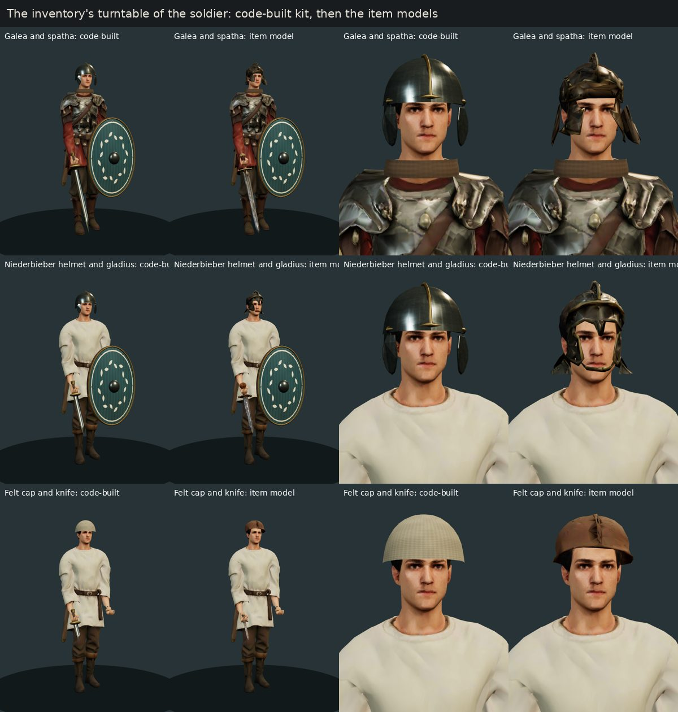

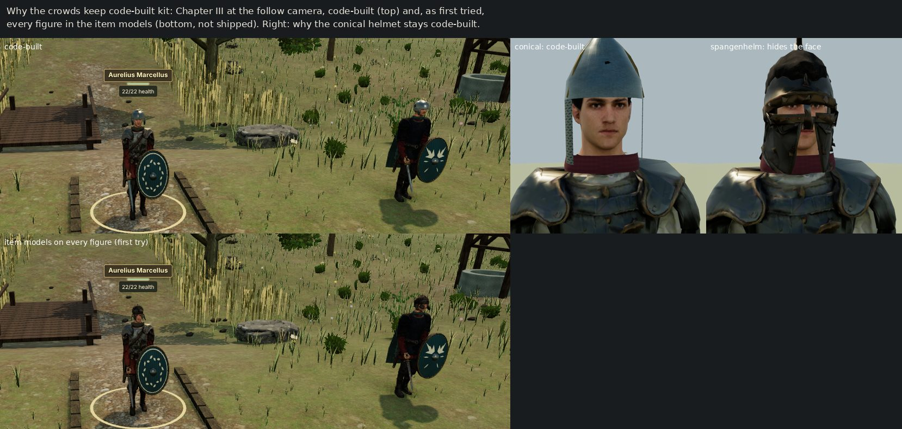

- **Where they are worn.** In the turntable, where the soldier fills the view, the item models show their guards, pommels, rivets and felt. In the battle, at the follow camera, a weapon is a few pixels wide and the two look alike. Tripo's dark iron also reads less clearly than the code-built steel there. So the pieces go to figures dressed in chosen items: the player's soldier, his companions, named veterans and his squads. The rank and file and the enemy keep the code-built pieces, which also cost 2,000–3,000 fewer triangles a figure.
- **The spangenhelm does not ship.** Its nasal and cheek guards close over the face; the conical helmet stays code-built.
- **Not made:**
  - spears, bows and slings, which stay code-built;
  - shields, which carry each unit's own design.
- **Fitted, not reshaped.** A weapon is scaled as one, so its tip meets the code-built tip. A helmet is scaled on each axis to the code-built helmet it replaces, which was fitted to every head; the galea's cheek guards stay splayed as the model has them. Two other fits were tried and dropped: one by the dome alone, and one by width with the model's own height. They lowered the galea over the eyes.
- **Overview level remade.** A first overview made by collapse alone tore the models' crossing surfaces into loose triangles. It is now a grid clustering of the near level, as the game's own overview simplifier does.
- **The felt cap** stays at 3,243 triangles, where its collapse stops; only a figure dressed in the cap draws it.

## Release G1's pilot: the armies · 8 November 2026

Release G1 of the [graphics plan](graphics-tripo-plan.md#g1s-pilot-8-november) gives the unit types that wore another unit's body bodies of their own. Its pilot, one body for each of the release's categories and one horse, went to the owner before the rest is generated. [The asset pipeline](asset-pipeline.md#release-g1s-pilot-a-unit-types-own-body--2026-11-08) has how a unit type's body is chosen.

The models were generated with Tripo's text-to-model API (`v3.1-20260211`, standard textures and geometry, 20 credits each) on 2026-11-08, from the text prompts below only: no reference image or third-party model. The bodies were rigged by Tripo's biped auto-rig (25 credits each); the horse was bound to the game's own horse skeleton without a rig. The Gothic skirmisher is step 0's calibration body at the standard tier, shipped from its own request with the calibration's task IDs and digests, so its credits are not spent twice. The pilot cost 310 credits of its 345-credit ceiling, task by task in [the G1 ledger](../art-source/models/graphics-g1-credits.json), and the balance read 10,510 before and 10,200 after. The owner's paid Tripo account gives the owner full rights to use, modify, distribute and commercially exploit them; Tripo holds a royalty-free, non-exclusive licence to display them as needed to provide its service.

| Model | Worn by | Chapters | Tripo task | Rig task | Triangles | Runtime file |
| --- | --- | --- | --- | --- | ---: | ---: |
| char-gothic-skirmisher | the Gothic skirmisher of the reinforcements | I, II | `7c8a8e44-993c-4bf8-9dd3-c2a384f68380` | `7f1bf80a-4f0c-4026-86df-c7f11749f79a` | 13,780 | 408,220 bytes |
| char-gothic-warband | the Gothic war bands' infantry | II, IV, VII, VIII | `ed7c6087-9578-4aa1-9d7e-5524bdc270f1` | `e66dd26e-11a4-4ee3-b734-d6cb4b979ec8` | 13,863 | 421,260 bytes |
| char-champion-gate | the war band's chieftain, the gate battle's champion | IV | `ca9f3eb1-015b-40b8-903f-96b9a35cd652` | `10395c0c-7008-4be5-b1f8-143f4ecb7c66` | 13,886 | 437,144 bytes |
| char-persian-skirmisher | Persian raiders | VI | `a69dc59a-eec4-4539-b95c-894c030c4d34` | `062ca361-4fcb-4cef-9e4e-650c2a538388` | 13,723 | 423,236 bytes |
| char-palmyrene-spearman | Palmyrene infantry | IX | `551e4849-1420-4ea0-91af-20f8b0519b33` | `a13c1ad5-ba58-4155-bd12-dc71b68aaeb3` | 14,013 | 472,840 bytes |
| char-rival-legionary-b | the claimant's civil-war cohorts | XII | `a07a6901-559f-4966-9e0e-60e19e70a2db` | `6e0ce422-414c-436a-80f8-19656a5d1fc0` | 13,709 | 432,828 bytes |
| char-roman-moorish-cavalry | the Roman cavalry of the Palmyrene war | IX | `c6176082-f573-4e9a-9e1b-1e13bad5597f` | `2a4f991d-2818-4c2f-91a4-e7c0cb918828` | 13,753 | 418,212 bytes |
| horse-cataphract | the Palmyrene cataphracts' horses | IX | `15f4f317-3226-4092-80a2-2d57f047818c` | — | 10,800 | 492,908 bytes |

Triangles count both levels of detail; the near bodies have 11,210–11,513 and the horse 9,000. Every runtime file is quantized and compressed (meshopt geometry, ETC1S KTX2 with mipmaps) and passes `check-model` within its request's budget. The raw files stay outside the repository; their digests, the task IDs and the parameters Tripo reported are in each request file (`art-source/models/requests/`), and the binding and compression reports in `art-source/models/reports/`. The first rival legionary (`char-rival-legionary`, task `935077b8-8885-43fb-b6d4-7161bc5518a7`, 20 credits) was rejected at review and is not shipped.

The prompts follow [the historical notes](historical-research.md): long-sleeved tunics and trousers; mail rather than segmented plate for the Romans; the kit each unit carries in the rules (the war band's segmented helmet and jerkin, the Palmyrene and Persian spearmen's helmets); Zosimus's Mauretanian horse in Aurelian's army at Emesa (*New History* 1.52); and the Palmyrene horse's scale trapper after those found at Dura-Europos.

### Reviewed before shipping

Each model was compared with its Tripo render and then, bound, in the game's actor viewer at High, beside the body its type wore before, at the game's distance, full length from the front and back, and walking. What it showed, and what was kept:

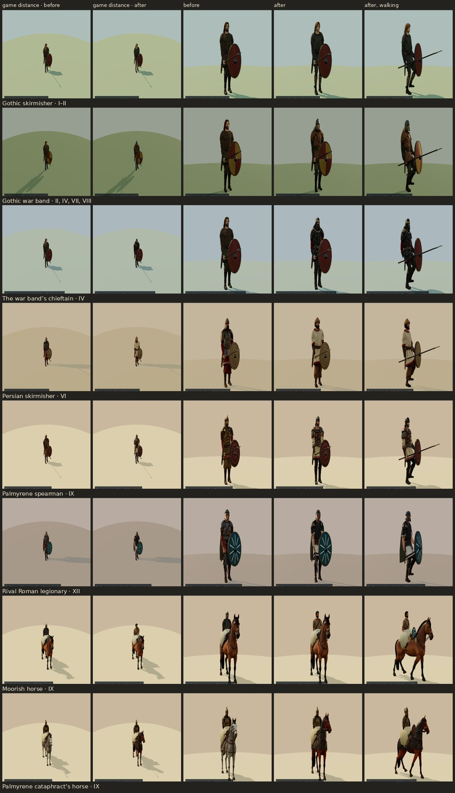

- **The first rival legionary was rejected.** Its armour came out as banded segmented plate with shoulder plates, despite the negative prompt, with bare arms and open sandals. The second attempt asked for the chainmail shirt in the words that gave Quintus and the Roman cavalryman theirs, and has it, over an off-white tunic with a purple band at the hem. Its forearms are bare below the tunic's sleeves, as several shipped bodies' are.
- **The war band's spearman** now wears the segmented helmet and leather jerkin his kit lists. The body his type wore before was bare-headed in a tunic. His jerkin has leather shoulder pieces and rivets the prompt did not ask for.
- **The Palmyrene spearman's** jerkin came out as a shaped corselet of red leather with riveted panels, rather than padded, and his helmet is rounded with cheek pieces rather than conical. He reads apart from the bronze-scaled guard, which is what the type needs.
- **The Moorish horseman's** hair came out in short waves rather than ringlets, and he wears a studded belt with hanging straps.
- **The cataphract's horse.** Its bronze scales read dark in the field light, darker than the eastern horse's iron. The trapper covers the neck and body and lies under the game's saddle; its tail hangs clear of the ground, so the binder did not cut it.
- **The chieftain** stands apart from his men: dark leather studded with bronze, red sleeves, the gold torc he drops as loot, and a helmet banded in bronze.
- **The skirmisher** is the calibration's: at the game's distance the standard tier showed no less than the detailed ([the calibration](graphics-calibration.md)).

#### In battle

The bodies were then seen where a player meets them, in four battles of the desktop build at High. Each moment was reached from New Game by the real-time bot's legal commands and restored through the Restore dialog. It was captured twice: with the pilot's bodies, and with the bodies the types wore before served under the same files' names. Chapter VI's and XII's moments were kept where the most of the changed type stood within 9 m of the soldier.

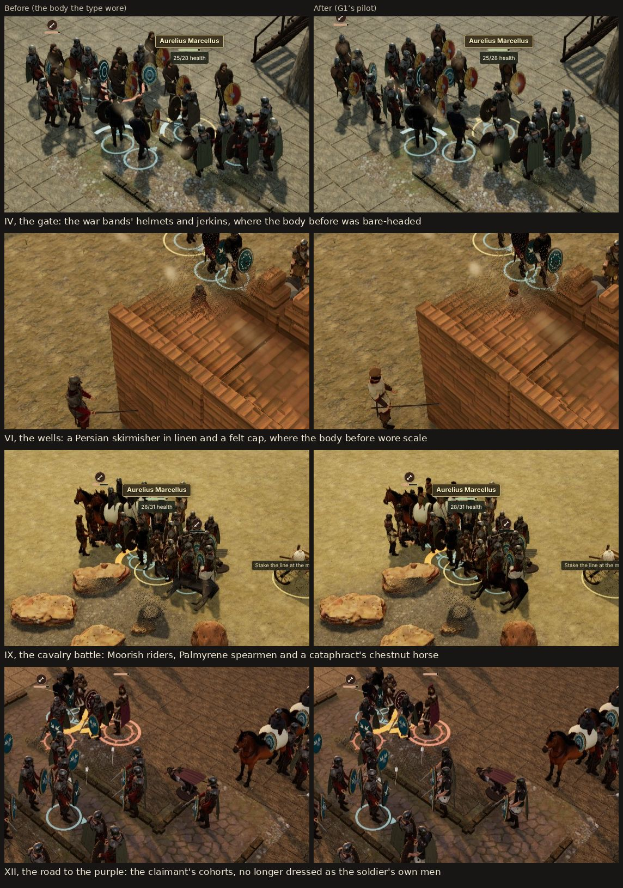

A figure stands about 70 to 100 pixels tall in a 1,080-pixel frame, and its shield covers much of its body. What reads there is a figure's outline and its main colours:
- **IV:** the war bands' helmets and dark jerkins, where the body before was bare-headed;
- **VI:** the skirmisher's undyed linen and felt cap, where the body before wore a scale coat and a helmet;
- **IX:** the Moorish riders' bare heads, the Palmyrene spearmen's leather and linen in place of bronze scale, and the cataphract's chestnut horse in place of a grey one;
- **XII:** the claimant's cohorts, in dark mail over off-white, now read apart from the soldier's own legionaries, whose body they wore before. They still carry the same shields as his men.

Finer work shows only close up: the chieftain's torc, the leather's rivets and the purple band at the rival's hem.

#### Exact prompts

**char-gothic-skirmisher**

```text
Full-body young Gothic skirmisher of the mid-3rd century AD, about eighteen years old, standing in a T-pose for rigging: arms straight out to the sides, legs straight and slightly apart, facing forward, symmetrical. Lean and wiry, he wears a long-sleeved undyed wool tunic to mid-thigh with a narrow woven border at the hem and cuffs, a narrow leather belt with a small leather pouch, close-fitting grey-brown wool trousers wrapped with linen leg bindings below the knee and soft leather shoes. Bare head with shoulder-length light-brown hair tied back with a leather thong and a thin young beard. Realistic proportions, historically accurate, worn and practical, earthy colours. No shield, no weapons, no cloak, no backpack, no quiver, no helmet, no text or inscriptions, no modern objects, no fantasy elements.
```
Negative prompt:

```text
armour, mail, helmet, shield, weapon, spear, sword, cloak, cape, fur, horns, fantasy armour, modern clothing
```

**char-gothic-warband**

```text
Full-body Gothic warrior of the mid-3rd century AD, a spearman of a war band, standing in a T-pose for rigging: arms straight out to the sides, legs straight and slightly apart, facing forward, symmetrical. He wears a sleeveless jerkin of thick brown leather over a long-sleeved dark green-brown wool tunic to mid-thigh, a leather belt, loose grey wool trousers wrapped with leg bindings and leather shoes, and a simple iron segmented helmet of riveted plates with a brow band and small cheek pieces, face visible. Fair hair to the shoulders and a short beard. Realistic proportions, historically accurate, worn and practical, earthy colours. No shield, no weapons, no cloak, no backpack, no quiver, no text or inscriptions, no modern objects, no fantasy elements.
```
Negative prompt:

```text
mail, plate armour, horns, wings, fur cape, cloak, shield, weapon, spear, sword, axe, fantasy armour, modern clothing
```

**char-champion-gate**

```text
Full-body Gothic war-band chieftain of the mid-3rd century AD, a powerful man of about fifty, standing in a T-pose for rigging: arms straight out to the sides, legs straight and slightly apart, facing forward, symmetrical. He wears a fitted jerkin of dark leather studded with bronze over a long-sleeved red wool tunic with a woven border, a heavy twisted gold torc at the neck, a broad belt with silver fittings, dark wool trousers with leg bindings and leather boots, and an iron segmented helmet with bronze bands, cheek pieces and a short mail neck guard, face visible. Grey-streaked long hair and a full grey-brown beard. Realistic proportions, historically accurate, worn and practical, earthy colours. No shield, no weapons, no cloak, no backpack, no quiver, no text or inscriptions, no modern objects, no fantasy elements.
```
Negative prompt:

```text
horns, wings, plate armour, fur cape, cloak, crown, shield, weapon, axe, sword, spear, skulls, fantasy armour, modern clothing
```

**char-persian-skirmisher**

```text
Full-body Sasanian Persian skirmisher of the mid-3rd century AD, a light-armed javelin man, standing in a T-pose for rigging: arms straight out to the sides, legs straight and slightly apart, facing forward, symmetrical. He wears a long-sleeved knee-length tunic of undyed linen with a woven red border at the hem and cuffs, belted with a brown cloth sash, baggy trousers gathered at the ankle, soft leather shoes, and a soft rounded felt cap. Black beard and dark hair to the shoulders. No armour, no helmet. Realistic proportions, historically accurate, worn and practical, earthy colours. No shield, no weapons, no cloak, no backpack, no quiver, no text or inscriptions, no modern objects, no fantasy elements.
```
Negative prompt:

```text
armour, mail, scale, lamellar, helmet, turban, cloak, cape, shield, weapon, spear, javelin, sword, bow, quiver, fantasy armour, modern clothing
```

**char-palmyrene-spearman**

```text
Full-body Palmyrene infantry spearman of the 270s AD, standing in a T-pose for rigging: arms straight out to the sides, legs straight and slightly apart, facing forward, symmetrical. He wears a padded leather jerkin over a long-sleeved knee-length tunic of natural linen with embroidered red borders at the hem and cuffs, a narrow belt, close-fitting dark trousers with an embroidered band down the front, soft leather boots, and a simple conical iron helmet, face visible. Short dark beard and dark curly hair. No metal armour. Realistic proportions, historically accurate, worn and practical, earthy colours. No shield, no weapons, no cloak, no backpack, no quiver, no text or inscriptions, no modern objects, no fantasy elements.
```
Negative prompt:

```text
mail, scale armour, plate armour, muscled cuirass, cloak, cape, shield, weapon, spear, sword, bow, quiver, turban, fantasy armour, modern clothing
```

**char-rival-legionary** (rejected at review)

```text
Full-body Roman legionary of the mid-3rd century AD serving a rival claimant, standing in a T-pose for rigging: arms straight out to the sides, legs straight and slightly apart, facing forward, symmetrical. He wears an iron mail shirt to mid-thigh over a long-sleeved off-white wool tunic with two narrow dark purple bands, a broad leather belt with a bronze ring buckle, close-fitting dark brown wool trousers and closed leather boots, and an iron helmet of the Niederbieber type with crossed reinforcing bars on the bowl, wide cheek guards and a deep neck guard. Clean-shaven weathered face. Realistic proportions, historically accurate, worn and practical, earthy colours. No shield, no weapons, no cloak, no backpack, no quiver, no text or inscriptions, no modern objects, no fantasy elements.
```
Negative prompt:

```text
lorica segmentata, segmented plate armour, muscled cuirass, crest, plume, red tunic, cloak, cape, shield, weapon, sword, spear, fantasy armour, modern clothing
```

**char-rival-legionary-b**

```text
Full-body Roman legionary of the mid-3rd century AD serving a rival claimant, standing in a T-pose for rigging: arms straight out to the sides, legs straight and slightly apart, facing forward, symmetrical. He wears a loose chainmail shirt of small interlocking iron rings, short-sleeved and hanging to mid-thigh like a heavy knitted shirt, over a long-sleeved off-white wool tunic with two narrow dark purple bands; a broad leather belt with a bronze ring buckle, close-fitting dark brown wool trousers and closed leather boots, and an iron helmet with a deep bowl, crossed reinforcing bars on the crown, wide cheek guards and a deep neck guard. Clean-shaven weathered face. Realistic proportions, historically accurate, worn and practical, earthy colours. No crest, no plume, no shield, no weapons, no cloak, no backpack, no text or inscriptions, no modern objects, no fantasy elements.
```
Negative prompt:

```text
plate armour, lorica segmentata, segmented armour, metal bands, breastplate, cuirass, shoulder plates, pauldrons, belt apron, crest, plume, red tunic, bare arms, sandals, cloak, shield, weapon, fantasy armour
```

**char-roman-moorish-cavalry**

```text
Full-body Moorish light cavalryman of the Roman army in the 270s AD, a Berber horseman from Mauretania, standing in a T-pose for rigging: arms straight out to the sides, legs straight and slightly apart, facing forward, symmetrical. He wears a short-sleeved belted tunic of undyed wool to just above the knee with a narrow red border, a narrow leather belt, close-fitting light brown wool trousers and soft leather boots. Brown skin, dark hair in tight curled ringlets and a short curly beard. No helmet, no armour. Realistic proportions, historically accurate, worn and practical, earthy colours. No shield, no weapons, no cloak, no backpack, no quiver, no text or inscriptions, no modern objects, no fantasy elements.
```
Negative prompt:

```text
helmet, armour, mail, turban, hood, robe, cloak, cape, shield, weapon, spear, javelin, sword, bow, fantasy armour, modern clothing
```

**horse-cataphract**

```text
An armoured horse of the Palmyrene heavy cavalry of the 270s AD, standing square for rigging: all four legs straight and vertical, evenly spaced, head raised and facing forward, tail hanging straight down, symmetrical. A tall, strong horse about 1.55 metres at the withers, chestnut coat with a dark mane and tail. It wears a close-fitting armour trapper of small overlapping bronze scales sewn on leather, covering the neck, chest, flanks and hindquarters down to the belly and lying flat and smooth along the back, where a saddle will sit on top, and a plain leather bridle; the legs below the trapper are bare. Realistic proportions, anatomically accurate, worn and practical. No saddle, no saddle cloth, no rider, no face mask, no plumes, no spikes, no text or inscriptions, no modern objects, no fantasy elements.
```
Negative prompt:

```text
saddle, rider, person, plate armour, face mask, plumes, spikes, horns, wings, extra legs, armoured legs, raised seat, fantasy, cartoon
```


## Release G1: the rest of the armies · 9 November 2026

The owner approved the pilot and the rest of G1 on 9 November. This batch gives the remaining unit types that wore another unit's body bodies of their own, and each of the other ten champions his own; the Persian cavalry's horse is remade. [The plan](graphics-tripo-plan.md#the-rest-of-g1-9-november) has which of its listed types it left out and why, and [the asset pipeline](asset-pipeline.md#the-rest-of-release-g1--2026-11-09) how each body is chosen.

The models were generated with Tripo's text-to-model API (`v3.1-20260211`, standard textures and geometry, 20 credits each) on 2026-11-09, from the text prompts below only: no reference image or third-party model. The bodies were rigged by Tripo's biped auto-rig (25 credits each); the horse was bound to the game's own horse skeleton without a rig. The batch cost 695 credits of its 780-credit ceiling, task by task in [the G1 ledger](../art-source/models/graphics-g1-credits.json), and the balance read 10,200 before and 9,505 after. No generation was rejected. The owner's paid Tripo account gives the owner full rights to use, modify, distribute and commercially exploit them; Tripo holds a royalty-free, non-exclusive licence to display them as needed to provide its service.

| Model | Worn by | Chapters | Tripo task | Rig task | Triangles | Runtime file |
| --- | --- | --- | --- | --- | ---: | ---: |
| char-gothic-warleader | the war leader the rules name in a band that fights alone | I, II, III | `8ccec7f0-0f69-4ef4-b653-e38f98c7f818` | `aec7fff7-dce2-4fd5-ad6a-cfa039fbf4ef` | 13,859 | 282,216 bytes |
| char-gothic-guard | the Gothic shield guard | IV, VII | `a7eef95a-1f0e-4c77-ad77-a2a20e75491f` | `2b3e2083-b3ef-44af-84e3-47b8d7ec2c04` | 13,855 | 428,312 bytes |
| char-persian-spearman | the Persian spearmen | V | `287d2853-2894-4f9c-b125-a05b532d0629` | `00429442-0120-4e5e-85a4-0ca0101066b7` | 13,744 | 414,900 bytes |
| char-rival-archer | the claimant's archers | XII | `24066f0a-d58d-4f5c-91a9-024f0aff73b1` | `ae74383f-ee92-4d5d-955a-ac3dcd51c0fe` | 13,770 | 404,160 bytes |
| char-roman-dalmatian-cavalry | Aurelian's Dalmatian horse, the Roman cavalry of the finale | XII | `9c3224a0-79ad-4ea7-b728-819bf7d01ed1` | `067ebf1e-ef0c-49df-b8a7-a69d628c9d31` | 13,705 | 435,700 bytes |
| char-champion-wall | the war band's war leader, the wall battle's champion | IV | `17a4ef90-6e3f-4284-ba78-abaea183560a` | `ea696362-e327-450c-95c0-86e2c289c056` | 13,843 | 422,988 bytes |
| char-champion-mine | a Persian sapper captain, the mine's champion | V | `ae2e241c-ccba-409a-b1fd-5800a6e6a540` | `e5cc08d0-1106-4a62-b750-30ef4966a62d` | 13,890 | 447,320 bytes |
| char-champion-wells | a Persian captain of the pursuit, the wells' champion | VI | `f1bcbd23-480b-4006-8b7f-45484aaef337` | `9fe0bd38-5a42-4405-bddc-84ad5aeb205e` | 13,886 | 418,936 bytes |
| char-champion-eagle | the raiders' standard-breaker, the eagle battle's champion | VI | `b30502a4-0127-44d5-8d95-08b7a7a320df` | `9ed90a8c-e9b3-4565-8119-55e47dece3d7` | 14,004 | 484,756 bytes |
| char-champion-legion | a mercenary captain in the usurper's pay, the legion battle's champion | VII | `3e8a39f0-ba7c-46b3-9eda-25c917270dff` | `b7194fad-5b63-40e5-a20b-e57117818db4` | 13,787 | 430,356 bytes |
| char-champion-crossing | the war band's champion at the crossing | VIII | `3b567ea7-f9b8-4f7c-b7c9-239d12057b87` | `8327d231-dbda-4dba-8a8c-d1409a5e26d7` | 13,769 | 436,424 bytes |
| char-champion-wing | a Palmyrene armoured officer, the cavalry battle's champion, now mounted | IX | `3d5bb9f0-d0d7-4e25-9b24-6a01ef90d1c9` | `6a461e51-d0e3-434b-818c-4289e26dddfb` | 13,873 | 450,104 bytes |
| char-champion-city | the city's defending captain | IX | `3199c783-ef76-41e4-8b30-c413dc4aaf4f` | `f3eccf2c-239e-4d39-87cc-a00de7d47bb1` | 13,977 | 443,396 bytes |
| char-champion-road | the raiders' chief, the road's champion | X | `6d2783af-3a9c-46e6-a2e2-13fc19aaf66c` | `84c796b5-bed4-402c-86c4-b1c2e5e72020` | 13,994 | 448,440 bytes |
| char-champion-guard | the claimant's guard captain | XII | `761bc946-fc7a-425b-a35c-a0ed8145d7d9` | `5de4594a-52df-4d60-bacf-f772a502da4f` | 13,787 | 464,140 bytes |
| horse-eastern-b | the Persian cavalry's horses | V, VI | `8afcbf1f-595e-4a3d-9df4-ea6645f863a7` | — | 10,800 | 551,620 bytes |

Triangles count both levels of detail; the near bodies have 11,206–11,504 and the horse 9,000. Every runtime file is quantized and compressed (meshopt geometry, ETC1S KTX2 with mipmaps) and passes `check-model` within its request's budget. The war leader stands in Chapter I's download, so his maps are 512 pixels (`--texture 512 --detail-texture 256`), as the cast's were in release 8; the other bodies have the shipped bodies' 1,024-pixel maps. The remade horse ships under the first eastern horse's file name, `horse-eastern.glb`; its first request, `horse-eastern.json`, is kept and marked replaced. The raw files stay outside the repository; their digests, the task IDs and the parameters Tripo reported are in each request file (`art-source/models/requests/`), and the binding and compression reports in `art-source/models/reports/`.

The prompts follow [the historical notes](historical-research.md) and the kit each unit carries in the rules. Each gives its type a headgear and a main colour of its own, since those are what read at the battle camera:
- **Gothic:** the war leader bare-headed in red, with a torc and a woven headband; the shield guard in a checked tunic like the one found at Thorsberg, under a segmented helmet; the champions in woad blue under a tall conical helmet (the wall), saffron yellow with red braids and a torc (the crossing), and undyed grey wool edged with wolf fur (the road's chief). The mercenary captain in the usurper's pay (the legion) is a Germanic officer, in dark green with a Roman military belt.
- **Persian:** the spearman in a leather jerkin over saffron linen; the sapper captain in indigo under a ridge helmet like the one found in the siege mine at Dura-Europos; the captain of the pursuit in crimson silk under a cloth-wrapped conical helmet; the standard-breaker in iron scale over turquoise, with a mail aventail. The horse wears iron lamellae, apart from the Palmyrene horse's bronze.
- **Palmyrene:** the armoured officer in gilded scale over purple embroidered with gold vine scrolls, as on Palmyrene funerary portraits; the city's captain in iron over white with red borders, under a white horsehair tuft.
- **The claimant's men:** his archers in off-white padding with his purple bands; his guard captain in mail over scarlet under a white transverse crest.
- **Aurelian's Dalmatian horse** (the *equites Dalmatae*), in mail over dark green, with a red scarf.

### Reviewed before shipping

Each model was compared with its Tripo render and then, bound, in the game's actor viewer at High, beside the body its type wore before, at the game's distance, full length from the front and back, and walking. What it showed, and what was kept:

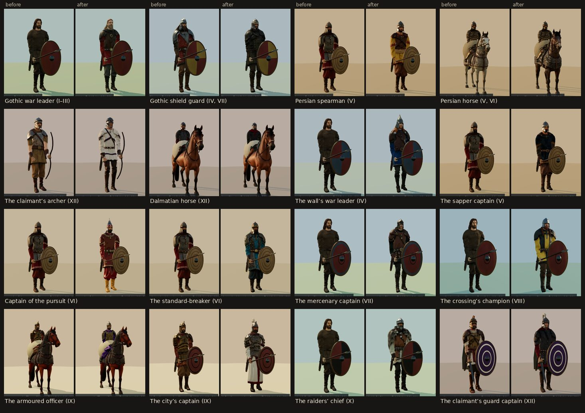

- **No generation was rejected.** Where a model differs from its prompt, the difference was kept:
  - **The city's captain's** corselet came out in larger iron plates with shoulder plates, rather than small scales.
  - **The sapper captain** has no jerkin over his indigo tunic.
  - **The Persian spearman's** helmet is pointed, with a nasal and cheek guards, rather than tall.
  - **The crossing's champion's** torc came out as a small pendant.
  - **Three wear a small knife at the belt,** though the prompts asked for no weapons: the sapper captain, the raiders' chief and the Dalmatian rider. The game adds every figure's own weapons.
  - **The claimant's archer** has bracers on both forearms and a strap across his chest without a quiver; the game adds his bow and quiver.
  - **The captain of the pursuit's** crimson silk reads glossy.
- **What reads, and what reads less.** Most of the new bodies stand plainly apart from the bodies their types wore before, by a colour of their own: the war leader's red, the Persian spearman's saffron, the archer's off-white, and the champions' woad blue, crimson, turquoise, saffron, white and undyed grey. Three are closer to before:
  - the shield guard's checked tunic reads dark brown-green under his jerkin, near the noble's body he wore;
  - the mercenary captain's dark green reads dark, though his helmet sets him apart from the bare-headed warrior's body he wore;
  - the Dalmatian rider is in mail like the cavalryman before him, and his dark green tunic and red scarf are what differ.
- **The armoured officer rides.** The rules have always mounted him; he was drawn on foot in the Palmyrene spearmen's body. The viewer shows both bodies on the cataphracts' horse, since it seats him now.
- **The Persian horse** is dark bay under its iron lamellae, where the first was grey under scales. Its rider sits on the game's saddle over the lamellae, walking and standing.
- **The claimant's guard captain** wears the code-built cloak the game gives its armoured Romans, which covers his back; his white crest and the purple markings on his shield show from the front. The markings show in both captures, since the shields are drawn by the current code.

#### In battle

The bodies were then seen where a player meets them, in sixteen moments of the desktop build at High. Each was reached from New Game by the real-time bot's legal commands, restored through the Restore dialog, and kept where the unit stood nearest the soldier. Eight were captured twice, with these bodies and with the bodies the types wore before served under the same files' names; the other eight only as built.

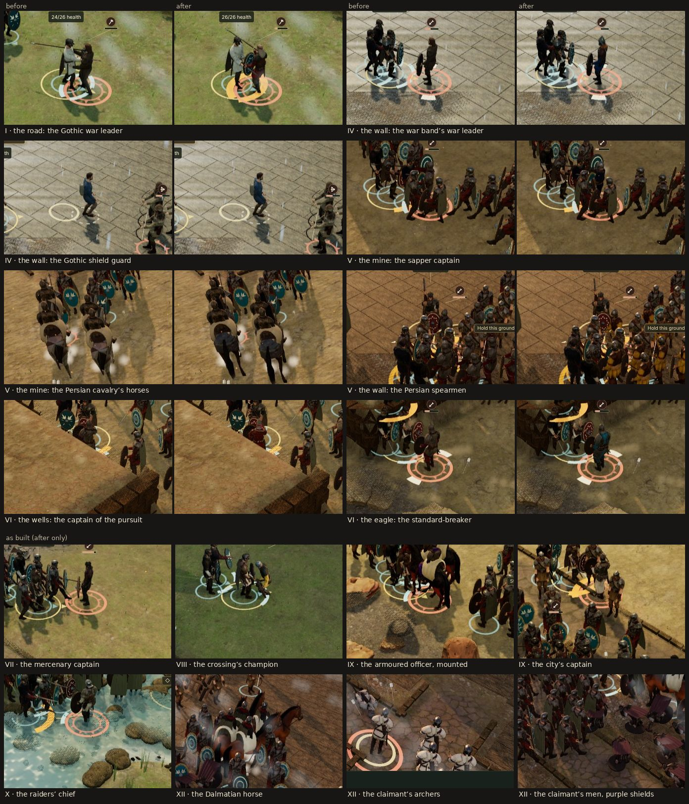

As in the pilot, a figure stands about 70 to 100 pixels tall, so what reads is its outline and main colours:
- **Clearest:** whole squads in a colour of their own, the Persian spearmen's saffron (V) and the claimant's archers' off-white (XII); and the armoured officer, now mounted, in gilded scale over purple (IX).
- **A champion reads as the one figure in his own colour:** the war leader's red (I), the wall's war leader's blue (IV), the standard-breaker's turquoise (VI), the crossing's champion's saffron (VIII), the city's captain's white (IX) and the raiders' chief's grey (X).
- **Barely:** the dark bodies read as dark figures, close to what they wore before: the shield guard (IV), the sapper captain's indigo (V) and the mercenary captain's dark green (VII). The Persian horses read darker, but their lamellae do not show.
- **The claimant's men** carry his purple on their shields, which reads across the field more than any of the bodies.
- **The claimant's guard captain** is hard to pick out in the finale's press at the camera's distance; the actor viewer shows him.

#### Exact prompts

**char-gothic-warleader**

```text
Full-body Gothic war-band leader of the mid-3rd century AD, a strong man of about thirty-five, standing in a T-pose for rigging: arms straight out to the sides, legs straight and slightly apart, facing forward, symmetrical. He wears a sleeveless jerkin of brown leather over a long-sleeved bright red wool tunic to mid-thigh with a woven border, a twisted bronze torc at the neck and a bronze ring on each upper arm, a broad leather belt with a bronze buckle, grey-brown wool trousers with leg bindings and leather shoes. Bare head, long fair hair bound with a red woven headband, and a full beard. No helmet, no armour. Realistic proportions, historically accurate, worn and practical, earthy colours. No shield, no weapons, no cloak, no backpack, no quiver, no text or inscriptions, no modern objects, no fantasy elements.
```
Negative prompt:

```text
helmet, mail, plate armour, horns, wings, fur cape, cloak, crown, shield, weapon, spear, axe, sword, skulls, fantasy armour, modern clothing
```

**char-gothic-guard**

```text
Full-body Gothic shield guard of the mid-3rd century AD, a heavyset man of about thirty, standing in a T-pose for rigging: arms straight out to the sides, legs straight and slightly apart, facing forward, symmetrical. He wears a sleeveless jerkin of thick dark leather over a long-sleeved wool tunic to mid-thigh woven in a dark green and brown check, like the tunic found at Thorsberg, a broad leather belt, checked wool trousers with leg bindings and leather shoes, and an iron segmented helmet with bronze strips and cheek pieces, face visible. Brown hair and a short beard. Realistic proportions, historically accurate, worn and practical, earthy colours. No shield, no weapons, no cloak, no backpack, no quiver, no text or inscriptions, no modern objects, no fantasy elements.
```
Negative prompt:

```text
mail, plate armour, horns, wings, fur cape, cloak, crown, shield, weapon, spear, axe, sword, skulls, fantasy armour, modern clothing
```

**char-persian-spearman**

```text
Full-body Sasanian Persian infantry spearman of AD 256, a young man of about twenty-five, standing in a T-pose for rigging: arms straight out to the sides, legs straight and slightly apart, facing forward, symmetrical. He wears a short leather jerkin over a long-sleeved knee-length linen tunic dyed saffron-yellow with a red woven border, a cloth sash, baggy brown trousers gathered at the ankle, soft leather boots, and a plain tall conical iron helmet, face visible. Black beard and dark hair to the shoulders. No scale armour, no mail. Realistic proportions, historically accurate, worn and practical, earthy colours. No shield, no weapons, no cloak, no backpack, no quiver, no text or inscriptions, no modern objects, no fantasy elements.
```
Negative prompt:

```text
scale armour, mail, lamellar, plate armour, cloak, cape, turban, shield, weapon, spear, sword, bow, quiver, tools, fantasy armour, modern clothing
```

**char-rival-archer**

```text
Full-body Roman auxiliary archer of AD 275 serving a rival claimant to the throne, a lean man of about twenty-five, standing in a T-pose for rigging: arms straight out to the sides, legs straight and slightly apart, facing forward, symmetrical. He wears a quilted padded jacket of off-white linen over a long-sleeved off-white wool tunic with two narrow dark purple bands, a leather belt, close-fitting dark brown wool trousers and closed leather boots, a leather bracer on the left forearm, and a plain iron helmet with cheek guards and a short neck guard, face visible. Clean-shaven. No mail. Realistic proportions, historically accurate, worn and practical, earthy colours. No shield, no weapons, no cloak, no backpack, no quiver, no text or inscriptions, no modern objects, no fantasy elements.
```
Negative prompt:

```text
mail, chainmail, scale armour, segmented plate, lorica segmentata, banded armour, plate armour, muscle cuirass, cloak, cape, shield, weapon, sword, spear, fantasy armour, modern clothing
```

**char-roman-dalmatian-cavalry**

```text
Full-body Roman cavalryman of the equites Dalmatae, Aurelian’s Dalmatian horse of the 270s AD, a lean man of about twenty-five, standing in a T-pose for rigging: arms straight out to the sides, legs straight and slightly apart, facing forward, symmetrical. He wears a loose chainmail shirt of small interlocking iron rings, short-sleeved and hanging to mid-thigh like a heavy knitted shirt, over a long-sleeved dark green wool tunic, a red wool scarf knotted at the neck, a broad leather belt with a bronze ring buckle, close-fitting brown wool trousers and closed leather riding boots, and an iron cavalry helmet with a low central ridge, large cheek guards and a short neck guard, face visible. Short dark hair and a short beard. Realistic proportions, historically accurate, worn and practical, earthy colours. No shield, no weapons, no cloak, no backpack, no quiver, no text or inscriptions, no modern objects, no fantasy elements.
```
Negative prompt:

```text
segmented plate, lorica segmentata, banded armour, plate armour, muscle cuirass, cloak, cape, shield, weapon, sword, spear, fantasy armour, modern clothing
```

**char-champion-wall**

```text
Full-body Gothic war leader of the mid-3rd century AD, a lean, hard man of about forty, standing in a T-pose for rigging: arms straight out to the sides, legs straight and slightly apart, facing forward, symmetrical. He wears a sleeveless jerkin of dark brown leather over a long-sleeved woad-blue wool tunic to mid-thigh with a woven border, a round silver brooch at the shoulder, a leather belt with a bronze buckle, grey wool trousers with leg bindings and leather shoes, and a tall conical iron helmet with small cheek pieces, face visible. Red-blond hair to the shoulders and a short beard. Realistic proportions, historically accurate, worn and practical, earthy colours. No shield, no weapons, no cloak, no backpack, no quiver, no text or inscriptions, no modern objects, no fantasy elements.
```
Negative prompt:

```text
mail, plate armour, horns, wings, fur cape, cloak, crown, shield, weapon, spear, axe, sword, skulls, fantasy armour, modern clothing
```

**char-champion-mine**

```text
Full-body Sasanian Persian sapper captain of AD 256 at the siege of Dura-Europos, a wiry man of about forty, standing in a T-pose for rigging: arms straight out to the sides, legs straight and slightly apart, facing forward, symmetrical. He wears a short leather jerkin over a long-sleeved knee-length linen tunic dyed dark indigo with an ochre border, a leather belt, baggy trousers gathered at the ankle, soft leather boots, and an iron helmet of two halves joined by a raised central ridge, like the one found in the siege mine at Dura-Europos, with a mail neck guard, face visible. Black beard and dark hair. Realistic proportions, historically accurate, worn and practical, earthy colours. No shield, no weapons, no cloak, no backpack, no quiver, no text or inscriptions, no modern objects, no fantasy elements.
```
Negative prompt:

```text
scale armour, lamellar, plate armour, cloak, cape, turban, shield, weapon, spear, sword, bow, quiver, tools, fantasy armour, modern clothing
```

**char-champion-wells**

```text
Full-body Sasanian Persian noble captain of AD 260, a tall man of about thirty-five, standing in a T-pose for rigging: arms straight out to the sides, legs straight and slightly apart, facing forward, symmetrical. He wears a short leather jerkin over a long-sleeved knee-length crimson silk tunic with gold-patterned borders, a belt with gilded fittings, baggy crimson trousers gathered at the ankle, soft yellow leather boots, and a tall conical iron helmet wrapped at its base with a crimson cloth band, face visible. A full black beard and black hair tied at the nape. Realistic proportions, historically accurate, worn and practical, earthy colours. No shield, no weapons, no cloak, no backpack, no quiver, no text or inscriptions, no modern objects, no fantasy elements.
```
Negative prompt:

```text
scale armour, lamellar, plate armour, cloak, cape, turban, shield, weapon, spear, sword, bow, quiver, tools, fantasy armour, modern clothing
```

**char-champion-eagle**

```text
Full-body Sasanian Persian veteran warrior of AD 260, a scarred, powerful man of about forty, standing in a T-pose for rigging: arms straight out to the sides, legs straight and slightly apart, facing forward, symmetrical. He wears a knee-length coat of small iron scales over a long-sleeved turquoise-blue tunic with patterned borders, a broad leather belt, baggy trousers gathered at the ankle, soft leather boots, and a domed conical iron helmet with a gilded bronze brow band and a mail aventail covering the neck and shoulders, face visible. A thick black beard. Realistic proportions, historically accurate, worn and practical, earthy colours. No shield, no weapons, no cloak, no backpack, no quiver, no text or inscriptions, no modern objects, no fantasy elements.
```
Negative prompt:

```text
plate armour, cloak, cape, turban, shield, weapon, spear, sword, bow, quiver, tools, fantasy armour, modern clothing
```

**char-champion-legion**

```text
Full-body Germanic mercenary captain of the 260s AD in the pay of a Roman usurper, a broad-shouldered man of about thirty-five, standing in a T-pose for rigging: arms straight out to the sides, legs straight and slightly apart, facing forward, symmetrical. He wears a sleeveless jerkin of brown leather over a long-sleeved dark green wool tunic to mid-thigh, a broad Roman military belt with bronze plates and a ring buckle, a gilded bronze ring on each upper arm, close-fitting dark wool trousers and leather boots, and a conical iron helmet with cheek pieces, face visible. Dark-blond hair to the shoulders and a long moustache. Realistic proportions, historically accurate, worn and practical, earthy colours. No shield, no weapons, no cloak, no backpack, no quiver, no text or inscriptions, no modern objects, no fantasy elements.
```
Negative prompt:

```text
mail, plate armour, horns, wings, fur cape, cloak, crown, shield, weapon, spear, axe, sword, skulls, fantasy armour, modern clothing
```

**char-champion-crossing**

```text
Full-body Gothic war-band champion of the 270s AD, a huge, heavily built man of about thirty, standing in a T-pose for rigging: arms straight out to the sides, legs straight and slightly apart, facing forward, symmetrical. He wears a sleeveless jerkin of black leather over a long-sleeved saffron-yellow wool tunic to mid-thigh with a dark woven border, a twisted bronze torc at the neck, a broad leather belt, brown wool trousers with leg bindings and leather boots, and an iron segmented helmet with cheek pieces, face visible. Red hair in two thick braids and a full red beard. Realistic proportions, historically accurate, worn and practical, earthy colours. No shield, no weapons, no cloak, no backpack, no quiver, no text or inscriptions, no modern objects, no fantasy elements.
```
Negative prompt:

```text
mail, plate armour, horns, wings, fur cape, cloak, crown, shield, weapon, spear, axe, sword, skulls, fantasy armour, modern clothing
```

**char-champion-wing**

```text
Full-body Palmyrene armoured cavalry officer of AD 272, a noble of about thirty, standing in a T-pose for rigging: arms straight out to the sides, legs straight and slightly apart, facing forward, symmetrical. He wears a corselet of gilded bronze scales with short scale sleeves over a long-sleeved purple tunic embroidered with gold vine scrolls, as on Palmyrene funerary portraits, wide purple trousers embroidered down the front, soft riding boots, and a conical iron helmet with a gilded brow band and cheek pieces, face visible. A short trimmed dark beard. Realistic proportions, historically accurate, worn and practical, earthy colours. No shield, no weapons, no cloak, no backpack, no quiver, no text or inscriptions, no modern objects, no fantasy elements.
```
Negative prompt:

```text
plate armour, cloak, cape, turban, shield, weapon, spear, sword, bow, quiver, tools, fantasy armour, modern clothing
```

**char-champion-city**

```text
Full-body Palmyrene city captain of AD 272, a stern man of about forty-five, standing in a T-pose for rigging: arms straight out to the sides, legs straight and slightly apart, facing forward, symmetrical. He wears a corselet of silver-grey iron scales over a long-sleeved white tunic with broad red embroidered borders at the hem and cuffs, wide white trousers with a red embroidered stripe down the front, soft leather boots, and a conical iron helmet with a short white horsehair tuft at the top, face visible. A full greying beard. Realistic proportions, historically accurate, worn and practical, earthy colours. No shield, no weapons, no cloak, no backpack, no quiver, no text or inscriptions, no modern objects, no fantasy elements.
```
Negative prompt:

```text
plate armour, cloak, cape, turban, shield, weapon, spear, sword, bow, quiver, tools, fantasy armour, modern clothing
```

**char-champion-road**

```text
Full-body Gothic raiders’ chief of the 270s AD, a weathered man of about fifty-five, standing in a T-pose for rigging: arms straight out to the sides, legs straight and slightly apart, facing forward, symmetrical. He wears a sleeveless jerkin of brown leather edged with grey wolf fur over a long-sleeved undyed grey-white wool tunic to mid-thigh, a broad belt with silver studs, dark wool trousers with leg bindings and leather boots, and an iron segmented helmet darkened with age, face visible. Long grey hair and a long grey beard. Realistic proportions, historically accurate, worn and practical, earthy colours. No shield, no weapons, no cloak, no backpack, no quiver, no text or inscriptions, no modern objects, no fantasy elements.
```
Negative prompt:

```text
mail, plate armour, horns, wings, cloak, cape, crown, shield, weapon, spear, axe, sword, skulls, fantasy armour, modern clothing
```

**char-champion-guard**

```text
Full-body Roman guard captain of AD 275 serving a rival claimant to the throne, a hard-faced veteran of about forty-five, standing in a T-pose for rigging: arms straight out to the sides, legs straight and slightly apart, facing forward, symmetrical. He wears a loose chainmail shirt of small interlocking iron rings, short-sleeved and hanging to mid-thigh like a heavy knitted shirt, over a long-sleeved scarlet wool tunic; a broad leather belt with bronze plates and a ring buckle, close-fitting dark wool trousers and closed leather boots, and an iron helmet with a deep bowl, wide cheek guards and a tall transverse crest of white horsehair across the top, face visible. Clean-shaven, with close-cropped grey hair. Realistic proportions, historically accurate, worn and practical, earthy colours. No shield, no weapons, no cloak, no backpack, no quiver, no text or inscriptions, no modern objects, no fantasy elements.
```
Negative prompt:

```text
segmented plate, lorica segmentata, banded armour, plate armour, muscle cuirass, cloak, cape, shield, weapon, sword, spear, fantasy armour, modern clothing
```

**horse-eastern-b**

```text
An armoured horse of the Sasanian Persian heavy cavalry of the mid-3rd century AD, standing square for rigging: all four legs straight and vertical, evenly spaced, head raised and facing forward, tail hanging straight down, symmetrical. A tall, strong horse about 1.55 metres at the withers, dark bay coat with a black mane and a short black tail. It wears a close-fitting armour trapper of small iron lamellae laced in rows on leather, covering the neck, chest, flanks and hindquarters down to the belly and lying flat and smooth along the back, where a saddle will sit on top, and a plain leather bridle; the legs below the trapper are bare. Realistic proportions, anatomically accurate, worn and practical. No saddle, no saddle cloth, no rider, no face mask, no plumes, no spikes, no text or inscriptions, no modern objects, no fantasy elements.
```
Negative prompt:

```text
saddle, rider, person, plate armour, face mask, plumes, spikes, horns, wings, extra legs, armoured legs, raised seat, fantasy, cartoon
```


## Release G3's pilot: the camps · 9 November 2026

Release G3 of the [graphics plan](graphics-tripo-plan.md#g3s-pilot-9-november) furnishes the camps. Its pilot, eight models for about a seventh of the release's list, was reviewed in the game before the rest is generated (the owner's decision 9). [The asset pipeline](asset-pipeline.md#release-g3s-pilot-the-timber-camps-walls-and-the-camps-furniture--2026-11-09) has how they are placed.

The models were generated with Tripo's text-to-model API (`v3.1-20260211`, standard textures and geometry, 20 credits each) on 2026-11-09, from the text prompts in their requests only: no reference image or third-party model. The pilot cost 180 credits of its 200-credit ceiling, task by task in [the G3 ledger](../art-source/models/graphics-g3-credits.json), and the balance read 9,505 before and 9,325 after. The owner's paid Tripo account gives the owner full rights to use, modify, distribute and commercially exploit them; Tripo holds a royalty-free, non-exclusive licence to display them as needed to provide its service.

| Model | Where | Chapters | Tripo task | Triangles | Runtime file |
| --- | --- | --- | --- | ---: | ---: |
| g3-palisade-timber | along the timber camps' walls | I, II, III, VII, VIII, X | `22c6bc13-d45c-4a79-8497-e4eccb4ca0e2` | 1,174 | 178,716 bytes |
| g3-watchtower-timber | on those walls' corners and gateways | I, II, III, VII, VIII, X | `cddc6ba5-0e4c-465b-8e10-17116f4eeb1e` | 2,940 | 229,792 bytes |
| g3-officers-tent | beside the principia | I, III, IV, VI, VII, VIII, IX, XII | `f425a693-9ca4-4f9a-bad8-8b64c0363a68` | 3,430 | 233,652 bytes |
| g3-tent-struck | beside the quartermaster | II, VI, VIII | `bf257e30-1de9-452e-977c-1695a5684d63` | 1,960 | 192,892 bytes |
| g3-horse-lines-b | beside the quartermaster | VII, IX, XII | `e557698b-05c2-4a2a-b799-22e4caf5893d` | 2,940 | 244,108 bytes |
| g3-training-post | beside the drill ground | I, III, IV, VII | `9f3720a2-45c4-4e88-aa3d-674f595ba769` | 1,960 | 171,928 bytes |
| g3-supply-stack | beside the quartermaster | I–IV, VI–X, XII | `a26c71e8-8281-4306-9e6f-19cf3f00a392` | 5,389 | 329,212 bytes |
| g3-granary | beside the quartermaster | IV, X | `fbb2f287-94d3-4bac-a2ed-82a365831e97` | 3,920 | 215,776 bytes |

Every runtime file was processed in Blender to its request's budget (512-pixel maps), compressed (meshopt geometry, ETC1S KTX2 with mipmaps) with its geometry checked unchanged, and passes `check-model` within its request's budget. Three budgets were raised at review, each noted in its request: the palisade's and the horse lines' bytes, by under 20,000, and the supply stack's triangles, since processing stops at 3,163 whatever the target below it. The rest of G3's review in the game raised the supply stack's again, to 5,500, as its barrels and amphorae had crumpled at 3,163 ([the rest's record](#release-g3-the-rest-of-the-camps--9-november-2026)); the table gives the file it ships as now. The raw files stay outside the repository; their digests, the task IDs and the parameters Tripo reported are in each request file (`art-source/models/requests/`), and the processing and compression reports in `art-source/models/reports/`. The first horse lines (`g3-horse-lines`, task `74808e8b-0248-455d-a8e0-d2dd5b79464b`, 20 credits) was rejected at review and is not shipped.

The prompts follow [the historical notes](historical-research.md):
- **The palisade:** the stakes (*pila muralia*, *sudes*) a marching army carried and drove into the bank of its camp each night.
- **The towers:** the timber towers of the forts on Trajan's Column, braced, railed and roofed.
- **The training post:** Vegetius's *palus*, at which recruits fought with a wicker shield and a wooden sword heavier than the real ones (*Epitome* 1.11).
- **The horse lines:** a picket line with its trough and the four-horned saddle, which had no stirrups.
- **The granary:** the raised floor of the military *horreum*, aired from beneath.

### Reviewed before shipping

Each model was compared with Tripo's render, then rendered from four sides with a 1.8 m figure for scale (`scripts/assets/preview-model.mjs`), and finally seen in the camps of Chapters I, IV, VII and VIII in the desktop build at High, restored from their earned checkpoints through the Restore dialog. What it showed, and what was kept:

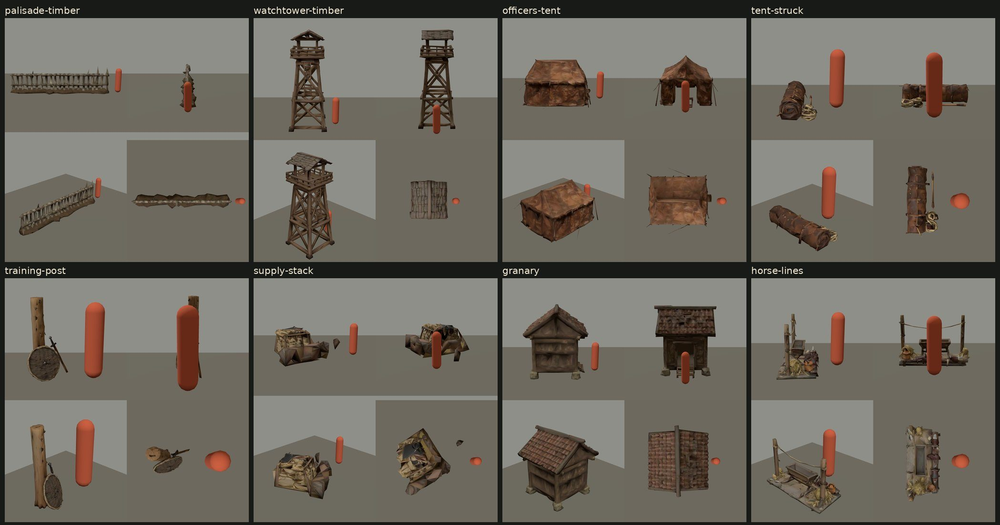

- **The first horse lines were rejected.** Four small toy-like horses stood in the picket line, despite the prompt and its negative prompt. The second attempt asked for the lines empty and named the animals in the negative prompt. It stands on a plank floor the negative prompt did not keep out. Its saddles carry small metal loops like stirrups, which the cavalry of the period did not have; at 2,940 triangles they no longer read as loops, and the saddles read as leather shapes with pale horns.
- **The palisade's** stakes are lashed with two bands on one face and braced behind on an earth bank. The bands face outward from the camp. Each section is stretched from 0.77 to 1.14 along its length to fill its run, which spaces its stakes a little closer or wider.
- **The watchtower** is 6 m high and stands within one wall cell.
- **The officers' tent** is a large leather tent with a ridge roof and its door flaps open; it is scaled to 0.94 to fit its court.
- **The supply stack** is barrels, flat-based amphorae and sacks on a straw-lined frame under a hide; one amphora stands apart in front. Flat-based amphorae were made in third-century Gaul, among others.
- **The training post's** practice sword has a metal hilt with a crossguard, which a Roman wooden sword would not have had; it is small at the camera's distance.

#### In the game

The camps were then seen where a player meets them, in the desktop build at High (which carries every chapter's models), each restored from its earned checkpoint through the Restore dialog: Chapters I and VII at the Overview and Follow cameras, beside the same views on main with the tent lines, and Chapters IV and VIII at their Overview cameras.

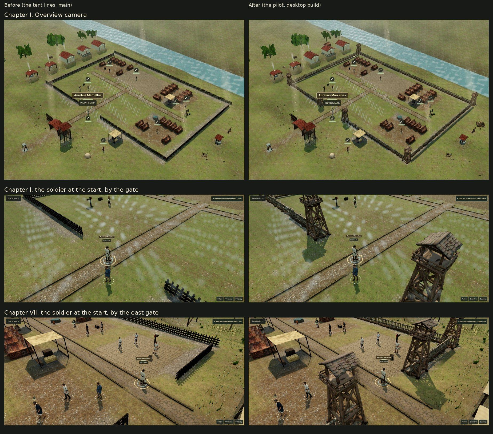

- **The walls:** the timber camps read as walled and towered camps from every camera, where the black breastwork read as a low fence. The palisade's pale stakes and earth bank read at the Overview camera, and no section's stretch shows.
- **The gates:** the gate towers frame the road out where the soldier starts in Chapters I and VII, without hiding him. A tower nearest the camera fills a good part of the frame there.
- **The furniture:** at the Overview camera the officers' tent and the horse lines read beside Chapter VII's walls, and the officers' tent and the granary beside Chapter IV's; the training post and the stores are small there. Beyond Chapter VIII's east wall the struck tent reads as a dark rolled bundle beside the ox cart, with its rope at one end; it too is small there.

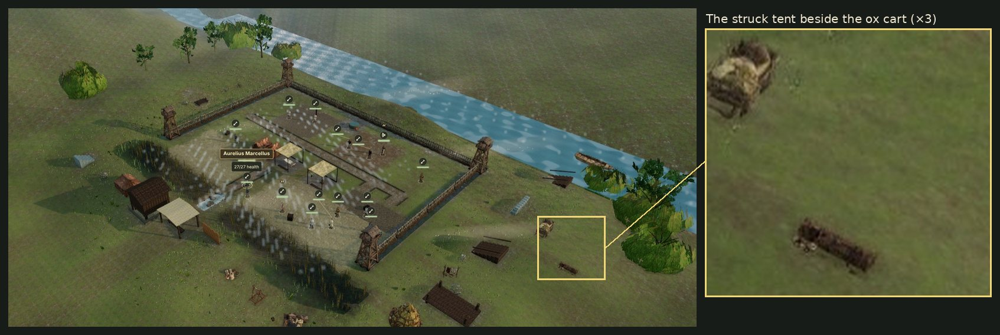

## Release G3: the rest of the camps · 9 November 2026

The rest of release G3 of the [graphics plan](graphics-tripo-plan.md#the-rest-of-g3-9-november): eighteen models, made after the pilot's review in the game (the owner's decision 9). [The asset pipeline](asset-pipeline.md#the-rest-of-release-g3--2026-11-09) has how they are placed.

The models were generated with Tripo's text-to-model API (`v3.1-20260211`, standard textures and geometry, 20 credits each) on 2026-11-09, from the text prompts in their requests only: no reference image or third-party model. The rest cost 380 credits of its 400-credit ceiling, task by task in [the G3 ledger](../art-source/models/graphics-g3-credits.json), and the balance read 9,325 before and 8,945 after. The owner's paid Tripo account gives the owner full rights to use, modify, distribute and commercially exploit them; Tripo holds a royalty-free, non-exclusive licence to display them as needed to provide its service.

| Model | Where | Chapters | Tripo task | Triangles | Runtime file |
| --- | --- | --- | --- | ---: | ---: |
| g3-wall-stone | along the stone camps' walls | IV, IX, XII | `0ff42fef-2121-45e5-97b9-b7067418d840` | 1,468 | 177,792 bytes |
| g3-tower-stone | on those walls' corners and gateways | IV, IX, XII | `910700e0-04af-45a2-9555-c821a2a40697` | 2,938 | 202,528 bytes |
| g3-gate-stone | over those walls' gateways | IV, IX, XII | `1a896afe-35eb-4065-9403-e6c727b6a832` | 2,450 | 188,016 bytes |
| g3-wall-mudbrick | along the mudbrick camps' walls | V, VI | `6c31d8b4-01ad-4e06-ad37-2c9c7c71764d` | 1,470 | 181,128 bytes |
| g3-tower-mudbrick | on those walls' corners and gateways | V, VI | `c52513a3-9d03-401d-9dff-235a0e66abc2` | 2,938 | 188,520 bytes |
| g3-gate-timber | over the timber camps' gateways | I, II, III, VII, X | `5d1d07bc-ab30-4db9-a9fa-4e0e63625049` | 2,450 | 205,012 bytes |
| g3-tent-open | on the tent lines | I, II, III, VII, VIII, IX | `d3651f2a-d321-4cab-8b0c-c6a124cd9a35` | 4,409 | 245,584 bytes |
| g3-tent-patched | on the tent lines | I, II, III, IX, XII | `d029539b-00cb-48b1-86d0-585a28402c39` | 4,410 | 267,056 bytes |
| g3-praetorium | beside the principia | II, VI, VII, IX | `a3a2726f-7c32-444f-b89f-400dbeadcb0f` | 3,430 | 216,188 bytes |
| g3-hospital-tent | beside the valetudinarium | II, III, VI, VIII, IX | `5f96d8b5-f04e-471b-96bc-6f63310ac0b4` | 3,430 | 231,220 bytes |
| g3-tribunal | beside the principia | I, IX, XII | `07accf57-028a-4c95-9b3c-5292bda4f558` | 1,960 | 180,836 bytes |
| g3-altar | beside the principia | I, IV, XII | `354939f7-7694-434e-a3d5-afaea71975a3` | 1,470 | 150,064 bytes |
| g3-parley-awning | beside the principia | VIII, IX | `c4b223da-9c34-49e1-910b-70e65348f19b` | 2,450 | 184,808 bytes |
| g3-pavilion-east | beside the principia | VI, IX | `a1c42151-adc2-4d6b-a210-80a18a4c07b0` | 3,429 | 235,396 bytes |
| g3-pavilion-shade | beside the canabae | VI, IX | `f1b1c516-cb2c-4b32-93eb-8f4d05d1713a` | 8,819 | 409,696 bytes |
| g3-pilum-rack-b | beside the drill ground | II, III, VI, VIII, X, XII | `417bca46-ea79-43bc-9bb3-5f39888da9be` | 1,960 | 175,076 bytes |
| g3-archery-butt | beside the drill ground | III, VI, X, XII | `348ec8b8-fe95-446d-8862-a3de67bfdc2b` | 4,410 | 304,964 bytes |
| g3-field-oven | beside the canabae | II, IV, VIII, X | `2f590cf3-aa3d-4a69-923b-88bb4a170350` | 2,938 | 190,084 bytes |

Every runtime file was processed in Blender to its request's budget (512-pixel maps), compressed (meshopt geometry, ETC1S KTX2 with mipmaps) with its geometry checked unchanged, and passes `check-model` within its request's budget. The second pilum rack ships as `g3-pilum-rack.glb`, the id the catalog places. Seven budgets were changed in review, each noted in its request:
- the mudbrick wall was processed 2.0 m high and the mudbrick tower 3.75 m, lower than asked, so that each wall section is stretched by at most 1.05 along Chapter VI's runs and the tower stays about 3.5 m wide;
- the open and the patched tents' bytes;
- the reed-mat shade's, twice: at review to 4,300 triangles, since processing stops at 4,269 whatever the target below it, and in the game to 9,000, where at 4,269 its roof and the jars beneath had crumpled into facets;
- the archery butt's triangles and bytes: below about 3,400 triangles its straw boss kept its triangles while its easel frame collapsed into sheets, and at 4,410 the frame, the wicker screen and the arrows hold;
- the field oven's triangles: at 1,960 its loaves, peel and firewood crumpled, and at 2,938 they hold.

The raw files stay outside the repository; their digests, the task IDs and the parameters Tripo reported are in each request file (`art-source/models/requests/`), and the processing and compression reports in `art-source/models/reports/`. The first pilum rack (`g3-pilum-rack`, task `b8b7df6d-f652-4dfc-ba6d-5edfcdea0276`, 20 credits) was rejected at review and is not shipped.

The prompts follow [the historical notes](historical-research.md) where the sources reach:
- **The walls and towers** of the stone and mudbrick camps follow the materials the code-built walls already gave them: dressed limestone in the fortress and frontier camps, mudbrick on a stone footing in the desert and the siege lines.
- **The tribunal:** the raised platform from which a commander addressed his army, as in the address scenes of the Columns of Trajan and Marcus Aurelius.
- **The pila:** the heavy javelin's long, thin iron shank on an ash shaft, ending in a small pyramidal point. The second rack's heads came out leaf-shaped, which is small at the camera's distance.
- **The archery butt:** Vegetius has recruits practise archery at targets of brushwood or straw (*Epitome* 1.15).
- **The field oven:** forts baked in round domed ovens, often built into the back of the rampart, away from the barracks for fear of fire (as the bread oven of camp life).
- **The pavilions of the East** are evocations for the camps of Chapters VI and IX, not reconstructions.

### Reviewed before shipping

Each model was compared with Tripo's render, then rendered from four sides with a 1.8 m figure for scale (`scripts/assets/preview-model.mjs`), and finally seen in the camps in the desktop build at High. What it showed, and what was kept:

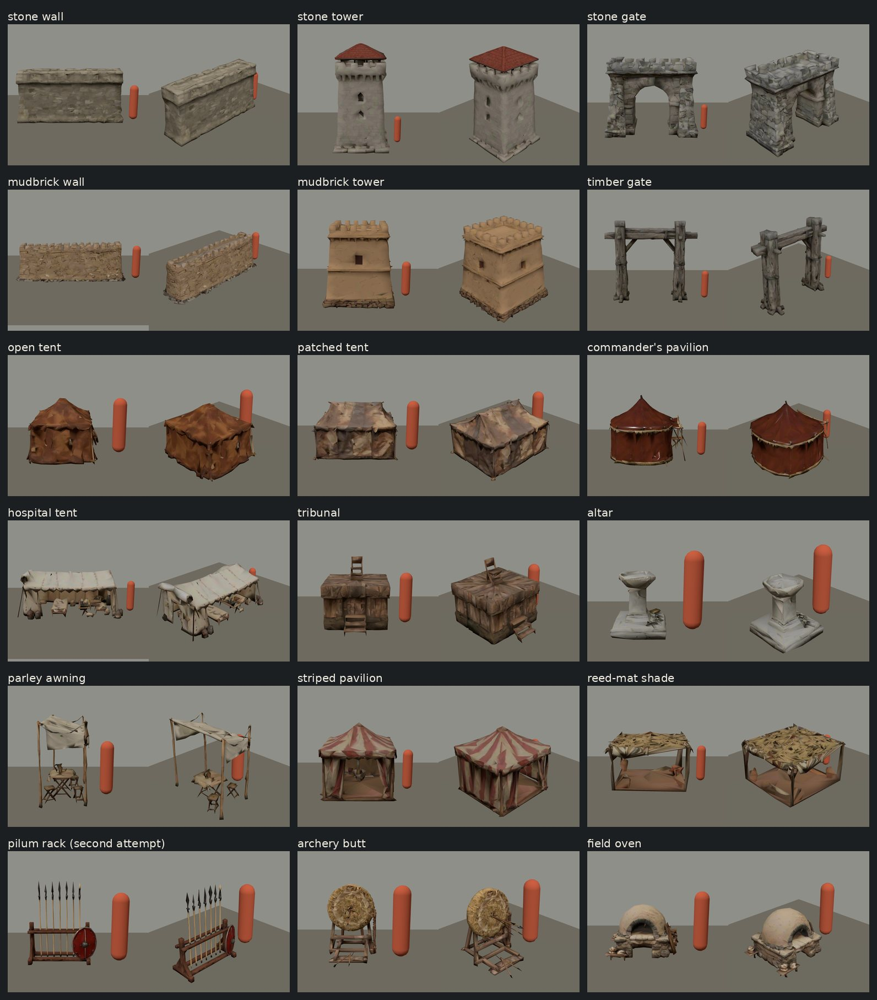

- **The first pilum rack was rejected.** The whole rack came out dark grey iron, its spears leaf-bladed, with no timber frame or wooden shafts. The second attempt asked for an oak trestle, ash shafts and iron shanks, and named the metal rack and the broad blades in the negative prompt. Its heads still came out leaf-shaped rather than pyramidal, and one is pale; both are small at the camera's distance.
- **The commander's pavilion** came out round, more like a later pavilion than the square Roman tent the prompt asked for. It is kept because it reads apart from the officers' ridge tent.
- **The timber gate** has no walkway, which the prompt asked for, and its oak posts are weathered grey.
- **The stone tower's** corbelled crenellations look a little later than the period. At 3.5 m wide it reaches half a metre beyond its wall cell on each side.
- **The tribunal and the parley awning** came out smaller than asked (the tribunal 2.3 m square, the awning 2.6 m long), at the true scale of their chair and stools.
- **The altar's** scrolled bolsters soften into the bowl's rim at 1,470 triangles.

#### In the game

The camps were then seen where a player meets them, in the desktop build at High (which carries every chapter's models), each restored from its earned checkpoint through the Restore dialog: Chapters II, IV, V, VI and IX at the Follow and Overview cameras, Chapters IV, VI and IX beside the same views on main, and Chapters II, IV, VI and IX from the edge of the board beside their courts, and Chapter II beside a tent line, the soldier walked there by ordinary move commands. Chapters IV, VI and IX were seen again once the shade and the supply stack had been processed again (below); the images show that build.

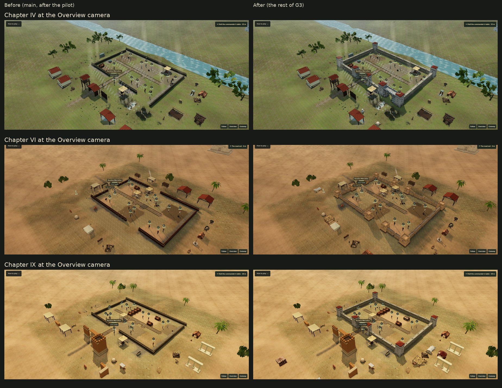

- **The walls:** the stone camps (IV, IX) read as stone forts where the code-built parapet read as a low dark band: limestone walls, square towers under red tiled roofs on each corner and either side of each gateway, and a round-arched gate over the road out. The mudbrick camps (V, VI) read as desert forts, their towers broad and low on stone footings. In Chapter V the courtyard's wall stands apart from the fortress kit's red frontage beyond the board. No wall section's stretch shows.
- **The gates** frame the road out where the soldier starts, without hiding him; the cutaway fades the pier nearest the camera. Chapter II's timber gate stands over its road out between the pilot's watchtowers.
- **The tent lines:** in Chapter II the open tent reads reddish and the patched one pale among the leather tents. The single tents of Chapters IV and VI stay leather.
- **The furniture,** from the edge of the board at the Follow camera: the commander's pavilion and the pilum rack beyond Chapter II's west wall; the altar beyond Chapter IV's south wall, with the oven there at the Overview camera; the hospital tent and its camp beds beyond Chapter VI's west wall, the archery butt and the pilum rack beside its south-east tower, and the reed-mat shade beyond its south wall; and the hospital tent, the commander's pavilion and the shade beyond Chapter IX's east wall.

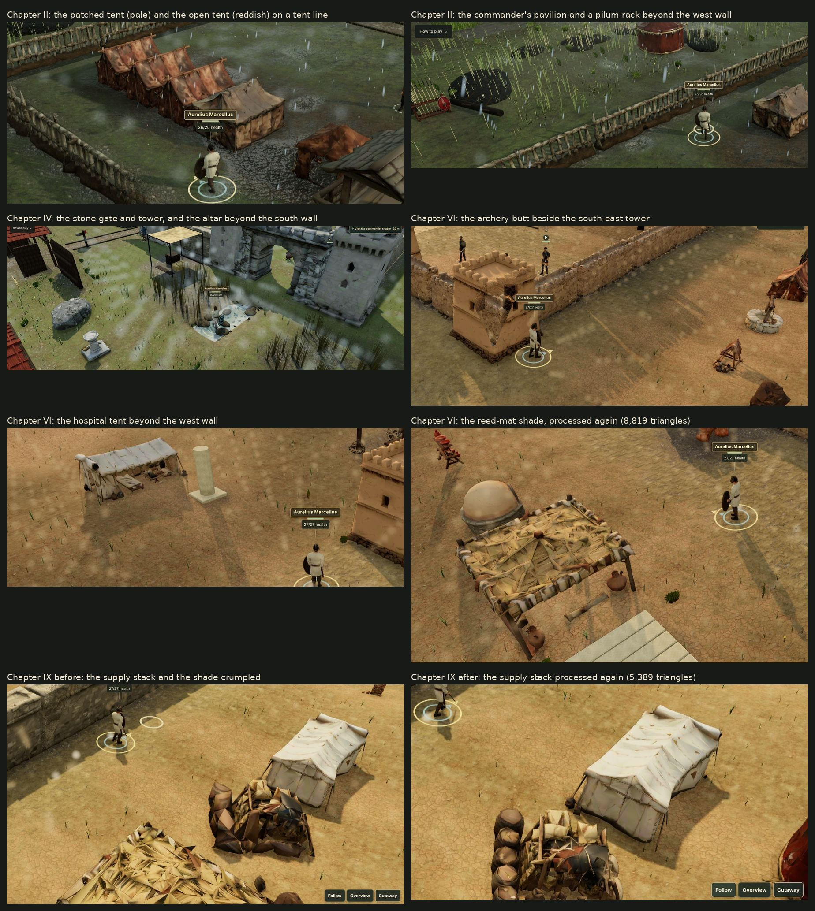

- **The reed-mat shade was processed again.** At 4,269 triangles its roof and the jars beneath it crumpled into facets at the Follow camera of Chapters VI and IX; at 8,819 they hold, for 121,844 more bytes.
- **So was the pilot's supply stack.** Beside Chapter IX's hospital tent at the Follow camera, its barrels, amphorae and sacks had crumpled into a heap at 3,163 triangles, the least its processing reaches, which the pilot's review at the Overview camera had not shown. At 5,500 (5,389 triangles, 329,212 bytes) they hold, in four views and in the game. 6,859 and 8,819 triangles held as well, but Chapter VII's web download, which carries the stack, had 129,529 bytes of room: 5,389 takes 72,560 more.
- **Not seen in the captures:** Chapter IX's courts are full, so its tribunal and parley awning stand in the far rows south of the camp, about 22 m beyond the board, below the edge of its Overview camera's frame at 1920 × 1080; the striped pavilion, further out to the south-west, shows at the frame's edge. The camera's pan stays over the board, so a player in Chapter IX may never see the tribunal or the awning there. The web therefore leaves both out of Chapter IX's download, which also made room for its other models, and since no other web chapter carries them, the web build leaves out their files; the desktop app keeps them, as it keeps every chapter's models.
- **Page errors:** none, in Chapters II, IV, V, VI and IX at High.

## Steam achievement icons · 3 November 2026

The 35 achievement icons for Steamworks (`desktop/steam/achievement-icons/`, 64 × 64 JPEG, each with a greyed locked copy) are made by `node scripts/steam-achievement-icons.mjs` from art the game already ships. Nothing new was generated and no credits were spent.

- **Chapters:** a square crop of the chapter's painting (`assets/scenes/`), with the chapter's numeral drawn in code. Chapters that share a painting are cropped at different places.
- **Errand titles, the finale's routes, the torc and the spear of honour:** an item picture from `assets/items/item-atlas.webp`, on a coloured ground. Swords and spears lie across the diagonal.
- **The other five decorations** (the civic, rampart and mural crowns, the armlets and the medals): insignia drawn in code, as the game has no pictures of them.
- **Finishing on Veteran:** the emperor's portrait. **Finishing under Iron discipline:** the oath's lead seal.

They carry the rights of the files they are made from, which [the asset manifest](asset-manifest.json) records. The frame, numerals and drawn insignia are the project's own code. The numerals use the renderer's serif font (DejaVu Serif on the Linux runner); no font file is added. The icons are uploaded to Steam, and the game does not ship them.

## Character face restorations · 4 November 2026

The face and hair paint of five generated characters was restored with OpenAI's built-in image tool (`image_gen`): the recruit (Marcellus), Aelia, Severianus, Paullus and Theon. The full account, with before-and-after comparisons and the checks, is in [the change notes](save-camp-art-refinements.md).

- **Input:** for each character, a frontal, unlit, orthographic render of the game's own bundled model on a grey ground. No photograph, other person's likeness or third-party image was supplied.
- **Prompt:** one shared base prompt asks for an identity-preserving albedo restoration that keeps every feature at its pixel position, and one sentence names each subject. Both are kept verbatim in `art-source/characters/surface-repair/prompts.json`, beside the references, the generated projection paint and the baked atlases. The build leaves that folder out.
- **Into the game:** Blender 5.2.2 LTS (`scripts/assets/bake-character-face.py`) projected the reviewed paint back onto the same mesh, into the model's original atlas. `scripts/assets/repair-character-surfaces.mjs` then wrote the model, with that albedo as KTX2 UASTC with mipmaps. Positions, UVs, skin weights, skeletons and contact anchors are unchanged.
- **Rejected:** whole-atlas repaints, which moved facial features, and ETC1S compression, which lost the restored detail.
- **Records:** each of the five models' entries in [the asset manifest](asset-manifest.json) gains a `surfaceRepair` record, naming the previous file's SHA-256 and size, the tools and its report (`art-source/models/reports/char-<id>-surface-repair.json`). The original Tripo tasks, prompts, charges and licence records stay as they were.
- **Rights:** as for the game's other OpenAI images, no exclusive copyright or licence ownership is asserted. [Steam's AI disclosure](steam-ai-disclosure.md) names the restorations, and [the owner's checklist](steam-release.md#rights-for-a-commercial-release) counts them with the illustrations.
