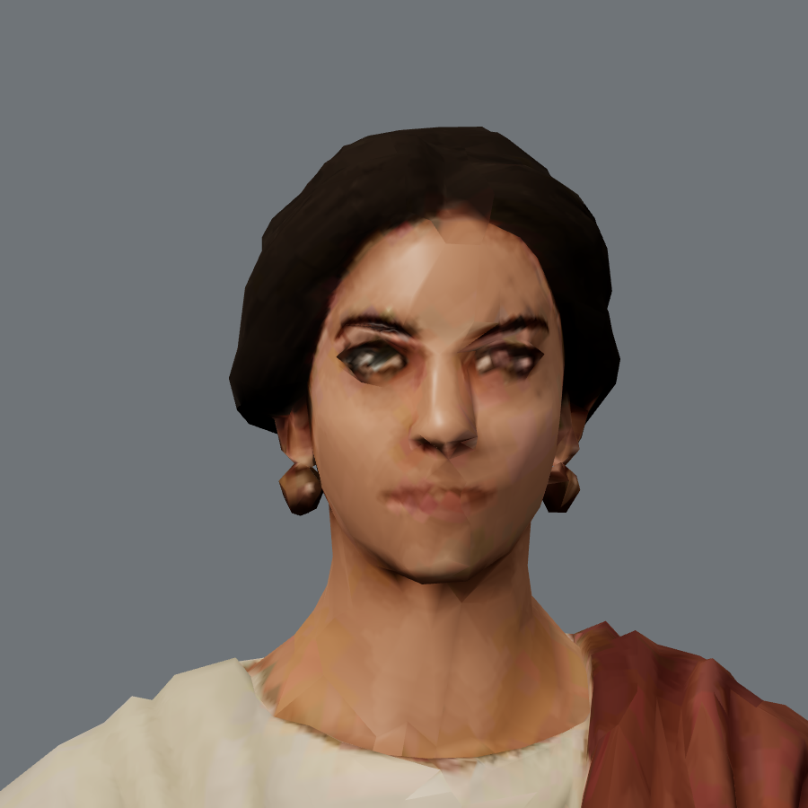
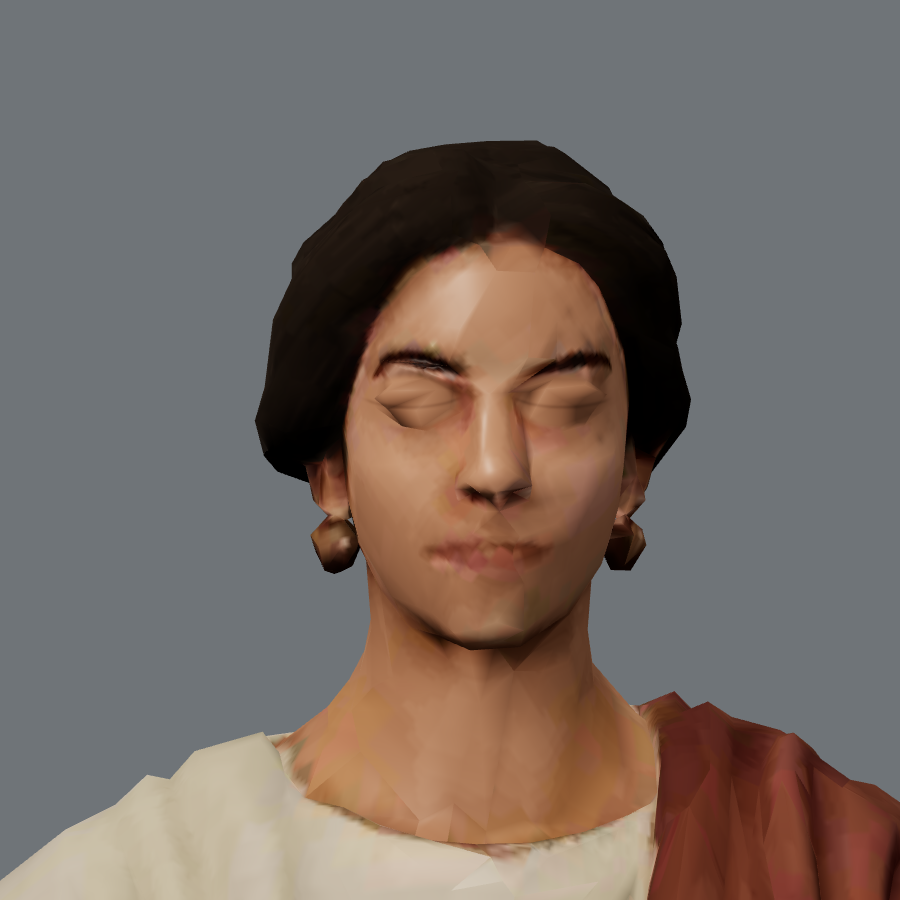

# Camp, character and control follow-up — 31 October 2026

This follow-up addresses the review of main at `d191201`: bridge feedback, the cavalry command card, Chapter VII download headroom, Aelia's expressions, Severianus's final-court offline body, and Windows checks of the new content. It does not complete the owner's Gate 4 acceptance or release 0.40.0.

The art changes reuse the existing models and textures. No Tripo credits were spent.

## Changes

- Bridge demolition reports its shared two-stage requirement, including an explicit completion message. Engineer support still finishes it in one action. The save schema, world version and simulation rules are unchanged.
- The squad toolbar and selection announcement describe the actual available card. Cavalry includes Charge and Feigned retreat. Visible shortcuts and `aria-keyshortcuts` follow the player's remapped bindings. A dedicated Chromium regression earns Chapter IX through legal commands and checks default 8/9, remapped K/D, applied orders and unchanged paused state after invalid inputs.
- Eleven Chapter VII props use the existing bounded normal/UV quantization format. Their textures, triangle positions, winding, materials and node transforms are preserved. Reproducible packing reports retain the original compression provenance. Download limits have not changed.
- Severianus's generated body belongs to Chapter XII's offline pack. A legal patron-support campaign covers his conditional appearance, in addition to the existing chapter inventories.
- Aelia uses restrained expression targets and feathered eyelid closure sampled from her own skin/PBR maps. Her original face, hair, earrings and neutral appearance are retained; this is bounded procedural animation, not facial capture or phoneme lip sync. Close visual review rejected an earlier stretched-lid approach; the accepted version preserves the original topology and eliminates its panel edges and forehead crack. The isolated neutral comparison against the untouched master found zero differing pixel channels. Both detail levels add 605,528 bytes of morph/sampling geometry, with unchanged triangle counts and isolated draw/program counts (3/2). The source face remains visibly coarse at extreme close range.

## Windows interaction review

The close specimens below are software-rendered diagnostics of the shipped figure, not new key art or an in-camp camera. The neutral specimen is pixel-identical to the original; the second shows the closed blink. Her coarse source topology is deliberately visible in this close inspection.

| Original neutral preserved | Own-face blink |
| --- | --- |
|  |  |

The agent used the Windows in-app browser against a separate local test origin. Later chapters were reached by importing save codes earned from New Game through public gameplay commands, then verified by the game's import review. No campaign flags, victories, actors or positions were injected into the browser.

- Chapter I: started a new real-time campaign, moved by keyboard, paused, and opened the menu.
- Chapter VIII: imported an earned checkpoint; accepted Aelia's seed-jar errand; used All actions to walk to the stores and collect the jar; returned it for two training points. The completed reply disappeared. Walking unlocked the appropriate travel destinations.
- Practice: opened Chapter V's red river gate from the completed-encounter list, inspected the siege objective and optional-work explanation, paused and tried F2. Practice refused to save. Return to chronicle and a page reload retained Chapter VIII, 134 training points, 80 denarii and the completed-encounter count.
- Chapter IX: restored the earned encounter, selected the horse standard, confirmed deployment, paused and pressed 9. The toolbar exposed keys 1–9 and Feigned retreat appeared in the queued-order feedback. On resuming, the log recorded the cavalry riding away, the enemy horse giving chase and its cohesion dropping. No browser console errors were recorded during these interactions.
- Chapter VIII crossing, final production build in 2D: completed the upstream repair opportunity through All actions, opening the side gate and restoring the footbridge to a ford. The repaired bridge offered `Demolish bridge (0/2)` with its two-action/nearby-engineer explanation. Approached it and completed engineer-supported demolition; the log explicitly reported deep water for both armies, and the scene labelled the bridge demolished. No browser console errors were recorded. The separate simulation regression covers the ordinary two-action `1 of 2` progress case and exact resume.

These are agent interaction checks, not an uninterrupted human campaign play-through. Concurrent software-rendered diagnostics caused adaptive quality to select Performance, so this session does not establish device frame-rate acceptance. Phone hardware, screen-reader use and first-time-player/owner Gate 4 testing remain outstanding.

## Final validation

Final production build: `79dbd5608dd7`. The preceding build, `6ea4a6a69ee9`, differs only in squad shortcut metadata: final review added canonical ARIA tokens for numpad and punctuation remaps, leaving input behavior and human-readable labels unchanged. Figures below are the final build's sum of gzip files, including the worker and each chapter's 2D extras where stated, not a browser network trace.

| Download | Baseline | Final | Unchanged limit |
| --- | ---: | ---: | ---: |
| First load | 941,799 bytes | 942,378 bytes | 2,000,000 bytes |
| Chapter I, 3D | 15,368,706 bytes | 15,262,551 bytes | 16,000,000 bytes |
| Chapter VII, including 2D | 23,935,403 bytes | 23,446,549 bytes | 24,000,000 bytes |
| Chapter XII, including 2D | 23,489,703 bytes | 23,719,792 bytes | 24,000,000 bytes |
| Complete campaign | 53,485,343 bytes | 52,996,489 bytes | 80,000,000 bytes |

VII recovers 488,854 bytes after the shared code changes, leaving 553,451 bytes of headroom. XII gains the conditional patron's body while remaining 280,208 bytes below its limit. The model repack alone saves 492,655 gzip bytes; its maximum measured normal drift is 0.3746 degrees and UV drift 0.000007630. All 22 before/after prop review renders passed; the independent root review also checked the equipment rack's shields and the Adda bridge. No map was resized or re-encoded.

All **1,491 unit tests passed**, with zero failures, cancellations or skips (Windows, Node 24.19.0; `node --test --test-concurrency=2 tests/*.test.mjs`, following `prepare-tests.mjs`). The final ARIA correction then passed all 15 targeted squad-card, direct-controls and squad-controls tests, including the new numpad/punctuation regression. All four campaign autoplay commands passed, including the mission routes and exact production retries. Asset verification, 768 character pose cases and the production animation audit passed. The character-handoff check retains its documented warning about stale development exports; this change does not alter the three exported specimens, and the authoritative verify command intentionally uses `--warn` for that notice.

The final browser suites use build `79dbd5608dd7`, Playwright 1.62.1 and matching regular Chromium 151.0.7922.34, launched headless with SwiftShader on Windows. They ran sequentially, with unchanged assertions and download limits.

| Check | Final result |
| --- | --- |
| Full Chromium smoke | 21/21 scenarios; no page or console errors |
| Usability | 11/11 flows; desktop and phone-sized layouts, 200% text, navigation and exact save protection; no browser or network errors |
| Real-time control/layout polish | 20/20 checks |
| Cavalry regression | 4/4 checks; default and remapped keys, actual order application, unavailable commands and feedback; no browser errors |
| Regional camp integration | VII, VIII and XII passed all nine camera checkpoints, asset loading and scenery retirement; no browser errors |
| Twelve-chapter benchmark | 13/13 scenes across all twelve chapters, including both Chapter V scenes and their horizon views; all five acceptance checks passed; no browser/runner errors |

The regional diagnostic is deliberately partial, not full twelve-camp acceptance. Its Balanced captures were visually inspected; no missing scenery or new material/seam defects were found. Its retained scenery sets were 13, 14 and 13 assets respectively, with no idle or loading leftovers. It does not establish close-up expression quality or physical-device frame rates.

The twelve-chapter benchmark kept Chapter V at Balanced quality, 1280×900, and the other chapter inventory at Performance, 960×720, all at DPR 1. Every capture verified imported actors, settled cameras and exact preservation of the public save. Its additional political-case preview/commit, 320px layout at 200% text, remapped keyboard/persistence and Practice-isolation checks also passed. This is a rendered inventory and interaction benchmark, not a physical-device performance result or a human campaign play-through.

The Practice regression now waits for the camp's normal first-visit save and pauses through its visible control before exporting its baseline. This removes a setup race while retaining every complete-chronicle equality assertion; the final full smoke run passed Practice and its reload check. The preferences flow additionally covers focused keyboard Continue after reload; pointer Continue remains covered by ordinary mode selection and campaign/Practice reloads. Neither change alters gameplay or save formats.

For this Windows environment, use the matching regular `chrome.exe` through `PLAYWRIGHT_EXECUTABLE_PATH`. Headless-shell repeatedly stalled on an otherwise responsive Settings capture, including with a matching driver. The regular matching browser captured that same panel in 0.56–0.77 seconds and completed all four suites above. No game styles or assertions were changed to resolve that tooling issue. Final unit verification used two workers to stay within available memory.
