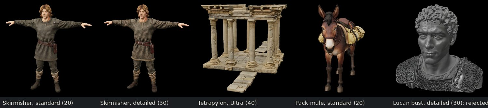
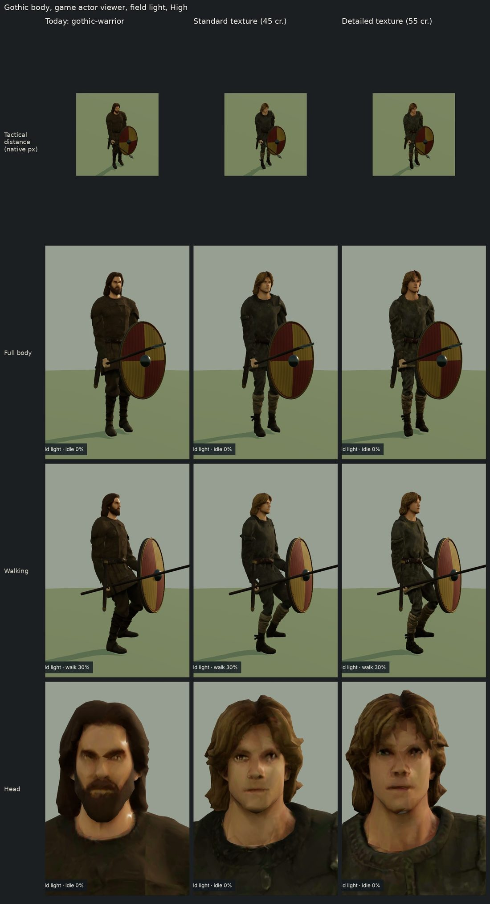
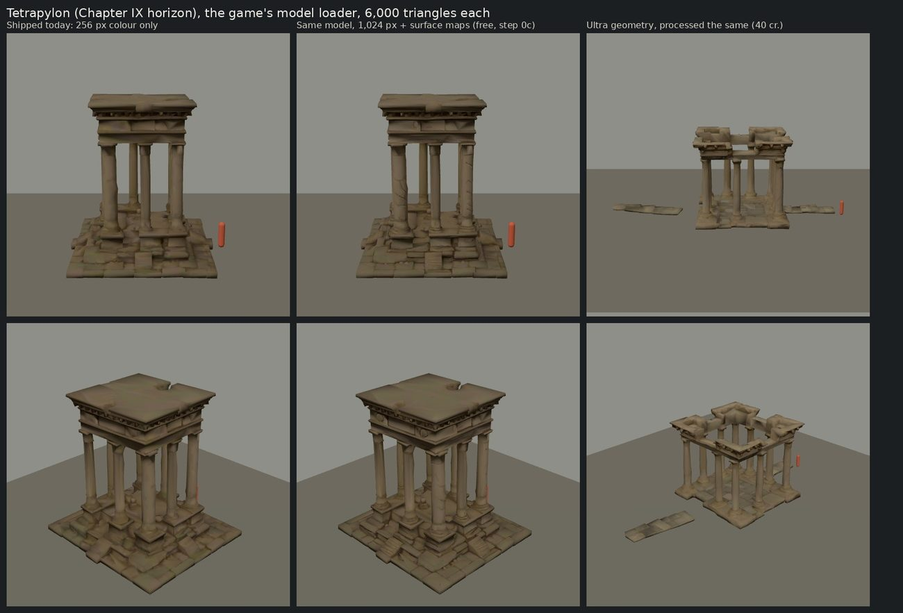
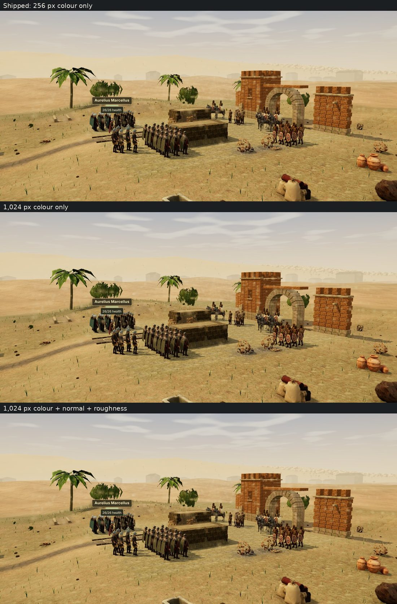
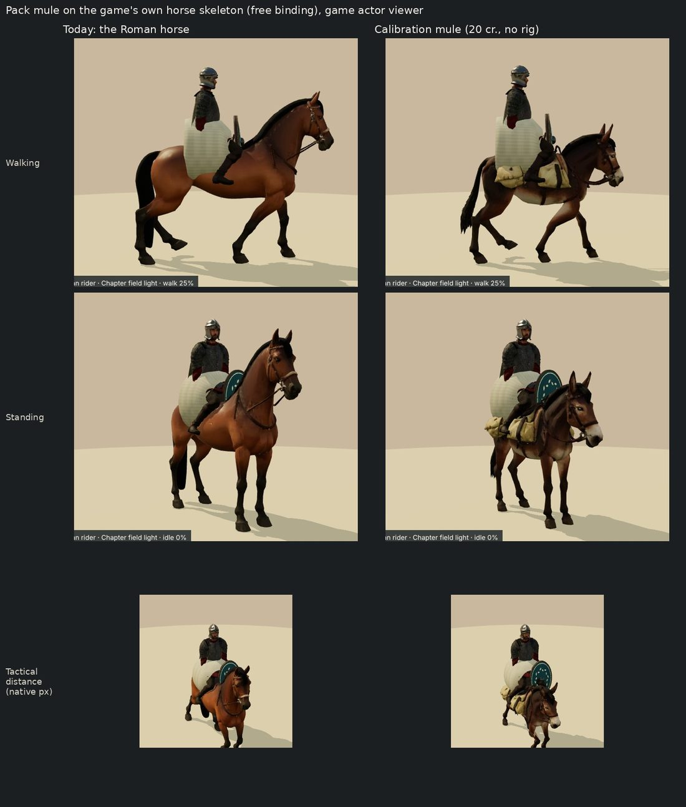

# Step 0's calibration: what Tripo's quality tiers buy in the game

Step 0 of [the graphics plan](graphics-tripo-plan.md) bought a few test models at Tripo's cheap and expensive tiers, processed each to the game's budgets and showed it in the game, so the owner can pick a tier for each category before any bulk spend. This records what was made on 8 November 2026, what it cost, what it showed and what it recommends. The owner decides.

## Spent: 190 of the 250-credit cap

| Model | What it tests | Credits |
| --- | --- | --- |
| Gothic skirmisher, standard textures | the baseline body | 20, and a rig 25 |
| The same skirmisher, detailed textures | the detailed texture tier on a soldier | 30, and a rig 25 |
| The tetrapylon at Ultra geometry | Ultra geometry on a building | 40 |
| A pack mule | a four-legged animal, rigged and walking | 20; Tripo's rig check is free |
| Lucan as a bust, detailed textures | a close-range face | 30, rejected |
| **Total** | 7 paid tasks, 1 rejected (14%) | **190** |

The balance went from 10,700 to 10,510 credits. Every task is in [the ledger](../art-source/models/graphics-calibration-credits.json) and its request in `art-source/models/requests/cal-*.json`. Tripo still serves each output by its task ID, so the models can be downloaded again without paying.

## Prices

| | Credits | Source |
| --- | --- | --- |
| A model with standard textures (2,048 px) | 20 | measured, as before |
| … with detailed textures (4,096 px) | 30 | measured |
| … with Ultra geometry and standard textures | 40 | measured |
| A biped rig | 25 | measured, as before |
| A rig check | 0 | measured |
| P2, the clean-topology series | 110 with standard textures (100 without, 120 detailed, 130 extreme) | Tripo's changelog; not bought |

Each price was read twice: from the frozen balance straight after each task was submitted, and from the task's reported cost once it finished. P2 costs five and a half times a standard model, so the plan's counts could not afford it, and no credits were spent to confirm the documented price.

## A soldier: standard against detailed textures

The two skirmishers share a prompt and seeds, and Tripo made the same young man twice: the detailed one's woven hems and leg bindings are crisper in Tripo's render. The game wears a body at about 11,300 triangles with a 1,024-pixel colour map, though, so both are bound and compressed to the same budget and shown below on the game's Gothic spearman, in the actor viewer at High with Chapter II's field light.

- **At the game's camera distance**, the top row, the two are indistinguishable.
- **Up close**, the detailed one shows a little more cloth texture.
- **Faces** are limited by the triangle budget, not the texture: both heads are faceted.

Detailed textures cost 10 more credits per body and buy nothing at the distance the game is played. Each tier's mesh differs, too: Tripo made a different mesh for the same seeds, so the tiers cannot share a rig.

## A building: Ultra against standard geometry

The Ultra tetrapylon has 1.95 million triangles where the standard one has 1.41 million. The game shows a landmark at 6,000 triangles, so both were processed to that budget, with 1,024-pixel colour, normal and roughness maps, and are shown below beside the one the game ships today.

- **The extra geometry does not survive** the reduction to the game's budget.
- **This attempt came out worse:** narrower, more ruined, with loose paving.
- **Re-texturing the shipped model** at 1,024 pixels with surface maps (the middle column) sharpens its fluting and stonework, but only this close.

**In the game, the difference disappears.** The landmarks stand 115 to 250 metres off, on the horizon. Below is the game's own Horizon camera on Chapter IX's first battle, from a legally reached checkpoint at High, with its three landmarks (the tetrapylon, the city gate and the walled sanctuary) in three versions:

- shipped, with 256 px colour only;
- re-processed with 1,024 px colour;
- re-processed with 1,024 px colour and surface maps.

They are faint shapes a few pixels high in the haze, and the three versions look the same. The pixels that differ belong to moving clouds and figures. In normal play the camera looks down on the board, and the horizon is smaller still.

The re-texture would add 120–320 KB per landmark (KTX2), about 10 MB across the 32 landmarks, for nothing visible. Step 0's free re-texturing of the landmarks is therefore recommended against.

## An animal: a pack mule

- **Tripo's quadruped rig is not usable here.** Tripo's free rig check returned "not riggable" for the mule, so the pipeline did not pay for a rig or a walk.
- **Bound to the game's own horse skeleton instead.** Without credits, it was bound the way the game's three horses are (`scripts/assets/bind-horse.py`). It walks on the game's horse gait, its hooves planted and its packs moving with its body, at 9,000 triangles and 714 KB compressed. It wears the Roman rider below only because the viewer's horse case carries one.

## A face: Lucan as a bust

Tripo made a grey stone sculpture of a stranger. Its colour map is uniformly grey, and the face is not Lucan's, despite a negative prompt against marble, stone and statues. A text prompt for a head and shoulders asks for a statue.

## Recommendations

| Category | Release | Recommended | Why |
| --- | --- | --- | --- |
| Soldiers' bodies | G1 | standard textures, rigged (45 credits a body) | detailed shows nothing at the game's distance |
| Weapons, shields, standards | G2 | standard | small on screen |
| Camps, tents and props | G3 | standard | Ultra's geometry does not survive the budget |
| Siege engines and debris | G5 | standard | as above |
| Backdrops | G7 | reconsider the release | the horizon's models are a few pixels high in the haze, so new ones there would barely show. Its 750 credits could go where the camera is, to camps (G3) or battle (G5) |
| The shipped landmarks | step 0c | leave them as they are | re-texturing them shows no difference in the game and adds about 10 MB |
| Animals | G4 | standard models, bound to the game's own four-legged skeleton (20 credits each) | Tripo's rig check refused the mule, and the game's horse gait works for it |
| Faces | G6 | a pilot that starts from a picture: image-to-model from the cast portraits, or full-body figures, compared at close range | a text-prompted bust becomes a statue, and faces are limited by triangles more than by texture |

What this changes in the plan:
- **Counts.** At standard prices each release's cap buys at least the planned count. G4 no longer pays for rigs or walks: about 35 credits an animal is freed for more animals or variants. Each release's pilot will propose its counts within its cap, so the total spend stays at or above the plan's 70% (7,490 credits).
- **What the camera sees.** Landmarks and backdrops stand at the horizon, where the game draws them a few pixels high. The credits buy most where the camera is: bodies, kit, camps and battle.
- **Pipeline support.** The client now also accepts P-series models and Tripo's preset animations (`retarget` and `resume-retarget` in `npm run asset:tripo`). Neither was used, for the reasons above.

## The owner's decisions (8 November)

- **Tiers:** standard textures for every category, with standard geometry.
- **Step 0c:** skipped; the shipped landmarks stay as they are.
- **G7:** skipped. Its 750 credits go where the camera is: 400 to the camps (G3) and 350 to battle and siege (G5). The plan keeps its 7,900-credit cap, 73.8% of the balance.
- **Faces:** the approach for G6 is still to choose, from its pilot.

## Limits

- **One sample per tier.** One soldier and one building were tried at each tier, and generations vary from attempt to attempt.
- **What the images are.** They come from the game's actor viewer, model loader and campaign 3D harness under a software renderer, at High: the production figures, materials, lighting and compression. The horizon view is a whole battlefield from a legally reached checkpoint; none is a real GPU.
- **Visual judgements.** The recommendations are visual judgements. The owner's eye decides.
- **Nothing ships.** No calibration model was added to the game. A model the owner picks for a release ships from a new request that reuses its task ID and digest, so its credits are not spent twice.
