# A substantially better-looking game, from Tripo credits — the approved plan

The owner approved this plan on 8 November 2026, with the recommended answer to each of its four decisions. It spends at least 70% of the Tripo balance on the game's graphics.

Each release's changelog entry records what it actually delivered, spent and measured. Where it and the plan differ, the changelog, the credit ledgers and the code are authoritative.

## The budget

| | Credits |
| --- | --- |
| Balance on 8 November | 10,700 |
| 70% minimum | 7,490 |
| **This plan's cap** | **7,900 (73.8%)** |
| Kept back | about 2,800, for fixes after Gate 4 and the final store media |

- **Spent before this plan:** 4,300 credits.
- **What they bought:** 112 shipped models:
  - 17 soldier bodies, 12 cast members and 3 horses;
  - 70 props, landmarks and rocks;
  - 35 item models, shipped only as 2D pictures.
- **Measured unit costs:**
  - 20 credits per textured model and 25 per biped rig, over 170 generations and 36 rigs;
  - 8% of past attempts were rejected.
- **Prices unknown at approval:** Tripo's prices for detailed textures, Ultra geometry and the clean-topology P-series were not yet known. Step 0 measured the first two (30 and 40 credits a model) and found P2's in Tripo's changelog (110 with standard textures): [the calibration](graphics-calibration.md).
- **How the plan holds:** each release has a fixed credit cap, and its counts follow the measured prices.

## Status

| # | Release | Cap | State |
| --- | --- | --- | --- |
| 0 | Use what's paid for, then calibrate | 250 | done: calibrated (190 credits, [results](graphics-calibration.md)), and the 3D kit made (seven weapons and helmets, no credits); the landmarks' re-texture skipped |
| G1 | Armies | 1,005 | done: the [pilot](#g1s-pilot-8-november) (310 credits) and [the rest](#the-rest-of-g1-9-november) (695): 22 bodies and 2 horses. Its other 1,295 credits went to G3 and G5 |
| G2 | Arms and standards | 700 | |
| G3 | Camps | 2,400 | done: [the tent lines](#g3s-tent-lines-9-november), with no credits, [the pilot](#g3s-pilot-9-november) (180 credits) and [the rest](#the-rest-of-g3-9-november) (380): 26 models. Its other 1,840 credits are [held for the releases after it](#what-g3-leaves) |
| G4 | Animals | 600 | done: [the pilot](#g4s-pilot-10-november) (80 credits), [seven more animals](#the-rest-of-g4-seven-more-animals-10-november) (160) and [the battles' animals](#the-battles-animals-10-november) (no credits): 12 models and the horse lines' horses, beside 20 pieces. [Walking animals wait](#g4-closes); the 1,180 credits it leaves, its own and those held for it, follow to G6 and G2 |
| G5 | Battle and siege | 1,845 | done: [the pilot](#g5s-pilot-9-november) (140 credits), [the first batch](#the-rest-of-g5-the-first-batch-9-november) (440) and [the last](#the-last-of-g5-10-november) (80): 28 models. Its other 1,185 credits [join G3's held 1,840](#what-g5-leaves) for G4, G6 and G2 |
| G6 | Faces and people | 1,100 | paused at its stop rule, at 3,340 with its held credits: [the pilot](#g6s-pilot-10-november) (185 credits) and [the first batch](#the-rest-of-g6-the-first-batch-10-november) (790): five faces from portraits, three senators and twelve of the camps' people. [The owner decides whether it goes on](#after-g6s-first-batch-10-november) |
| G7 | Backdrops | — | skipped by the owner; its 750 credits went to G3 and G5 |
| | **Total** | **7,900** | |

## What the game shows today, and where it falls short

- **Factions look alike:**
  - each enemy faction has 3 bodies for its 5–7 unit types;
  - all 11 champions share their faction's bodies;
  - rival Romans wear the player's own soldiers' bodies.
- **Code-built kit:** weapons, shields, helmets and standards are code-built.
- **No animals** other than horses. Carts stand unharnessed.
- **Flat camps:** the camps are flat service courts with code-built tents.
- **Missing set pieces:** there is no artillery, and the council, parley and tribunal are code-built.
- **Faces** have low-resolution paint, and all the named men share one eye paint.
- **Landmarks** have 256 px colour maps only, so they look flat up close.

## Step 0: use what's paid for, then measure (cap 250 credits)

1. **3D weapons, shields and helmets, at no credit cost.** The 39 item models generated for the inventory become held and worn kit. Code-built kit stays the fallback.

   Done on 8 November with seven of them: the spatha, gladius, knife, axe, galea, Niederbieber helmet and felt cap, worn by figures dressed in those items (the player's soldier, his companions, named veterans and his squads). The crowds keep the code-built pieces, which read more clearly at the field's distance. The spangenhelm hides the face; spears, bows, slings and the shields, with their unit designs, stay code-built. The armour and clothes are the generated bodies' own. [The changelog](../CHANGELOG.md) has why.
2. **Landmarks re-textured, at no credit cost.** They go from 256 px colour-only maps to 512–1,024 px with surface maps, from the original downloads.

   Skipped by the owner on 8 November, as the calibration recommended: in the game's Horizon view the landmarks are a few pixels high, and the re-texture would add about 10 MB for nothing visible.
3. **Calibration.** About 10 test assets, each made at the cheap tier and the expensive tiers:
   - a soldier, a tent, a building and a shield;
   - a mule, rigged on four legs and walking;
   - a cast bust.

   Each is processed to the game's budgets and shown in the game, and the owner picks the tier for each category. The default is standard for troops and props, and detailed only where the camera comes close.

   The owner chose standard textures for every category on 8 November, with standard geometry.

   Done on 8 November for 190 credits: [the calibration](graphics-calibration.md) recommends standard textures throughout, animals bound to the game's own skeleton, and a face pilot that starts from a picture. In the game's Horizon view the landmarks are a few pixels high, so it recommends against item 2 and asks the owner to reconsider G7.

The original downloads (7.3 GB, not in git) exist only in the working container, so the two credit-free upgrades come first. Tripo still serves them by task ID: on 8 November a task from 2 November downloaded again, identical to its recorded SHA-256.

## The releases

Each release is its own PR. A pilot of about 15% goes to the owner before the rest is generated.

| | Release | What it adds | Count |
| --- | --- | --- | --- |
| G1 | Armies | 34 rigged bodies (below), plus 3 horses that fix the cataphract trapper and the oversized northern horse | 37 |
| G2 | Arms and standards | Helmets (ridge, spangenhelm, Persian, Palmyrene, centurion), faction shields, bows, lances and maces; standards (draco, vexillum, imperial portrait, Persian banner) | 30 |
| G3 | Camps | Tents (contubernium in three states, officers', praetorium, hospital, eastern pavilions); towers, gates, ovens, granaries and horse lines; racks, carts, barrels, amphorae and training posts; the council, parley, tribunal and ceremony sets | 54 |
| G4 | Animals | Mules, oxen, camels, dogs, goats and sheep, rigged on four legs and walking; carts harnessed | 10 |
| G5 | Battle and siege | Onager, ballista, scorpion and cart-mounted ballista; siege tower, ram shed, mantlets and the Gothic wagon laager; regional palisades and stakes; the code-built field objects; battlefield debris; river boats | 40 |
| G6 | Faces and people | 12 detailed cast busts, their faces baked onto the shared animated head; bodies for Vibia, Dida, Caecilia, Licinia and the smith; 3 civilians; correct full-length togas | 24 |
| G7 | Backdrops (skipped) | Temple of Bel, tetrapylon, Euphrates bridge, Danube fort gate, roadside tombs, aqueduct, triumphal arch, Milvian bridge, villas and shrines | — |

G1's 34 bodies:

| Side | New bodies |
| --- | --- |
| Gothic | 8 |
| Persian | 5 |
| Palmyrene | 5 |
| Rival Romans | 4 |
| Roman specialists: Moorish and Dalmatian cavalry, a draco-bearer, a centurion | 4 |
| Unique champions | 8 |

### G1's pilot (8 November)

Seven bodies and a horse, one for each of G1's categories, in the game for the owner's review:

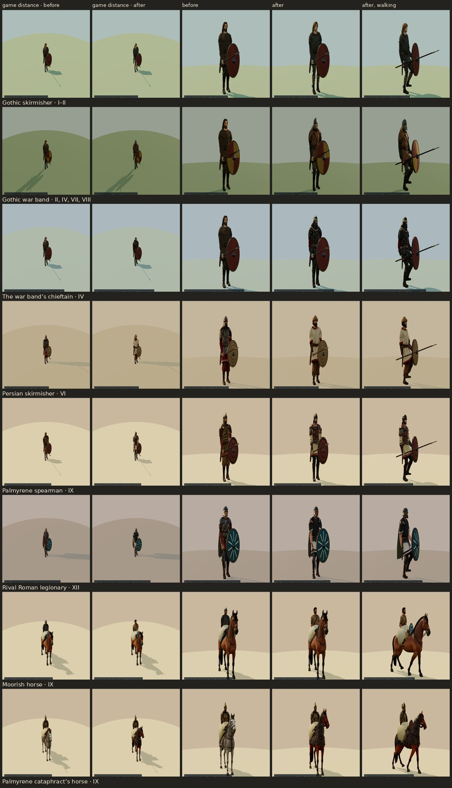

| Category | Body | Worn by | Chapters |
| --- | --- | --- | --- |
| Gothic | a young skirmisher, step 0's calibration body (no credits) | the skirmisher who marches on with the reinforcements | I, II |
| Gothic | a war-band spearman in a leather jerkin and segmented helmet | the war bands' infantry | II, IV, VII, VIII |
| Persian | a skirmisher in linen and a felt cap | the raiders | VI |
| Palmyrene | a spearman in a leather corselet over linen | the infantry | IX |
| Rival Romans | a legionary in mail over an off-white tunic | the claimant's civil-war cohorts | XII |
| Roman specialists | a Moorish horseman | the Roman cavalry of the Palmyrene war | IX |
| Champions | the war band's chieftain, with his torc | the gate battle's champion | IV |
| Horses | a chestnut cataphract's horse under bronze scales, flat along the back | the Palmyrene cataphracts | IX |

- **Credits:** 310: six rigged bodies (45 each), the horse (20), and one rejected generation redone (the first rival legionary came out in segmented plate). [The ledger](../art-source/models/graphics-g1-credits.json) has every task.
- **How a body is chosen:** by what the rules made the unit (its role, a skirmisher's or a claimant's name, a champion's id), in presentation only; a type's body is matched before its faction's.
- **Downloads:** Chapter I's download is now 17.2 of its 18 MB, so at most two more of Chapter I's bodies fit the web build at the bodies' 1,024-pixel maps. The rest can take the cast's 512-pixel maps, as release 8 did, or ship in the desktop app only, as decision 2 allows.
- **In battle:** the change is modest at the battle camera ([the art record](art-generation.md#in-battle) has the method).
  - A figure stands about 70 to 100 pixels tall in a 1,080-pixel frame, and its shield covers much of its body.
  - What reads is a figure's outline and its main colours: a helmet or a bare head, light cloth or dark armour, a horse's coat.
  - The clearest gain is Chapter XII, where the claimant's cohorts no longer look like the soldier's own men.
  - Close up, in the actor viewer, every body is plainly its own.

  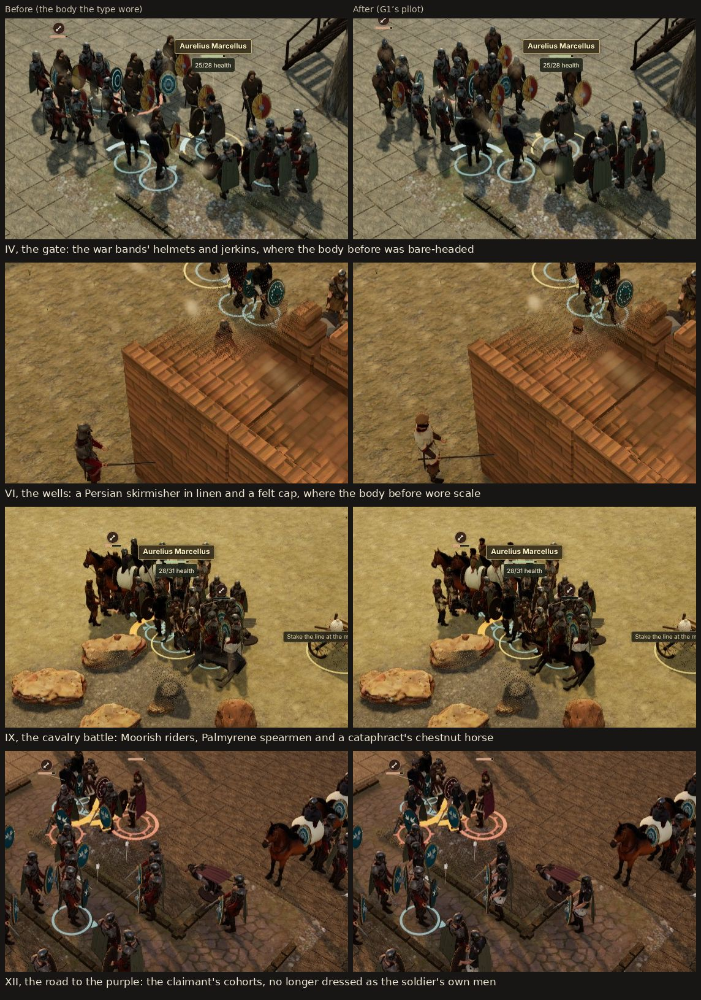

**Proposed for the rest of G1, and approved by the owner on 9 November** ([what was made](#the-rest-of-g1-9-november)). G1 had 1,990 credits left.
- **Now, about 1,200 credits** (1,075 at the measured prices, and the plan's 10% for rejected attempts):
  - **a body for every unit type still without one (23):**
    - Gothic: the axe raider, the spearman, the band's war leader, the shield guard and the horseman;
    - Persian: the spearman and the guard;
    - rival Romans: the guardsman, the archer and the horseman;
    - Roman specialists: Dalmatian cavalry, a draco-bearer and a centurion;
    - the other ten champions. The mounted Palmyrene officer is drawn on foot today, and would ride.
  - **two horses:** the northern horse remade at its own smaller size, and a Persian horse in iron lamellae, apart from the Palmyrene bronze.
  - Each prompt gives its type a headgear and a main colour of its own, since those are what read in battle. Each body is seen at the battle camera before it ships.
- **Afterwards, about 500 credits:** a second body for the crowds seen most (10).
  - Each squad would wear one of its type's bodies by its identity, so neighbouring squads differ: the war bands, the raiders, the Persian and Palmyrene spearmen, the claimant's legionaries, and the soldier's own legionaries, archers and cavalry.
  - It is decided once the new type bodies have been seen in battle, because it is the part least likely to show there.
- **Chapter I's web download:** the bodies that do not fit take 512-pixel maps. A figure 100 pixels tall cannot show a finer one.
- **At no credit cost:** the claimant's cohorts could carry shield markings of their own. Their shields are still the soldier's men's.

### The rest of G1 (9 November)

The owner approved the pilot and the proposal above on 9 November. Fifteen bodies and a horse were made, reviewed and shipped:

| Category | Body | Worn by | Chapters |
| --- | --- | --- | --- |
| Gothic | a war leader, bare-headed in red, with a torc | the war leader of a band that fights alone | I–III |
| Gothic | a shield guard in a checked tunic and a segmented helmet | the shield guard (he wore the noble's body) | IV, VII |
| Persian | a spearman in a leather jerkin over saffron linen | the spearmen (they wore the guard's scale coat) | V |
| Rival Romans | an archer in off-white padding with the claimant's purple | the claimant's archers (they wore the soldier's archers' body) | XII |
| Roman specialists | a Dalmatian horseman in mail over dark green, with a red scarf | the soldier's cavalry in the finale | XII |
| Champions | a body each for the ten who had none | the wall's war leader (IV), the sapper captain (V), the captain of the pursuit and the standard-breaker (VI), the mercenary captain (VII), the crossing's champion (VIII), the armoured officer, who now rides, and the city's captain (IX), the raiders' chief (X) and the claimant's guard captain (XII) | IV–XII |
| Horses | a dark bay under iron lamellae, flat along the back | the Persian cavalry, in place of the first eastern horse | V, VI |

- **Credits:** 695 of the batch's 780-credit ceiling: fifteen rigged bodies at 45 and the horse at 20. No generation was rejected. [The ledger](../art-source/models/graphics-g1-credits.json) has every task.
- **Not made: 8 of the proposal's 23 types.** The game's own data showed:
  - four already wear a body of their own: the Gothic raider, the war bands' spearman (the pilot's), the Gothic horseman and the Persian guard;
  - four are not units in the game: a rival guardsman, a rival horseman, a draco-bearer and a centurion.
- **The northern horse** is not remade. The binder sets every horse's back to the game's one saddle height, so a smaller remake would come out the same size. A smaller northern horse needs runtime work, with its rider lowered, and no credits.
- **At no credit cost:** the claimant's cohorts and archers carry his purple on their shields, with designs of their own.
- **Downloads:** Chapter I's download is 17.5 of its 18 MB, with the war leader at 512-pixel maps. The largest chapter's (XII) is 27.5 of 28 MB, and the complete game 65.2 of 80 MB.
- **In battle** ([the art record](art-generation.md#in-battle-1)): whole squads in a colour of their own read best, the Persian spearmen's saffron and the claimant's archers' off-white, and so does the armoured officer, now mounted. A champion reads as the one figure in his own colour; the dark bodies (the shield guard, the sapper captain, the mercenary captain) barely differ from before. The claimant's purple shields read more than any body.

  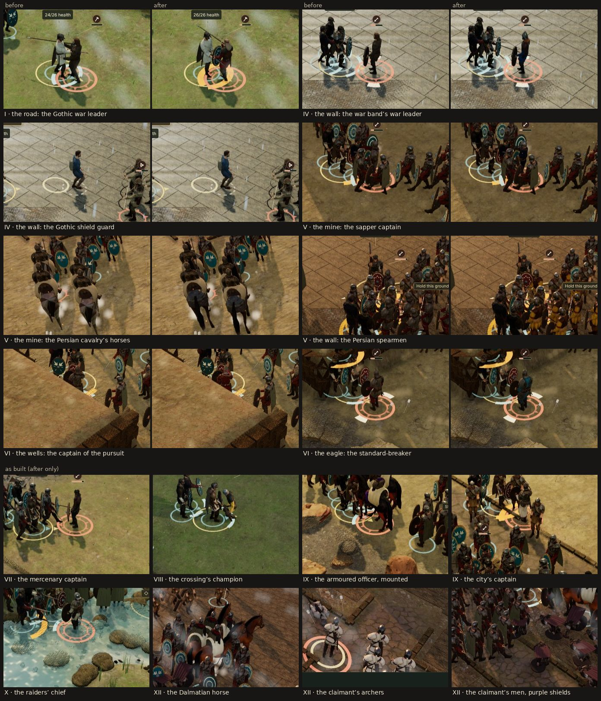

**Left of G1: 1,295 credits, moved on.** On 9 November the owner left the rest of the plan to my judgement ([decisions 8–11](#after-g1-9-november)):
- the second bodies for the crowds (about 500 credits) are not made. At the battle camera a figure reads by its outline and main colours, which its type's body already gives, and Chapter XII's download has 0.5 MB left;
- G1's remaining credits go to the camps (G3, 700) and to battle and siege (G5, 595), so the plan still spends at least 70% of the balance.

Each cap includes about 10% for rejected attempts. G3 and G5 have G7's credits too: each pilot proposes how many more of its own list they buy. Some things stay out of Tripo:
- the Colosseum, which failed three times there, gets a Blender build;
- terrain, trees and water stay with the existing code and Blender kits.

### G3's tent lines (9 November)

G3 starts with its credit-free layer: the camps' tent lines, open ground until now, are pitched with the leather tent generated for Chapter V's supply camp in 0.36. The pilot's tents then replace it on the same pitches.

- **The pitches** are data (`src/data/camp-regions.js`): two cells of tent-line ground a tent, in rows a street apart, each pair facing across its street, with an alley every four tents. A tent keeps 2 m from any spot a person, object, place or way out can take. That leaves 23 tents in Chapter I, 13 in II, 12 in III, and 1 to 6 in IV, VI–IX and XII, whose tent lines are small and crowded; 67 in all.
- **Walking:** a pitched tent is solid. The camp map's `blocked` tiles keep their ground's name, so the ground, the 2D view and the rules' terrain are unchanged, and every target stays reachable in every variant tried.
- **Drawing:** one instanced draw for each of the model's meshes carries every tent in a camp, which the plan asked of repeated props. A code-built tent stands on each pitch on Performance and until the model is ready.
- **Downloads:** the tent (231,056 bytes) joins the packs of the nine chapters with tent lines.
- **What the pilot needs from it:** the smaller camps (IV–IX, XII) fit only a few tents on their board, so their pilot tents also need ground beyond the walls, where the camp continues.

### G3's pilot (9 November)

Eight camp models, about a seventh of G3's list, made and reviewed in the game before the rest of G3 (decision 9):

| Model | Where it stands | Chapters |
| --- | --- | --- |
| a timber palisade section | along every wall cell of the timber camps, stretched to fill each straight run | I, II, III, VII, VIII, X |
| a timber watchtower | on each corner of those walls, and at each end of a wall that opens on a gateway | I, II, III, VII, VIII, X |
| an officers' tent | beside the principia | I, III, IV, VI, VII, VIII, IX, XII |
| a struck tent, rolled with its poles | beside the quartermaster | II, VI, VIII |
| empty horse lines | beside the quartermaster | VII, IX, XII |
| a training post with a wicker shield | beside the drill ground | I, III, IV, VII |
| the quartermaster's stores under a hide | beside the quartermaster | I–IV, VI–X, XII |
| a raised timber granary | beside the quartermaster | IV, X |

- **Credits:** 180 of the pilot's 200-credit ceiling: eight generations at 20, and one rejected and redone (the first horse lines had toy-like horses in them). [The ledger](../art-source/models/graphics-g3-credits.json) has every task. G3 has 2,220 credits left.
- **The walls:** the palisade and towers stand on the wall cells, which were solid already, so the rules and every route are unchanged.
  - One instanced draw for each model carries a camp's 14 to 29 palisade sections and its 4 to 6 towers.
  - The palisade hides the code-built breastwork, which stays as its fallback on Performance and until the model is ready. No other part of the camp now joins the breastwork's batches, so hiding them hides nothing else.
  - The camps walled in stone or mudbrick keep their code-built walls.
- **The furniture** stands only in a camp, beyond the board: beside the service it belongs to where a court is free, otherwise in the baggage line. Like the props of camp life, it has no code-built stand-in.
- **Downloads:** decision 2 now applies chapter by chapter.
  - A model's catalog entry names the chapters whose web download has room for it; the desktop app carries every chapter's models.
  - Chapter I's web download takes the palisade alone (17.87 of its 18 MB), and Chapter XII's takes none (27.71 of 28 MB with the 2D view).
  - The web downloads of Chapters VII and VIII now stand within 0.16 MB of their 28 MB limit, so later models for them ship in the desktop app only.
- **The review,** in the desktop build at High, each camp restored from its earned checkpoint through the Restore dialog:
  - the timber camps now read as walled and towered camps from every camera, where the black breastwork read as a low fence;
  - the gate towers frame the road out where the soldier starts in Chapters I and VII, without hiding him;
  - the palisade's stakes and earth bank read at the Overview camera, and no section's stretch shows;
  - at the Overview camera, the officers' tent, the horse lines and the granary read beside the walls of Chapters IV and VII; the training post, the stores and Chapter VIII's struck tent are small there.

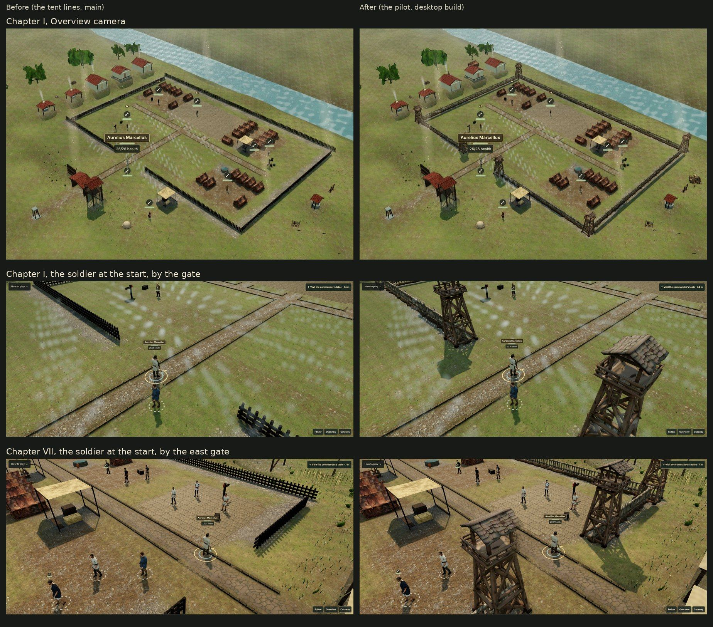

### The rest of G3 (9 November)

Eighteen more camp models, made after the pilot's review in the game (decision 9), in the order the camera meets them:

| Model | Where it stands | Chapters |
| --- | --- | --- |
| a coursed limestone wall section | along every wall cell of the stone camps, stretched to fill each straight run | IV, IX, XII |
| a square limestone tower under a tiled roof | on each corner of those walls, and at each end of a wall that opens on a gateway | IV, IX, XII |
| a round-arched limestone gate with a walkway | over each gateway of those walls | IV, IX, XII |
| a plastered mudbrick wall section | along every wall cell of the mudbrick camps | V, VI |
| a squat mudbrick tower | on each corner of those walls, and either side of a gateway | V, VI |
| a timber gate of two posts under a lintel | over each gateway of the timber camps | I, II, III, VII, X |
| a goatskin tent with its door tied open | on the tent lines, mixed by cell with the leather tent | I, II, III, VII, VIII, IX |
| a goatskin tent patched in lighter and darker hide | on the tent lines, mixed by cell with the leather tent | I, II, III, IX, XII |
| a round commander's pavilion of red leather | beside the principia | II, VI, VII, IX |
| a hospital tent, one wall rolled up on two camp beds | beside the valetudinarium | II, III, VI, VIII, IX |
| a raised timber tribunal with a folding chair | beside the principia | I, IX, XII |
| a limestone camp altar | beside the principia | I, IV, XII |
| a linen awning over a table and two stools, for a parley | beside the principia | VIII, IX |
| a pavilion of striped linen in the eastern style | beside the principia | VI, IX |
| a reed-mat shade on poles over a carpeted floor | beside the canabae | VI, IX |
| a timber rack of pila with a red oval shield | beside the drill ground | II, III, VI, VIII, X, XII |
| a straw archery butt on a timber easel | beside the drill ground | III, VI, X, XII |
| a domed clay field oven on a dry-stone base | beside the canabae | II, IV, VIII, X |

- **Credits:** 380 of the rest's 400-credit ceiling: eighteen generations at 20, and one rejected and redone (the first pilum rack came out all grey iron, with leaf-bladed spears and no timber frame). The balance went from 9,325 to 8,945. [The ledger](../art-source/models/graphics-g3-credits.json) has every task. One generation in nineteen was rejected, under the 20% stop rule.
- **The walls:** the stone and mudbrick camps are walled like the timber ones, along the wall cells, which were solid already.
  - The wall model stands for the code-built parapet, which stays its fallback on Performance and until the model is ready. The parapet is now a batch of its own, so hiding it leaves the camps' terraces and kerbs.
  - Each gateway takes a gate, as wide as the gap but stretched by at most 1.35 times its width. Chapters I–III's 12.5 m gateways keep open ground either side of theirs.
  - Chapter XI, a portico in Rome, keeps its code-built walls. Chapter V's courtyard takes the mudbrick wall and towers too.
- **The tent lines** mix the two new tents with the leather tent by a hash of each pitch's first cell, a quarter of the pitches each. Each model hides only its own pitches' code-built tents. Chapters IV and VI pitch one tent each, which falls to the leather tent.
- **The furniture** stands beside its service where a court is free, otherwise in the baggage line, as the pilot's does.
- **Reviewed in the game,** two models were processed again at more triangles, as their parts had crumpled into facets at the Follow camera: the reed-mat shade (8,819 triangles) and the pilot's supply stack (5,389, the most Chapter VII's web room could take). [The art record](art-generation.md#release-g3-the-rest-of-the-camps--9-november-2026) has the review.
- **Downloads:** each model downloads with its chapters in the desktop app. On the web:
  - Chapters I, VII, VIII and XII take none of the rest's models, as decided after the pilot;
  - Chapter IX's share came to 2.45 MB against its 2.33 MB of room. It leaves out the two new tents, one pitch each, which stay leather on the web, and the tribunal and the parley awning, which stand in its far rows beyond the camera's reach (27.34 of 28 MB). No other web chapter carries those two, so the web build leaves out their files (0.35 MB);
  - every other chapter takes all its models: IV at 27.21 MB, VI at 26.71 and X at 27.40 of 28;
  - with the supply stack processed again, Chapter VII's download stands at 27.94 of 28 MB and VIII's at 27.92;
  - Chapter I's 3D download is unchanged at 17.87 of 18 MB, and the complete web game is 70.42 of 80 MB.

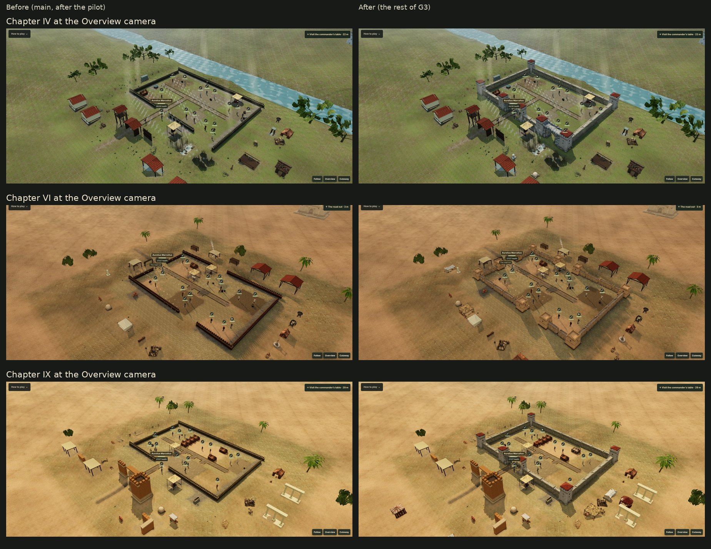

#### What G3 leaves

G3 is done at 560 of its 2,400 credits. The rest bought what its list still lacked where the camera meets the camps; the carts, barrels and amphorae on the list already stood there, as camp life (release 9) and the quartermaster's stores. Its other 1,840 credits are held for the releases after it rather than moved now, since moving them would raise another release's cap:
- at standard prices, the lists of G5, G4, G6 and G2 come to about 3,000 credits, so the plan would end near 4,800 of its 7,900, below the owner's 70% floor (7,490);
- G5's pilot proposes how many more of battle and siege to buy, and where the rest of the 1,840 goes, before anything beyond a cap is spent.

### G5's pilot (9 November)

Six battle and siege models, about a seventh of G5's list, made and reviewed in the game before the rest of G5 (decision 9). Four draw field objects on their cells in place of the code-built pieces, which stay for every other state, on Performance and until a model is ready; two are set pieces beyond the board:

| Model | Where it stands | Chapters |
| --- | --- | --- |
| an abandoned two-wheeled supply cart | on the supply cart's cell, in all four of its states | every battle (I–X, XII) |
| the cart's load: sacks, amphorae and rope under a lashed sheet | on the cart's bed while the supplies are still to be recovered | every battle |
| a timber barricade of sharpened stakes, two panels side by side | on the barricade's cell while it stands | III–X, XII |
| a ram under a hide-roofed shed | on the ram's cell at Chapter V's river gate while it stands | V |
| a carroballista, a bolt-thrower with bronze-cased springs on a cart | beyond the west edge, behind the Roman line, facing the enemy | the field battles of VII–X |
| an onager, a one-armed stone-thrower | beyond the west edge, behind the Roman line, facing the enemy | the sieges of IV, V, IX and XII |

- **Credits:** 140 of the pilot's 160-credit ceiling: six generations at 20, and one rejected and redone (the first load came on a four-wheeled cart of its own). [The ledger](../art-source/models/graphics-g5-credits.json) has every task. The balance went from 8,945 to 8,805. One generation in seven was rejected, under the 20% stop rule. G5 has 1,705 credits left.
- **Field objects:** the rules keep each object's state, and the model shows it.
  - The cart stands in every state, its load only while the supplies are to be recovered. A cart never stands empty while they are: without its load the code-built cart, with its own sacks, stands instead.
  - Two barricade panels span the barricade's cell east to west, as the code-built barricade's two metres do. Dismantled, its code-built scattered timbers remain.
  - The ram's iron head points west at the gate. Burnt, its code-built charred timbers remain.
  - Each copy is drawn as the scenery's placed models are, with their shader programs: the barricade's two panels are two draws.
- **Set pieces:** each stands a few metres beyond the board's west edge, on the first spot clear of the roads that leave the board, the region's buildings and the scene's other scenery. The fixed camera looks north-west, so it sees them behind the army. Like the camps' furniture, they have no code-built stand-in.
- **Downloads:** each model downloads with its chapters in the desktop app. On the web:
  - Chapters I, VII and VIII take none (17.87 of 18 MB, 27.95 and 27.92 of 28);
  - IV takes the cart, its load and the barricade (27.91 of 28); IX the two engines (27.86); X the carroballista and the barricade (27.92); XII the barricade (27.95);
  - II, III, V and VI take all of theirs (V at 24.91, VI at 27.40);
  - the complete web game is 71.86 of 80 MB.
- **The review,** in the desktop build at High, each battle restored from a moment the real-time bot reached from New Game, before (G5's files refused) and after:
  - the cart and its load (Chapters III and VIII) read at once as an abandoned cart with its load still lashed on;
  - the barricade's two lattice panels (Chapter XII) stand where the code-built stakes stood. In the press of the fight they are half hidden, as the stakes are, and their thin beams are harder to pick out;
  - the ram (Chapter V) reads as a siege engine on its ground before the river gate, its iron head toward the gate. From the camera's height its hide roof shows only as dark, ragged pieces;
  - the onager (Chapters V and IX) reads at once behind the Roman line. The carroballista (Chapter VII) reads less well: at the edge of the view its thin frame and dark timber are hard to tell from the scrub.

#### What G5's pilot proposes

The pilot shows the field objects and the set pieces read in battle, so the rest of G5 buys more of both, in two batches, each reviewed in the game before the next:
- **What the review teaches the next batch:** from the camera's height, solid shapes read at once (the cart, the onager, the ram's body), while thin frames and lattices (the carroballista, the barricade) are harder to pick out. So the next requests ask for solid timbers and bold silhouettes, and each model is checked at the field's distance before it is placed.
- **The rest of the list,** about 30 models, about 660 credits with a tenth for rejects:
  - the other field objects on their cells, each with its code-built fallback: the signal station, the pitch brazier (its flame stays the particle plume), the Gothic ladder, the countermine's timbering, the siege ramp, and the side gate and the footbridge outside the fortified fields (7);
  - beyond the west edge, a ballista on its stand and a scorpion (2); before the walls of the sieges, a siege tower and a row of mantlets (2);
  - beyond the north edge, which the camera sees behind both armies: the Gothic wagon laager in the Gothic battles (2), the Persian siege works in Chapter V (2), regional palisades (2), and at Chapter VIII's river a Danube patrol boat and a barge (2);
  - regional carts and barricades, so the eastern and Gothic battles differ from the Roman ones: an eastern cart, a Gothic ox wagon and an eastern barricade of wicker hurdles (3);
  - battlefield debris for the walked field after a win: scattered shields and broken spears, a fallen standard, spent bolts and a broken cart (4), and the stacks of shot and bolts beside the engines (2), an eastern signal station (1) and the fascines and gabions of a Roman siege (1).
- **Regional sets,** about 40 models and 900 credits, after the first batch's review: each region's battles take field objects and set pieces in their own style (the Danube, the East, Palmyra, Italy). G5 would then have spent about 1,700 of its 1,845.
- **Downloads:** most of these ship in the desktop app alone. After the pilot, Chapters I, IV, VII–X and XII have under 0.15 MB of web room left, and their web builds keep the code-built pieces. Raising the web's 28 MB chapter limit is the owner's call.

**The 1,840 credits held from G3.** At standard prices what is left of the lists of G5, G4, G6 and G2 comes to about 2,600 credits, so the plan would end near 4,500 of its 7,900, well below the owner's 70% floor (7,490). With G5 spending about 1,700, the floor needs the held credits too. I propose they go where the camera still meets the weakest work:
- **G6, faces and people, +900:** bodies of their own for the camps' people, who share a few bodies in every chapter;
- **G4, animals, +500:** mules and oxen harnessed to the carts, wagons and carroballista, which stand unhitched, and the camps' animals;
- **G2, arms and standards, +440:** each faction's shields and weapons as 3D kit, and each unit's standard.

The plan would then end near 7,700 of its 7,900 credits, 72% of the balance. Each of those releases' pilots proposes its counts, as G3's and G5's did, and nothing beyond G5's own cap is spent before the owner has seen this proposal.

### The rest of G5: the first batch (9 November)

Eighteen models, the first of the two batches the pilot proposed, asked for in solid timbers and bold silhouettes and checked at the field's distance before they were placed. They extend the pilot's field objects and set pieces, and add the walked field's debris:

| Model | Where it stands | Chapters |
| --- | --- | --- |
| a pitch brazier, an iron fire basket on three legs heaped with pitch | on the brazier's cell, unlit or burning; burning, the stage's flame and smoke rise from its heap | III–X, XII |
| the countermine, a square shaft in heavy timbers under a windlass | on its cell while it is worked | V |
| the Persian siege ramp of earth and rubble in a timber-and-reed revetment | on its cell while it is worked | V |
| an eastern supply cart, a pale bed with faded red boards | on the supply cart's cell in the eastern battles, in every state, with the pilot's load | V, VI, IX |
| a two-armed ballista | beyond the west edge, behind the Roman line | the sieges of IV, V, IX and XII |
| a stack of stone shot | beside the onager | the sieges of IV, V, IX and XII |
| a crate of bolts | beside the carroballista | the field battles of VII–X |
| a siege tower hung with hides, a broad wicker mantlet, and fascines with gabions | beyond the west edge, where the Romans attack a wall | IX, XII |
| the Goths' open and covered wagons | beyond the north edge, behind both armies | the battles against Gothic bands (I–IV, VII, VIII, X) |
| the Persian siege tower and reed-mat screens | beyond the north edge | V |
| the beaten side's gear (the Goths', the eastern armies' or the rival Romans') and a fallen war banner | on the walked field after a win, beside the beaten side's fallen | every battle |

- **Credits:** 440 of the batch's 440-credit ceiling: 22 generations at 20. [The ledger](../art-source/models/graphics-g5-credits.json) has every task. The balance went from 8,805 to 8,365. G5 has spent 580 of its 1,845 credits and has 1,265 left.
- **Rejected:** four generations of 22 (18%), under the 20% stop rule. The first ballista (a flat grey colour map and metal coil springs) and the first mantlets (three thin racks) were redone and ship. The eastern barricade was rejected twice (two hurdles standing apart, then a rack of hanging baskets) and not made a third time: the pilot's timber barricade now stands in every battle from Chapter III.
- **Field objects:** each model draws its object only in the states it is made for. A spent brazier, a disabled countermine or ramp, and every object on Performance keep their code-built pieces. The eastern cart carries the pilot's load on its own bed.
- **Set pieces on two edges:** beyond the west edge as in the pilot, and now beyond the north edge, which the fixed camera sees behind both armies. A piece may stand beside another, at an offset in that piece's frame: the shot by the onager, the bolts by the carroballista. A piece tries 13 shares of its edge rather than 9, since a fortified field's north edge is crowded with its walls.
- **The walked field's debris:** up to six spots, each 1.1 m off one of the beaten side's fallen, at least 6 m apart, on the board and clear of the field objects. The first takes the fallen banner. The fallen men's ids order the spots, so nothing is drawn from the game's random streams, and the chronicle is unchanged.
- **Budgets:** the countermine and the fascines were raised to 7,000 and 6,000 triangles to keep their timbers and gabions whole. The debris's heights were set from each model's proportions, since a flat model is scaled by its height.
- **Downloads:** each model downloads with its chapters in the desktop app. On the web:
  - Chapters II, III and V take all of theirs, and VI the eastern cart, the brazier and the eastern debris;
  - Chapters I, IV and VII–XII take none of the new ones, so the bolts, the Roman siege works and the Roman debris ship in the desktop app alone;
  - the largest chapter download is 27.96 of 28 MB, Chapter I's 3D download 17.88 of 18 MB, and the complete web game 75.04 of 80 MB.
- **The review,** in the desktop build at High, each battle restored from a moment the real-time bot reached from New Game, before (G5's files refused) and after:
  - the siege ramp and the countermine read at once, where the code-built pieces read as a bench and a table;
  - the engines' stores (the stone shot, the bolt crate) and the new ballista read at once behind the Roman line. The Roman siege tower is the batch's boldest piece, and the mantlet reads as a broad arched screen;
  - the Persian tower, open timber faced with reed mats, reads as the enemy's, lighter than the Roman one;
  - the brazier is as small as the code-built one at the field's distance, and the bolts in their crate are too small to pick out;
  - the eastern cart reads as a different cart from the Roman one, its pale bed and faded red boards under the pilot's load. Framed at the objective, the near half of either cart fades: the opening the game cuts toward an objective the camera frames reaches the objective's own piece. That is older than G5, and is now fixed at no credit cost: the opening ends 1.5 m short of the objective;
  - on the walked field the fallen banner reads at once, the brightest thing there. The beaten side's gear lies among the fallen, darker and smaller than the banner (the Goths') or pale against the dust (the eastern armies');
  - the review found the open Gothic wagon standing in Chapter II's marsh, whose water reaches 6 m past the board. Set pieces now keep to dry ground, out of the marsh, a river leaving the board, the distant river and Chapter V's Euphrates. Before the change 5 of the 60 set pieces touched water, and now none does; Chapter II's rearguard has dry room for one wagon.

#### What the first batch proposes

The batch bears out the pilot's lesson and adds three:
- **Bold pieces read; small ones do not.** From the camera's height the ramp, the countermine, the engines and the towers read at once, while a 1 m brazier and a crate of bolts read only as shapes. The next requests favour pieces a metre and a half or more on a side, and gather small stores into larger stacks.
- **What Tripo will not do:**
  - it gave spoked wheels each of the three times solid wheels were asked for, so the next requests stop asking, since spokes and planks look alike at the field's distance;
  - thin wicker failed three times (the first mantlets and both eastern barricades), so the next requests ask for solid timber, earth and hides.
- **Colours named, heights set:**
  - a request names each material's colour, since the first ballista came grey;
  - a flat model has its height set from its raw proportions;
  - a model of many small parts is given room above the decimator's floor.
- **Dry ground:** in the wet chapters there is little room past the north edge. Chapter II's rearguard holds one wagon.

**Done at no credit cost:** the opening the game cuts toward an objective the camera frames now ends 1.5 m short of the objective, so a cart standing at an objective stays whole.

**The last of G5,** within its 1,265 credits left, in two batches of about 26 models, each reviewed in the game before the next. That is about 1,150 credits with a tenth for rejects, and G5 would end near 1,730 of its 1,845:
- **The rest of the pilot's list,** about 12 models:
  - the field objects still code-built: the signal station (Roman and eastern), the Gothic ladder, the side gate and the footbridge;
  - a scorpion beside the ballista;
  - palisades for the Danube's and the East's fields;
  - a patrol boat and a barge on Chapter VIII's river. These stand on the water, so they need a placement of their own;
  - spent bolts and a broken cart for the walked field.
- **The regional sets,** about 40 models: each region's battles take field objects and set pieces in their own style: the Danube (I, IV, VIII), the marshes (II), the East (V, VI), Palmyra (IX) and Italy (VII, X, XII).
- **Downloads:** the web's chapter downloads are nearly full. Chapter II has 2.6 MB of room, III 1.2 MB and V 0.9 MB, and the other battles' chapters under 0.2 MB, so most of the last batches would ship in the desktop app alone. Raising the web's 28 MB chapter limit remains the owner's call.

### The last of G5 (10 November)

Four models, where the first batch proposed about fifty. Before they were asked for, a survey of what the battles still draw in code changed the proposal:
- **The regional sets** would have duplicated what is already there. Every battle's surroundings are its chapter's regional kit, the Blender buildings around the board, and Chapter V's are its pilot's.
- **The side gate and the footbridge** stand only in the fortified fields, where the board kit draws the gates, breaches and bridges.
- **The signal station** is the one field object every battle still draws in code.
- **Left out, after the first batch's lessons:**
  - the Gothic ladder, the scorpion and the spent bolts, which are thin or small and do not read at the field's distance;
  - the palisades, which would stand past the north edge, where the fortified fields have walls of their own and the wet chapters little dry room;
  - the broken cart, since the walked field already has the beaten side's gear and the fallen banner.

| Model | Where it stands | Chapters |
| --- | --- | --- |
| a Roman signal post: a mast on a fieldstone cairn, with its red banner, fire basket and beacon stack | on the signal station's cell, in every state | I–IV, VII, VIII, X, XII |
| an eastern signal post: a stone pillar with its fire basket, brushwood, ladder and pennant | the same, in the eastern battles | V, VI, IX |
| a Roman river patrol boat under oars and a square sail | afloat on the distant river beyond the north edge | the battles of I, II, IV, VIII and X |
| a Danube barge loaded with sacks, amphorae and a lashed leather sheet | the same, further along the river | the same |

- **Credits:** 80 of the batch's 100-credit ceiling: four generations at 20, none rejected. [The ledger](../art-source/models/graphics-g5-credits.json) has every task. The balance went from 8,365 to 8,285.
- **Field objects:** the signal station takes one model in all four of its states, as the cart does, and the objective's marker shows whether it was secured, forgone or missed. The code-built mast stays on Performance, after a failed download and where a web download has no room.
- **On the water:** the boats have a placement of their own. Each takes the first spot along the distant river whose footprint lies wholly where the river's own surface shows, sunk by its draft below the surface. Both float in all nine battles whose scenes have the river, including the training ground.
- **Budgets:** the patrol boat came with its mast raised and its square sail set, where a lowered mast was asked for. Like the barge's, its height was set from its raw proportions: 5.7 m to the masthead.
- **Downloads:** each model downloads with its chapters in the desktop app. On the web:
  - the Roman post rides in Chapters II and III, the eastern post in V, and the boats in II;
  - the other chapters keep the code-built mast and an empty river;
  - the largest chapter download is still 27.96 of 28 MB and Chapter I's 3D download 17.88 of 18 MB; the complete web game is 76.09 of 80 MB.
- **The review,** in the desktop build at High, each battle restored from a moment the real-time bot reached from New Game, before (G5's files refused) and after:
  - the signal posts read at once where the code-built mast, a thin pole on a pale block, was the smallest piece on its field: the Roman post's long red banner at Chapter I's road, the eastern post's pale pillar at Chapter VI's wells;
  - in Chapter II's marsh battle both boats float on the river behind the Gothic wagons' bank, the patrol boat's pale sail the brightest thing on the water;
  - at Chapter VIII's ferry the barge looked sunk, only its load above the water. The ferry's river leaves the board and runs on, at its own level 0.8 m higher, over the near half of the distant river, and the barge had taken a spot under it. The boats now keep to where the distant river's own surface shows, and lie further along the river in Chapter VIII's two battles and Chapter X's;
  - seen again after the fix, both boats at Chapter VIII's ferry float whole: the barge at the river's east end, and the patrol boat upstream of where the ferry's river comes in.

#### G5 closes

G5 ends at 660 of its 1,845 credits with 28 models: six in the pilot, 18 in the first batch and four in the last. Of its 33 generations, five were rejected (15%), under the 20% stop rule. The battles' field objects take models in the states that read, and the code-built pieces stay for the rest: the Gothic ladder, each object's spent or broken state, and wherever a web download has no room. Behind the lines stand the engines, the siege works, the wagons and the boats, and the walked field has the beaten side's gear. Its lessons go to the releases after it:
- solid shapes read from the camera's height, while thin frames, lattices and small stores do not;
- Tripo gives spoked wheels whatever is asked, and thin wicker fails;
- name every material's colour, and set a flat model's height from its raw proportions;
- check a placement in the game, where water, walls and roads decide what fits.

#### What G5 leaves

G5's other 1,185 credits join the 1,840 held from G3: 3,025 for the three releases still to come, beyond their own caps of 2,400.
- **Where the plan stands:** it has spent 2,415 credits, and its 70% floor (7,490) needs 5,075 more. That is nearly all of what G4, G6 and G2 could spend: 5,425 with the held credits.
- **G5's pilot's proposal stands:** the held credits go where the camera still meets the weakest work.
- **G5's 1,185 follow it,** in the same proportions: G6 +580, G4 +320 and G2 +285. G6's cap with its held credits would be 2,580, G4's 1,420 and G2's 1,425.
- **Each release's pilot proposes its counts,** as G3's and G5's did.

The order stays: the animals (G4) next, then the faces and people (G6), then the arms and standards (G2). If all of it is spent, the plan ends near 7,840 of its 7,900 credits, 73.3% of the balance.

### G4's pilot (10 November)

The game's first animals other than the cavalry's horses. Each stands beside the piece of the camps' furniture or life it belongs to: in that piece's court beyond a camp's board, and where the piece also stands in a battle's baggage line beyond the southern edge, there too.

- **Standing, not walking, for now.** Tripo's rig check refused a four-legged rig for the calibration's mule, and nothing in the game yet walks an animal without a rider. Standing animals need neither, and read in the courts and the baggage lines. Walking ones need a rider-less horse figure and a scale for each species, which the rest of G4 can add at no credit cost.

| Animal | Where it stands | Chapters | Credits |
| --- | --- | --- | --- |
| three Roman horses, tethered by the rail and its trough | at the horse lines | VII, IX, XII | none: the Roman horse's coat, which those chapters already download for their cavalry, stood as scenery |
| two grey long-horned draught oxen, unyoked | beside the ox cart | VIII, X | 20 |
| two draught mules, unhitched, the *carpentum*'s usual team | beside the covered carriage | VII, XI, XII | 20 |
| a dromedary under a red and ochre blanket | beside the camel gear | VI, IX | 20 |
| a tawny molossian dog | beside the bread oven or the field oven | I–IV, VI, VIII–X | 20 |
| a bay pack mule with its bundles | beside the broken cart or the handcart | II, III, IV, VI | none: step 0's calibration mule |

- **Credits:** 80 of the pilot's 100-credit ceiling: four generations at 20, none rejected. [The ledger](../art-source/models/graphics-g4-credits.json) has every task. The balance went from 8,285 to 8,205.
- **Where they stand:** in the piece's own frame, on its far side from the board, where the camera looks in, the piece moved aside in its court to make room. Every animal stays inside its piece's court or line spot, clear of the piece and of the others, in every camp and every battle. An animal stands only where its piece does, and has no code-built stand-in.
- **The horses:** the scenery loader stands a skinned model as plain meshes in its rest pose, so the horse lines take the coat their chapters' cavalry already download, exactly as its skeleton holds it.
- **Downloads:** each model downloads with its chapters in the desktop app. On the web:
  - the pack mule and the dog ride in Chapters II and III, and the mules in XI;
  - the horses stand wherever their horse lines do;
  - the other chapters' downloads have no room, so their pieces stand alone there;
  - Chapter II's download rises from 26.15 to 26.57 MB and III's from 27.08 to 27.50, the largest is still 27.96 of 28 MB, and the complete web game is 76.72 of 80 MB.
- **The review** was in the desktop build at High, each camp restored through the Restore dialog from a save reached from New Game by legal commands: before and after in Chapters VII, VIII and IX, and with the animals in II, III, VI, XI and XII.
  - The horses, the oxen, the camel and the pack mule read at once beside their pieces.
  - The mules read as a pale team, but their long ears are less plain from the camp camera than in the four views.
  - The dog is the smallest of them, but reads as a dog beside its oven.
  - Not seen: the oxen in Chapter X, the dog by Chapter VIII's field oven, the animals of Chapters I and IV, and the battles' baggage lines, which the tests check.

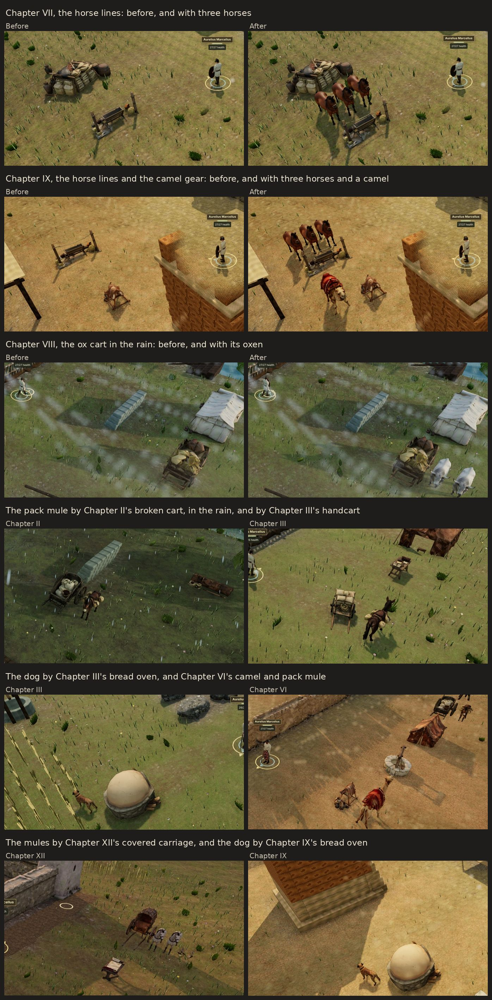

#### What the pilot proposes for the rest of G4

- **At no credit cost:**
  - the pilot's animals beside more pieces: oxen by the Gothic wagons beyond the north edge of the Gothic battles, and mules by the engines behind the Roman line;
  - walking animals: the ox, the mules and the camel bound to the game's horse skeleton as the calibration's mule was, a few of them led along the roads beyond the board. Each species takes its own scale, which also mends the northern horse's size.
- **About ten new animals, near 200 credits:** a small flock of sheep and goats by the stalls and hay ricks, a donkey with panniers, a dark ox to pair with the grey, a camel couched at rest and a cart horse.
- **Credits:** G4 would then end near 300 of its 600 credits, without the 820 held credits the plan proposed for it. The plan would have spent about 2,715, and its 70% floor (7,490) would rest on G6 and G2: about 4,800 of the 5,200 credits the plan would have left.

### The rest of G4: seven more animals (10 November)

The new animals the pilot proposed, made after its review in the game, and the pilot's camel and dog beside two more pieces:

| Animal | Where it stands | Chapters | Credits |
| --- | --- | --- | --- |
| two white sheep, horned, and a brown ewe grazing between them | beside the loom | VIII, X | 40 |
| two goats | beside the woodpile, or the market stall | I, II, IV; IX–XII | 20 |
| a grey pack donkey with a basket of jars at each side | beside the pottery stall | VI, IX, XI, XII | 20 |
| a dark ox, beside the pilot's grey one | by the ox cart | VIII, X | 20 |
| a dromedary couched at rest | beside the caravan's baggage, in the battles' baggage line | IX | 20 |
| a courier's bay horse under a red saddle cloth | beside the courier table | III, VII | 40, with the rejected first |
| the pilot's dromedary | beside the caravan's trough, in the battles' baggage line | IX | none |
| the pilot's dog | beside the cooks' fire, in the battles' baggage line | I, III, VII | none |

- **Credits:** 160 of the batch's 180-credit ceiling: eight generations at 20. [The ledger](../art-source/models/graphics-g4-credits.json) has every task. The balance went from 8,205 to 8,045. G4 has spent 240 of its 600 credits.
- **Rejected:** one of eight (13%), under the 20% stop rule. The first courier's horse came under a saddle of a later shape, a stirrup hanging at its side. The second, with a saddle cloth and no saddle frame, ships.
- **Kept, with notes:** the standing sheep came horned, where a hornless ewe was asked; the dark ox has a small udder; and the courier's horse's ear tips came red. [The art record](art-generation.md#the-rest-of-g4-seven-more-animals--10-november-2026) has each.
- **Changed from the pilot's proposal:**
  - the sheep stand by the loom, since the hay rick fills its court; the goats by the woodpile and the market stall, which had no animal;
  - a courier's horse waits by the courier table in place of a cart horse, since the camps' carts have their oxen and mules, and the courier table had no animal;
  - seven models rather than about ten: the goats and the standing sheep are each one model set out twice.
- **Where they stand:** as the pilot's do, on the piece's far side from the board, the piece moved aside in its court or line spot to make room. Every animal stays inside it, clear of the piece and of the others, in every camp and every battle, and stands only where its piece does.
- **Only where it is seen:** a piece on a service pad inside a camp has no animals. The caravan's trough and baggage and the cooks' fire stand on pads in their camps, so their animals stand in the battles' baggage lines alone. Chapter XI's courier table stands on a pad and XI has no battle, so the courier's horse is not downloaded there. A test now finds every animal standing somewhere in each chapter that downloads it.
- **Downloads:** each model downloads with its chapters in the desktop app. On the web:
  - the goats ride in Chapters II and XI, the donkey in XI, and the courier's horse in III;
  - the sheep, the dark ox and the couched camel ship in the desktop app alone, as do the camel by the trough and, but in Chapter III, the dog by the cooks' fire;
  - Chapter II's download rises from 26.57 to 26.76 MB, III's from 27.50 to 27.72 and XI's from 20.68 to 21.12. The largest is still 27.96 of 28 MB, Chapter I's 3D download 17.88 of 18, and the complete web game is 77.39 of 80.
- **The review** was in the desktop build at High, in the camps of Chapters II, III, VIII, IX and XI, each restored through the Restore dialog from a save reached from New Game by legal commands:
  - the sheep by the loom, the dark ox beside the grey and the courier's horse by its table read at once;
  - the goats and the donkey read as goats and a donkey, though small: the donkey smallest in Chapter IX, whose pottery stall stands 16 m beyond the board;
  - neither the dark ox's udder nor the courier's horse's red ear tips shows from the camp camera;
  - seen whole with the Overview camera, each camp draws a few more calls: Chapter VIII 150 against 147, IX 244 against 237 and XI 211 against 208;
  - not seen: the camels by the caravan's trough and baggage and the dog by the cooks' fire, which stand only in battles' baggage lines. An attempt at Chapter IX's fell back to Performance quality under software rendering, where animals are not drawn. The tests check every placement.

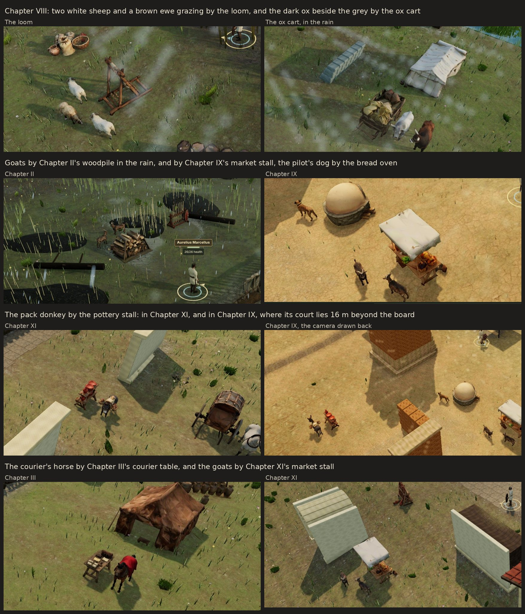

### The battles' animals (10 November)

The pilot's last proposal for its animals, beside more pieces, at no credit cost: its oxen by the Gothic wagons and its mules by the engines.

| Animals | Where they stand | Chapters |
| --- | --- | --- |
| a pair of oxen, the grey and the dark, unyoked | at one end of each Gothic wagon beyond the north edge of the battles against Gothic bands, before its pole or behind it | I–IV, VII, VIII, X |
| a pair of mules, unhitched | alongside each engine behind the Roman line, the onager and the carroballista, or at its end | IV, V, VII–X, XII |

- **Where they stand:** once every set piece has its spot, so none moves for them, each pair takes its piece's first formation, as given or mirrored, where both stand off the board and on dry ground, clear of the piece, of each other, of the scene's other scenery and of the roads. Every wagon and engine has its pair but in Chapter II's marsh, whose water leaves no dry room beside the wagons. They are scenery with no code-built stand-in, so none stand on Performance or after a failed download.
- **Downloads:** each model downloads with its chapters in the desktop app. On the web:
  - both oxen ride in Chapter II, the grey ox in III, standing alone by each wagon, and the mules in V;
  - the engines of IX and X stand there without their mules, their downloads having no room;
  - Chapter II's download rises from 26.76 to 27.17 MB, III's from 27.72 to 27.94 and V's from 27.36 to 27.57. The largest is still 27.96 of 28 MB, Chapter I's 3D download 17.89 of 18, and the complete web game is 77.80 of 80.
- **The review** was in the desktop build at High, in the battles of Chapters II, III, V and VII. Each moment was reached from New Game by the real-time bot's legal commands, restored through the Restore dialog, and seen twice, with the animals' files refused and with them:
  - the oxen read at once as a pair, the grey and the dark side by side before the wagon's pole: at Chapter II's rearguard on the dry strip between the marsh and the river, and before both wagons at Chapter III's station;
  - the mules stood at the engine's end away from the board, their long ears plain: by Chapter V's onager, and by Chapter VII's carroballista, whose place they mark more plainly than its own thin frame;
  - not seen: the battles of Chapters I, IV, VIII, IX, X and XII, and the web build. The tests check every pair.
- **The stage benchmark** with CI's ceilings is unchanged from main: Chapter V's mine battle at Balanced draws 163 calls, 493,523 triangles and 46 programs, and Chapter XII 162, 799,585 and 47, with no shader program compiled in the first frame or in play.

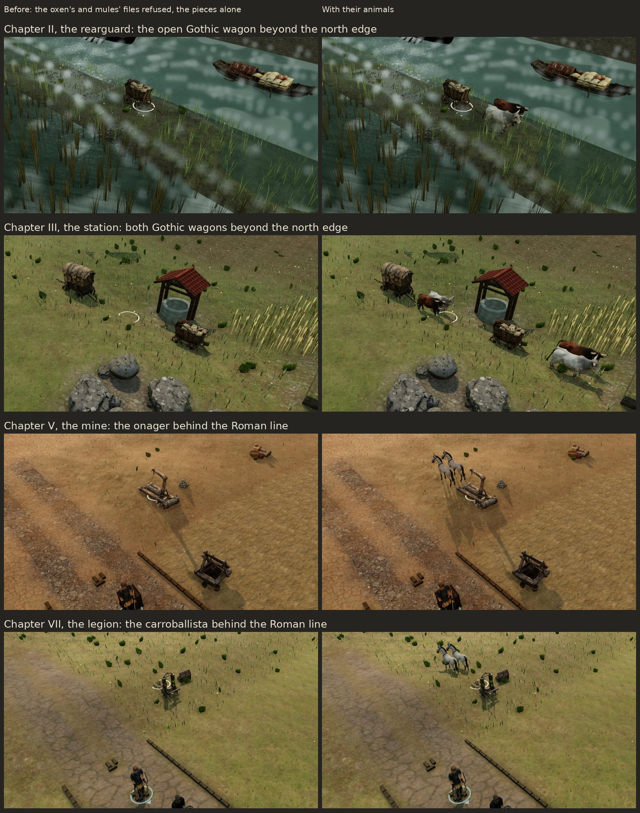

#### G4 closes

G4 ends at 240 of its 600 credits: 12 models and the horse lines' horses, beside 20 pieces of the camps and the battles.

- **Walking animals wait.** The pilot proposed binding the ox, the mules and the camel to the game's horse skeleton, as the calibration's mule was, and leading a few along the roads beyond the board. Two things stand in the way, and neither needs credits:
  - **Size.** The binder sets the back of every animal it binds to the game's one saddle height, so a bound ox, mule or camel would come out a horse's size, as the northern horse did. Each species would need its own size in three places: the horse's frame, whose body joint stands at one height for every horse; its gait, the stride and the planted hooves; and, for a ridden horse, its rider's seat. That reworks what every cavalry battle stands on, for animals seen only beyond the board.
  - **Movement.** Nothing in the game yet moves an animal without a rider. A led animal needs its own path along the roads beyond the board, from the presentation seed, never from the game's random streams.

  So they wait until after G6 and G2. Then the horse's frame can take a size for each species once, mending the northern horse's with it, checked in the cavalry battles.
- **Credits:** G4 leaves 360 of its 600 and the 820 held for it: 1,180 in all. The plan has spent 2,655 credits, and its 70% floor (7,490) needs 4,835 more. G6 and G2 can spend 4,005 with their held credits, so the floor needs G4's 1,180 too. They follow in proportion to the two caps: G6 +760 and G2 +420, for caps of 3,340 and 1,845. If all of it is spent, the plan ends near 7,840 of its 7,900 credits, 73.3% of the balance.

The order stays: the faces and people (G6) next, then the arms and standards (G2).

### G6's pilot (10 November)

The faces and people's first models: a named man's face from his campaign portrait, the elder senator in a toga to his feet, and bodies of their own for two of the camps' people.

| Who | What changes | Chapters | Credits |
| --- | --- | --- | --- |
| Lucan | his face, modelled by image-to-model from his campaign portrait and baked onto the shared head | I–XII | 30 |
| the elder senator | remade, his toga falling to his feet | VII, VIII, X–XII | 45 |
| Vibia the wine-seller | a body of her own: a blue tunic, a dark apron and a brown shawl | VII | 45 |
| Bassus the armourer | a body of his own, in a smith's leather apron | I–XII | 65, with the rejected first |

- **Credits:** 185 of the pilot's 200-credit ceiling: four text-to-model generations at 20, three rigs at 25, and one image-to-model at 30, not the 20 planned. [The ledger](../art-source/models/graphics-g6-credits.json) has every task. The balance went from 8,045 to 7,860.
- **Rejected:** one of five generations (20%), at the stop rule's line. The first armourer came in leather armour; the second, asked for one smooth sheet of leather, ships.
- **Kept, with notes:** the senator and Vibia wear open sandals, though closed shoes were asked; Bassus's hair and beard came black, not grizzled; and Lucan's beard ends in a straight line at the chin, where his own throat joins the face. [The art record](art-generation.md#g6s-pilot-faces-and-people--10-november-2026) has each.
- **A face from a picture**, as the calibration recommended. Tripo's bust from his portrait has its likeness, which a text-made head lacked: curly hair and a short beard, where the 3D Lucan had been clean-shaven. `wrap-cast-head.py --face` turns the bust to face the front, scales it to the shared head, keeps its own eyes and its face down to the chin, and bakes it onto the shared head as before, so his blinks and expressions stay ([the pipeline](asset-pipeline.md#g6s-pilot-a-face-from-a-portrait-and-bodies-of-their-own--2026-11-10)).
- **Downloads:** each model downloads with its chapters in the desktop app. A body can now ride the web in fewer chapters than the desktop app, and there its figures wear what they wore before:
  - Lucan's face rides in every chapter, his file 40 kB larger;
  - Bassus rides on the web in Chapter XI alone, the one camp whose download has room, and elsewhere there he wears the escorts' body with the code-built apron;
  - Vibia ships in the desktop app alone, and on the web keeps the procedural woman's figure;
  - the largest chapter download is now 27.99 of 28 MB, Chapter I's 3D download 17.93 of 18, and the complete web game 78.21 of 80.
- **The review** was in the desktop build at High: Chapter VII's camp before and after, and Chapter XI's chamber after, each restored through the Restore dialog from a save reached from New Game by legal commands, and the figure viewer for Lucan's face, the senator and Bassus.
  - Lucan's face is his portrait's in the viewer. In the camp it is small, but his beard shows.
  - Vibia and Bassus read at once in their own dress.
  - In the chamber the elders' togas fall to their feet among the other members' knee-length ones.
  - Not seen: Bassus on the web in Chapter XI, and the senators in the chambers of Chapters VII, VIII, X and XII. The tests check every body in every chapter, in the desktop app and on the web.

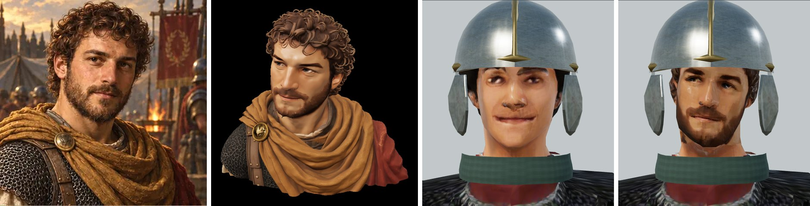

#### What the pilot proposes for the rest of G6

- **Faces from portraits for the five other named men who have one:** Varro, Sabinus, Crispus, Severianus and Paullus, 150 credits. Felix, Naso, Brennus, Quintus and Theon have no campaign portrait, and Aelia keeps her own head.
- **The other two senators** remade with togas to their feet, 90.
- **Bodies of their own** for the people the camera meets closest who still wear a shared body or the procedural figure, near 1,600 credits:
  - in the camps, about 22: the sentries, the veteran instructor, the eagle-bearer and the cornicen, the engineer and the evacuation officer, the water steward, Aper the quartermaster, more orderlies and clerks, the traders Barnaios, Abgar, Malku and Atticus, Dida, Caecilia and Licinia, and the two envoys;
  - the chamber's speakers and more of its members;
  - the civilians in the battles.
- **Downloads:** the desktop app carries every one. The web downloads are full, and a face adds about 40 kB to its man's file in every chapter he stands in, so on the web each rides only where its chapter has room, as Bassus does in XI.
- **Credits:** G6 would end near 2,000 of its 3,340, and the plan near 4,700. The 70% floor (7,490) would then need about 2,800 more, beyond G2's 1,845. The next batch's survey looks for the rest among the figures the camera meets closest: the protagonist's face from his own portraits, the people of the story's set scenes and the finale's crowd. If G6 and G2 cannot reach the floor with work the game needs, the owner is told before either ends.

### The rest of G6: the first batch (10 November)

Faces from four more named men's portraits, the other two senators in togas to their feet, and bodies of their own for ten of the camps' people.

| Who | What changes | Chapters | Credits |
| --- | --- | --- | --- |
| Varro, Sabinus, Crispus and Paullus | their faces, modelled by image-to-model from their campaign portraits | Varro I–VI, Sabinus II–XII, Crispus III, IV, VII and XI, Paullus XI and XII | 30 each |
| Severianus | his face, made but not shipped | — | 30 |
| the younger and the bearded senators | remade, their togas falling to their feet | VII, VIII, X–XII | 45, and 65 with the bearded's rejected second |
| the gate sentry and Quartermaster Aper | bodies of their own | I–XII | 45 each |
| the veteran instructor | a body of his own, in a studded leather jerkin | VI–XII | 45 |
| the supply orderly | a body of his own, with fleeces over his shoulders | IV, VI–XII | 65, with a rejected second |
| Caecilia the grain-seller and Licinia the witness | bodies of their own | X | 45 each |
| the traders Barnaios, Abgar, Malku and Atticus | bodies of their own | V, VI, IX and XI | 45, 65, 45 and 65 |
| Dida the honey-seller | made, but refused by the rig check | — | 20 |

- **Credits:** 790 of the batch's 820-credit ceiling: five image-to-model generations at 30, seventeen text-to-model generations at 20 and twelve rigs at 25. [The ledger](../art-source/models/graphics-g6-credits.json) has every task. The balance went from 7,860 to 7,070.
- **Rejected at review:** four of the batch's 22 generations, each before its rig, and each redone once:
  - the bearded senator's second: its toga ended at mid-shin, the length the remake was for;
  - Abgar's first: its waterskin came as a dark ball at its hip;
  - Atticus's first: a pen held in its mouth read as a cigarette;
  - the orderly's second: it came holding bundles, where the game puts his load in his hands. His first, set aside at first, ships.
- **Two more did not ship:**
  - **Dida.** Her body passed review, but Tripo's free rig check refused it: her wide skirt hides her legs. She keeps the procedural woman's figure.
  - **Severianus's face.** The bust is kept, but no wrap of it passed review: at every turn and nod tried, his crown came bald and smudged where the bust's high forehead and curls met the shared head's scalp, and his throat took his toga's white. He keeps his own generated head.
- **The stop rule:** with the pilot's one, 5 of G6's 27 generations were rejected at review (18.5%), under the line. Counting Dida and Severianus's face, 7 of the 27 have not shipped (26%), over it. So G6 pauses here, and [the owner is asked](#after-g6s-first-batch-10-november) whether it goes on.
- **Kept, with notes:** the younger and the bearded senators, Abgar and Atticus wear open sandals, though closed shoes were asked; Atticus's cape hangs open, where it was asked closed; Malku's mantle is a brighter blue than asked; the orderly came with fleeces over his shoulders, a studded belt and sandals, where a sheepskin vest, a cord and closed shoes were asked. [The art record](art-generation.md#the-rest-of-g6-the-first-batch--10-november-2026) has each.
- **Faces from portraits,** as Lucan's was. Two new settings of the wrap: `--face-nod` lifts a bust that looks down, as Paullus's does (12°), and `--max-mouth-fit` lets a long face be fitted to the shared head's lip line by more than a fifth (Paullus's by 23%). Texels the bake does not reach are now filled from their painted neighbours. Each face ships as a body of its own beside the man's first, which the web keeps ([the pipeline](asset-pipeline.md#the-rest-of-g6-the-first-batch-faces-from-portraits-beside-the-first-and-bodies-for-the-desktop-app--2026-11-10)).
  - Each has his portrait's likeness: Varro's grey hair and short grey beard, Sabinus's black beard and moustache, Crispus's black curls and Paullus's long, lined face.
  - Their eyes glance aside, as in the portraits.
  - The portraits' red cloaks streak the sides of Varro's and Crispus's necks, seen above the neckcloth when they turn.
  - Crispus's hair reads as a patchy dark cap, and a fold shows under his chin.
  - Paullus's face is shortened by 23% to fit, and his crown is bald where his portrait's hair is curly; a dark smudge marks his hairline.
- **Downloads:** each model downloads with its chapters in the desktop app. The web downloads had little room left:
  - the senators' new togas ride in all their chapters, 24 kB smaller between them than the old, and Atticus in Chapter XI;
  - the four faces, Aper, the sentry, the instructor, the orderly, the other traders and the two women ship in the desktop app alone, and on the web each wears what he or she wore before. The four staff bodies rode the web in Chapter XI at first, but the complete web game then came to 80.26 MB, over its 80, so they ship in the desktop app alone; the bearded senator was bound again with 256-pixel detail maps, from 442 to 405 kB, for Chapter XII's room;
  - the largest chapter download is 27.98 of 28 MB, Chapter I's 3D download 17.93 of 18, and the complete web game 78.57 of 80. Chapter XI's download rises by 0.36 MB; the senators' chapters other than XI fall by 25 kB.
- **The review** was in the figure viewer, for the faces and the senators, and in the desktop build at High, in the camps of Chapters II, V, VI, IX, X and XI, before (main's build) and after. Each camp was restored through the Restore dialog from a save reached from New Game by legal commands.
  - Each face has its portrait's likeness at close range. In the camps the faces are small.
  - The staff, the traders and the two women read at once in their own dress, where most had worn the escorts' blue body or been the procedural woman.
  - Not seen: the senators' new togas in a chamber, and the web build. The tests check every body worn in exactly its chapters, in the desktop app and on the web.

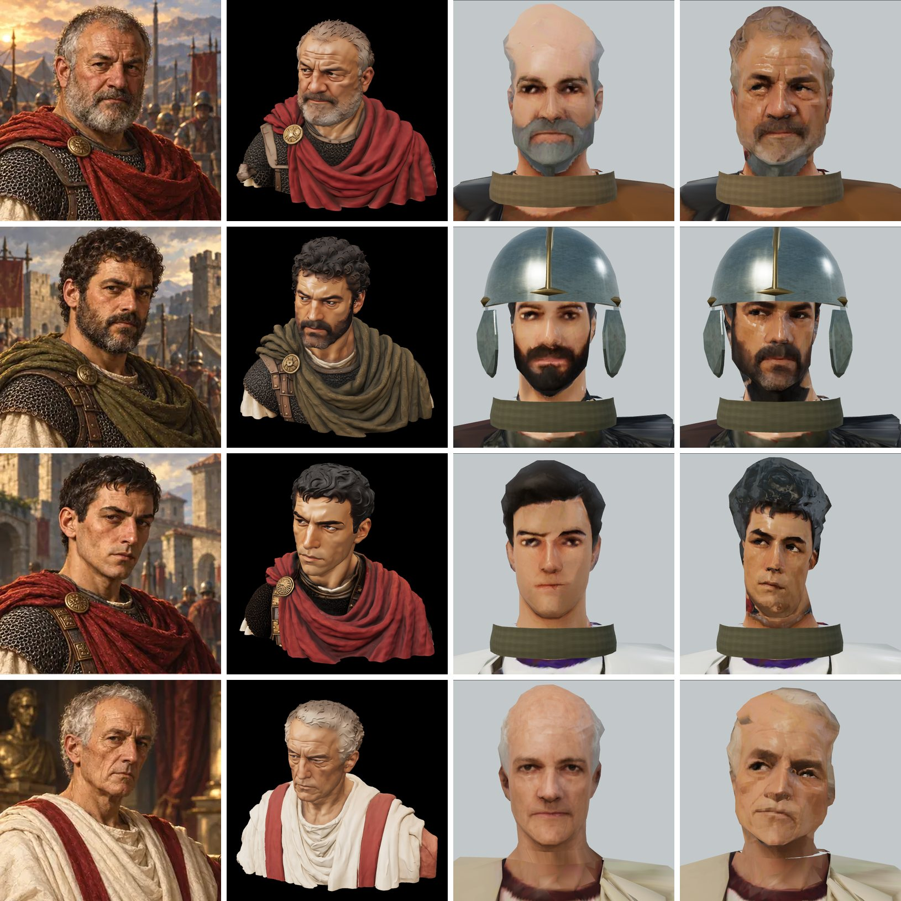

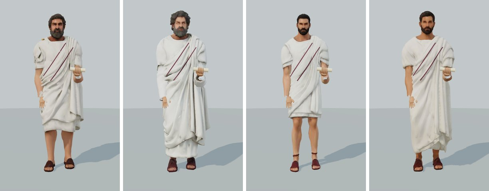

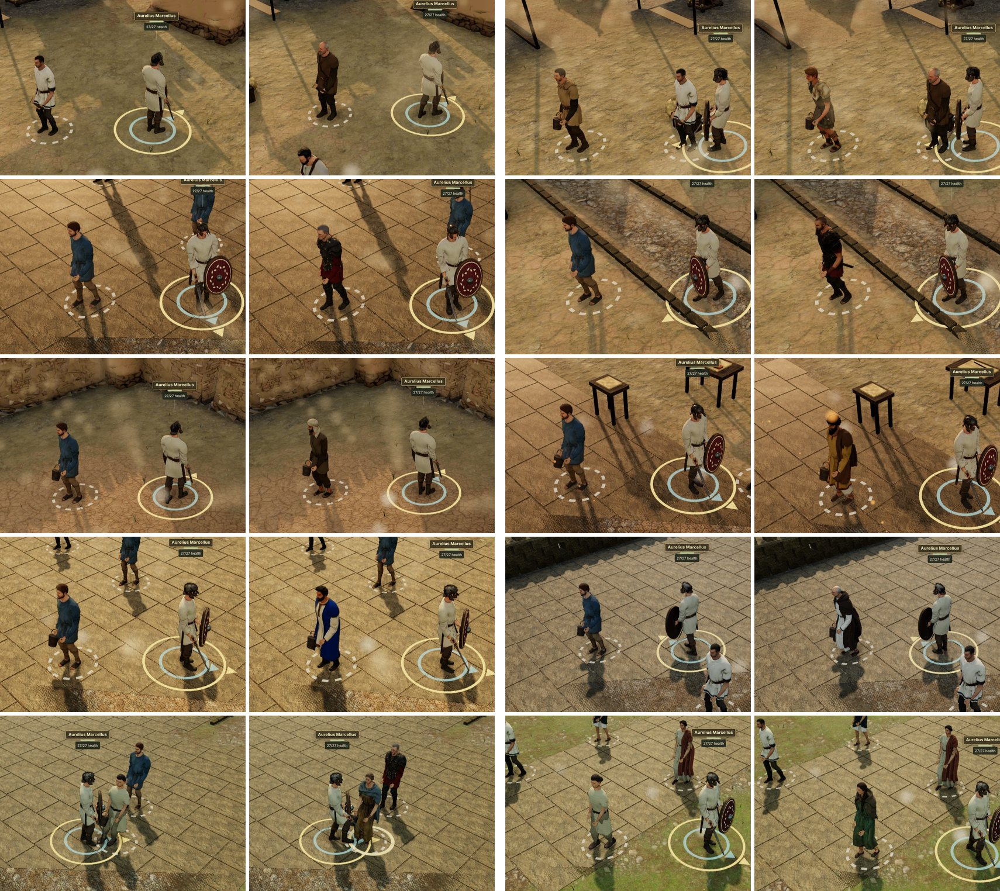

#### What the first batch leaves

- **Credits:** G6 has spent 975 of its 3,340, and 2,365 remain. The plan has spent 3,630 credits since 8 November, so its 70% floor (7,490) needs 3,860 more. G2 can spend 1,845, so the floor needs about 2,015 more from G6.
- **What more G6 could make,** all of it for the desktop app, as the web downloads are full:
  - bodies for the camps' other people the camera meets: the eagle-bearer and the cornicen, the engineer and the evacuation officer, the water steward, the other orderlies and clerks, the two envoys, and Dida again, in a narrower skirt the rig check can read;
  - the chamber's speakers and more of its members, and the civilians in the battles;
  - the protagonist's face from his own portraits, the people of the story's set scenes and the finale's crowd;
  - Severianus's face again from the bust already made, at no credit cost.
- **Next:** the arms and standards (G2), a release of its own, which the stop rule does not pause. G6 waits for the owner's word.

## Around every release, at no credit cost

- **Pipeline:**
  - a batch runner with a credit cap per batch, which stops on the first failure;
  - Blender processing into near and far detail levels, compression and budget checks.
- **Rendering:**
  - one draw call per repeated prop (instancing);
  - texture atlases per camp;
  - imported art keeps one shader program.
- **Placement and invariants:**
  - layouts come from data and use decorative cells only, so walkability and the rules never change;
  - presentation never consumes gameplay randomness;
  - every model keeps its code-built fallback.
- **Checks:**
  - tests that every unit type has a body and every camp its props;
  - draw-call and triangle ceilings raised only on purpose, with the reason recorded;
  - the browser checks.
- **Records:**
  - the asset manifest, the provenance notes and the credit ledgers for every task;
  - the Steam AI disclosure, regenerated.
- **Store media:** the screenshots and the trailer are taken again once the releases land.

## The owner's decisions (8 November)

1. **The budget:** 7,900 credits, keeping about 2,800.
2. **Downloads:** the full set ships in the desktop app, which has no download limit. The web builds take what fits their current limits:
   - Chapter I's 3D load stands at 16 of 18 MB;
   - the whole campaign stands at 55 of 80 MB.
3. **Timing:** step 0 starts now, in parallel with Gate 4. Nothing here changes the rules.
4. **Review:** each release's pilot goes to the owner before the rest is generated. From G3 on, decision 9 replaces this.

After the calibration (8 November):

5. **Tiers:** standard textures for every category, and standard geometry.
6. **Step 0c:** skipped; the shipped landmarks stay as they are.
7. **G7:** skipped. Its 750 credits went where the camera is: 400 to the camps (G3) and 350 to battle and siege (G5), so the plan keeps its 7,900-credit cap, 73.8% of the balance.

### After G1 (9 November)

8. **G1's rest:** approved after the pilot, and made ([the rest of G1](#the-rest-of-g1-9-november)).
9. **The rest of the plan** is left to my judgement, within each release's cap and the rules below. Each pilot is reviewed in the game before the rest of its release is generated, and its review images go with its PR, rather than to the owner first.
10. **Order:** the camps (G3), then battle and siege (G5), animals (G4), faces and people (G6), and arms and standards (G2), the standards first. The camps and the siege works are large enough to read at any distance; most of G2's kit is too small to read in battle, where step 0 found the crowds read better with the code-built pieces.
11. **G1's remaining 1,295 credits** go to G3 (700) and G5 (595); the second crowd bodies are not made. The plan keeps its 7,900-credit cap.

### After G6's first batch (10 November)

12. **G6 pauses at its stop rule.** 7 of its 27 generations have not shipped: five rejected at review, Dida's body refused by the rig check and Severianus's face not passing review. The owner decides whether it goes on, with my recommendation first:
    - **go on after G2** with a second batch for the desktop app, prompts that leave the hands empty and the feet showing, and each body's rig checked before the next is generated (recommended): the 70% floor needs about 2,015 of G6's remaining 2,365 credits;
    - or **end G6 here**, and the plan ends near 5,475 credits, 51% of the balance, under its 70% floor.

## Rules for the spend

- **Approvals:**
  - no task is created before its release is approved (decision 9 approves G2–G6 within their caps);
  - step 0's comparison comes before any bulk spend;
  - each pilot comes before the rest of its release.
- **Caps:** no cap is exceeded without asking.
- **Stop rule:** if more than 20% of a release's attempts are rejected, the release pauses and the owner is told.
- **Process:** every paid task runs `--dry-run` first, and recovery never creates a replacement ([the pipeline](asset-pipeline.md), [Tripo V3](tripo-v3-migration.md)).

## Risks

- **Prices:** step 0 measured them, and every category takes the standard tier: 20 credits a model and 25 a rig. The caps don't move.
- **The original downloads** live only in the working container. If it is reclaimed, the free upgrades depend on Tripo still serving the outputs. On 8 November it did: a task from 2 November downloaded again by its ID, identical to its recorded SHA-256.
- **Rights:** the owner's statement of 20 October covers commercial use of what a paid account generates. [The release checklist](steam-release.md) still asks for a saved copy of Tripo's terms and a record of the plan tier, before the bulk releases.
- **Style and history:**
  - generated models drift, and the togas and sleeves were wrong before;
  - prompts fix the 3rd-century kit, and every release is reviewed.
- **Performance evidence is thin:**
  - the only real device measured, an Intel integrated GPU, ran Balanced at about 33 ms a frame;
  - new scenery shows on Balanced and High;
  - Performance, the phone default, keeps loading bodies and horses only.
- **Scale:** about 230 models with their integration is a programme of several weeks. It runs alongside Gate 4 and does not change the road to 0.40.0 ([the Steam plan](steam-plan.md#the-road-to-0400-and-steam-revised-8-november-2026)).
