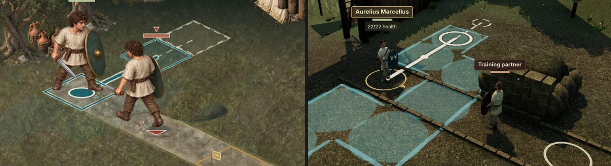

# Movement verification — 0.31.0

This records what was checked for click-to-walk in 0.31 and how. It does not claim real-device, real-mouse, other-browser or screen-reader behaviour, or human playtesting; those were not done.

## What changed

- With no other action chosen, selecting open ground walks the selected unit there at once. The click issues the ordinary legal `move` command through `Game.act`, so the rules check it, the save records it and **Undo Move** (`U`) takes it back until the unit acts. Every other command still previews first and commits on a second selection or Confirm.
- Ground beyond this turn's reach walks the unit as far toward it as the rules allow: to the reachable tile that leaves the shortest way on, measured over the ground the player can see. Ties go to the straighter line, then the cheaper move, then by row and column. If no reachable tile is closer, nothing moves and the readout says why.
- Pointing at ground, or moving the board cursor onto it, draws the route in 2D and 3D (solid to the stop, dashed beyond) over a faint wash of the ground the unit can reach. The board readout and the cursor announcement give the same summary in words.
- **Pause → Confirm moves** (off by default) restores preview-then-confirm for moves, including far ground, where the preview is the stop.
- The rules are unchanged. The new core module [`movement.js`](../src/core/movement.js) and the query `Game.moveRoute` only read state. They change nothing, use no clock and use no randomness. The module also replaces the two separate route reconstructions (the 2D preview path and the walking animation), so the preview, the drawn route and the walk share one route.

## Automated checks

- `npm run verify` passed: 668 Node tests, the legal-command campaign autoplay (New Game to Augustus, all 12 chapters), the production build and the asset/offline checks. Chapter I is 7,283,366 bytes compressed of its 8,000,000-byte budget, first load 446,964 of 2,000,000 and the complete campaign 10,761,419 of 24,000,000.
- [`tests/v031-movement.test.mjs`](../tests/v031-movement.test.mjs) checks the following:
  - For every legal move at legally reached checkpoints in Chapters I, II (marsh), VIII (the crossing) and XI (the chamber), the route is a chain of orthogonal steps over open ground whose cost equals the rules' cost, and asking for it leaves the state unchanged.
  - Beyond reach, the stop is a legal tile that leaves the least way on. Impassable ground, no route, spent movement, the unit's own tile, off-board points and the camp return no stop.
  - A hidden unit does not change the plan.
  - The animation walks the same tiles as the preview and the 2D path.
  - The readout wording, the 2D route strokes and the 3D ink trail (and its caching).
  - The app wiring: walks go through `Game.act` inside the normal change path, the setting defaults to off, routes reach both views, and 2D clicks pick from the pressed pointer's position.
  - The board hint and the board's accessible name follow the setting.
- [`tests/direct-controls.test.mjs`](../tests/direct-controls.test.mjs) covers the click contract: one click walks (near or far), choosing Move first behaves the same, and a chosen attack never turns a ground click into a walk. With Confirm moves on, the first click previews (far ground previews its stop) and the same target again confirms. No intention changes the serialized state.

## Injected and synthetic scenarios

These are labelled because they are not ordinary play:

- Some unit tests edit the Chapter I drill after New Game: a rock tile, a river across the board (to seal ground off), or an added hidden enemy on the onward route. They check the impassable, unreachable and hidden-unit cases, which the drill does not contain.
- The 2D overlay and 3D ink tests draw on a recording canvas and on a stage built without a renderer; one stage test passes a hand-made route.

## Real interface (scripted browser, software GPU)

A scripted headless Chromium session (SwiftShader) ran the actual app from the development server: New Game, then the Chapter I drill. A pointer sweep read the board readout to find tiles, then clicked or tapped them.

- **Desktop, 1280 × 900, 2D**:
  - Far ground (1A) read "Beyond reach · stops at 1B this turn". Clicking it announced "Walked to 1B (2 movement). 1A is beyond this turn's reach. Undo Move (U) takes it back until you act."
  - `U` returned the unit, and a near click walked to 1E.
  - A click on ground after moving announced "Open ground. Movement already spent this turn."
  - With Confirm moves on, the hint and the board's accessible name changed. A near click and then a far click each previewed the move (the far one previewed its stop, 1B), and the same click again walked.
  - Clicking the training partner previewed a Throw instead of acting.
- **Desktop, 3D**:
  - The arrow-key cursor announced "Grid 4D. Road. Beyond reach · stops at 2C this turn", and Enter walked to 2C. That stop is the expected one: 2C and 2E both leave three steps, and the row tie-break picks 2C.
  - A pointer click on far ground walked to 1B.
- **Phone width, 390 × 844 at 3× with touch**: taps walked in 2D (far and near) and 3D (far). The Undo Move button worked, and the page had no horizontal overflow at the start or end of the run.
- The only console error in these runs was the development server's 404 for the service-worker script, which exists only in the build. There were no page errors.

This was a scripted check, not a human playthrough, and only the Chapter I drill was played through the interface. Later chapters are covered by the unit tests above.

*Pointing at far ground in the Chapter I drill, 2D (left) and 3D (right), software-rendered. The route runs solid from the recruit to the stop, 1B, then dashed to the goal, 1A. The walkable ground is washed faintly (most visible in 3D).*

## Found and fixed during verification

- **A 2D click could pick the neighbouring tile.** After one Undo, a click where the readout said "1E · Walk here" picked a tile off the board and did nothing. Clicks report whole pixels (343), while the pointer moves that drew the readout were fractional (343.98), so at a tile edge the two picked different tiles. Scripted browsers produce fractional pointer positions, and high-DPI mice can too. The 2D click now picks from the pressed pointer's exact position. The 3D view already used pointer events for both.
- **Confirm moves ignored far ground.** A far click did nothing when moves needed confirming. It now previews the stop.
- **Input-specific wording.** The first hints said "Click open ground"; in-game text now says "select", which fits touch and keyboard play.

## Not checked

- Real devices (desktop, iOS, Android), real mice on high-DPI screens, Safari and Firefox.
- Screen-reader review of the new announcements and of the board's accessible name.
- Contest chambers and later chapters in the real interface (unit tests only, as above).
- Human playtesting, including whether one-click moves lead to accidental walks (Undo Move mitigates this until the unit acts), and the 90–150 minute campaign target.

## Since 0.32.0

The expanded campaign merged in 0.32.0 adds closed gates and extra cost for high ground in the rain. The shared route follows both through the rules' own field geometry, and a closed gate reads "Closed gate". The checks are recorded in [Integration into 0.32.0](release-validation-v031.md#integration-into-0320).

## Known limitations

- A far goal is planned one turn at a time and is not remembered for later turns.
- Touch has no hover, so on a phone the route is not drawn before a tap. The walk itself shows where the unit went and Undo Move takes it back; with Confirm moves on, the first tap previews the destination.
- The rest of the way is measured over visible ground, so a hidden unit can make the real way longer than the dashed line shows. This is deliberate, so the preview never reveals hidden units. This turn's legal tiles still come from the rules, which, as before, never let a unit walk onto a tile a hidden unit holds. The walk then stops short of that tile, or, if the unit is already next to it, the readout says there is no nearer ground.
