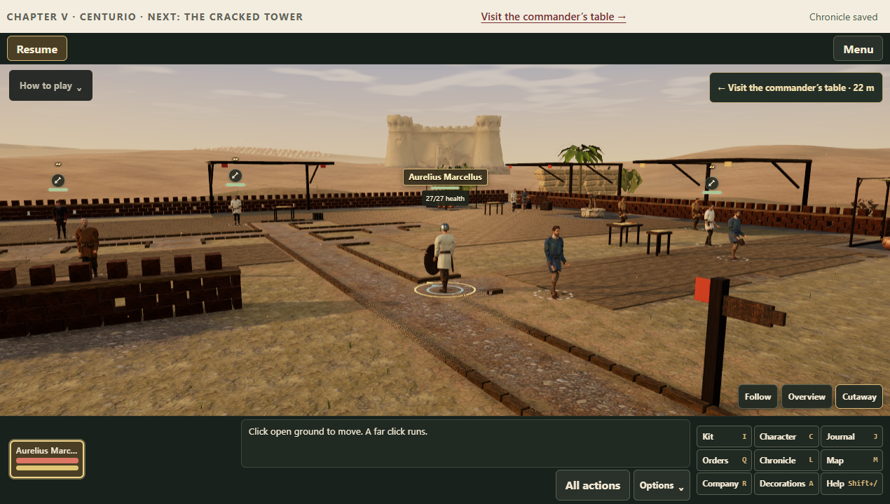
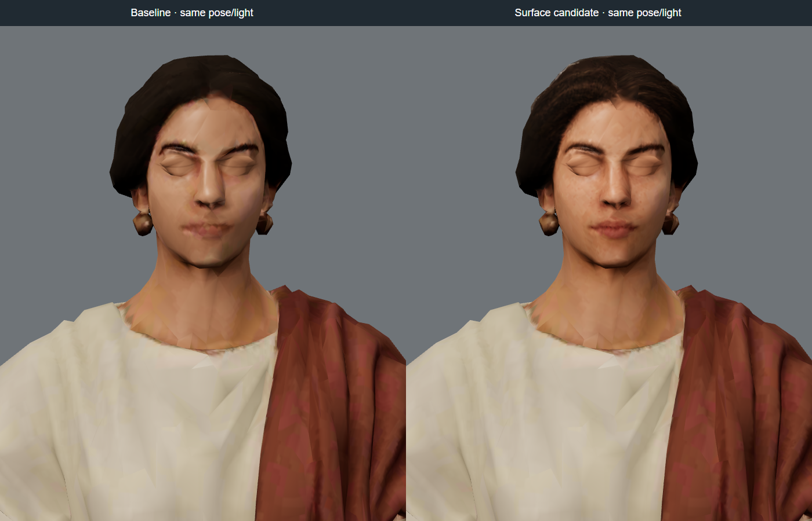
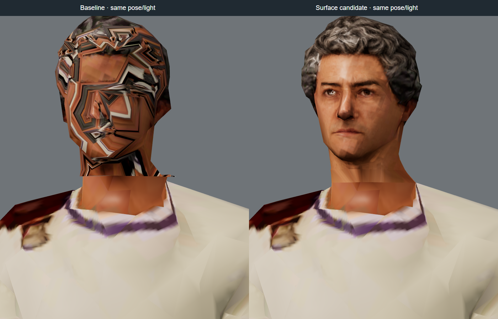

# Save recovery, camp entrances and character surfaces

This change starts from `dc666025c600001d158bb5a04381f079fcf43aad`. It repairs the two desktop-save faults, aligns all twelve camp frontages with their actual entrances, and updates the existing character assets. No Tripo credits or credentials were used or changed.

## Save recovery

The local IndexedDB/localStorage envelope records the fingerprint of the file it was based on. After a successful file write, that revision is acknowledged locally. On relaunch, an unacknowledged local revision replaces the old file only when that file still matches its recorded base. This retains equipment changes and other progress made before a disk-write failure. A genuinely changed external file is loaded with the displaced local payload retained in recovery, even when both versions occupy the same checkpoint. A rollback of an acknowledged file is treated as an external change, not as an interrupted save.

Only `ENOENT` means a file is missing. A sharing violation, directory in place of a file or other read error stops file writes, reports the problem, and leaves local progress available. Writes compare the expected file before and after writing/fsyncing the temporary file, run in one queue, and atomically rename it. The previous file remains available; restoring a corrupt primary keeps its good predecessor and quarantines the corrupt raw data. Quit no longer reports success for a memory-only or conflicted save.

If a startup read failed, a later retry can write only when the recovered file matches the last known base. A changed or previously unknown file requires reopening to reconcile both copies; its newly readable contents are never silently accepted as permission to overwrite it.

The historical database names, save keys and serialized gameplay format are unchanged. `fileBase` is local reconciliation metadata and is stripped from the cloud file. This is not a merge algorithm for two independent playthroughs: the alternatives remain explicit recovery records. Atomic compare/rename substantially narrows external-write races; a separate process ignoring the game's locking can still race between the last comparison and rename.

## Camp entrances

The presentation uses the real gate and nearby departure interaction to select its entrance edge and lane. Chapters VI and VII enter from west and east respectively; the other camps enter from the south. Regional buildings rotate around that lane, the Chapter V fortress follows it, and worn paths extend to the actual departure. Scenery reserves the entrance corridor. Rules terrain, navigation, interaction positions and campaign state do not change.

The low camp camera shortens its view when relocated architecture would stand between it and the soldier. The first visual review caught a Chapter V curtain wall filling that view despite passing the existing camera checks; the added clearance regression checks all twelve camps, their services and 24 bearings. Overview and follow framing retain their existing behavior.



## Character art

Five existing characters—Marcellus's persistent recruit-derived head, Aelia, Severianus, Paullus and Theon—receive face/hair paint restored with OpenAI image generation from orthographic renders of their existing models. Blender 5.2.2 LTS projects the reviewed paint into their original atlases. Positions, detailed-head UVs, body weights, skeletons and contact anchors remain unchanged. All eleven named men's distant heads are rebuilt by reducing the intact detailed head with UV borders locked. Transferring UV coordinates onto the old cross-island topology did not repair it and was rejected.

The three civilian neck assemblies use a short skinned bridge from 1.49 to 1.51 metres, with separate UV segments at atlas seams. The face above it is retained. No new material, draw call or texture sample is required. This closes the inherited opening and removes projecting border fragments. It does **not** erase every colour boundary between independently generated head/body paint, nor replace the coarse source silhouette with cinematic anatomy. Some eye/normal-map artifacts and side/scalp paint remain visible in enlarged views.

Whole-atlas AI repaints shifted facial features and were rejected. ETC1S exports degraded the restored facial detail, so the five edited albedos use UASTC/Zstandard KTX2 with mipmaps. Full-body atlases use 1024 pixels; the three separate civilian head atlases use 512. Other texture payloads remain unchanged. The thirteen GLBs grow by **1,757,236 bytes** combined. The per-chapter gzip ceiling increases from 24 MB to 26 MB; startup, Chapter I and complete-campaign ceilings stay at 2/16/80 MB. The largest chapter is approximately 25.4 MB and the complete web build approximately 55 MB gzip. Every character remains within its original per-model byte budget.

Original Tripo tasks, credit records, input hashes, licence records and the earlier geometry-refinement reports are retained. The manifest appends `surfaceRepair` records linking old and new hashes. Source references, generated projection paint, Blender atlas outputs and exact prompts are in `art-source/characters/surface-repair/`; the build excludes this directory. `char-*-surface-repair.json` reports record final textures and geometry. Steam's generated disclosure now names the five OpenAI texture restorations.

The repaired overview heads add 454–536 triangles each. Their current rendering budgets are appended under `surfaceRepair.budget`; the original generation requests and their budgets remain intact. Detailed heads are unchanged, and each overview head remains below 1,200 triangles.

Reviewed comparisons use identical poses and lighting. These enlarged captures expose both the improvement and the remaining coarse geometry:





## Reproduction and validation

Use the local asset environment described in [asset-pipeline.md](asset-pipeline.md), with `ASSET_MODULES` pointing to the glTF-Transform/Sharp tools and `BASISU` to Basis Universal. Preserve the input model from the base commit; do not apply the pass repeatedly to an already repaired export.

```text
node scripts/assets/repair-character-surfaces.mjs export source.glb mesh.json
blender --background --factory-startup --python-exit-code 1 --python scripts/assets/bake-character-face.py -- mesh.json base-albedo.png projection-paint.png atlas.png 1024
node scripts/assets/repair-character-surfaces.mjs source.glb candidate.glb --paint atlas.png --size 1024 --rebuild-overview --report report.json
```

Omit `--rebuild-overview` for the recruit and Aelia. Omit `--paint` for the eight named men whose existing paint is retained. Use `--size 512` for the three civilian head atlases and `--rdo 2.5` for Aelia to keep her export under 900 KB. The bridge verifies protected geometry before encoding and after decoding the compressed output. Regression tests independently check asset hashes, unchanged detailed UVs/contact weights, and that each reduced-head vertex retains its detailed source position, normal, UV and skin influences.

Local validation on Windows passed:

| Check | Result |
| --- | --- |
| Full automated suite on the final sources | 1,738 passed; zero failures or skips |
| Chromium smoke | All 25 scenarios; no page or console errors |
| Usability | All 15 flows |
| Twelve-chapter benchmark | 13 scenes across all 12 chapters, plus five additional checks |
| Final camp camera/asset diagnostic | Chapters V, VI and VII; three cameras each; captures reviewed |
| Final packaged Windows application | All 11 checks, including disk failures, retry, relaunch and window controls |
| Final build/source parity | 579 source/asset files and four desktop entry points agree |
| Asset and provenance checks | Passed; every character remains within its original byte cap |

[The evidence record](evidence/save-camp-art-refinements.json) includes exact build identifiers, log paths, hashes and the scope of each check. The broad browser tests preceded the final Aelia compression adjustment, desktop retry guard and camp low-camera correction; the final suite, targeted camera captures, asset parity and packaged Windows checks cover those accepted changes. The final web build is **54,954,790 bytes gzip** for the complete campaign, with a largest chapter download of **25,384,457 bytes**.

Browser tests use automated public UI flows; the twelve-chapter benchmark restores legally earned snapshots. Fault-injection tests are separate from player-flow evidence. Packaged-app checks do not establish hardware frame rates or performance on other computers. The three-camp diagnostic is not a full twelve-camp browser acceptance run. Steam overlay, achievements on a live account and real Steam Cloud synchronization require a configured App ID/account and are not validated by these local checks.
